# PAN Vault

*[Read this in English](README.md) · [Ler em português](README.pt-BR.md)*

[](https://github.com/camcima/tokenizer/actions/workflows/ci.yml) [](https://github.com/camcima/tokenizer/actions/workflows/integration.yml) [](https://github.com/camcima/tokenizer/actions/workflows/image.yml) [](https://github.com/camcima/tokenizer/actions/workflows/fuzz.yml) [](go.mod) [](LICENSE)

Un servicio pequeño y de propósito único que mantiene los números de tarjeta de crédito fuera del resto de nuestra plataforma de pagos.

El navegador le entrega la tarjeta al vault. El vault la guarda bajo llave y devuelve un **token** sin ningún significado. A partir de ese momento, la plataforma solo maneja tokens. Cuando un proveedor de pagos como Stripe necesita la tarjeta real, la plataforma escribe la solicitud al proveedor con espacios en blanco donde va la tarjeta y le pide al vault que los complete y haga la llamada. El vault verifica cada solicitud contra una lista revisada de lo que está permitido, y el número de tarjeta nunca pasa por la plataforma.

Este documento está escrito para dos audiencias a la vez. Cada sección empieza con **La versión corta**, en lenguaje sencillo para cualquier persona. Luego continúa con **En profundidad**, para ingenieros, revisores de seguridad y auditores. Lee solo las versiones cortas para tener el panorama general, o lee todo para conocer la historia completa.

---

## Contenido

1. [Por qué los números de tarjeta son peligrosos](#1-por-qué-los-números-de-tarjeta-son-peligrosos)
2. [Qué es un tokenizer (vault)](#2-qué-es-un-tokenizer-vault)
3. [PCI DSS en términos sencillos](#3-pci-dss-en-términos-sencillos)
4. [Por qué reducir el alcance PCI es tan importante](#4-por-qué-reducir-el-alcance-pci-es-tan-importante)
5. [Cómo el vault reduce nuestro alcance](#5-cómo-el-vault-reduce-nuestro-alcance)
6. [Cómo funciona el vault, paso a paso](#6-cómo-funciona-el-vault-paso-a-paso)
7. [Cómo nos protege el vault](#7-cómo-nos-protege-el-vault)
8. [Por qué está construido así](#8-por-qué-está-construido-así)
9. [Operarlo de forma segura](#9-operarlo-de-forma-segura)
10. [Limitaciones conocidas y próximos pasos](#10-limitaciones-conocidas-y-próximos-pasos)
11. [Para desarrolladores](#11-para-desarrolladores)
12. [Glosario](#12-glosario)

---

## 1. Por qué los números de tarjeta son peligrosos

### La versión corta

Un número de tarjeta de crédito es como dinero en efectivo que se puede copiar. Cualquiera que lo obtenga, junto con la fecha de vencimiento y a veces el código de seguridad de 3 dígitos, puede intentar gastar el dinero de otra persona. Eso convierte a los números de tarjeta en lo más atractivo que un delincuente puede robarle a una empresa.

Por eso, cada lugar donde un número de tarjeta se almacena, se envía o incluso se ve brevemente se convierte en un lugar que hay que proteger. Cuantos más lugares, más protección hace falta, y más posibilidades de que alguno quede sin llave.

### En profundidad

El número de tarjeta se llama formalmente **Primary Account Number (PAN)**. Junto con el nombre del titular, la fecha de vencimiento y el código de servicio, forma los **Cardholder Data (CHD)**. El código de verificación de la tarjeta (CVV/CVC) pertenece a una categoría más estricta llamada **Sensitive Authentication Data (SAD)**. Las reglas de las marcas de tarjetas prohíben almacenar SAD después de que se autoriza un pago, incluso si está cifrado.

Un PAN tiende a propagarse. Aparece en:

- logs de solicitudes y de acceso, especialmente cuando aparece en una URL;
- mensajes de error y stack traces;
- colas de mensajes, cachés y pipelines de analítica;
- backups y réplicas de bases de datos;
- sesiones de depuración, tickets de soporte y capturas de pantalla.

Cada copia es un pasivo. Las brechas rara vez vienen de la "base de datos de tarjetas" en sí. Vienen de la copia olvidada en un bucket de logs. La forma más barata de proteger un PAN es asegurarse de que casi nada lo vea nunca.

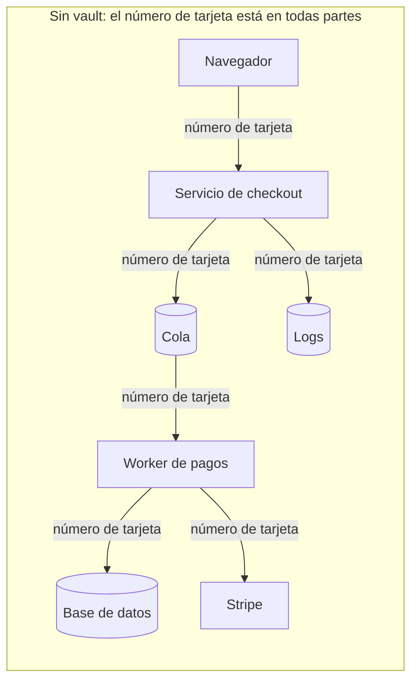

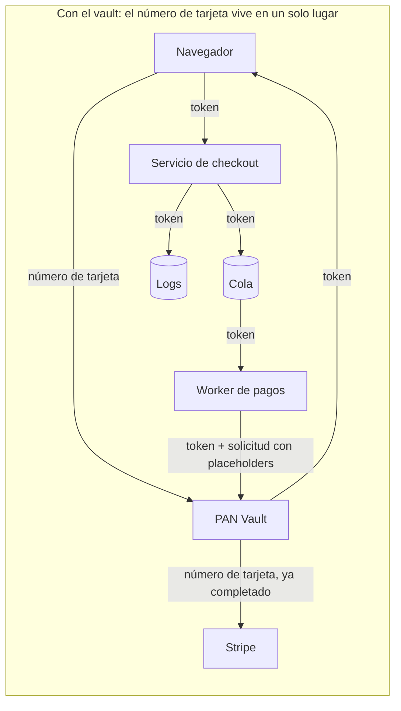

---

## 2. Qué es un tokenizer (vault)

### La versión corta

Piensa en un **guardarropa**. Entregas tu abrigo y recibes un ticket numerado. El ticket no le sirve de nada a un ladrón: es solo un número y no abriga a nadie. Solo el guardarropa puede relacionarlo con tu abrigo, y el guardarropa solo devuelve el abrigo bajo reglas estrictas.

El PAN Vault es ese guardarropa, y el abrigo es el número de tarjeta:

- El navegador del cliente le entrega la tarjeta al vault.
- El vault la guarda bajo llave y devuelve un **token**, una cadena aleatoria como `tok_4f3a9c…`.
- Nuestra plataforma almacena y transmite únicamente el token.
- Cuando Stripe necesita la tarjeta real, la plataforma le entrega al vault el token junto con la solicitud que quiere hacer, dejando espacios en blanco donde van los datos de la tarjeta. El vault verifica la solicitud contra una lista aprobada, completa los espacios en blanco y hace la llamada a Stripe por sí mismo. La tarjeta va directamente del vault a Stripe, y nuestra plataforma nunca la toca.

Un token no es un número de tarjeta cifrado. Es aleatoriedad pura, sin ningún vínculo matemático con la tarjeta, así que ni siquiera un poder de cómputo ilimitado puede convertir un token de vuelta en un número de tarjeta. La única forma de volver es preguntarle al vault, y el vault no le devuelve números de tarjeta a nadie.

### En profundidad

Existen varios tipos de tokenización. Este vault usa **tokenización aleatoria basada en vault**:

| Enfoque | Cómo se genera un token | ¿Se puede revertir el token sin el vault? | ¿Se usa aquí? |
|---|---|---|---|
| Token aleatorio + tabla de búsqueda | Bytes aleatorios; el vault almacena un mapeo token → tarjeta cifrada | No, no hay nada que revertir | **Sí** |
| Format-preserving encryption (FPE) | El número de tarjeta se cifra en otro número de 16 dígitos | Sí, con la clave | No |
| Basado en hash | Un hash unidireccional del número de tarjeta | Se puede romper por fuerza bruta: el espacio de PANs es pequeño y los BINs son públicos | No |

El formato del token es `tok_` seguido de 32 caracteres hexadecimales en minúscula (16 bytes de un generador aleatorio criptográficamente seguro). No contiene ninguna información: ni BIN, ni últimos cuatro dígitos, ni vencimiento. El vault devuelve `last4` y el vencimiento por separado para que la UI de checkout pueda mostrar "Visa terminada en 4242". Esos valores no son secretos según PCI DSS.

Dos propiedades hacen que este vault sea distinto de un simple servicio de "cifrar y almacenar":

1. **Nunca devuelve un número de tarjeta.** No existe un endpoint de "detokenizar", ni siquiera uno de administración o de depuración.
2. **Actúa sobre la tarjeta en lugar de entregarla.** Quien llama construye la solicitud al proveedor con **placeholders** como `{{pan}}` y proporciona un token. El vault verifica la solicitud contra un **catálogo** revisado y compilado en el binario, con los endpoints y campos permitidos, completa la tarjeta y su propia credencial del proveedor, y la envía a un host que elige el catálogo.

Este modelo de "hacer de proxy, no revelar" está diseñado para mantener el back end de la plataforma fuera del alcance PCI, sujeto a la delimitación del alcance que haga el auditor. La página de checkout es un asunto aparte (ver [§5](#5-cómo-el-vault-reduce-nuestro-alcance)).

---

## 3. PCI DSS en términos sencillos

### La versión corta

**PCI DSS** (Payment Card Industry Data Security Standard) es el reglamento que toda empresa que maneja números de tarjeta debe cumplir. Lo redactan las principales marcas de tarjetas (Visa, Mastercard, American Express, Discover y JCB) a través de una organización llamada **PCI Security Standards Council**.

El reglamento tiene doce requisitos generales, como "proteger los datos de tarjeta almacenados", "restringir el acceso", "registrar y monitorear todo" y "probar la seguridad con regularidad". Cada requisito se desglosa en cientos de controles detallados.

La idea clave es el **alcance** (scope). Las reglas se aplican por completo a todo sistema que almacena, procesa o transmite números de tarjeta. También se aplican a todo sistema conectado a esos sistemas o que podría afectar su seguridad. Esa zona se llama **Cardholder Data Environment (CDE)**. Todo lo que está dentro debe cumplir el reglamento completo y ser revisado por un auditor, a menudo cada año.

### En profundidad

**Los doce requisitos**, agrupados en seis objetivos:

| Objetivo | Requisitos |
|---|---|
| Construir y mantener una red y sistemas seguros | 1. Controles de seguridad de red · 2. Configuraciones seguras |
| Proteger los datos de cuenta | 3. Proteger los datos de cuenta almacenados · 4. Proteger los datos en tránsito con criptografía robusta |
| Mantener un programa de gestión de vulnerabilidades | 5. Proteger contra software malicioso · 6. Desarrollar y mantener sistemas y software seguros |
| Implementar un control de acceso robusto | 7. Restringir el acceso según la necesidad de conocer · 8. Identificar usuarios y autenticar el acceso · 9. Restringir el acceso físico |
| Monitorear y probar las redes con regularidad | 10. Registrar y monitorear todos los accesos · 11. Probar la seguridad con regularidad |
| Mantener una política de seguridad de la información | 12. Respaldar la seguridad con políticas y programas organizacionales |

**¿Quién verifica el cumplimiento, y cómo?** Depende del volumen de transacciones (el "nivel" del comercio o del proveedor de servicios) y de cómo se manejan los datos de tarjeta:

- **Las organizaciones grandes** (Nivel 1) necesitan una evaluación anual en sitio realizada por un **Qualified Security Assessor (QSA)**. Esta produce un **Report on Compliance (ROC)** y una **Attestation of Compliance (AoC)**.
- **Las organizaciones más pequeñas** pueden completar un **Self-Assessment Questionnaire (SAQ)**. El tipo de SAQ refleja cuántos datos de tarjeta manejan:
  - **SAQ A**: el manejo de tarjetas está totalmente tercerizado, por ejemplo con una página de pago alojada por el proveedor. Es el cuestionario más corto.
  - **SAQ A-EP**: e-commerce en el que el sitio web del comercio puede afectar la seguridad de la página de pago, aunque la tarjeta vaya a otro lugar.
  - **SAQ D**: todo lo demás, incluido cualquiera que almacene números de tarjeta. En la práctica es el estándar completo.
- La mayoría de los niveles también exige **escaneos externos de vulnerabilidades trimestrales** realizados por un Approved Scanning Vendor (ASV), junto con escaneos internos y pruebas de penetración periódicas.

**Reglas de alcance que nos importan:**

- **Los datos de tarjeta cifrados siguen siendo datos de tarjeta.** Permanecen dentro del alcance, a menos que el sistema que los guarda no tenga acceso a las claves de descifrado. Por eso el vault mantiene su key-encryption key en un proyecto separado, en un módulo de seguridad de hardware (HSM).
- **Los sistemas "conectados" también están dentro del alcance.** Un sistema que puede llegar al CDE, o que podría afectar su seguridad, queda incluido, a menos que esté correctamente segmentado.
- **Los tokens no son datos de tarjeta.** Un sistema que solo maneja tokens, y que no puede usarlos para recuperar la tarjeta, puede quedar fuera del alcance. La guía de tokenización del PCI SSC lo describe.
- **Los datos de autenticación sensibles (el CVV) no deben almacenarse después de la autorización**, ni siquiera cifrados. El vault los mantiene solo en memoria y los usa como máximo una vez. Expiran 15 minutos después de la tokenización y se borran de la memoria alrededor de un minuto después, salvo que se hayan usado o descartado antes.

> La última palabra sobre el alcance siempre la tiene tu auditor. Este documento explica cómo está diseñado el vault para minimizar el alcance; no es una determinación de cumplimiento.

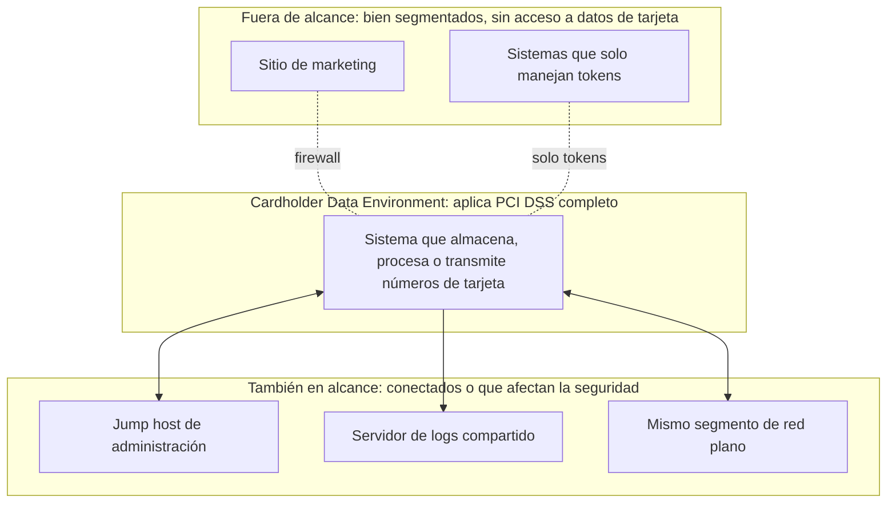

---

## 4. Por qué reducir el alcance PCI es tan importante

### La versión corta

Cada sistema dentro de la zona PCI tiene que estar blindado, documentado, monitoreado, escaneado, parcheado según un calendario y presentado a un auditor. Eso cuesta tiempo y dinero, y frena a los equipos. Un cambio en un sistema dentro del alcance puede requerir revisión y evidencia adicionales.

Si los números de tarjeta solo existen dentro de un servicio diminuto y construido para ese fin, solo ese servicio carga con el peso. El resto de la plataforma puede avanzar rápido. Además es más seguro: un atacante que logra entrar a la plataforma solo encuentra tokens, que no le sirven de nada.

### En profundidad

| Dimensión | Alcance amplio (las tarjetas pasan por la plataforma) | Alcance reducido (tarjetas confinadas al vault) |
|---|---|---|
| **Esfuerzo de auditoría** | Se evalúan todos los servicios, bases de datos, colas, pipelines de logs, runners de CI/CD y rutas de administración | Un servicio, su base de datos, KMS y secretos |
| **Velocidad de ingeniería** | Control de cambios, segregación de funciones y recolección de evidencia para cada equipo | La mayoría de los equipos entrega con normalidad; solo los cambios del vault requieren el proceso estricto |
| **Superficie de ataque** | Cientos de componentes, cualquiera de los cuales puede filtrar un número de tarjeta | Un paquete Go (unas 4.000 líneas) y cuatro funciones SQL, que mantiene el mismo tamaño a medida que se agregan proveedores |
| **Impacto de una brecha** | Comprometer la plataforma significa una brecha de tarjetas y una investigación forense | Comprometer la plataforma expone tokens, que son inútiles fuera del vault |
| **Logs y observabilidad** | Los logs deben sanearse o tratarse como datos de tarjeta | Los logs están libres de datos de tarjeta por diseño |
| **Herramientas de terceros** | APM, rastreadores de errores y analítica corren el riesgo de recibir números de tarjeta | Ningún número de tarjeta les llega |
| **Costo** | Escaneos, pruebas de penetración, hardening y monitoreo en toda la infraestructura | Concentrado en un componente pequeño y estable |

La reducción de alcance también es una estrategia de seguridad en sí misma, no solo papeleo. Significa menos lugares que defender, menos personas con acceso y menos formas de cometer un error.

---

## 5. Cómo el vault reduce nuestro alcance

### La versión corta

El vault traza una línea firme alrededor del número de tarjeta:

- **Dentro de la línea:** el vault en sí, su base de datos privada y sus claves. Viven en un proyecto cloud dedicado y blindado.
- **Fuera de la línea:** todo lo demás. La plataforma almacena tokens, llama al vault con tokens y recibe la respuesta del proveedor con cualquier número de tarjeta borrado.

La tarjeta va directamente del navegador del cliente al vault, y directamente del vault al proveedor de pagos. La plataforma nunca está en el medio.

### En profundidad

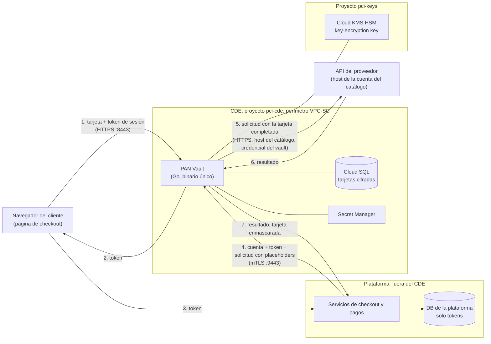

**Lo que ve la plataforma:** tokens, `last4`, mes y año de vencimiento, y respuestas del proveedor en las que cualquier número de tarjeta devuelto se reemplaza por `****4242`.

**Lo que la plataforma nunca ve:** un número de tarjeta completo ni un CVV. No existe ninguna API que los devuelva.

**Dónde se impone la línea:**

| Frontera | Mecanismo |
|---|---|
| Navegador → vault | Un listener público dedicado que solo atiende `POST /tokenize`. Exige una coincidencia exacta de `Origin` y un token de sesión de corta duración emitido por la plataforma. |
| Plataforma → vault | Un listener interno separado que exige un certificado de cliente (mTLS) firmado por una única CA fijada. Solo atiende `POST /proxy` y `GET /healthz`. |
| Vault → base de datos | El rol de base de datos del vault (`vault_app`) solo puede llamar a tres funciones: `put_card`, `get_card` y `list_deks`. No tiene ningún acceso a tablas. Agregar una clave (`add_dek`) requiere un rol separado, `vault_rotator`. |
| Vault → KMS | La key-encryption key está en otro proyecto y nunca sale del HSM. |
| Vault → internet | Solo los hosts de las cuentas del catálogo de este entorno, impuesto en el código y por el firewall de egress de la VPC. |

**Una advertencia honesta sobre la página de checkout.** El número de tarjeta sí pasa por el navegador del cliente, dentro de una página que sirve nuestra plataforma. Quien controle el JavaScript de esa página podría, en teoría, cambiar el destino al que se envía la tarjeta. Por eso, la página que aloja el formulario de tarjeta y los sistemas que la sirven normalmente siguen dentro de un alcance reducido (comparable a SAQ A-EP para un comercio). PCI DSS v4.0 además agrega requisitos para gestionar y monitorear los scripts en las páginas de pago. El vault está diseñado para sacar del alcance al back end (APIs, bases de datos, colas, logs, workers), sujeto a la delimitación del alcance que haga el auditor. No saca del alcance a la página de pago en sí. Servir el formulario de tarjeta desde un origen controlado por el vault, por ejemplo en un iframe, lo reduciría aún más y es un posible paso futuro.

---

## 6. Cómo funciona el vault, paso a paso

### La versión corta

El vault hace exactamente dos trabajos:

1. **Tokenizar.** Recibe una tarjeta desde el navegador y, opcionalmente, el nombre del titular. Verifica la tarjeta, la cifra, la almacena y devuelve un token.
2. **Hacer de proxy.** La plataforma le envía al vault un token, el nombre de una de nuestras cuentas de proveedor de pagos y la solicitud completa que quiere enviar a ese proveedor. La solicitud tiene espacios en blanco, como `{{pan}}`, en cada lugar donde van los datos de la tarjeta. El vault verifica la solicitud contra un reglamento revisado (el **catálogo**). Si la solicitud pasa, el vault descifra la tarjeta, completa los espacios en blanco y su propia contraseña del proveedor, y envía la solicitud al proveedor de esa cuenta. Devuelve la respuesta con cualquier número de tarjeta borrado.

Piensa en una carta modelo. La plataforma escribe la carta y deja espacios en blanco para la tarjeta. El vault la compara con una plantilla aprobada: el destinatario correcto, espacios en blanco solo en los lugares aprobados, nada que haga que el proveedor guarde la tarjeta. Luego el vault completa los espacios en blanco, la firma con nuestra propia firma y la envía a una dirección que elige el vault. La plataforma nunca ve la carta completada.

No hace nada más.

### En profundidad

#### 6.1 Tokenizar: navegador → vault

Antes de mostrar el formulario de tarjeta, la plataforma emite un **token de sesión** para ese checkout:

```
v1.<expires_unix>.<hex(HMAC-SHA256(key, "v1." + expires_unix))>
```

Es válido por un máximo de 15 minutos. No está atado a ninguna tarjeta, y prueba que "a este navegador lo envió aquí nuestra plataforma". Esto impide que desconocidos en internet usen el vault como un validador gratuito de números de tarjeta.

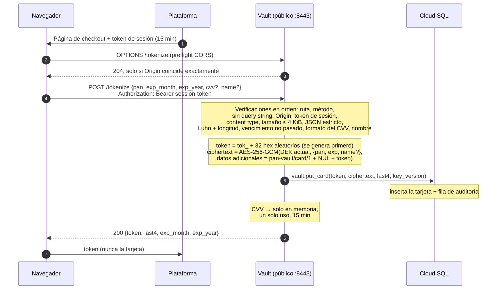

Detalles clave:

- **El CVV nunca se almacena.** Queda en una caché en memoria, como bytes que se sobrescriben cuando se elimina la entrada (con el mejor esfuerzo posible, como todo borrado de memoria en Go). Se elimina cuando una llamada a `/proxy` lo lee, cuando el proveedor acepta con un 2xx cualquier llamada a `/proxy` para esa tarjeta (ver 6.2 más abajo), o cuando expira, 15 minutos después de la tokenización. Las entradas expiradas se eliminan cada 60 segundos, y también cuando la caché está llena, así que incluso una instancia inactiva conserva un CVV expirado como máximo alrededor de un minuto. La caché guarda como máximo 50.000 CVVs. Cuando está llena, `/tokenize` igual almacena la tarjeta y devuelve 200, pero no guarda el CVV en caché y registra `ALERT cvv_cache_full` (como máximo una vez por segundo). Una solicitud posterior con `{{cvv}}` para esa tarjeta recibe el 409 de siempre. Nunca se desaloja un CVV vigente para hacer lugar.
- **El nombre del titular es opcional.** Si se envía, debe tener entre 1 y 100 caracteres de UTF-8 válido, sin caracteres de control (`"name": null` se rechaza). Se cifra junto con la tarjeta y solo se usa donde una solicitud al proveedor tiene un placeholder `{{name}}`. El vault en sí nunca lo devuelve, pero la respuesta de un proveedor puede devolverlo (el `card.name` de un token de Stripe, por ejemplo), y esa respuesta llega a la plataforma tal cual: el vault solo enmascara números de tarjeta, no nombres. Una tarjeta tokenizada sin nombre no puede completar `{{name}}`: esa llamada a `/proxy` recibe `409 {"error":"name unavailable"}`.
- **Un query string se rechaza de plano.** Esto garantiza que un número de tarjeta nunca pueda terminar en una URL y, por lo tanto, nunca en ningún log basado en URLs a lo largo del camino.
- **El navegador recibe el mismo formato de error sin importar qué salga mal**: `{"error":"invalid pan"}` y similares. Ese formato nunca devuelve la entrada.

#### 6.2 Proxy: plataforma → vault → proveedor

La plataforma envía un **envelope** JSON de como máximo 64 KiB. Los campos desconocidos se rechazan:

```json
{
  "account": "stripe_test",
  "token": "tok_4f3a9c…",
  "request": {
    "method": "POST",
    "path": "/v1/tokens",
    "headers": { "Idempotency-Key": "ord-123" },
    "body": "card[number]={{pan}}&card[exp_month]={{exp_month}}&card[exp_year]={{exp_year}}&card[cvc]={{cvv}}&card[name]={{name}}"
  }
}
```

`body` es el body crudo del proveedor como string, en el formato del proveedor (`json` o `form`). El vault envía exactamente esos bytes, reemplazando solo los placeholders.

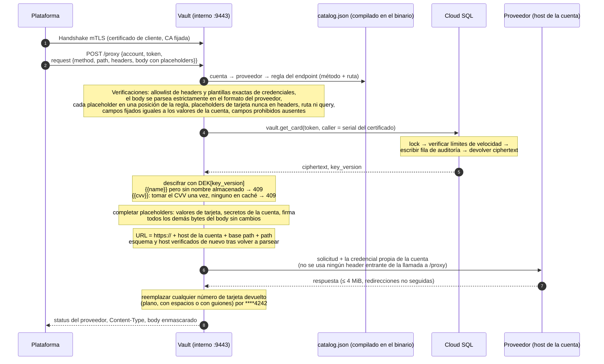

Detalles clave:

- **La plataforma escribe la solicitud. El catálogo decide qué se puede enviar.** `catalog.json` está compilado en el binario. Para cada proveedor, lista los endpoints permitidos (método y ruta). Para cada endpoint, indica las posiciones exactas del body donde puede aparecer cada placeholder, las plantillas de headers de credenciales, los **pins** (campos que deben ser iguales a uno de los valores de la cuenta, como el `merchantAccount` de Adyen) y los campos **prohibidos** (flags para guardar la tarjeta). Cualquier otra cosa se rechaza antes de tocar la base de datos.
- **Los placeholders** forman un vocabulario fijo:

  | Placeholder | Se convierte en | Permitido en |
  |---|---|---|
  | `{{pan}}`, `{{cvv}}`, `{{name}}` | número de tarjeta, CVV en caché, nombre del titular almacenado | posiciones del body listadas en la regla |
  | `{{exp_month}}` / `{{exp_month:int}}` | `"03"` / `3` | posiciones del body listadas en la regla |
  | `{{exp_year}}` / `{{exp_year:yy}}` / `{{exp_year:int}}` | `"2030"` / `"30"` / `2030` | posiciones del body listadas en la regla |
  | `{{exp:yyyy/mm}}` / `{{exp:mm/yy}}` | `"2030/03"` / `"03/30"` | posiciones del body listadas en la regla |
  | `{{secret:NAME}}` | el secreto NAME de la cuenta | plantillas de headers o posiciones del body listadas en la regla |
  | `{{basic:NAME}}` | base64(secreto NAME + ":") | plantillas de headers listadas en la regla |
  | `{{signature}}` | salida del signer nombrado del endpoint (p. ej. `payu`) | plantillas de headers o posiciones del body listadas en la regla |

  Un placeholder debe ser un valor completo (nada de `"{{exp_month}}/{{exp_year}}"`). Cada placeholder de tarjeta puede aparecer como máximo una vez. Los placeholders de tarjeta nunca se permiten en un header, en la ruta ni en el query. Cualquier cosa que parezca un placeholder pero no sea uno de estos, o que esté en cualquier otro lugar, se rechaza. Nunca se envía literalmente.
- **La cuenta elige el destino y la credencial.** La plataforma nombra una cuenta, como `stripe_test`. La URL siempre es `https://` + el host de la cuenta + su base path + la ruta de la solicitud, y el vault vuelve a verificar el esquema y el host después de construirla. La plataforma no puede nombrar un host.
- **La credencial es del vault.** Los secretos de las cuentas se cargan desde Secret Manager al arrancar. Un header de credencial debe ser exactamente su plantilla del catálogo (por ejemplo `Authorization: Bearer {{secret:secretKey}}`). La plataforma puede enviar ese string de plantilla u omitir el header, y el vault lo renderiza en ambos casos. Cualquier otro valor, incluido un `authorization: Bearer sk_attacker` en minúsculas, se rechaza. Del mismo modo, un campo de credencial en el body solo acepta su placeholder del vault. Nunca se usa ningún header HTTP de la propia llamada a `/proxy`.
- **Los headers de la plataforma viajan en `request.headers`, y solo se permiten tres:** `Accept`, `Idempotency-Key` y `X-Idempotency-Key`, cada uno de 1 a 1024 bytes de ASCII imprimible. Cualquier otro header se rechaza con `header not allowed`, no se descarta en silencio, para que los bugs de la plataforma salgan a la luz. El vault mismo define `Host`, `Content-Type` (a partir del formato del proveedor), `Content-Length` y `User-Agent: pan-vault/1`. Solo vuelven el status, el `Content-Type` y el body.
- **El CVV se usa como máximo una vez, y solo cuando pasan todas las verificaciones.** Si el body usa `{{cvv}}` y no hay ningún CVV en caché (ya usado, expirado o tokenizado en otra instancia), la respuesta es `409 {"error":"cvv unavailable"}`. La plataforma reenvía sin el campo del CVV, por ejemplo para un cobro con tarjeta guardada. El vault nunca edita el body para quitar un campo. Una respuesta 2xx del proveedor significa que la tarjeta salió del vault, así que el vault también descarta cualquier CVV que siga en caché para ese token, haya usado o no la solicitud `{{cvv}}`, e incluso cuando después se niega a reenviar la respuesta (una respuesta comprimida se convierte en un `502`). Un reintento que use `{{cvv}}` recibe entonces el 409. Cualquier otro status deja en caché un CVV no usado para un reintento. El descarte solo llega a la instancia que tiene el CVV. `/tokenize` y `/proxy` llegan por load balancers distintos, así que un CVV en caché en otra instancia se queda allí hasta que expira: 15 minutos después de la tokenización más como máximo un barrido, unos 16 minutos en el peor caso.
- **Cada ciphertext solo se abre con su propio token.** Una tarjeta se cifra con su token como datos adicionales de AES-GCM (`pan-vault/card/1`, un byte NUL y luego el token). Un ciphertext copiado a la fila de otro token no se puede descifrar y se responde con `500` y `ALERT decrypt_failed`. No se envía nada al proveedor. Si la versión de clave de la tarjeta es una que esta instancia todavía no tiene (una clave agregada hace instantes), el vault primero refresca sus claves desde la base de datos, como máximo una vez cada 10 segundos (ver §9). Eso puede retener la solicitud hasta unos 30 segundos, dentro del write timeout de 60 segundos del listener interno. Si a un refresco lento le sigue un proveedor lento, ese timeout puede vencer antes de que se escriba la respuesta. La plataforma debe tratarlo como cualquier timeout del proveedor y reintentar con el mismo `Idempotency-Key`.
- **Los rechazos son específicos y nunca devuelven la entrada.** Una falla de política es un `400` con un único mensaje fijo: `unknown account`, `endpoint not allowed`, `header not allowed`, `invalid placeholder use`, `pinned field mismatch`, `forbidden field` o `invalid request body`. Una vez que se conoce la cuenta, toda falla de regla también genera `ALERT proxy_policy` (ver [§7.6](#76-nada-sensible-en-los-logs-por-diseño)). Una cuenta desconocida, un token mal formado o un envelope mal formado se rechazan sin alerta.
- **Las redirecciones nunca se siguen.** El vault ignora `HTTP_PROXY`, rechaza las respuestas comprimidas que no puede inspeccionar y nunca devuelve un body truncado. El enmascaramiento tiene un límite preciso: el vault enmascara solo el número de esta misma tarjeta, como dígitos seguidos o en grupos de cuatro separados por espacios o por guiones. Otras agrupaciones (como el 4-6-5 de Amex) y cualquier otro dato que devuelva un proveedor, como un nombre o un mensaje de error, llegan a la plataforma tal cual, y por eso se revisan las respuestas documentadas de cada endpoint del catálogo antes de agregarlo.

#### 6.3 La vida de una tarjeta

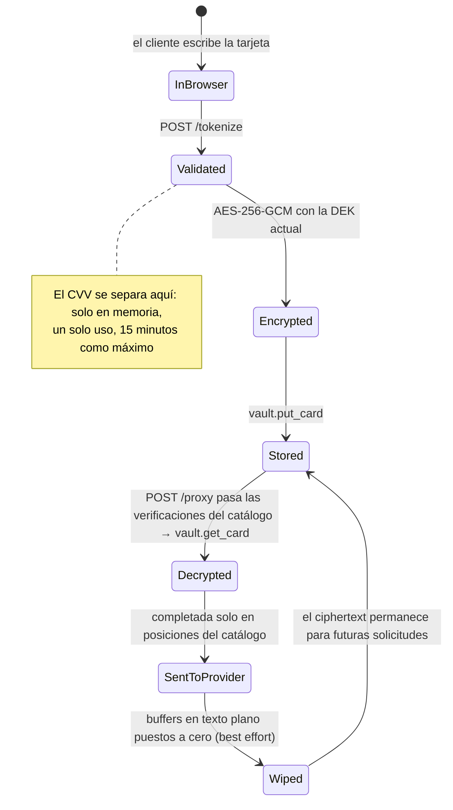

#### 6.4 El catálogo actual

El primer `catalog.json` incluye **solo Stripe**, porque Stripe es el único proveedor que podemos verificar en CI (mediante el `stripe-mock` oficial de Stripe). Adyen, Mercado Pago, PayU Latam y Pagar.me ya están modelados en el catálogo sintético de la suite de tests. Cada uno llegará como su propio cambio solo de datos, después de verificarse contra el sandbox de ese proveedor.

| Cuenta (entorno) | Proveedor (formato) | Endpoint | Qué crea | Posiciones de tarjeta | Campos prohibidos |
|---|---|---|---|---|---|
| `stripe_test` (dev) | `stripe` (form) | `POST /v1/tokens` | Un token de tarjeta de un solo uso (`tok_…`) | `card[number]`, `card[exp_month]`, `card[exp_year]`, `card[cvc]`, `card[name]` | `customer` (Connect: un token clonado de la tarjeta guardada de un customer) |

Así que el flujo de Stripe es: el vault crea un `tok_…` de un solo uso mediante `POST /v1/tokens`, y la plataforma, con su propia clave de Stripe, lo cobra o crea un PaymentMethod a partir de él (por ejemplo `POST /v1/payment_methods` con `type=card&card[token]=tok_…`). Esas llamadas no llevan datos de tarjeta, así que no pasan por el vault. El vault en sí nunca llama a `POST /v1/payment_methods` con datos de tarjeta: un PaymentMethod de tarjeta es reutilizable y se puede asociar a un customer, lo que equivale a almacenamiento en el proveedor, así que ese endpoint no está en el catálogo.

Cada endpoint del catálogo lleva datos de tarjeta y lista una posición para `{{pan}}`, y cada solicitud a `/proxy` debe contener `{{pan}}`. La credencial del vault solo se presta para llamadas que llevan tarjeta. Cualquier otra cosa (un pago con un token del proveedor, un reembolso, una consulta, un token `pii` de Stripe) es una llamada propia de la plataforma, hecha con sus propias claves.

Todavía no hay una cuenta de prod, así que `egress-hosts.prod.txt` está vacío. Para agregar un proveedor o una cuenta, ver [§11](#11-para-desarrolladores).

---

## 7. Cómo nos protege el vault

### La versión corta

El vault asume que las cosas van a salir mal y limita el daño cuando eso pasa:

- **Si hackean la plataforma**, el atacante igual no puede obtener números de tarjeta. Solo puede pedirle al vault que envíe solicitudes que el reglamento permite, a nuestras propias cuentas de proveedor, con los datos de la tarjeta solo en campos aprobados, y a una tasa limitada.
- **Si roban la base de datos**, el atacante obtiene datos ilegibles. La clave para descifrarlos vive en un sistema separado, protegido por hardware.
- **Si alguien en internet ataca el vault**, el endpoint de pagos es inalcanzable sin un certificado especial. El endpoint de tarjetas es inútil sin un ticket reciente de nuestro checkout.
- **Si pasa algo inesperado**, el vault se niega en lugar de adivinar.

### En profundidad

#### 7.1 De quién nos defendemos

| | Adversario | Qué puede hacer | A qué lo limita el diseño |
|---|---|---|---|
| **A** | **Plataforma comprometida**, o un insider con el certificado de cliente de la plataforma | Llamar a `/proxy` con cualquier token y cualquier solicitud al proveedor | Solo endpoints del catálogo de nuestras propias cuentas, en los hosts que indica el catálogo. Datos de tarjeta solo en posiciones de la regla, nunca en headers ni URLs. Los campos fijados de la cuenta deben coincidir, los campos que guardan la tarjeta están prohibidos, solo se permiten tres headers de la plataforma y la credencial siempre es la del vault. Sin lecturas masivas. Las búsquedas tienen rate limit dentro de la base de datos, que la plataforma no puede cambiar. |
| **B** | **Proceso del vault comprometido** (ejecución de código, build malicioso) | Tiene las claves de datos y el rol de DB | El acceso a la DB es solo mediante funciones de una sola fila, sin lecturas de tablas. Los límites de velocidad viven en la base de datos. El egress está restringido por firewall a los proveedores. Ver la limitación conocida en [§10](#10-limitaciones-conocidas-y-próximos-pasos). |
| **C** | **Credenciales de base de datos robadas** | Llamar a `get_card` | Solo obtiene ciphertext AES-256-GCM. La clave no está en la base de datos. |
| **D** | **Atacante desde internet** | Llegar a `/tokenize` | No puede llegar a `/proxy` en absoluto (requiere mTLS). No puede usar `/tokenize` como oráculo de validez de tarjetas sin un token de sesión emitido por la plataforma. |
| **E** | **Proveedor de pagos deshonesto** | Recibe números de tarjeta legítimamente | Fuera del alcance del vault. La allowlist de egress impide que el tráfico se redirija a otro proveedor. |

Fuera del alcance por diseño: el compromiso del owner del proyecto cloud o del administrador de KMS, una toolchain de Go comprometida, y los ataques de canal lateral y físicos. Estos están cubiertos por los controles cloud descritos en [§9](#9-operarlo-de-forma-segura).

#### 7.2 Capas de defensa

Ningún control por sí solo es de confianza. Un atacante tiene que vencer cada capa, una tras otra:

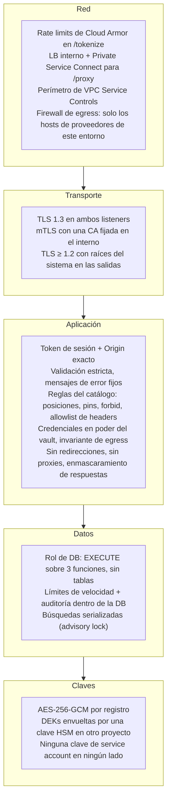

#### 7.3 Qué le pasa a un atacante que controla la plataforma

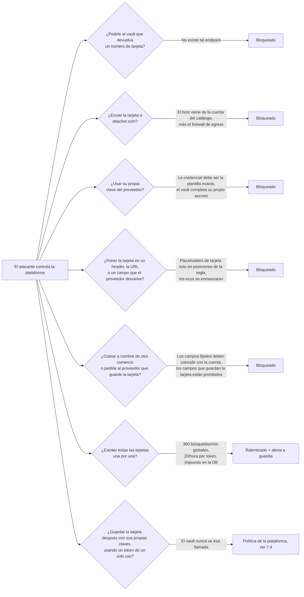

#### 7.4 Lo que el vault no puede imponer: tokens de traspaso

Algunos endpoints del catálogo crean un **traspaso de un solo uso** (hand-off): hoy un token de Stripe (`/v1/tokens`) y, más adelante, un card token de Mercado Pago. La plataforma luego usa ese token con sus propias claves del proveedor, por ejemplo para cobrarlo.

Con sus propias claves, la plataforma también podría pedirle al proveedor que **guarde** la tarjeta, por ejemplo creando un PaymentMethod a partir del token de Stripe y asociándolo a un customer. Esa llamada no lleva datos de tarjeta y nunca pasa por el vault, así que el vault no puede impedirla. Esto no rompe la confidencialidad: la tarjeta queda en un proveedor certificado PCI, en nuestra propia cuenta, y la plataforma sigue sin ver nunca el número de tarjeta. Lo que sí rompe es el objetivo de que el vault sea el único lugar donde viven las tarjetas.

**Por lo tanto, esta es una regla de la plataforma: la plataforma nunca debe guardar, asociar ni reutilizar una tarjeta mediante un token de traspaso.** La revisión de código de la plataforma y el monitoreo del lado del proveedor tienen que hacerla cumplir.

#### 7.5 Cosas que el vault deliberadamente nunca hace

- Almacenar un CVV, datos de banda magnética, un PIN o un PIN block.
- Enviar una solicitud al proveedor que el catálogo no permite. La plataforma no puede elegir el host, la credencial, el valor de un campo que selecciona la cuenta, ni ningún lugar para la tarjeta fuera de una posición de la regla. No existe un modo de paso libre.
- Enviar datos de tarjeta a un endpoint que almacena la tarjeta en el proveedor, o que envía datos a una URL elegida por quien llama.
- Acumular código específico de proveedores. Los proveedores, endpoints y cuentas son datos del catálogo. El único código de proveedor permitido es un pequeño signer nombrado (hoy solo `payu`).
- Ofrecer cualquier endpoint que devuelva, liste, busque, cuente o elimine tarjetas.
- Seguir redirecciones HTTP de los proveedores.
- Registrar en logs los bodies o headers de solicitudes o respuestas, en cualquier nivel de log.
- Leer la configuración, o el catálogo, desde un archivo o desde la base de datos en tiempo de ejecución.
- Ejecutar migraciones de base de datos.
- Terminar el TLS del listener interno en un load balancer. Termina en el vault, para que el propio vault vea y registre el certificado de cliente.

#### 7.6 Nada sensible en los logs, por diseño

Hay exactamente una línea de log de acceso por solicitud:

```
2026-10-30T15:04:05Z req listener=internal method=POST path=/proxy status=200 dur=183ms caller=0A1B2C
```

- Las rutas y los métodos se registran solo si son valores conocidos. Cualquier otra cosa se convierte en `path=other` y `method=other`, así que un número de tarjeta escrito en una URL no puede llegar al log.
- Las únicas otras líneas son los mensajes de arranque y estas líneas `ALERT`. Los nombres de cuentas y endpoints vienen del catálogo, nunca de la solicitud:

| Alerta | Significado |
|---|---|
| `ALERT proxy_policy account=… endpoint=… reason=…` | Una solicitud a `/proxy` violó una regla del catálogo. `reason` es uno de `endpoint`, `header`, `body`, `placeholder`, `pin` o `forbidden_field`, y `endpoint=-` significa que ningún endpoint coincidió. Posible plataforma comprometida. Como máximo una línea por segundo. |
| `ALERT velocity token=… caller=… account=…` | Se alcanzó un límite de búsquedas. Posible extracción masiva. |
| `ALERT pan_echo account=… endpoint=… token=…` | Un proveedor devolvió un número de tarjeta. Se enmascaró, pero hay que investigar. |
| `ALERT decrypt_failed token=… key_version=… account=…` | Corrupción del ciphertext o de la clave, o un ciphertext copiado a la fila de otro token. Esto nunca debería pasar. |
| `ALERT egress_invariant account=…` | Una solicitud estaba a punto de salir hacia un host inesperado. Esto debería ser inalcanzable. |
| `ALERT session_token_invalid reason=…` | Token de sesión inválido, expirado o falsificado. Como máximo una línea por segundo. |
| `ALERT cvv_cache_full` | La caché del CVV está llena (50.000 entradas). Las tarjetas nuevas se siguen almacenando, pero su CVV no se guarda en caché. Posible avalancha de `/tokenize`. Como máximo una línea por segundo. |

La suite de tests lo demuestra. Cada test escribe sus logs en un buffer compartido. Al terminar la ejecución, el buffer se escanea en busca de cualquier secuencia de 13 a 19 dígitos que pase la verificación de Luhn, incluidas las secuencias con espacios o guiones y las que están escondidas dentro de cadenas de dígitos más largas. También se escanea en busca del CVV de prueba, los secretos de proveedor de prueba y el nombre del titular de prueba. Cualquier coincidencia hace fallar el build.

---

## 8. Por qué está construido así

### La versión corta

El vault es deliberadamente **pequeño, simple y estricto**:

- **Pequeño**, para que una sola persona pueda leerlo completo de una sentada y detectar cualquier cosa que esté mal. Además, sigue siendo pequeño a medida que agregamos proveedores de pagos: un nuevo proveedor es una entrada revisada en un reglamento, no código nuevo.
- **Simple**: sin frameworks, sin trucos ingeniosos y con una sola librería externa. Cada pieza de código adicional es una cosa más que podría ser atacada.
- **Estricto**: ante la duda, dice que no.

El código de seguridad que es fácil de leer es más fácil de confiar.

### En profundidad

Cada decisión a continuación indica la elección, el motivo y la contrapartida que aceptamos.

**Un paquete Go, unos pocos archivos, sin subpaquetes.**
*Por qué:* un revisor o auditor todavía puede leer todo el servicio de principio a fin, y nada se esconde en un rincón de un árbol de paquetes: es un único `package main` en la raíz del repo. Los archivos están divididos por responsabilidad para que el núcleo de seguridad (`scan.go`, `policy.go`, `render.go`, `catalog.go`) pueda auditarse por sí solo, sin tener que recorrer el código de arranque y la plomería HTTP. La división no agrega abstracción: no hay APIs exportadas, interfaces ni generics, y cualquier archivo puede usar cualquier cosa del paquete, exactamente como cuando era un solo archivo. *Contrapartida:* quien lee salta entre archivos en lugar de desplazarse por uno solo, y los límites entre archivos son una convención, no un muro impuesto por el compilador. Todavía hay algo de repetición. Se prefiere la repetición a la abstracción porque la abstracción oculta comportamiento.

**Librería estándar más exactamente una dependencia (pgx, el driver de Postgres).**
*Por qué:* cada módulo de terceros es un riesgo de supply chain dentro del CDE. No hay framework HTTP, librería de logging, ORM ni SDK de cloud. Las APIs de Google se llaman con `net/http` puro. *Se impone con:* `make deps-check` (go.mod y una línea base de go.sum) y `make vendor-check` (el código vendorizado debe coincidir byte a byte con el módulo oficial). *Contrapartida:* un poco más de código para las llamadas a KMS y Secret Manager.

**Un vault liviano: la plataforma construye la solicitud, el catálogo la acota.**
*Por qué:* necesitamos muchos proveedores (primera ola: Stripe, Adyen, Mercado Pago, PayU Latam y Pagar.me) y varias cuentas por proveedor. Si cada operación de proveedor fuera una función Go, el código del vault crecería con cada proveedor. En cambio, la plataforma construye la solicitud completa al proveedor con placeholders, y el vault solo la verifica contra las reglas, la completa y la envía. Agregar un proveedor, un endpoint o una cuenta es un cambio solo de datos en `catalog.json`, más los secretos en Secret Manager. *Contrapartida:* las reglas del catálogo cargan con el peso de seguridad que antes cargaba el código constructor, así que cada cambio del catálogo pasa por un checklist de revisión estricto (ver [§11](#11-para-desarrolladores)).

**El catálogo es código, no configuración.**
*Por qué:* `catalog.json` se embebe en el binario en tiempo de build y nunca se lee desde disco, una base de datos o el entorno en tiempo de ejecución. Una allowlist editable en tiempo de ejecución sería lo primero que un atacante editaría. Se valida estrictamente al arrancar y mediante un test unitario: claves desconocidas, duplicados, rutas o hosts inválidos, placeholders o signers desconocidos y secretos faltantes son todos errores fatales. Como los builds son reproducibles, el digest de la imagen certifica el catálogo exacto que corre en producción. Cada cuenta está etiquetada como `dev` o `prod`, así que la misma imagen revisada se promueve de dev a prod y solo carga las cuentas de su propio entorno. *Contrapartida:* agregar un proveedor sigue siendo un release, aunque no un cambio de código.

**Placeholders en posiciones exactas, nunca un lenguaje de plantillas.**
*Por qué:* el vocabulario es fijo (`{{pan}}`, `{{cvv}}`, `{{name}}`, formatos de vencimiento, `{{secret:…}}`, `{{basic:…}}`, `{{signature}}`). Un placeholder debe ser un valor completo, en una posición que nombra la regla. Los parsers de body para `json` y `form` son estrictos: claves duplicadas, datos sobrantes al final, codificación inválida, placeholders escapados o con percent-encoding, y claves de form fuera de una gramática acotada se rechazan todos. Los bytes enviados son exactamente los bytes verificados más las sustituciones, así que ninguna diferencia de parseo entre el vault y el proveedor puede mover la tarjeta. *Contrapartida:* un proveedor que necesite un `{{` literal en sus datos, o un valor concatenado, no está soportado hasta que agreguemos un formato para eso. XML se puede agregar más adelante como un parser más, sin cambiar el modelo.

**Verificar, no reescribir.**
*Por qué:* los campos fijados (como el `merchantAccount` de Adyen) se comparan con los valores de la cuenta, y se verifica que los campos prohibidos estén ausentes. El vault nunca sobrescribe ni descarta nada de la solicitud de la plataforma: una discrepancia se rechaza. Los headers desconocidos se rechazan, no se descartan. Así, un bug o un ataque de la plataforma aparece como un error y una alerta, en lugar de "corregirse" en silencio. *Contrapartida:* la plataforma tiene que armar cada solicitud exactamente bien.

**Signers nombrados, no un lenguaje de firmas.**
*Por qué:* algunos proveedores firman cada solicitud (PayU hace un hash de la API key, el merchant ID, la referencia y el monto). Una "receta de firma" genérica en el catálogo sería un pequeño lenguaje de programación dentro de la allowlist. En cambio, cada esquema es una pequeña función Go nombrada (hoy solo `payu`) que lee secretos de la cuenta y campos del body, nunca datos de tarjeta. Este es el único código Go específico de proveedor permitido. *Contrapartida:* un proveedor con un esquema de firma nuevo necesita una nueva función revisada.

**Fail closed.**
*Por qué:* una entrada ambigua, una configuración faltante o un estado inesperado significan rechazo. Por ejemplo: claves JSON duplicadas, un header `Origin` duplicado, `"cvv": null`, un campo del body que difiere de un campo verificado solo en mayúsculas o minúsculas, una respuesta comprimida del proveedor o una URL de base de datos sin verificación de certificado en producción. *Contrapartida:* un cliente inusual pero legítimo puede recibir un `400` y tener que ajustarse.

**Acceso a la base de datos solo mediante funciones `SECURITY DEFINER`.**
*Por qué:* el rol de la aplicación, `vault_app`, no puede hacer `SELECT` sobre ninguna tabla. Solo puede llamar a `put_card`, `get_card` y `list_deks`. Un vault comprometido no puede ejecutar `SELECT * FROM cards`. Cada búsqueda queda auditada, y la aplicación no puede saltarse la auditoría. *Contrapartida:* los cambios de esquema pasan por un pipeline de migraciones ejecutado por un rol owner separado, nunca por el vault.

**Límites de velocidad dentro de la base de datos, serializados con un lock.**
*Por qué:* los límites impuestos en la aplicación podrían ser desactivados por quien controle la aplicación. En la base de datos quedan fuera del alcance de la plataforma y de la aplicación: 300 búsquedas por minuto en total y 20 por hora por token. Un advisory lock hace que las solicitudes paralelas hagan fila en lugar de colarse todas a la vez antes del conteo. Sin el lock, 50 búsquedas simultáneas dejan pasar 27 o 28 en lugar de 20. *Contrapartida:* las búsquedas se ejecutan de a una, a unos pocos milisegundos cada una. Eso es mucho más de lo que el límite permite de todos modos.

**Envelope encryption con una clave respaldada por HSM.**

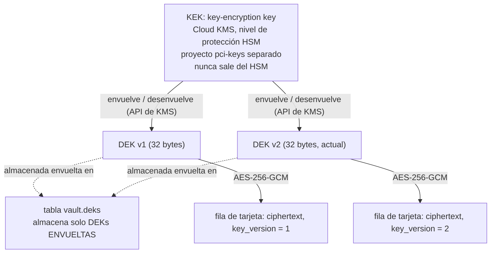

*Por qué:* la base de datos solo guarda ciphertext y claves envueltas. Desenvolverlas requiere una llamada a KMS en otro proyecto, con su propio IAM y sus propios logs de auditoría. Cada registro usa un nonce aleatorio nuevo de 12 bytes y lleva su token como datos adicionales autenticados (`pan-vault/card/1`, un byte NUL y luego el token), así que un ciphertext solo se descifra con el token con el que se guardó. Recomendamos una nueva clave de datos cada mes. Así cada clave cubre alrededor de un mes de tarjetas, lo que mantiene pequeño el conjunto de claves antiguas que cada instancia desenvuelve al arrancar (unas doce por año), a cambio de que una clave de datos expuesta revele hasta un mes de tarjetas en lugar de un día. La clave de KMS rota cada 90 días. El descifrado de KMS acepta versiones anteriores de la clave, así que las DEKs envueltas siguen siendo legibles después de una rotación de KMS, pero siguen envueltas con la versión que las envolvió: volver a envolver las DEKs existentes con la versión más reciente de la clave de KMS es trabajo de la v1.1. *Contrapartida:* el arranque depende de que KMS esté disponible, y las claves de datos antiguas se conservan para que las tarjetas antiguas sigan siendo legibles. Volver a cifrar las filas antiguas está planificado para la v1.1.

**Dos listeners, dos modelos de confianza.**
*Por qué:* el listener orientado al navegador y el listener orientado a la plataforma tienen llamadores completamente distintos. Puertos, configuraciones TLS y handlers separados hacen que un bug en un lado no pueda exponer el otro. *Contrapartida:* dos load balancers que operar.

**Sin redirecciones, sin proxies, TLS estricto en la salida.**
*Por qué:* una redirección o una variable de entorno `HTTP_PROXY` podría enviar una tarjeta a otro lugar en silencio. El cliente de salida ignora ambas, verifica TLS 1.2 o superior contra las raíces del sistema y limita las respuestas a 4 MiB. *Contrapartida:* ninguna en la práctica.

**Un contenedor `scratch`, ejecutado como non-root, con builds reproducibles.**
*Por qué:* la imagen contiene el binario, los certificados de CA y un archivo passwd de una línea, y nada más: ni shell ni gestor de paquetes. El build es reproducible, así que dos builds del mismo commit producen el mismo digest y cualquiera puede verificar que una imagen en ejecución proviene de código revisado, catálogo incluido. *Contrapartida:* no hay shell para depurar. Es intencional, ya que nadie debería estar depurando dentro del CDE.

**Sin claves de service account, sin archivos de configuración.**
*Por qué:* las credenciales vienen del metadata server de GCE (Workload Identity) y de Secret Manager al arrancar. La configuración viene solo de variables de entorno. No hay nada en disco que robar o manipular. *Contrapartida:* el desarrollo local usa variables `VAULT_DEV_*` explícitas, y el binario se niega a arrancar si alguna de ellas está definida en producción.

**Probado como si importara.**
*Por qué:* la lista completa de tests de la especificación está implementada. Eso incluye el escaneo de fugas en logs, tests de privilegios de base de datos contra un Postgres real, una ejecución end-to-end sobre listeners mTLS reales, la rotación de claves, tests negativos para cada regla del catálogo contra un catálogo sintético que modela los cinco proveedores de la primera ola, y una verificación de la forma de las solicitudes que envía solicitudes construidas por la plataforma a través del `catalog.json` real hacia el mock oficial de la API de Stripe (`stripe-mock`). *Contrapartida:* el archivo de tests es más grande que el código, lo cual es normal en software de seguridad.

---

## 9. Operarlo de forma segura

### La versión corta

El vault es tan seguro como el entorno en el que corre. Debe estar en sus propios proyectos cloud blindados, sin acceso humano permanente. Sus claves se rotan según un calendario, y cada línea `ALERT` le genera una alerta a alguien de guardia.

### En profundidad

**Estructura en la nube** (Google Cloud):

| Proyecto | Contiene |
|---|---|
| `pci-cde-<env>` | VMs del vault (managed instance group de 2 Shielded VMs, Container-Optimized OS, sin SSH), Cloud SQL (Postgres 18, IP privada, CMEK, pgaudit), Secret Manager. Nada más, nunca. |
| `pci-keys-<env>` | Key ring de Cloud KMS con la key-encryption key protegida por HSM. |
| `pci-logs` | Sink de logs de auditoría con Bucket Lock, retenido durante al menos un año. |

Las políticas de organización en la carpeta `pci` prohíben las IPs externas y la creación de claves de service account, y exigen Shielded VMs y CMEK. No hay IAM humano permanente en el proyecto del CDE: el acceso break-glass está acotado en el tiempo y pasa por Access Approval.

**Rotación de claves:**

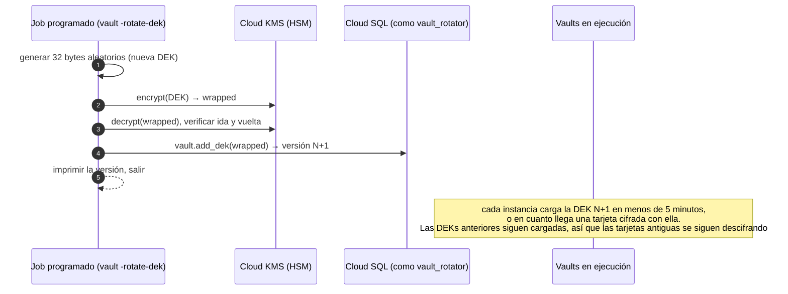

**Calendario de rotación y refresco de claves.** Ejecuta `vault -rotate-dek` una vez por mes (la contrapartida está en [§8](#8-por-qué-está-construido-así)). Después no hace falta reiniciar nada. Cada instancia vuelve a leer la lista de claves cada 5 minutos, y una instancia que se encuentra con una tarjeta cifrada con una versión de clave que no tiene refresca en el acto, como máximo una vez cada 10 segundos, con un límite de 30 segundos por refresco. Las claves nuevas se suman a las que ya tiene la instancia y nunca se quita ninguna, así que ya no hace falta un reinicio escalonado y ya no causa `decrypt_failed`. Queda un caso: si KMS o la base de datos no están disponibles en el momento en que una instancia se encuentra por primera vez con una versión de clave nueva, o si el último refresco de esa instancia terminó menos de 10 segundos antes, cuando la clave todavía no existía, las solicitudes de tarjetas cifradas con esa clave fallan en esa instancia con `decrypt_failed` durante hasta 10 segundos (el límite de frecuencia del refresco), y funcionan en cuanto un refresco sale bien.

**Respuesta a alertas:**

| Alerta | Severidad | Primeros pasos |
|---|---|---|
| `pan_echo` | Alerta a guardia inmediata | Averiguar qué cuenta y endpoint devolvieron un número de tarjeta. El vault lo enmascaró, pero hay que confirmar que nada más lo haya capturado. |
| `decrypt_failed` | Alerta a guardia inmediata | Posible corrupción de claves o datos, o un ciphertext copiado a la fila de otro token. Revisar el estado de la clave de KMS y las versiones de DEK. |
| `egress_invariant` | Alerta a guardia inmediata | Debería ser imposible. Tratarlo como un posible compromiso del binario del vault. |
| `proxy_policy` | Alerta a guardia | La plataforma envió una solicitud que el catálogo prohíbe. Posible plataforma comprometida. Cruzarla con las líneas del log de acceso de `/proxy` con `status=400` en el mismo momento para encontrar el certificado de cliente (`caller=`). Una ráfaga justo después de un deploy de la plataforma es más probablemente un bug de la plataforma. |
| `velocity` | Alerta a guardia | Posible intento de extracción masiva. Revisar qué serial de certificado de cliente (`caller=`) hizo las búsquedas. |
| `session_token_invalid` (pico de tasa) | Notificación | Card testing o checkout mal configurado. Revisar Cloud Armor. |
| `cvv_cache_full` | Notificación | La caché del CVV llegó a su tope de 50.000 entradas. Los checkouts siguen funcionando, pero las tarjetas tokenizadas mientras tanto no tienen CVV en caché, así que las solicitudes con `{{cvv}}` para ellas reciben 409. Revisar Cloud Armor y el tráfico de `/tokenize` en busca de una avalancha. |

**Requisitos previos para el despliegue:**

- **TLS de la base de datos.** En producción, `VAULT_DB_URL` debe verificar el certificado del servidor, o el vault no arranca. Usa `sslmode=verify-ca&sslrootcert=/path/to/server-ca.pem` con la CA del servidor de Cloud SQL. `verify-full` normalmente falla contra una IP privada.
- **Identidades de Cloud SQL.** El vault y el job de rotación corren cada uno con su propia service account de IAM, por ejemplo `pan-vault@pci-cde-<env>.iam.gserviceaccount.com` (servicio) y `pan-vault-rotator@pci-cde-<env>.iam.gserviceaccount.com` (rotación). Cada una se agrega a la instancia de Cloud SQL como usuario de base de datos de IAM, cuyo nombre de usuario de Postgres es el email de la cuenta sin `.gserviceaccount.com`. Luego el pipeline de migraciones, conectado como `vault_owner`, le otorga a cada una su rol:

  ```sql
  GRANT vault_app     TO "pan-vault@pci-cde-<env>.iam";
  GRANT vault_rotator TO "pan-vault-rotator@pci-cde-<env>.iam";
  ```

  `VAULT_DB_URL` usa ese nombre de usuario de IAM, codificado para URL y sin contraseña, por ejemplo `postgres://pan-vault%40pci-cde-<env>.iam@<private-ip>:5432/vault?sslmode=verify-ca&sslrootcert=…`. En producción el vault envía como contraseña el access token de su service account (autenticación de base de datos con IAM de Cloud SQL).
- **Smoke test contra Cloud SQL.** Antes del primer despliegue en un entorno, y después de cualquier cambio en sus usuarios de IAM o roles de base de datos, verificar contra la instancia real de Cloud SQL que la cuenta de servicio puede iniciar sesión con su token de IAM y llamar a `put_card`, `get_card` y `list_deks`, pero no puede leer ninguna tabla ni llamar a `add_dek`, y que la cuenta del rotador puede llamar a `add_dek`. Es un paso del pipeline de despliegue, no un test de este repositorio.
- **Una cuenta revisada para el entorno.** El vault se niega a arrancar cuando el catálogo no tiene ninguna cuenta para su `VAULT_ENV` (`catalog has no accounts for env=prod`), porque un vault que no puede enviar una tarjeta a ningún lado parecería sano de todos modos. Por eso, el primer despliegue en prod necesita una cuenta de prod revisada en `catalog.json`, con su host en `egress-hosts.prod.txt`.
- **Health checks.** Los load balancers prueban ambos listeners con health checks TCP simples: el puerto acepta conexiones. La disponibilidad real se verifica aparte, con un monitor que tiene un certificado de cliente de la plataforma y llama a `GET /healthz` por mTLS, lo que también pone a prueba la cadena de certificados y la base de datos. A propósito no hay ninguna ruta de salud sin autenticación. El listener interno pide un certificado de cliente en el handshake TLS de cada conexión, y el vault no sirve nada más que `/tokenize`, `/proxy` y `/healthz`, así que una ruta para las sondas significaría un endpoint nuevo o un mTLS más débil en el listener que sirve `/proxy`.
- **Acceso a datos de tarjeta en crudo en cada proveedor.** Por defecto, Stripe rechaza las solicitudes a la API que contienen números de tarjeta completos. El acceso en modo live requiere la aprobación de Stripe, respaldada con evidencia PCI (normalmente un SAQ D o una Attestation of Compliance). Otros proveedores tienen controles similares, como el "API PCI Payments role" de Adyen.
- **Secretos de las cuentas.** Cada secreto nombrado por una cuenta del catálogo del entorno debe existir en Secret Manager y ser legible por la service account del vault, o el vault no arranca.
- **Certificados de cliente de la plataforma.** La CA en `VAULT_CLIENT_CA` solo debería emitir certificados para los servicios de la plataforma que tienen permitido llamar a `/proxy`.
- **Firewall de egress.** Para cada host de proveedor en `egress-hosts.dev.txt` o `egress-hosts.prod.txt`, el firewall de ese entorno debe permitir solo los rangos de IP publicados por ese proveedor. El firewall de prod solo permite hosts de prod.
- **Política de tokens de traspaso.** El código de la plataforma nunca debe guardar, asociar ni reutilizar una tarjeta mediante un token de un solo uso devuelto por el vault (ver [§7.4](#74-lo-que-el-vault-no-puede-imponer-tokens-de-traspaso)).

---

## 10. Limitaciones conocidas y próximos pasos

**Las búsquedas revertidas con rollback no se cuentan (aceptado para la v1, riesgo RR-1).** Alguien que tenga el propio rol de base de datos del vault (adversario B, en la práctica un proceso del vault comprometido) puede buscar una tarjeta dentro de una transacción y hacer rollback, lo que borra la fila de auditoría y su conteo para el rate limit. La plataforma no puede hacer esto, `pgaudit` sigue registrando cada llamada, y una escritura de auditoría fuera de la transacción de quien llama está planificada para la v1.1. La entrada completa, con los controles compensatorios, la decisión, su responsable y el disparador de revisión, está en el [registro de riesgos](docs/risk-register.md).

**El CVV y las múltiples instancias.** La caché del CVV vive en la memoria de cada instancia. Si una llamada a `/proxy` llega a una instancia distinta de la que recibió la llamada a `/tokenize`, el CVV no está disponible, y una solicitud que usa `{{cvv}}` recibe `409 {"error":"cvv unavailable"}`. La plataforma puede reenviarla sin el campo del CVV. Lo mismo vale para el descarte: el 2xx de un proveedor descarta el CVV solo en la instancia que atendió la llamada a `/proxy`, así que un CVV en caché en otra instancia se queda hasta que expira, unos 16 minutos como máximo. Es una contrapartida deliberada: compartir el CVV entre instancias significaría almacenarlo en algún lugar.

**La plataforma puede guardar los tokens de traspaso.** Después de que el vault devuelve un token de un solo uso, la plataforma podría usar sus propias claves del proveedor para guardar la tarjeta en el proveedor. El vault nunca ve esa llamada, así que esto es una regla de la plataforma, no un control del vault. Ver [§7.4](#74-lo-que-el-vault-no-puede-imponer-tokens-de-traspaso).

**La página de checkout sigue parcialmente dentro del alcance.** Ver [§5](#5-cómo-el-vault-reduce-nuestro-alcance).

**Planificado para la v1.1:** volver a cifrar las tarjetas antiguas con la clave más reciente (`rewrap_card`), volver a envolver las DEKs existentes con la versión más reciente de la clave de KMS, la escritura de auditoría fuera de la transacción de quien llama que cierra RR-1, una función de retención y purga con su propio rol, y el ajuste de Cloud Armor a partir de tráfico real.

**Próximas entradas del catálogo:** Adyen, Mercado Pago, PayU Latam y Pagar.me, cada una después de su verificación en sandbox. Un formato de body `xml` y más signers nombrados se agregarán solo cuando un proveedor real los necesite.

---

## 11. Para desarrolladores

### La versión corta

Todo se maneja con `make`. `make ci` ejecuta las verificaciones que todo cambio debe pasar, y `make ci-all` agrega las verificaciones de base de datos, de `stripe-mock` y de imagen reproducible. El vault lee su configuración solo desde variables de entorno. La lista de proveedores de pagos y cuentas vive en `catalog.json`, que se compila dentro del binario. Agregar un proveedor o una cuenta significa editar ese archivo, agregar su secreto a Secret Manager y actualizar la lista de hosts de egress. No hay cambios en el código Go. GitHub Actions ejecuta las mismas verificaciones en cada pull request, y los git hooks opcionales (`make hooks`) ejecutan las rápidas antes de cada commit y cada push.

### En profundidad

**Requisitos:** Go 1.27.3 (se descarga automáticamente mediante `GOTOOLCHAIN`), Docker, `psql`, `curl`, `make`.

| Comando | Qué hace |
|---|---|
| `make build` | Binario estático y reproducible `./vault` |
| `make test` | Tests unitarios con el race detector. Los tests de integración se omiten a menos que haya una DB configurada. |
| `make lint` | gofmt, go vet, staticcheck (versión fijada, instalado en `.tools/`) |
| `make vuln` | govulncheck |
| `make deps-check` / `make vendor-check` | Allowlist de dependencias, línea base de go.sum, el código vendorizado coincide con upstream |
| `make docs-check` | Los tres READMEs no repiten ninguna de las afirmaciones retiradas y tienen la misma cantidad de títulos, filas de tabla y diagramas Mermaid |
| `make comment-check` | Ningún archivo Go hace referencia a la spec ni a los documentos de diseño (`SPEC-DECISION`, `§`, `design doc`) |
| `make gitleaks` | Escaneo de secretos de todo el historial de git (gitleaks, versión fijada, allowlist en `.gitleaks.toml`) |
| `make ci` | lint + vuln + deps-check + vendor-check + docs-check + comment-check + gitleaks + test + build |
| `make itest` | Levanta Postgres 18 en Docker, aplica `schema.sql`, ejecuta los tests de DB y end-to-end. El puerto se cambia con `PG_PORT=…`. |
| `make stripe-mock-test` | Envía solicitudes construidas por la plataforma a través de los endpoints de Stripe del `catalog.json` embebido hacia el `stripe-mock` oficial. El puerto se cambia con `STRIPE_MOCK_PORT=…`. |
| `make image` / `make image-repro` | Construye la scratch image e imprime su digest, o la construye dos veces y verifica que los digests coincidan |
| `make ci-all` | Todo lo anterior |
| `make fuzz` / `make fuzz-long` | Ejecuta cada fuzz target durante 20 segundos, o durante `FUZZTIME` (por defecto 10 minutos). Un input que falla se guarda en `testdata/fuzz/`; haz commit de él junto con la corrección y `make test` lo vuelve a ejecutar. |
| `make commit-check` | Verifica cada mensaje de commit en `COMMIT_RANGE` (por defecto `origin/main..HEAD`) contra la regla de conventional commits |
| `make hooks` | Instala los git hooks (lefthook) en este clon |

`TestStripeLive` envía las mismas solicitudes a la API real de Stripe en modo test. Solo se ejecuta cuando `VAULT_TEST_STRIPE_SECRET` contiene una clave de modo test (`sk_test_…`), que nunca se imprime.

**Integración continua.** Cuatro workflows de GitHub Actions, cada uno con su badge al principio de este archivo, son las verificaciones obligatorias: **CI** (`make ci`, más un job que ejecuta `make commit-check` sobre los commits del pull request o del push), **Integration** (`make itest` y `make stripe-mock-test`), **Image** (`make image-repro` y luego `make image`, guardando el digest como artefacto del build) y **Fuzz** (`make fuzz` en los pull requests, `make fuzz-long` cada noche). La protección de la rama `main` debería exigir los cuatro. `main` recibe squash merges cuyo mensaje de commit es el título del pull request, por eso el job de commits también verifica el título con la misma regla.

**Git hooks.** `make hooks` instala hooks de [lefthook](https://github.com/evilmartians/lefthook) en tu clon (opcional). Antes de cada commit verifican que los archivos Go en stage estén formateados con gofmt, escanean los cambios en stage con gitleaks y rechazan archivos Go que hagan referencia a la spec o a los documentos de diseño. Cada mensaje de commit debe ser un conventional commit (`feat: …`, `fix(scan): …`, con como máximo 72 caracteres después del tipo), y cada push ejecuta `make ci`. CI también ejecuta todas estas verificaciones, así que saltarse un hook no evita la verificación.

#### 11.1 Configuración (solo entorno)

| Variable | Obligatoria | Propósito |
|---|---|---|
| `VAULT_ENV` | sí | `dev` o `prod`. También selecciona qué cuentas del catálogo se cargan. |
| `VAULT_PUBLIC_ADDR` / `VAULT_INTERNAL_ADDR` | no | Por defecto `:8443` y `:9443` |
| `VAULT_CERT`, `VAULT_KEY` | sí | Certificado y clave del servidor (rutas PEM) |
| `VAULT_CLIENT_CA` | sí | La única CA para los certificados de cliente de la plataforma |
| `VAULT_ALLOW_ORIGIN` | sí | Origen exacto del checkout, p. ej. `https://checkout.example.com` |
| `VAULT_DB_URL` | sí | URL `postgres://`. Producción exige TLS verificado. |
| `VAULT_KMS_KEY` | prod | `projects/P/locations/L/keyRings/R/cryptoKeys/K` |
| `VAULT_SESSION_HMAC_SECRET` | prod | Nombre de recurso en Secret Manager de la clave HMAC de sesión |
| `VAULT_DEV_DEK_HEX`, `VAULT_DEV_SESSION_HMAC_HEX` | solo dev | Sustitutos locales para la DEK y la clave HMAC de sesión |
| `VAULT_DEV_SECRET_<ACCOUNT>_<NAME>` | solo dev | Sustituto local para un secreto de una cuenta del catálogo (ver más abajo) |

Los secretos de los proveedores no son variables de entorno. Cada cuenta del catálogo nombra sus secretos por su nombre de recurso en Secret Manager, y el vault carga al arrancar todos los secretos de todas las cuentas de su entorno. **El arranque falla si alguno de ellos falta o es inválido.** `VAULT_STRIPE_SECRET` y `VAULT_DEV_STRIPE_SECRET` ya no existen.

**Variables de secretos para dev.** En dev, un secreto de cuenta puede venir de `VAULT_DEV_SECRET_<ACCOUNT>_<NAME>` en lugar de Secret Manager. El nombre es el nombre de la cuenta y del secreto, en mayúsculas, con cada carácter fuera de `[A-Z0-9]` reemplazado por `_`. Por ejemplo, la cuenta `stripe_test` con el secreto `secretKey` se convierte en `VAULT_DEV_SECRET_STRIPE_TEST_SECRETKEY`. Los valores deben ser ASCII imprimible sin espacios en blanco. Cualquier nombre `VAULT_DEV_*` que no sea una de las variables anteriores, ni la variable del secreto de una cuenta de dev, impide un arranque en dev, para que un error de tipeo no pueda recurrir en silencio a Secret Manager. Cualquier variable `VAULT_DEV_*`, sea cual sea, impide un arranque en prod.

`vault -rotate-dek` (ejecutado como `vault_rotator`) solo necesita `VAULT_ENV`, `VAULT_DB_URL` y `VAULT_KMS_KEY`.

#### 11.2 El catálogo de proveedores (`catalog.json`)

`catalog.json` se embebe en el binario en tiempo de build (`go:embed`) y se valida estrictamente al arrancar y mediante `TestEmbeddedCatalog`. Tiene dos partes:

- **`providers`**: cada proveedor tiene un único `format` de body (`json` o `form`) y una lista de `endpoints`. Un endpoint tiene un `id`, un `method`, un `path` (segmentos como `{id}` coinciden con `[A-Za-z0-9_-]{1,128}`), `"card_data": true` y `positions`:
  - `card_data` debe ser `true`: cada endpoint lleva datos de tarjeta. Las llamadas sin datos de tarjeta son de la plataforma, hechas con sus propias claves, y `/proxy` rechaza una solicitud que no contenga `{{pan}}`;
  - `positions`: la dirección en el body de cada placeholder permitido, incluida una posición para `{{pan}}`. Las direcciones son JSON Pointers para `json` (`/paymentMethod/number`) y nombres de campo para `form` (`card[number]`).

  Opcionalmente, también tiene:
  - `query`: las claves de query permitidas;
  - `headers`: plantillas exactas de headers de credenciales, como `"Authorization": "Bearer {{secret:secretKey}}"`;
  - `pins`: campos que deben ser iguales a un valor de la cuenta (`{"account": "merchantAccount"}`) o a un literal (`{"literal": "SUBMIT_TRANSACTION"}`);
  - `forbid`: campos que deben estar ausentes (`[]`) o ser iguales a uno de los literales listados (`[false]`);
  - `signer`: un signer nombrado, hoy solo `payu`.
- **`accounts`**: cada cuenta nombra su `provider`, su `env` (`dev` o `prod`), su `host`, un `base_path` opcional, sus `secrets` (nombre → recurso de Secret Manager, p. ej. `projects/pci-cde-dev/secrets/stripe-test-secret-key`) y sus `values` no secretos (IDs de comercio o de cuenta usados por los pins y los signers).

Un vault carga solo las cuentas cuyo `env` coincide con `VAULT_ENV`, y trata a las demás como desconocidas. Los nombres de campos de form deben coincidir con `^[A-Za-z0-9_-]+(\[[A-Za-z0-9_-]+\])*(\[\])?$`: sin `.`, y `[]` solo al final, así que `metadata[order.id]` se rechaza.

El primer catálogo incluye solo Stripe (ver [§6.4](#64-el-catálogo-actual)). Adyen, Mercado Pago, PayU Latam y Pagar.me llegarán después de su verificación en sandbox, cada uno como su propio pull request solo de datos.

**Para agregar un proveedor, un endpoint o una cuenta:**

1. **Edita `catalog.json`.** Es un cambio solo de datos. Si la forma de la solicitud necesita algo que el formato de reglas no tiene (un nuevo formato de body, signer o placeholder), detente: eso es un cambio de código con su propia revisión de diseño.
2. **Crea el secreto en Secret Manager** en el proyecto del entorno de la cuenta, con el nombre de recurso que indica el catálogo. Para desarrollo local, define su variable `VAULT_DEV_SECRET_<ACCOUNT>_<NAME>`.
3. **Actualiza la lista de hosts de egress.** `egress-hosts.dev.txt` y `egress-hosts.prod.txt` deben listar exactamente los hosts de las cuentas de ese entorno (`TestEgressHostsMatchCatalog` lo verifica), y la regla de firewall de egress correspondiente debe permitir solo los rangos de IP publicados por ese proveedor.
4. **Agrega una solicitud de ejemplo** para cada endpoint nuevo en `embeddedFixtures`, en `catalog_test.go`. Si el cambio introduce una forma nueva, agrégala también al catálogo sintético de tests (`testCatalogJSON`) y a sus tests.
5. **Completa el checklist de revisión** en la descripción del pull request (está en `CLAUDE.md`, "Catalog changes"). La descripción debe enlazar el documento del proveedor que muestra que cada endpoint de tarjeta cobra o crea un token de un solo uso, nunca uno que almacene la tarjeta. También debe listar cada flag para guardar o reutilizar la tarjeta que tenga el endpoint, y la entrada `forbid` que cubre cada uno.

#### 11.3 Estructura del repositorio

El servicio es un único paquete Go (`package main`) en la raíz del repo:

- `main.go`: configuración, variables de dev, pool de base de datos, carga y rotación de DEKs, secretos, CA de cliente, listeners, `main()`.
- `gcp.go`: access token del metadata server, encrypt/decrypt de KMS y Secret Manager, sobre REST puro.
- `card.go`: validación de tarjetas, cifrado, formato del token y la caché del CVV en memoria.
- `vault.go`: estado del vault, logging, la guarda de solicitudes, bodies de error.
- `tokenize.go`: tokens de sesión y el `POST /tokenize` público con CORS.
- `scan.go`: el vocabulario de placeholders y los scanners estrictos de JSON y form.
- `catalog.go`: el `catalog.json` embebido y su parser.
- `policy.go`: las verificaciones de las solicitudes a `/proxy`.
- `render.go`: completado de placeholders, plantillas de headers, signers y la URL de la cuenta.
- `outbound.go`: el cliente de salida hacia los proveedores y el enmascaramiento de PANs en las respuestas de los proveedores.
- `proxy.go`: el `POST /proxy` y el `GET /healthz` internos.
- `db.go`: llamadas a las cuatro funciones SQL.

Los tests están junto al código, en archivos `*_test.go` correspondientes (`boot_test.go` cubre `main.go` y `gcp.go`; `integration_test.go` contiene los tests de base de datos, end-to-end y de Stripe; `fuzz_test.go` contiene los fuzz targets, con sus inputs guardados en `testdata/fuzz/`). Los helpers de test compartidos y el `TestMain` que escanea fugas están en `helpers_test.go`.

Otros archivos: `catalog.json` (proveedores y cuentas, compilado en el binario), `egress-hosts.dev.txt` / `egress-hosts.prod.txt` (hosts de egress por entorno, verificados contra el catálogo), `schema.sql` (tablas, funciones y roles, aplicado por CI como `vault_owner`), `Makefile`, `Dockerfile`, `deps-baseline.txt`, `vendor/`, `CLAUDE.md` (reglas para agentes de programación con IA, incluidos el checklist de revisión del catálogo y las limitaciones conocidas), `LICENSE` (MIT), `lefthook.yml` (git hooks), `.gitleaks.toml` (allowlist del escaneo de secretos), `scripts/` (las verificaciones de mensajes de commit y de comentarios que comparten los hooks y CI), `.github/workflows/` (CI, Integration, Image, Fuzz), `docs/` (la revisión de arquitectura de seguridad y el registro de riesgos).

---

## 12. Glosario

| Término | Significado |
|---|---|
| **AoC** | Attestation of Compliance: el resumen firmado de una evaluación PCI. |
| **ASV** | Approved Scanning Vendor: realiza los escaneos externos de vulnerabilidades trimestrales. |
| **Catálogo** | `catalog.json`: la lista compilada en el binario de proveedores, endpoints permitidos y nuestras cuentas, contra la que se verifica cada solicitud a `/proxy`. |
| **BIN / IIN** | Los primeros 6 a 8 dígitos de un número de tarjeta, que identifican al banco emisor. |
| **CDE** | Cardholder Data Environment: las personas, procesos y sistemas que manejan datos de tarjeta, más todo lo que esté conectado a ellos. |
| **CHD** | Cardholder Data: el PAN, más el nombre, el vencimiento y el código de servicio cuando se almacenan junto con él. |
| **CMEK** | Customer-Managed Encryption Keys: almacenamiento en la nube cifrado con claves que controlamos nosotros. |
| **CVV / CVC** | El código de seguridad de 3 o 4 dígitos. Dato de autenticación sensible, nunca almacenado después de la autorización. |
| **DEK** | Data-Encryption Key: la clave AES de 32 bytes que cifra los registros de tarjetas. |
| **Envelope encryption** | Cifrar los datos con una DEK y luego cifrar (envolver) la DEK con una KEK. |
| **Token de traspaso (hand-off token)** | Un token de un solo uso o un método de pago no asociado que un proveedor crea a partir de una tarjeta, y que luego la plataforma usa con sus propias claves. |
| **HSM** | Hardware Security Module: hardware resistente a manipulaciones que guarda claves y nunca las exporta. |
| **Idempotency key** | Un ID elegido por quien llama que le permite a un proveedor deduplicar de forma segura las solicitudes reintentadas. |
| **KEK** | Key-Encryption Key: envuelve las DEKs; vive en Cloud KMS con nivel de protección HSM. |
| **Verificación de Luhn** | Un checksum incorporado en los números de tarjeta que detecta errores de tipeo. |
| **mTLS** | Mutual TLS: ambas partes presentan certificados, así que el servidor sabe exactamente qué cliente está llamando. |
| **PAN** | Primary Account Number: el número de tarjeta. |
| **PCI DSS** | Payment Card Industry Data Security Standard. |
| **PCI SSC** | PCI Security Standards Council: el organismo que publica PCI DSS. |
| **Placeholder** | Un marcador como `{{pan}}` que la plataforma escribe donde el vault debe completar datos de tarjeta, un secreto o una firma. |
| **QSA** | Qualified Security Assessor: un auditor certificado para evaluar el cumplimiento PCI. |
| **ROC** | Report on Compliance: el informe de evaluación completo de un QSA. |
| **SAD** | Sensitive Authentication Data: CVV, PIN, datos completos de la banda magnética o del chip. |
| **SAQ** | Self-Assessment Questionnaire (A, A-EP, D, …), para organizaciones que pueden autoevaluarse. |
| **Alcance (scope)** | El conjunto de sistemas a los que se aplica PCI DSS. |
| **Signer** | Una pequeña función nombrada en el vault que calcula la firma de la solicitud de un proveedor (hoy solo `payu`). |
| **Token de sesión** | Un ticket HMAC de corta duración que la plataforma le da al navegador para que pueda llamar a `/tokenize`. |
| **Token** | Un sustituto aleatorio de una tarjeta (`tok_` + 32 caracteres hexadecimales). No sirve de nada fuera del vault. |
| **Límite de velocidad** | Un tope a la frecuencia con la que se pueden buscar tarjetas, para impedir la extracción masiva. |
| **VPC-SC** | VPC Service Controls: un perímetro de Google Cloud que impide que los datos salgan de un conjunto de proyectos. |
