# PAN Vault

*[Leer en español](README.es.md) · [Ler em português](README.pt-BR.md)*

[](https://github.com/camcima/tokenizer/actions/workflows/ci.yml) [](https://github.com/camcima/tokenizer/actions/workflows/integration.yml) [](https://github.com/camcima/tokenizer/actions/workflows/image.yml) [](https://github.com/camcima/tokenizer/actions/workflows/fuzz.yml) [](go.mod) [](LICENSE)

A small, single-purpose service that keeps credit card numbers out of the rest of our payment platform.

The browser hands the card to the vault. The vault locks it away and gives back a meaningless **token**. From then on the platform only ever handles tokens. When a payment provider such as Stripe needs the real card, the platform writes the provider request with blanks where the card goes, and asks the vault to fill them in and make the call. The vault checks every request against a reviewed list of what is allowed, and the card number never passes through the platform at all.

This document is written for two audiences at once. Every section starts with **The short version**, in plain language for anyone. It then continues with **The deeper dive**, for engineers, security reviewers and auditors. Read only the short versions for the big picture, or read everything for the full story.

Looking for the detailed documentation? The [`docs/` folder](docs/README.md) (English only) has a local quickstart, integration and deployment guides, the complete API, configuration, catalog and limits reference, and the architecture, threat model and design explanations.

---

## Contents

1. [Why card numbers are dangerous](#1-why-card-numbers-are-dangerous)
2. [What a tokenizer (vault) is](#2-what-a-tokenizer-vault-is)
3. [PCI DSS in plain terms](#3-pci-dss-in-plain-terms)
4. [Why shrinking PCI scope is a big deal](#4-why-shrinking-pci-scope-is-a-big-deal)
5. [How the vault shrinks our scope](#5-how-the-vault-shrinks-our-scope)
6. [How the vault works, step by step](#6-how-the-vault-works-step-by-step)
7. [How the vault keeps us safe](#7-how-the-vault-keeps-us-safe)
8. [Why it is built the way it is](#8-why-it-is-built-the-way-it-is)
9. [Running it safely](#9-running-it-safely)
10. [Known limitations and what comes next](#10-known-limitations-and-what-comes-next)
11. [For developers](#11-for-developers)
12. [Glossary](#12-glossary)

---

## 1. Why card numbers are dangerous

### The short version

A credit card number is like cash that can be copied. Anyone who gets hold of it, along with the expiry date and sometimes the 3-digit security code, can try to spend someone else's money. That makes card numbers the most attractive thing a criminal can steal from a business.

So every place a card number is stored, sent or even briefly seen becomes a place that has to be guarded. The more places, the more guarding, and the more chances that one of them is left unlocked.

### The deeper dive

The card number is formally the **Primary Account Number (PAN)**. Together with the cardholder name, expiry date and service code it forms **Cardholder Data (CHD)**. The card verification code (CVV/CVC) belongs to a stricter category called **Sensitive Authentication Data (SAD)**. Card brand rules forbid storing SAD after a payment is authorized, even when it is encrypted.

A PAN tends to spread. It shows up in:

- request logs and access logs, especially when it appears in a URL;
- error messages and stack traces;
- message queues, caches and analytics pipelines;
- database backups and replicas;
- debugging sessions, support tickets and screenshots.

Each copy is a liability. Breaches rarely come from the "card database" itself. They come from the forgotten copy in a log bucket. The cheapest way to protect a PAN is to make sure almost nothing ever sees it.

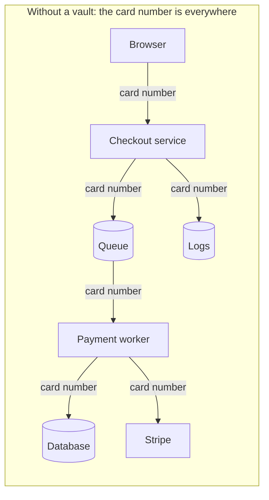

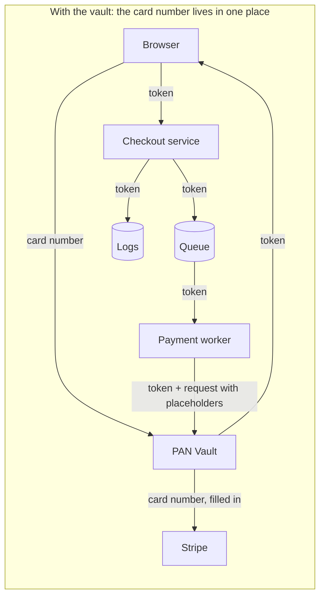

---

## 2. What a tokenizer (vault) is

### The short version

Think of a **coat check**. You hand over your coat and get a numbered ticket. The ticket is worthless to a thief: it's just a number, and it can't keep anyone warm. Only the cloakroom can match it back to your coat, and the cloakroom only hands the coat back under strict rules.

The PAN Vault is that cloakroom, and the coat is the card number:

- The customer's browser hands the card to the vault.
- The vault locks it away and returns a **token**, a random string like `tok_4f3a9c…`.
- Our platform stores and passes around only the token.
- When Stripe needs the real card, the platform hands the vault the token together with the request it wants made, leaving blanks where the card details go. The vault checks the request against an approved list, fills in the blanks and makes the call to Stripe itself. The card goes straight from the vault to Stripe, and our platform never touches it.

A token is not an encrypted card number. It is pure randomness with no mathematical link to the card, so even unlimited computing power cannot turn a token back into a card number. The only way back is to ask the vault, and the vault doesn't give card numbers back to anyone.

### The deeper dive

There are several kinds of tokenization. This vault uses **vault-based random tokenization**:

| Approach | How a token is made | Can the token be reversed without the vault? | Used here? |
|---|---|---|---|
| Random token + lookup table | Random bytes; the vault stores a token → encrypted card mapping | No, there is nothing to reverse | **Yes** |
| Format-preserving encryption (FPE) | The card number is encrypted into another 16-digit number | Yes, with the key | No |
| Hash-based | A one-way hash of the card number | It can be brute-forced: the PAN space is small and BINs are public | No |

The token format is `tok_` followed by 32 lowercase hex characters (16 bytes from a cryptographically secure random generator). It carries no information: no BIN, no last four digits, no expiry. The vault returns `last4` and the expiry separately so the checkout UI can display "Visa ending 4242". Those values are not secret under PCI DSS.

Two properties make this vault different from a plain "encrypt and store" service:

1. **It never returns a card number.** There is no "detokenize" endpoint, not even an admin or debug one.
2. **It acts on the card instead of handing it out.** The caller builds the provider request with **placeholders** such as `{{pan}}` and supplies a token. The vault checks the request against a reviewed, compiled-in **catalog** of allowed endpoints and fields, fills in the card and its own provider credential, and sends it to a host the catalog chooses.

This "proxy, don't reveal" model is designed to keep the platform's back end out of PCI scope, subject to the assessor's scoping. The checkout page is a separate matter (see [§5](#5-how-the-vault-shrinks-our-scope)).

---

## 3. PCI DSS in plain terms

### The short version

**PCI DSS** (Payment Card Industry Data Security Standard) is the rulebook that every business handling card numbers must follow. It's written by the major card brands (Visa, Mastercard, American Express, Discover and JCB) through an organization called the **PCI Security Standards Council**.

The rulebook has twelve broad requirements, such as "protect stored card data", "restrict access", "log and monitor everything" and "test security regularly". Each requirement breaks down into hundreds of detailed checks.

The key idea is **scope**. The rules apply in full to every system that stores, processes or transmits card numbers. They also apply to every system that is connected to those systems or could affect their security. That zone is called the **Cardholder Data Environment (CDE)**. Anything inside it has to meet the full rulebook and be checked by an auditor, often every year.

### The deeper dive

**The twelve requirements**, grouped under six goals:

| Goal | Requirements |
|---|---|
| Build and maintain a secure network and systems | 1. Network security controls · 2. Secure configurations |
| Protect account data | 3. Protect stored account data · 4. Protect data in transit with strong cryptography |
| Maintain a vulnerability management program | 5. Protect against malicious software · 6. Develop and maintain secure systems and software |
| Implement strong access control | 7. Restrict access by need to know · 8. Identify users and authenticate access · 9. Restrict physical access |
| Regularly monitor and test networks | 10. Log and monitor all access · 11. Test security regularly |
| Maintain an information security policy | 12. Support security with organizational policies and programs |

**Who checks compliance, and how?** That depends on transaction volume (the merchant or service-provider "level") and on how card data is handled:

- **Large organizations** (Level 1) need an annual on-site assessment by a **Qualified Security Assessor (QSA)**. It produces a **Report on Compliance (ROC)** and an **Attestation of Compliance (AoC)**.
- **Smaller organizations** may fill in a **Self-Assessment Questionnaire (SAQ)**. The SAQ type reflects how much card data they touch:
  - **SAQ A**: card handling is fully outsourced, for example a payment page hosted by the provider. This is the shortest questionnaire.
  - **SAQ A-EP**: e-commerce where the merchant's website can affect the security of the payment page, even though the card goes elsewhere.
  - **SAQ D**: everything else, including anyone who stores card numbers. This is effectively the full standard.
- Most levels also require **quarterly external vulnerability scans** by an Approved Scanning Vendor (ASV), along with internal scans and periodic penetration tests.

**Scoping rules that matter for us:**

- **Encrypted card data is still card data.** It stays in scope unless the system holding it has no access to the decryption keys. That's why the vault keeps its key-encryption key in a separate project, in a hardware security module.
- **"Connected-to" systems are in scope too.** A system that can reach the CDE, or that could affect its security, is pulled in unless it's properly segmented.
- **Tokens are not card data.** A system that only handles tokens, and cannot use them to get the card back, can fall out of scope. The PCI SSC's tokenization guidance describes this.
- **Sensitive authentication data (the CVV) must not be stored after authorization**, even encrypted. The vault keeps it only in memory and uses it at most once. It expires 15 minutes after tokenization and is wiped from memory within about a minute after that, unless it was used or dropped sooner.

> The final word on scope always belongs to your assessor. This document explains how the vault is designed to minimize scope; it isn't a compliance determination.

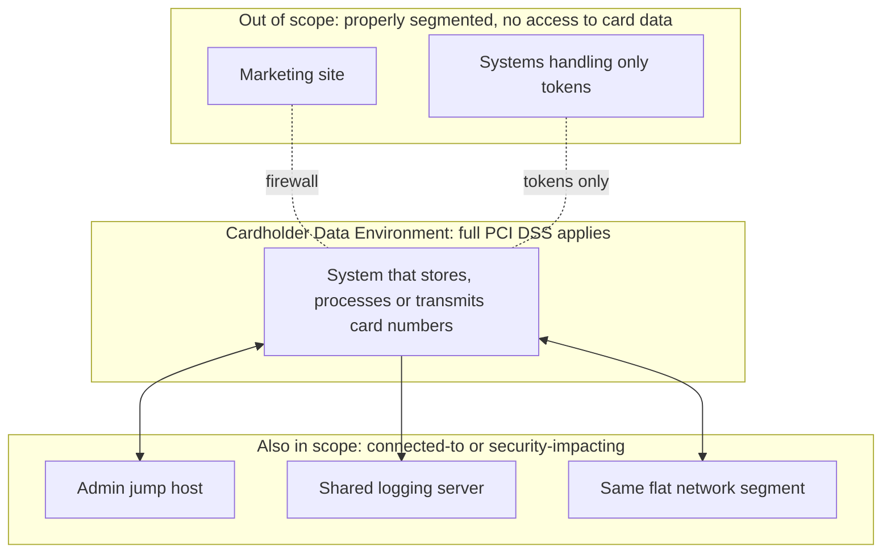

---

## 4. Why shrinking PCI scope is a big deal

### The short version

Every system inside the PCI zone has to be locked down, documented, monitored, scanned, patched on a schedule and shown to an auditor. That costs time and money, and it slows teams down. A change to a system in scope may need extra review and evidence.

If card numbers only ever exist inside one tiny, purpose-built service, then only that service carries the heavy burden. The rest of the platform can move fast. It is also safer: an attacker who breaks into the platform finds only tokens, which are worthless to them.

### The deeper dive

| Dimension | Large scope (cards flow through the platform) | Small scope (cards confined to the vault) |
|---|---|---|
| **Audit effort** | Every service, database, queue, log pipeline, CI/CD runner and admin path is assessed | One service, its database, KMS and secrets |
| **Engineering speed** | Change control, segregation of duties and evidence collection for every team | Most teams ship normally; only vault changes need the strict process |
| **Attack surface** | Hundreds of components, any of which can leak a card number | One Go package (about 4,000 lines) and four SQL functions, which stays the same size as providers are added |
| **Breach impact** | Platform compromise means a card breach and forensic investigation | Platform compromise exposes tokens, which are useless outside the vault |
| **Logging and observability** | Logs must be scrubbed or treated as card data | Logs are free of card data by construction |
| **Third-party tools** | APM, error trackers and analytics all risk receiving card numbers | No card number reaches them |
| **Cost** | Scanning, penetration testing, hardening and monitoring across the whole estate | Concentrated on a small, stable component |

Scope reduction is also a security strategy in its own right, not just paperwork. It means fewer places to defend, fewer people with access and fewer ways to make a mistake.

---

## 5. How the vault shrinks our scope

### The short version

The vault draws a hard line around the card number:

- **Inside the line:** the vault itself, its private database and its keys. These live in a dedicated, locked-down cloud project.
- **Outside the line:** everything else. The platform stores tokens, calls the vault with tokens, and gets back the provider's answer with any card number blanked out.

The card goes straight from the customer's browser to the vault, and straight from the vault to the payment provider. The platform is never in the middle.

### The deeper dive

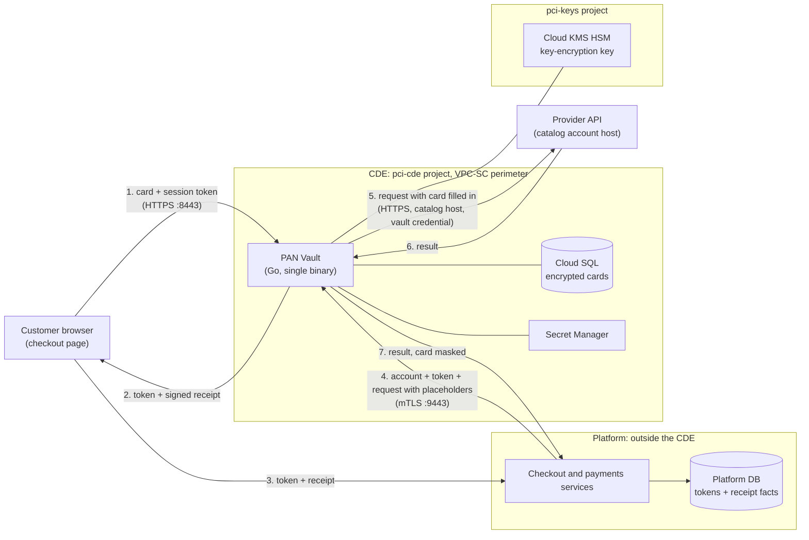

**What the platform sees:** tokens, `last4`, expiry month and year, the BIN (the first 6 or 8 digits) and the cardholder name from the signed receipt (see [§6.2](#62-the-signed-receipt)), and provider responses with any echoed card number replaced by `****4242`.

**What the platform never sees:** a full card number or a CVV. There is no API that returns them.

**Where the line is enforced:**

| Boundary | Mechanism |
|---|---|
| Browser → vault | A dedicated public listener that serves only `POST /tokenize`. It requires an exact `Origin` match and a short-lived session token minted by the platform. |
| Platform → vault | A separate internal listener that requires a client certificate (mTLS) signed by one pinned CA. It serves only `POST /proxy` and `GET /healthz`. |
| Vault → database | The vault's database role (`vault_app`) can only call three functions: `put_card`, `get_card` and `list_deks`. It has no table access at all. Adding a key (`add_dek`) needs a separate role, `vault_rotator`. |
| Vault → KMS | The key-encryption key is in a different project and never leaves the HSM. |
| Vault → internet | Only the hosts of this environment's catalog accounts, enforced in code and by the VPC egress firewall. |

**An honest caveat about the checkout page.** The card number does pass through the customer's browser, inside a page our platform serves. Whoever controls that page's JavaScript could in theory change where the card is sent. So the page that hosts the card form, and the systems that serve it, are usually still in a reduced scope (comparable to SAQ A-EP for a merchant). PCI DSS v4.0 also adds requirements for managing and monitoring scripts on payment pages. The vault is designed to take the back end (APIs, databases, queues, logs, workers) out of scope, subject to the assessor's scoping. It does not take the payment page itself out of scope. Serving the card form from a vault-controlled origin, for example in an iframe, would shrink this further and is a possible future step.

---

## 6. How the vault works, step by step

### The short version

The vault does exactly two jobs:

1. **Tokenize.** It receives a card from the browser, and optionally the cardholder's name. It checks the card, encrypts it, stores it and returns a token, together with a **signed receipt**: a tamper-proof note of the card's first and last digits, expiry and name that the platform can keep.
2. **Proxy.** The platform sends the vault a token, the name of one of our payment-provider accounts, and the complete request it wants sent to that provider. The request has blanks, such as `{{pan}}`, wherever the card details go. The vault checks the request against a reviewed rulebook (the **catalog**). If the request passes, the vault decrypts the card, fills in the blanks and its own provider password, and sends the request to that account's provider. It returns the answer with any card number blanked out.

Think of a form letter. The platform writes the letter and leaves blanks for the card. The vault checks it against an approved template: the right recipient, blanks only in the approved spots, nothing that would make the provider keep the card. Then the vault fills in the blanks, signs it with our own signature and posts it to an address the vault chooses. The platform never sees the filled-in letter.

It does nothing else.

### The deeper dive

#### 6.1 Tokenize: browser → vault

Before showing the card form, the platform mints a **session token** for that checkout:

```
v1.<expires_unix>.<hex(HMAC-SHA256(key, "v1." + expires_unix))>
```

It is valid for at most 15 minutes. It isn't tied to a card, and it proves that "this browser was sent here by our platform". This stops strangers on the internet from using the vault as a free card-number validator.

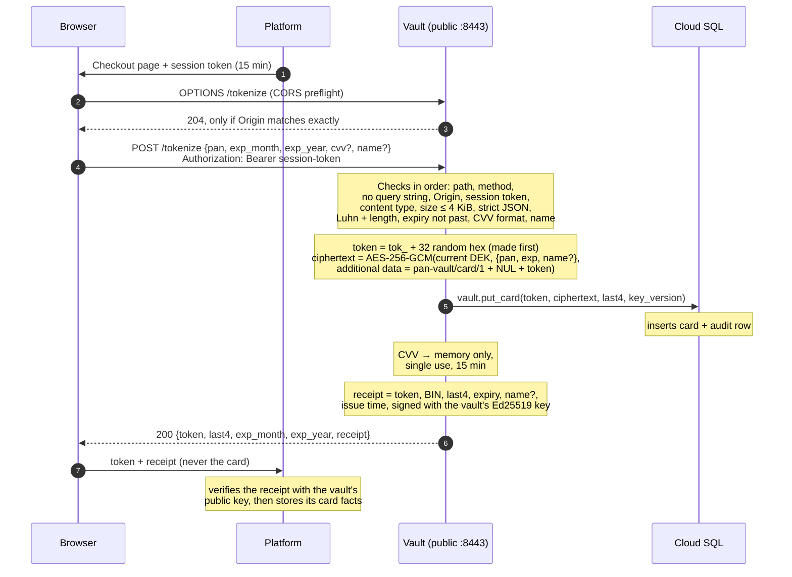

Key details:

- **The CVV is never stored.** It sits in a memory cache, as bytes that are overwritten when the entry is removed (best effort, like all clearing of Go memory). It is removed when a `/proxy` call reads it, when the provider accepts any `/proxy` call for that card with a 2xx (see 6.3 below), or when it expires 15 minutes after tokenization. Expired entries are swept every 60 seconds, and also when the cache is full, so even an idle instance holds an expired CVV for at most about a minute. The cache holds at most 50,000 CVVs. When it is full, `/tokenize` still stores the card and returns 200, but doesn't cache the CVV and logs `ALERT cvv_cache_full` (at most once a second). A later `{{cvv}}` request for that card gets the usual 409. Live CVVs are never evicted to make room.
- **The cardholder name is optional.** If given, it must be 1–100 characters of valid UTF-8 with no control characters (`"name": null` is rejected). It is encrypted together with the card and only used where a provider request has a `{{name}}` placeholder. The vault returns it only inside the signed receipt (see 6.2 below), to the browser that supplied it. A provider's response may also echo it (a Stripe token's `card.name`, for example), and that response reaches the platform as is: the vault masks only card numbers, not names. A card tokenized without a name can't fill `{{name}}`: that `/proxy` call gets `409 {"error":"name unavailable"}`.
- **The response carries a signed receipt.** Besides `token`, `last4` and the expiry, which the checkout page can show, `/tokenize` returns `receipt`, which also carries the BIN and the name (see 6.2 below). The BIN and the name never appear as top-level fields, and the receipt is never logged.
- **A query string is rejected outright.** This guarantees a card number can never end up in a URL, and so never in any URL-based log along the way.
- **The browser gets the same error format whatever goes wrong**: `{"error":"invalid pan"}` and the like. That format never echoes input back.

#### 6.2 The signed receipt

The platform needs a few facts about each card: its brand and issuer, how to show it to the customer, and when it expires. It can't ask the vault later, because the vault has no endpoint that returns card data. It can't trust the browser to report them either, because whoever controls the checkout page's JavaScript could report anything. So `/tokenize` also returns a **receipt**: a short statement of the card facts, signed by the vault.

```
rcpt.v1.<base64url(payload JSON, no padding)>.<base64url(Ed25519 signature over "rcpt.v1." + base64url payload, no padding)>
```

The payload is compact JSON with these keys, in this order:

```json
{"token":"tok_…","bin":"42424242","last4":"4242","exp_month":"12","exp_year":"2030","name":"JANE Q DOE","iat":1793456789}
```

- `token`: the token issued for this card.
- `bin`: the card's **BIN**: 8 digits for a 16-digit card, 6 otherwise. The 8-digit form follows the PCI SSC truncation table for 16-digit numbers (at most the first 8 and last 4 digits); other lengths use 6 until the card brands' guidance says otherwise. With `last4` this always leaves digits hidden: even a 13-digit card keeps 3.
- `last4`, `exp_month`, `exp_year`: the same values as in the response.
- `name`: the cardholder name exactly as given. It is omitted when the card was tokenized without one.
- `iat`: when the vault issued the receipt, in Unix seconds.

**Signed with Ed25519, verified with a public key.** The vault signs with an Ed25519 private key whose seed only the vault holds (see [§9](#9-running-it-safely)). The platform verifies with the matching **public key**, which is not a secret. So the checkout service, support tools and reporting can all check receipts, and none of them can create one. The payload is encoded once and the signature covers exactly those bytes, so a verifier never re-serializes it. [§11.4](#114-verifying-a-receipt) shows how to verify.

**What the platform does with it:**

1. The browser forwards `receipt` to the platform together with the token.
2. The platform verifies the receipt with the vault's public key, and checks that its `token` is the token it received, before storing anything from it. An invalid receipt is rejected as a whole, never partly trusted.
3. The platform stores the BIN, last four, expiry and name next to the token.

**Why the platform may keep these facts.** A card number truncated to the BIN (8 digits for a 16-digit card, 6 otherwise) and the last four, even with the expiry and the name, is not cardholder data. Holding these facts therefore doesn't bring the platform's back end into the CDE; whether the back end is out of scope also depends on its segmentation from the CDE and on the assessor's scoping (see [§5](#5-how-the-vault-shrinks-our-scope)). The platform must also follow three rules:

- **Customers see only the last four.** The BIN together with the last four may be shown only to staff with a business need (PCI DSS requirement 3.4.1).
- **No hash of the card number.** Never store a hash of the card number next to the truncated number: together they narrow a brute-force search, and PCI treats the pair as a control gap. The vault never produces such a hash.
- **The platform derives the card's details from the BIN.** Brand, issuer, country and card type come from the platform's own BIN data (a licensed database or prefix rules), which the platform keeps current without changing the vault.

The receipt is never logged, and neither is the seed that signs it. A receipt holds at most 8 + 4 digits of the card number, in separate fields, so it never looks like a card number to the log leak scan ([§7.6](#76-nothing-sensitive-in-logs-by-construction)).

#### 6.3 Proxy: platform → vault → provider

The platform sends a JSON **envelope** of at most 64 KiB. Unknown fields are rejected:

```json
{
  "account": "stripe_test",
  "token": "tok_4f3a9c…",
  "request": {
    "method": "POST",
    "path": "/v1/tokens",
    "headers": { "Idempotency-Key": "ord-123" },
    "body": "card[number]={{pan}}&card[exp_month]={{exp_month}}&card[exp_year]={{exp_year}}&card[cvc]={{cvv}}&card[name]={{name}}"
  }
}
```

`body` is the provider's raw body as a string, in the provider's format (`json` or `form`). The vault sends exactly those bytes, with only the placeholders replaced.

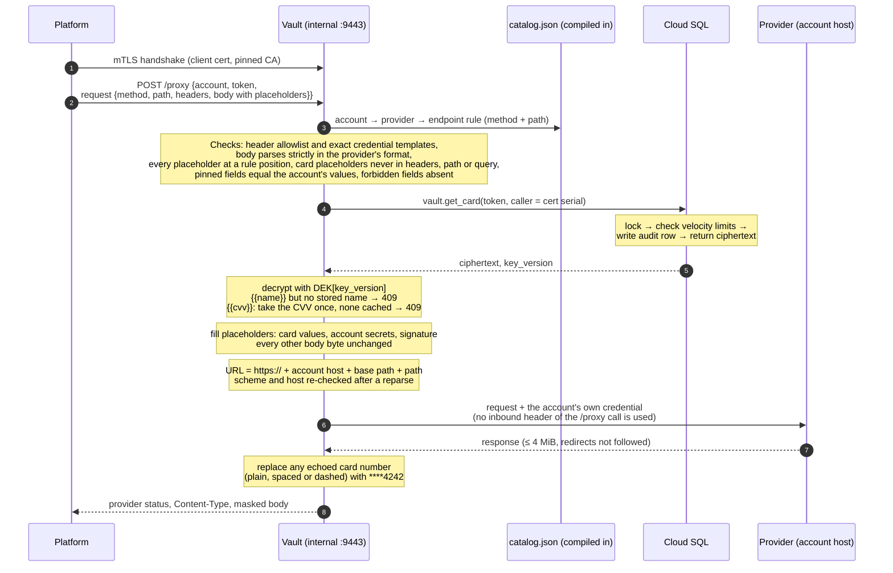

Key details:

- **The platform writes the request. The catalog decides what may be sent.** `catalog.json` is compiled into the binary. For each provider it lists the allowed endpoints (method and path). For each endpoint it gives the exact body positions where each placeholder may appear, the credential header templates, the **pins** (fields that must equal one of the account's values, such as Adyen's `merchantAccount`) and the **forbidden** fields (card-saving flags). Anything else is rejected before the database is touched.
- **Placeholders** are a fixed vocabulary:

  | Placeholder | Becomes | Allowed in |
  |---|---|---|
  | `{{pan}}`, `{{cvv}}`, `{{name}}` | card number, cached CVV, stored cardholder name | rule-listed body positions |
  | `{{exp_month}}` / `{{exp_month:int}}` | `"03"` / `3` | rule-listed body positions |
  | `{{exp_year}}` / `{{exp_year:yy}}` / `{{exp_year:int}}` | `"2030"` / `"30"` / `2030` | rule-listed body positions |
  | `{{exp:yyyy/mm}}` / `{{exp:mm/yy}}` | `"2030/03"` / `"03/30"` | rule-listed body positions |
  | `{{secret:NAME}}` | the account's secret NAME | rule-listed header templates or body positions |
  | `{{basic:NAME}}` | base64(secret NAME + ":") | rule-listed header templates |
  | `{{signature}}` | output of the endpoint's named signer (e.g. `payu`) | rule-listed header templates or body positions |

  A placeholder must be a whole value (no `"{{exp_month}}/{{exp_year}}"`). Each card placeholder may appear at most once. Card placeholders are never allowed in a header, the path or the query. Anything that looks like a placeholder but isn't one of these, or sits anywhere else, is rejected. It is never sent literally.
- **The account chooses the destination and the credential.** The platform names an account, such as `stripe_test`. The URL is always `https://` + the account's host + its base path + the request path, and the vault re-checks the scheme and host after building it. The platform can't name a host.
- **The credential is the vault's.** Account secrets are loaded from Secret Manager at boot. A credential header must be exactly its catalog template (for example `Authorization: Bearer {{secret:secretKey}}`). The platform may send that template string or leave the header out, and the vault renders it either way. Any other value, including a lowercase `authorization: Bearer sk_attacker`, is rejected. A credential body field likewise accepts only its vault placeholder. No HTTP header of the `/proxy` call itself is ever used.
- **Platform headers travel in `request.headers`, and only three are allowed:** `Accept`, `Idempotency-Key` and `X-Idempotency-Key`, each 1–1024 bytes of printable ASCII. Any other header is rejected with `header not allowed`, not silently dropped, so platform bugs show up. The vault itself sets `Host`, `Content-Type` (from the provider's format), `Content-Length` and `User-Agent: pan-vault/1`. Only the status, `Content-Type` and body come back.
- **The CVV is used at most once, and only when all checks pass.** If the body uses `{{cvv}}` and no CVV is cached (already used, expired, or tokenized on another instance), the answer is `409 {"error":"cvv unavailable"}`. The platform resends without the CVV field, for example for a card-on-file charge. The vault never edits the body to drop a field. A 2xx answer from the provider means the card has left the vault, so the vault also drops any CVV still cached for that token, whether or not the request used `{{cvv}}`, and even when it then refuses to relay the answer (a compressed response becomes a `502`). A retry that uses `{{cvv}}` then gets the 409. Any other status leaves an unused CVV cached for a retry. The drop only reaches the instance that holds the CVV. `/tokenize` and `/proxy` arrive through different load balancers, so a CVV cached on another instance stays there until it expires: 15 minutes after tokenization plus at most one sweep, about 16 minutes in the worst case.
- **Each ciphertext opens only under its own token.** A card is encrypted with its token as AES-GCM additional data (`pan-vault/card/1`, a NUL byte, then the token). A ciphertext copied into another token's row fails to decrypt and is answered with `500` and `ALERT decrypt_failed`. Nothing is sent to the provider. If the card's key version is one this instance doesn't hold yet (a key added moments ago), the vault first refreshes its keys from the database, at most once every 10 seconds (see §9). That can hold the request for up to about 30 seconds, within the internal listener's 60-second write timeout. If a slow refresh is followed by a slow provider, that timeout can expire before the answer is written. The platform should handle that like any provider timeout and retry with the same `Idempotency-Key`.
- **Rejections are specific and never echo input.** A policy failure is a `400` with one fixed message: `unknown account`, `endpoint not allowed`, `header not allowed`, `invalid placeholder use`, `pinned field mismatch`, `forbidden field` or `invalid request body`. Once the account is known, every rule failure also raises `ALERT proxy_policy` (see [§7.6](#76-nothing-sensitive-in-logs-by-construction)). An unknown account, a malformed token or a malformed envelope is rejected without an alert.
- **Redirects are never followed.** The vault ignores `HTTP_PROXY`, refuses compressed responses it can't inspect, and never returns a truncated body. Masking has a precise limit: the vault masks only this card's own number, as plain digits or in groups of four separated by spaces or by dashes. Other groupings (such as Amex's 4-6-5) and any other data a provider returns, such as a name or an error message, reach the platform as is, which is why each catalog endpoint's documented responses are reviewed before it is added.

#### 6.4 The life of a card

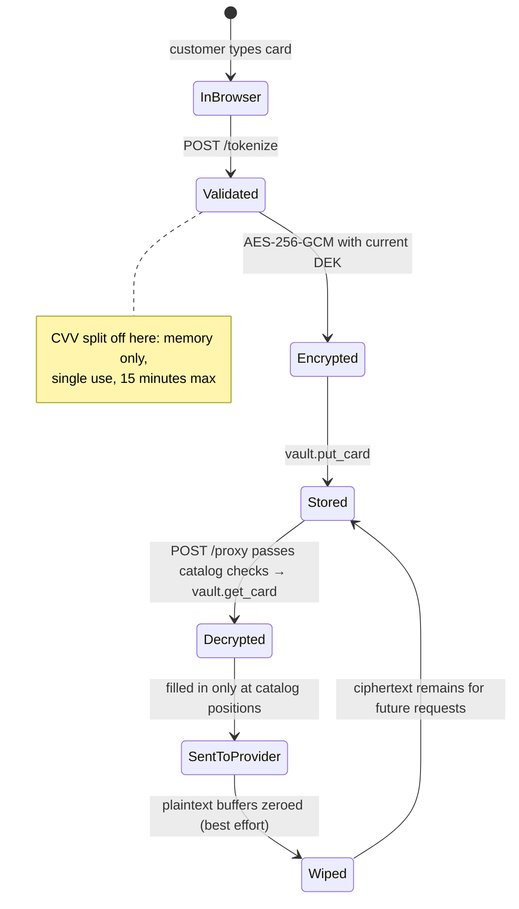

#### 6.5 The current catalog

The first `catalog.json` ships **Stripe only**, because Stripe is the one provider we can verify in CI (through Stripe's official `stripe-mock`). Adyen, Mercado Pago, PayU Latam and Pagar.me are already modelled in the test suite's synthetic catalog. Each will land as its own data-only change after it has been verified against that provider's sandbox.

| Account (env) | Provider (format) | Endpoint | What it creates | Card positions | Forbidden fields |
|---|---|---|---|---|---|
| `stripe_test` (dev) | `stripe` (form) | `POST /v1/tokens` | A single-use card token (`tok_…`) | `card[number]`, `card[exp_month]`, `card[exp_year]`, `card[cvc]`, `card[name]` | `customer` (Connect: a token cloned from a customer's saved card) |

So the Stripe flow is: the vault creates a single-use `tok_…` through `POST /v1/tokens`, and the platform, with its own Stripe key, charges it or creates a PaymentMethod from it (for example `POST /v1/payment_methods` with `type=card&card[token]=tok_…`). Those calls carry no card data, so they don't go through the vault. The vault itself never calls `POST /v1/payment_methods` with card data: a card PaymentMethod is reusable and can be attached to a customer, which is storage at the provider, so that endpoint is not in the catalog.

Every catalog endpoint carries card data and lists a `{{pan}}` position, and every `/proxy` request must contain `{{pan}}`. The vault's credential is only lent to card-carrying calls. Anything else (a payment with a provider token, a refund, a query, a Stripe `pii` token) is the platform's own call, made with its own keys.

There is no prod account yet, so `egress-hosts.prod.txt` is empty. To add a provider or an account, see [§11](#11-for-developers).

---

## 7. How the vault keeps us safe

### The short version

The vault assumes things will go wrong and limits the damage when they do:

- **If the platform is hacked**, the attacker still can't get card numbers. They can only ask the vault to send requests the rulebook allows, to our own provider accounts, with the card details only in approved fields, at a limited rate.
- **If the database is stolen**, the attacker gets scrambled data. The key to unscramble it lives in a separate, hardware-protected system.
- **If someone on the internet attacks the vault**, the payment endpoint is unreachable without a special certificate. The card endpoint is useless without a fresh ticket from our checkout.
- **If something unexpected happens**, the vault refuses instead of guessing.

### The deeper dive

#### 7.1 Who we defend against

| | Adversary | What they can do | What the design limits them to |
|---|---|---|---|
| **A** | **Compromised platform**, or an insider holding the platform's client certificate | Call `/proxy` with any token and any provider request | Only catalog endpoints of our own accounts, at the hosts the catalog gives. Card data only at rule positions, never in headers or URLs. Pinned account fields must match, card-saving fields are forbidden, only three platform headers are allowed, and the credential is always the vault's. No bulk reads. Lookups are rate-limited inside the database, which the platform can't change. |
| **B** | **Compromised vault process** (code execution, malicious build) | Has the data keys and the DB role | DB access is through single-row functions only, with no table reads. Velocity limits live in the database. Egress is firewalled to the providers. See the known limitation in [§10](#10-known-limitations-and-what-comes-next). |
| **C** | **Stolen database credentials** | Call `get_card` | Gets only AES-256-GCM ciphertext. The key isn't in the database. |
| **D** | **Internet attacker** | Reach `/tokenize` | Cannot reach `/proxy` at all (it needs mTLS). Can't use `/tokenize` as a card-validity oracle without a platform-minted session token. |
| **E** | **Rogue payment provider** | Receives card numbers legitimately | Out of scope for the vault. The egress allowlist stops traffic being redirected to a different provider. |

A tampered browser or checkout page can't forge card facts either: the BIN, last four, expiry and name the platform stores come from a receipt the vault signed (see [§6.2](#62-the-signed-receipt)), and only the vault holds the signing key.

Out of scope by design: compromise of the cloud project owner or KMS admin, a compromised Go toolchain, side-channel and physical attacks. These are covered by the cloud controls described in [§9](#9-running-it-safely).

#### 7.2 Layers of defense

No single control is trusted alone. An attacker has to defeat every layer in turn:

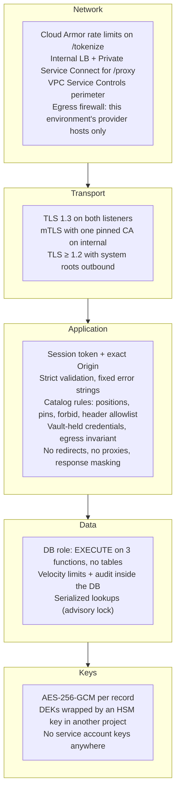

#### 7.3 What happens to an attacker who owns the platform

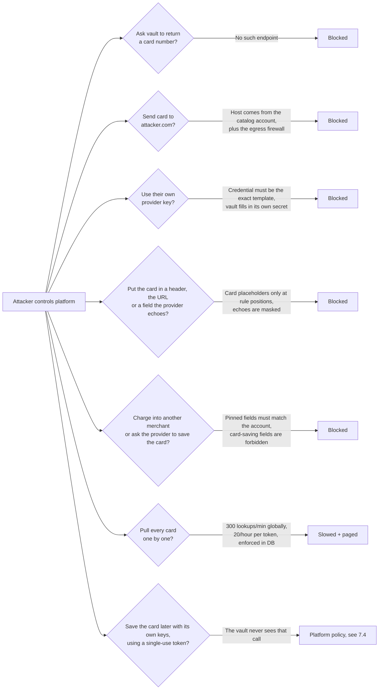

#### 7.4 What the vault cannot enforce: hand-off tokens

Some catalog endpoints create a **single-use hand-off**: a Stripe token (`/v1/tokens`) today, and later a Mercado Pago card token. The platform then uses that token with its own provider keys, for example to charge it.

With its own keys, the platform could also ask the provider to **save** the card, for example by creating a PaymentMethod from the Stripe token and attaching it to a customer. That call carries no card data and never goes through the vault, so the vault cannot stop it. This doesn't break confidentiality: the card stays at a PCI-certified provider, in our own account, and the platform still never sees the card number. It does break the goal that the vault is the only place cards live.

**So this is a platform rule: the platform must never save, attach or reuse a card through a hand-off token.** Platform code review and provider-side monitoring have to enforce it.

#### 7.5 Things the vault deliberately never does

- Store a CVV, magnetic-stripe data, a PIN or a PIN block.
- Send a provider request the catalog doesn't allow. The platform can't choose the host, the credential, an account-selecting field value, or any place for the card outside a rule position. There is no free pass-through mode.
- Send card data to an endpoint that stores the card at the provider, or that sends data to a caller-chosen URL.
- Grow provider-specific code. Providers, endpoints and accounts are catalog data. The only provider code allowed is a small named signer (today only `payu`).
- Offer any endpoint that returns, lists, searches, counts or deletes cards.
- Follow HTTP redirects from providers.
- Log request or response bodies or headers, at any log level.
- Read configuration, or the catalog, from a file or from the database at runtime.
- Run database migrations.
- Terminate the internal listener's TLS at a load balancer. It terminates in the vault, so the vault itself sees and logs the client certificate.

#### 7.6 Nothing sensitive in logs, by construction

There is exactly one access-log line per request:

```
2026-10-30T15:04:05Z req listener=internal method=POST path=/proxy status=200 dur=183ms caller=0A1B2C
```

- Paths and methods are logged only if they are known values. Anything else becomes `path=other` and `method=other`, so a card number typed into a URL can't reach the log.
- The only other lines are boot messages and these `ALERT` lines. One boot message prints the receipt public key (`receipt public key=…`), which is public by design. Receipts and the seed that signs them are never logged. Account and endpoint names come from the catalog, never from the request:

| Alert | Meaning |
|---|---|
| `ALERT proxy_policy account=… endpoint=… reason=…` | A `/proxy` request broke a catalog rule. `reason` is one of `endpoint`, `header`, `body`, `placeholder`, `pin` or `forbidden_field`, and `endpoint=-` means no endpoint matched. Possible compromised platform. At most one line per second. |
| `ALERT velocity token=… caller=… account=…` | A lookup limit was hit. Possible bulk extraction. |
| `ALERT pan_echo account=… endpoint=… token=…` | A provider echoed a card number. It was masked, but investigate. |
| `ALERT decrypt_failed token=… key_version=… account=…` | Ciphertext or key corruption, or a ciphertext copied into another token's row. This should never happen. |
| `ALERT egress_invariant account=…` | A request was about to leave for an unexpected host. This should be unreachable. |
| `ALERT session_token_invalid reason=…` | Bad, expired or forged session token. At most one line per second. |
| `ALERT cvv_cache_full` | The CVV cache is full (50,000 entries). New cards are still stored, but their CVV isn't cached. Possible `/tokenize` flood. At most one line per second. |

The test suite proves this. Every test logs into a shared buffer. After the run, the buffer is scanned for any 13–19-digit run that passes the Luhn check, including runs with spaces or dashes and runs buried inside longer digit strings. It is also scanned for the test CVV, the test provider secrets and the test cardholder name. Any match fails the build.

---

## 8. Why it is built the way it is

### The short version

The vault is deliberately **small, plain and strict**:

- **Small**, so one person can read all of it in a sitting and spot anything wrong. It also stays small as we add payment providers: a new provider is a reviewed entry in a rulebook, not new code.
- **Plain**: no frameworks, no clever tricks, and only one outside library. Every extra piece of code is something else that could be attacked.
- **Strict**: when in doubt, it says no.

Security code that is easy to read is easier to trust.

### The deeper dive

Each decision below gives the choice, the reason, and the trade-off we accepted.

**One Go package, a handful of files, no sub-packages.**
*Why:* a reviewer or auditor can still read the whole service top to bottom, and nothing hides in a corner of a package tree: it is one `package main` at the repo root. The files are split by responsibility so the security core (`scan.go`, `policy.go`, `render.go`, `catalog.go`) can be audited on its own, without paging through boot and HTTP plumbing. The split adds no abstraction: no exported APIs, interfaces or generics, and any file can use anything in the package, exactly as when it was one file. *Trade-off:* a reader jumps between files instead of scrolling one, and file boundaries are a convention, not a compiler-enforced wall. There is still some repetition. Repetition is preferred over abstraction because abstraction hides behaviour.

**Standard library plus exactly one dependency (pgx, the Postgres driver).**
*Why:* every third-party module is supply-chain risk inside the CDE. There is no HTTP framework, logging library, ORM or cloud SDK. Google APIs are called with plain `net/http`. *Enforced by:* `make deps-check` (go.mod and a go.sum baseline) and `make vendor-check` (the vendored code must match the official module byte for byte). *Trade-off:* a little more code for KMS and Secret Manager calls.

**A lean vault: the platform builds the request, the catalog bounds it.**
*Why:* we need many providers (first wave: Stripe, Adyen, Mercado Pago, PayU Latam and Pagar.me) and several accounts per provider. If every provider operation were a Go function, the vault's code would grow with every provider. Instead the platform builds the complete provider request with placeholders, and the vault only checks it against the rules, fills it in and sends it. Adding a provider, an endpoint or an account is a data-only change to `catalog.json`, plus secrets in Secret Manager. *Trade-off:* the catalog rules carry the security weight that builder code used to carry, so every catalog change gets a strict review checklist (see [§11](#11-for-developers)).

**The catalog is code, not configuration.**
*Why:* `catalog.json` is embedded into the binary at build time and never read from disk, a database or the environment at runtime. A runtime-editable allowlist would be the first thing an attacker edits. It is strictly validated at boot and by a unit test: unknown keys, duplicates, bad paths or hosts, unknown placeholders or signers, and missing secrets are all fatal. Because builds are reproducible, the image digest attests the exact catalog running in production. Every account is tagged `dev` or `prod`, so the same reviewed image is promoted from dev to prod and loads only its own environment's accounts. *Trade-off:* adding a provider is still a release, just not a code change.

**Placeholders at exact positions, never a template language.**
*Why:* the vocabulary is fixed (`{{pan}}`, `{{cvv}}`, `{{name}}`, expiry formats, `{{secret:…}}`, `{{basic:…}}`, `{{signature}}`). A placeholder must be a whole value, at a position the rule names. Body parsers for `json` and `form` are strict: duplicate keys, trailing data, invalid encoding, escaped or percent-encoded placeholders, and form keys outside a narrow grammar are all rejected. The bytes sent are exactly the bytes checked plus the substitutions, so no parser difference between the vault and the provider can move the card. *Trade-off:* a provider that needs a literal `{{` in its data, or a concatenated value, isn't supported until we add a format for it. XML can be added later as one more parser, without changing the model.

**Verify, don't rewrite.**
*Why:* pinned fields (such as Adyen's `merchantAccount`) are checked against the account's values, and forbidden fields are checked to be absent. The vault never overwrites or drops anything in the platform's request: a mismatch is rejected. Unknown headers are rejected, not dropped. That way a platform bug or attack shows up as an error and an alert, instead of being quietly "fixed". *Trade-off:* the platform has to get every request exactly right.

**Named signers, not a signing language.**
*Why:* some providers sign each request (PayU hashes the API key, merchant ID, reference and amount). A general "signature recipe" in the catalog would be a small programming language inside the allowlist. Instead each scheme is a small named Go function (today only `payu`) that reads account secrets and body fields, never card data. This is the only provider-specific Go code allowed. *Trade-off:* a provider with a new signing scheme needs one new reviewed function.

**Fail closed.**
*Why:* an ambiguous input, missing config or unexpected state means rejection. For example: duplicate JSON keys, a duplicate `Origin` header, `"cvv": null`, a body field that differs from a checked field only in letter case, a compressed provider response, or a database URL without certificate verification in production. *Trade-off:* an unusual but legitimate client may get a `400` and have to adjust.

**Database access only through `SECURITY DEFINER` functions.**
*Why:* the app's role, `vault_app`, cannot `SELECT` from any table. It can only call `put_card`, `get_card` and `list_deks`. A compromised vault can't run `SELECT * FROM cards`. Every lookup is audited, and the audit can't be skipped by the application. *Trade-off:* schema changes go through a migration pipeline run by a separate owner role, never by the vault.

**Velocity limits inside the database, serialized with a lock.**
*Why:* limits enforced in the app could be switched off by whoever controls the app. In the database they are outside the platform's and the app's reach: 300 lookups a minute globally and 20 an hour per token. An advisory lock makes parallel requests queue instead of all slipping past the count at once. Without the lock, 50 simultaneous lookups let 27 or 28 through instead of 20. *Trade-off:* lookups run one at a time, at a few milliseconds each. That's far more than the limit allows anyway.

**Envelope encryption with an HSM-backed key.**

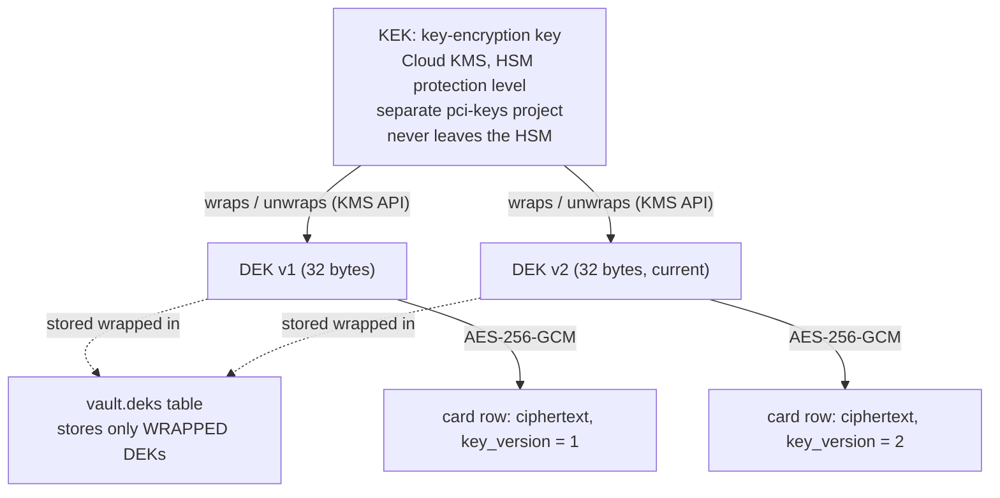

*Why:* the database holds only ciphertext and wrapped keys. Unwrapping needs a call to KMS in a different project, with its own IAM and audit logs. Each record uses a fresh 12-byte random nonce and carries its token as additional authenticated data (`pan-vault/card/1`, a NUL byte, then the token), so a ciphertext decrypts only under the token it was stored with. We recommend a new data key every month. Each key then covers about a month of cards, which keeps the set of old keys every instance unwraps at boot small (about twelve a year), at the price that one exposed data key reveals up to a month of cards rather than a day's. The KMS key rotates every 90 days. KMS decrypt accepts older key versions, so wrapped DEKs stay readable after a KMS rotation, but they stay wrapped under the version that wrapped them: rewrapping existing DEKs under the newest KMS key version is v1.1 work. *Trade-off:* boot depends on KMS being available, and old data keys are kept so old cards stay readable. Re-encrypting old rows is planned for v1.1.

**Two listeners, two trust models.**
*Why:* the browser-facing listener and the platform-facing listener have completely different callers. Separate ports, TLS settings and handlers mean a bug on one side can't expose the other. *Trade-off:* two load balancers to operate.

**No redirects, no proxies, strict TLS on the way out.**
*Why:* a redirect or an `HTTP_PROXY` environment variable could silently send a card somewhere else. The outbound client ignores both, verifies TLS 1.2 or higher against system roots, and caps responses at 4 MiB. *Trade-off:* none in practice.

**A `scratch` container, run as non-root, with reproducible builds.**
*Why:* the image contains the binary, CA certificates and a one-line passwd file, and nothing else: no shell and no package manager. The build is reproducible, so two builds of the same commit produce the same digest and anyone can check that a running image came from reviewed code, catalog included. *Trade-off:* no shell for debugging. That is intentional, since nobody should be debugging inside the CDE.

**No service account keys, no config files.**
*Why:* credentials come from the GCE metadata server (Workload Identity) and Secret Manager at boot. Configuration comes only from environment variables. There's nothing on disk to steal or tamper with. *Trade-off:* local development uses explicit `VAULT_DEV_*` variables, and the binary refuses to start if any of them is set in production.

**Tested like it matters.**
*Why:* the spec's whole test list is implemented. That includes the log-leak scan, database privilege tests against a real Postgres, an end-to-end run over real mTLS listeners, key rotation, negative tests for every catalog rule against a synthetic catalog that models all five first-wave providers, and a request-shape check that sends platform-built requests through the real `catalog.json` to Stripe's own API mock (`stripe-mock`). *Trade-off:* the test file is larger than the code, which is normal for security software.

---

## 9. Running it safely

### The short version

The vault is only as safe as the environment it runs in. It belongs in its own locked-down cloud projects, with no standing human access. Its keys get rotated on a schedule, and every `ALERT` line pages someone.

### The deeper dive

**Cloud layout** (Google Cloud):

| Project | Contains |
|---|---|
| `pci-cde-<env>` | Vault VMs (managed instance group of 2 Shielded VMs, Container-Optimized OS, no SSH), Cloud SQL (Postgres 18, private IP, CMEK, pgaudit), Secret Manager. Nothing else, ever. |
| `pci-keys-<env>` | Cloud KMS key ring with the HSM-protected key-encryption key. |
| `pci-logs` | Audit log sink with Bucket Lock, retained for at least one year. |

Org policies on the `pci` folder deny external IPs and service-account key creation, and require Shielded VMs and CMEK. There's no standing human IAM on the CDE project: break-glass access is time-boxed and goes through Access Approval.

**Key rotation:**

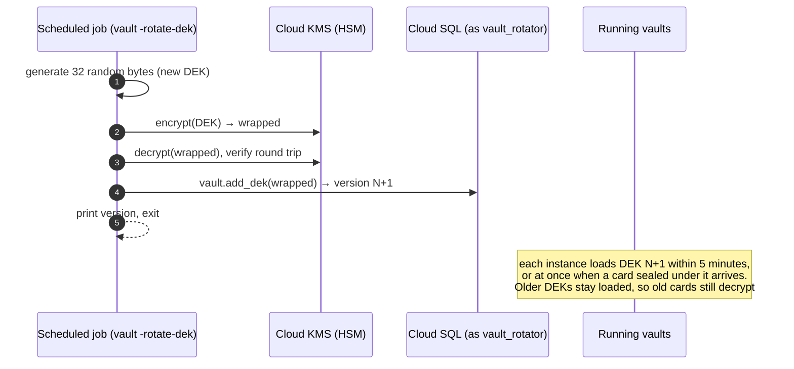

**Rotation schedule and key refresh.** Run `vault -rotate-dek` monthly (the trade-off is in [§8](#8-why-it-is-built-the-way-it-is)). No restart is needed afterwards. Every instance re-reads the key list every 5 minutes, and an instance that meets a card sealed under a key version it doesn't hold refreshes at once, at most once every 10 seconds, each refresh limited to 30 seconds. New keys are added to the ones an instance holds, and none is ever dropped, so a rolling restart is no longer needed and no longer causes `decrypt_failed`. One case remains: if KMS or the database is unreachable at the moment an instance first meets a new key version, or that instance's last refresh finished less than 10 seconds earlier, before the key existed, requests for cards under that key fail on that instance with `decrypt_failed` for up to 10 seconds (the refresh rate limit), and succeed once a refresh gets through.

**Responding to alerts:**

| Alert | Severity | First steps |
|---|---|---|
| `pan_echo` | Page immediately | Find out which account and endpoint echoed a card number. The vault masked it, but confirm nothing else captured it. |
| `decrypt_failed` | Page immediately | Possible key or data corruption, or a ciphertext copied into another token's row. Check KMS key state and the DEK versions. |
| `egress_invariant` | Page immediately | Should be impossible. Treat it as a possible compromise of the vault binary. |
| `proxy_policy` | Page | The platform sent a request the catalog forbids. Possible compromised platform. Match it to the `/proxy` access-log lines with `status=400` at the same time to find the client certificate (`caller=`). A burst right after a platform deploy is more likely a platform bug. |
| `velocity` | Page | Possible bulk extraction attempt. Check which client-certificate serial (`caller=`) made the lookups. |
| `session_token_invalid` (rate spike) | Notify | Card-testing or misconfigured checkout. Check Cloud Armor. |
| `cvv_cache_full` | Notify | The CVV cache hit its 50,000-entry cap. Checkouts still work, but cards tokenized meanwhile have no cached CVV, so `{{cvv}}` requests for them get 409. Check Cloud Armor and the `/tokenize` traffic for a flood. |

**Deployment prerequisites:**

- **Database TLS.** In production, `VAULT_DB_URL` must verify the server certificate, or the vault won't boot. Use `sslmode=verify-ca&sslrootcert=/path/to/server-ca.pem` with Cloud SQL's server CA. `verify-full` usually fails against a private IP.
- **Cloud SQL identities.** The vault and the rotation job each run as their own IAM service account, for example `pan-vault@pci-cde-<env>.iam.gserviceaccount.com` (serving) and `pan-vault-rotator@pci-cde-<env>.iam.gserviceaccount.com` (rotation). Each one is added to the Cloud SQL instance as an IAM database user, whose Postgres username is the account's email without `.gserviceaccount.com`. The migration pipeline, connected as `vault_owner`, then grants each one its role:

  ```sql
  GRANT vault_app     TO "pan-vault@pci-cde-<env>.iam";
  GRANT vault_rotator TO "pan-vault-rotator@pci-cde-<env>.iam";
  ```

  `VAULT_DB_URL` names that IAM username, URL-encoded and without a password, for example `postgres://pan-vault%40pci-cde-<env>.iam@<private-ip>:5432/vault?sslmode=verify-ca&sslrootcert=…`. In production the vault sends its service account's access token as the password (Cloud SQL IAM database authentication).
- **Cloud SQL smoke test.** Before the first deploy to an environment, and after any change to its IAM users or database roles, check against the real Cloud SQL instance that the serving account can log in with its IAM token and call `put_card`, `get_card` and `list_deks`, but can't read any table or call `add_dek`, and that the rotator account can call `add_dek`. This is a step in the deploy pipeline, not a test in this repository.
- **A reviewed account for the environment.** The vault refuses to boot when the catalog has no account for its `VAULT_ENV` (`catalog has no accounts for env=prod`), because a vault that can't send a card anywhere would otherwise look healthy. The first prod deploy therefore needs a reviewed prod account in `catalog.json`, with its host in `egress-hosts.prod.txt`.
- **Health checks.** The load balancers probe both listeners with plain TCP checks: the port accepts connections. Real readiness is checked separately, by a monitor that holds a platform client certificate and calls `GET /healthz` over mTLS, which also exercises the certificate chain and the database. There is deliberately no unauthenticated health route. The internal listener asks for a client certificate in the TLS handshake of every connection, and the vault serves nothing beyond `/tokenize`, `/proxy` and `/healthz`, so a probe path would mean either a new endpoint or weaker mTLS on the listener that serves `/proxy`.
- **Raw card data access at each provider.** By default Stripe refuses API requests that contain full card numbers. Live-mode access requires Stripe's approval, backed by PCI evidence (typically an SAQ D or an Attestation of Compliance). Other providers have similar gates, such as Adyen's "API PCI Payments role".
- **Account secrets.** Every secret named by a catalog account of the environment must exist in Secret Manager and be readable by the vault's service account, or the vault won't boot.
- **Platform client certificates.** The CA in `VAULT_CLIENT_CA` should issue certificates only to the platform services that are allowed to call `/proxy`.
- **Egress firewall.** For every provider host in `egress-hosts.dev.txt` or `egress-hosts.prod.txt`, that environment's firewall must allow only that provider's published IP ranges. The prod firewall allows only prod hosts.
- **Receipt signing key.** The receipt seed is 32 random bytes, stored in Secret Manager as exactly 64 hex characters with no trailing newline (for example `openssl rand -hex 32 | tr -d '\n' | gcloud secrets create receipt-key --data-file=-`). `VAULT_RECEIPT_KEY_SECRET` names it, and the vault's service account must be able to read it, or the vault won't boot. The platform needs only the public key, never the seed. Read the key from the boot log line `receipt public key=<base64url>`, or derive it from the seed with this Go program (`gcloud secrets versions access latest --secret=receipt-key | go run pubkey.go`, or offline before the seed is stored: `openssl rand -hex 32 | tr -d '\n' > seed.hex && go run pubkey.go < seed.hex`):

  ```go
  package main

  import (
  	"crypto/ed25519"
  	"encoding/base64"
  	"encoding/hex"
  	"fmt"
  	"io"
  	"os"
  )

  func main() {
  	in, err := io.ReadAll(os.Stdin)
  	if err != nil {
  		fmt.Fprintln(os.Stderr, "cannot read standard input")
  		os.Exit(1)
  	}
  	seed, err := hex.DecodeString(string(in))
  	if err != nil || len(seed) != ed25519.SeedSize {
  		fmt.Fprintln(os.Stderr, "expected exactly 64 hex characters and nothing else")
  		os.Exit(1)
  	}
  	fmt.Println(base64.RawURLEncoding.EncodeToString(ed25519.NewKeyFromSeed(seed).Public().(ed25519.PublicKey)))
  }
  ```

  The program reads standard input exactly as the vault reads the secret: anything other than exactly 64 hex characters, a trailing newline included, is refused, so a seed it accepts is one the vault boots with. Delete `seed.hex` once the seed is stored (`shred -u seed.hex` or equivalent); never commit it or leave it on the workstation.

  **Rotation** means a new seed, and so a new public key. Follow this order: a vault instance can boot at any moment (autohealing, scale-out, a crash), and one that boots with a seed whose public key the platform doesn't accept yet issues receipts the platform rejects.

  1. Generate the new seed offline and derive its public key with `pubkey.go` above.
  2. Add that public key to the platform's list of accepted public keys, and confirm the change is deployed everywhere that verifies receipts.
  3. Only then add the seed as a new version of the secret (the vault reads the latest version at boot) and restart the vaults.
  4. Keep both keys accepted until every instance runs the new seed and the checkouts that started before the switch have finished. Then remove the old key.

  During the changeover the platform verifies each receipt against every accepted key, and accepts it if any one of them verifies it.
- **Hand-off token policy.** Platform code must never save, attach or reuse a card through a single-use token the vault returned (see [§7.4](#74-what-the-vault-cannot-enforce-hand-off-tokens)).

---

## 10. Known limitations and what comes next

**Rolled-back lookups aren't counted (accepted for v1, risk RR-1).** Someone holding the vault's own database role (adversary B, in practice a compromised vault process) can look a card up inside a transaction and roll it back, which erases the audit row and its rate-limit count. The platform can't do this, `pgaudit` still records every call, and an audit write outside the caller's transaction is planned for v1.1. The full entry, with the compensating controls, the decision, its owner and the revisit trigger, is in the [risk register](docs/risk-register.md).

**CVV and multiple instances.** The CVV cache lives in each instance's memory. If a `/proxy` call lands on a different instance than the `/tokenize` call, the CVV isn't available, and a request that uses `{{cvv}}` gets `409 {"error":"cvv unavailable"}`. The platform can resend it without the CVV field. The same goes for dropping it: a provider's 2xx drops the CVV only on the instance that handled the `/proxy` call, so a CVV cached on another instance stays until it expires, about 16 minutes at most. This is a deliberate trade-off: sharing the CVV between instances would mean storing it somewhere.

**Hand-off tokens can be saved by the platform.** After the vault returns a single-use token, the platform could use its own provider keys to save the card at the provider. The vault never sees that call, so this is a platform rule, not a vault control. See [§7.4](#74-what-the-vault-cannot-enforce-hand-off-tokens).

**The checkout page stays partly in scope.** See [§5](#5-how-the-vault-shrinks-our-scope).

**Planned for v1.1:** re-encrypting old cards under the newest key (`rewrap_card`), rewrapping existing DEKs under the newest KMS key version, the audit write outside the caller's transaction that closes RR-1, a retention and purge function with its own role, and Cloud Armor tuning from real traffic.

**Next catalog entries:** Adyen, Mercado Pago, PayU Latam and Pagar.me, each after sandbox verification. An `xml` body format and more named signers will be added only when a real provider needs them.

---

## 11. For developers

### The short version

Everything is driven by `make`. `make ci` runs the checks every change must pass, and `make ci-all` adds the database, `stripe-mock` and reproducible-image checks. The vault reads its settings only from environment variables. The list of payment providers and accounts lives in `catalog.json`, which is built into the binary. Adding a provider or an account means editing that file, adding its secret to Secret Manager and updating the egress host list. No Go code changes. GitHub Actions runs the same checks on every pull request, and opt-in git hooks (`make hooks`) run the quick ones before each commit and push.

### The deeper dive

**Requirements:** Go 1.27.3 (downloaded automatically through `GOTOOLCHAIN`), Docker, `psql`, `curl`, `make`.

| Command | What it does |
|---|---|
| `make build` | Static, reproducible binary `./vault` |
| `make test` | Unit tests with the race detector. Integration tests skip unless a DB is configured. |
| `make lint` | gofmt, go vet, staticcheck (pinned, installed into `.tools/`) |
| `make vuln` | govulncheck |
| `make deps-check` / `make vendor-check` | Dependency allowlist, go.sum baseline, vendored code matches upstream |
| `make docs-check` | The three READMEs repeat none of the retired claims and have the same number of headings, table rows and Mermaid diagrams |
| `make comment-check` | No Go file refers to the spec or the design documents (`SPEC-DECISION`, `§`, `design doc`) |
| `make gitleaks` | Secret scan of the whole git history (gitleaks, pinned, allowlist in `.gitleaks.toml`) |
| `make ci` | lint + vuln + deps-check + vendor-check + docs-check + comment-check + gitleaks + test + build |
| `make itest` | Starts Postgres 18 in Docker, applies `schema.sql`, runs the DB and end-to-end tests. Override the port with `PG_PORT=…`. |
| `make stripe-mock-test` | Sends platform-built requests through the embedded `catalog.json`'s Stripe endpoints to the official `stripe-mock`. Override the port with `STRIPE_MOCK_PORT=…`. |
| `make image` / `make image-repro` | Builds the scratch image and prints its digest, or builds it twice and checks the digests match |
| `make ci-all` | Everything above |
| `make fuzz` / `make fuzz-long` | Runs each fuzz target for 20 seconds, or for `FUZZTIME` (default 10 minutes). A failing input is saved under `testdata/fuzz/`; commit it with the fix and `make test` replays it. |
| `make commit-check` | Checks every commit message in `COMMIT_RANGE` (default `origin/main..HEAD`) against the conventional-commit rule |
| `make hooks` | Installs the git hooks (lefthook) into this clone |

`TestStripeLive` sends the same requests to the real Stripe test-mode API. It runs only when `VAULT_TEST_STRIPE_SECRET` holds a test-mode key (`sk_test_…`), which is never printed.

**Continuous integration.** Four GitHub Actions workflows, each with its badge at the top of this file, are the required checks: **CI** (`make ci`, plus a job that runs `make commit-check` over the commits of the pull request or push), **Integration** (`make itest` and `make stripe-mock-test`), **Image** (`make image-repro`, then `make image`, keeping the digest as a build artifact) and **Fuzz** (`make fuzz` on pull requests, `make fuzz-long` nightly). Branch protection on `main` should require all four. `main` takes squash merges whose commit message is the pull request's title with GitHub's ` (#N)` suffix, so the commits job also checks that title, suffix included, against the same rule.

**Git hooks.** `make hooks` installs [lefthook](https://github.com/evilmartians/lefthook) hooks into your clone (opt-in). Before each commit they check that the staged Go files are gofmt-formatted, scan the staged changes with gitleaks, and reject Go files that refer to the spec or the design documents. Each commit message must be a conventional commit (`feat: …`, `fix(scan): …`, with at most 72 characters after the type), and each push runs `make ci`. CI runs every one of these checks too, so skipping a hook doesn't skip the check.

#### 11.1 Configuration (environment only)

| Variable | Required | Purpose |
|---|---|---|
| `VAULT_ENV` | yes | `dev` or `prod`. Also selects which catalog accounts load. |
| `VAULT_PUBLIC_ADDR` / `VAULT_INTERNAL_ADDR` | no | Defaults `:8443` and `:9443` |
| `VAULT_CERT`, `VAULT_KEY` | yes | Server certificate and key (PEM paths) |
| `VAULT_CLIENT_CA` | yes | The single CA for platform client certificates |
| `VAULT_ALLOW_ORIGIN` | yes | Exact checkout origin, e.g. `https://checkout.example.com` |
| `VAULT_DB_URL` | yes | `postgres://` URL. Production requires verified TLS. |
| `VAULT_KMS_KEY` | prod | `projects/P/locations/L/keyRings/R/cryptoKeys/K` |
| `VAULT_SESSION_HMAC_SECRET` | prod | Secret Manager resource name of the session HMAC key |
| `VAULT_RECEIPT_KEY_SECRET` | prod | Secret Manager resource name of the receipt signing seed (64 hex characters, see [§9](#9-running-it-safely)) |
| `VAULT_DEV_DEK_HEX`, `VAULT_DEV_SESSION_HMAC_HEX` | dev only | Local stand-ins for the DEK and the session HMAC key |
| `VAULT_DEV_RECEIPT_KEY_HEX` | dev only | Local stand-in for the receipt signing seed (64 hex characters) |
| `VAULT_DEV_SECRET_<ACCOUNT>_<NAME>` | dev only | Local stand-in for a catalog account secret (see below) |

Provider secrets are not environment variables. Each catalog account names its secrets by Secret Manager resource name, and the vault loads every secret of every account for its environment at boot. **Boot fails if any of them is missing or invalid.** `VAULT_STRIPE_SECRET` and `VAULT_DEV_STRIPE_SECRET` no longer exist.

**Dev secret variables.** In dev, an account secret can come from `VAULT_DEV_SECRET_<ACCOUNT>_<NAME>` instead of Secret Manager. The name is the account and secret name, uppercased, with every character outside `[A-Z0-9]` replaced by `_`. For example, account `stripe_test`, secret `secretKey` becomes `VAULT_DEV_SECRET_STRIPE_TEST_SECRETKEY`. Values must be printable ASCII without whitespace. Any `VAULT_DEV_*` name that isn't one of the variables above, or the variable of a dev account's secret, refuses a dev boot, so a typo can't silently fall back to Secret Manager. Any `VAULT_DEV_*` variable at all refuses a prod boot.

`vault -rotate-dek` (run as `vault_rotator`) needs only `VAULT_ENV`, `VAULT_DB_URL` and `VAULT_KMS_KEY`.

#### 11.2 The provider catalog (`catalog.json`)

`catalog.json` is embedded into the binary at build time (`go:embed`) and validated strictly at boot and by `TestEmbeddedCatalog`. It has two parts:

- **`providers`**: each provider has one body `format` (`json` or `form`) and a list of `endpoints`. An endpoint has an `id`, a `method`, a `path` (segments like `{id}` match `[A-Za-z0-9_-]{1,128}`), `"card_data": true` and `positions`:
  - `card_data` must be `true`: every endpoint carries card data. Calls without card data are the platform's, made with its own keys, and `/proxy` rejects a request that does not contain `{{pan}}`;
  - `positions`: the body address of each allowed placeholder, including a `{{pan}}` position. Addresses are JSON Pointers for `json` (`/paymentMethod/number`) and field names for `form` (`card[number]`).

  Optionally, it also has:
  - `query`: the allowed query keys;
  - `headers`: exact credential header templates, such as `"Authorization": "Bearer {{secret:secretKey}}"`;
  - `pins`: fields that must equal an account value (`{"account": "merchantAccount"}`) or a literal (`{"literal": "SUBMIT_TRANSACTION"}`);
  - `forbid`: fields that must be absent (`[]`) or equal one of the listed literals (`[false]`);
  - `signer`: a named signer, today only `payu`.
- **`accounts`**: each account names its `provider`, its `env` (`dev` or `prod`), its `host`, an optional `base_path`, its `secrets` (name → Secret Manager resource, e.g. `projects/pci-cde-dev/secrets/stripe-test-secret-key`) and non-secret `values` (merchant or account IDs used by pins and signers).

A vault loads only the accounts whose `env` matches `VAULT_ENV`, and treats the others as unknown. Form field names must match `^[A-Za-z0-9_-]+(\[[A-Za-z0-9_-]+\])*(\[\])?$`: no `.`, and `[]` only at the end, so `metadata[order.id]` is rejected.

The first catalog ships Stripe only (see [§6.5](#65-the-current-catalog)). Adyen, Mercado Pago, PayU Latam and Pagar.me land after sandbox verification, each as its own data-only pull request.

**To add a provider, an endpoint or an account:**

1. **Edit `catalog.json`.** This is a data-only change. If the request shape needs something the rule format doesn't have (a new body format, signer or placeholder), stop: that is a code change with its own design review.
2. **Create the secret in Secret Manager** in the account's environment project, under the resource name the catalog gives. For local dev, set its `VAULT_DEV_SECRET_<ACCOUNT>_<NAME>` variable.
3. **Update the egress host list.** `egress-hosts.dev.txt` and `egress-hosts.prod.txt` must list exactly that environment's account hosts (`TestEgressHostsMatchCatalog` checks this), and the matching egress firewall rule must allow only that provider's published IP ranges.
4. **Add an example request** for every new endpoint to `embeddedFixtures` in `catalog_test.go`. If the change introduces a new shape, also add it to the synthetic test catalog (`testCatalogJSON`) and its tests.
5. **Fill in the review checklist** in the pull request description (it lives in `CLAUDE.md`, "Catalog changes"). The description must link the provider document showing that each card endpoint charges or creates a single-use token, never one that stores the card. It must also list every card-saving or reuse flag the endpoint has, and the `forbid` entry covering each one.

#### 11.3 Repository layout

The service is one Go package (`package main`) at the repo root:

- `main.go`: configuration, dev variables, database pool, DEK loading and rotation, secrets, client CA, listeners, `main()`.
- `gcp.go`: metadata access token, KMS encrypt/decrypt and Secret Manager, over plain REST.
- `card.go`: card validation, encryption, token format, and the in-memory CVV cache.
- `vault.go`: vault state, logging, the request guard, error bodies.
- `tokenize.go`: session tokens and the public `POST /tokenize` with CORS.
- `receipt.go`: the signed card receipt: the BIN rule, signing, and `verifyReceipt`, the reference verifier.
- `scan.go`: the placeholder vocabulary and the strict JSON and form scanners.
- `catalog.go`: the embedded `catalog.json` and its parser.
- `policy.go`: the `/proxy` request checks.
- `render.go`: filling placeholders, header templates, signers and the account URL.
- `outbound.go`: the outbound provider client and PAN masking in provider responses.
- `proxy.go`: the internal `POST /proxy` and `GET /healthz`.
- `db.go`: calls to the four SQL functions.

Tests sit next to the code in matching `*_test.go` files (`boot_test.go` covers `main.go` and `gcp.go`; `integration_test.go` holds the database, end-to-end and Stripe tests; `fuzz_test.go` holds the fuzz targets, with their saved inputs under `testdata/fuzz/`). Shared test helpers and the leak-scanning `TestMain` are in `helpers_test.go`.

Other files: `catalog.json` (providers and accounts, compiled in), `egress-hosts.dev.txt` / `egress-hosts.prod.txt` (egress hosts per environment, checked against the catalog), `schema.sql` (tables, functions and roles, applied by CI as `vault_owner`), `Makefile`, `Dockerfile`, `deps-baseline.txt`, `vendor/`, `CLAUDE.md` (rules for AI coding agents, including the catalog review checklist and the known limitations), `LICENSE` (MIT), `lefthook.yml` (git hooks), `.gitleaks.toml` (secret-scan allowlist), `scripts/` (the commit-message and comment checks shared by the hooks and CI), `.github/workflows/` (CI, Integration, Image, Fuzz), `docs/` (the risk register).

#### 11.4 Verifying a receipt

Any language with Ed25519 can verify a receipt (format in [§6.2](#62-the-signed-receipt)). Reject anything longer than 2048 bytes before looking at it (the longest receipt the vault issues is 1097 bytes), and cap the size of the request that carries it. Split it on `.`: there must be exactly four parts, and the first two must be `rcpt` and `v1`. The last two must be non-empty unpadded base64url (only `A–Z`, `a–z`, `0–9`, `-` and `_`, no `=`) and canonical: the last character's unused low bits must be zero (Go's `Strict()` decoder rejects anything else; in other languages, re-encode the decoded bytes and require them to equal the part received). The fourth part must be exactly 86 characters, checked before it is scanned or decoded. Decode it into a 64-byte signature, and check it with the vault's public key over the ASCII bytes of `rcpt.v1.` followed by the third part exactly as received. Only then decode the third part, and parse it as a single JSON object with only the receipt's keys, spelled exactly, each at most once and nothing after it, where every key except `name` is present, `iat` is a JSON integer greater than 0 and every other value is a non-empty JSON string. Anything else makes the whole receipt invalid: never repair or partly trust it. Then check that `token` is the token the browser sent. The Go version below follows `verifyReceipt` in `receipt.go`, which the vault's tests run against the receipts it signs:

```go
package receipt

import (
	"bytes"
	"crypto/ed25519"
	"encoding/base64"
	"encoding/json"
	"errors"
	"io"
	"strings"
)

// Receipt is what a vault receipt states about a card.
type Receipt struct {
	Token    string `json:"token"`
	BIN      string `json:"bin"`
	Last4    string `json:"last4"`
	ExpMonth string `json:"exp_month"`
	ExpYear  string `json:"exp_year"`
	Name     string `json:"name,omitempty"`
	IAT      int64  `json:"iat"`
}

var ErrInvalid = errors.New("invalid receipt")

// maxReceiptLen is well above the longest receipt the vault issues (1097 bytes); longer input is
// rejected before any work is done on it.
const maxReceiptLen = 2048

const b64url = "ABCDEFGHIJKLMNOPQRSTUVWXYZabcdefghijklmnopqrstuvwxyz0123456789-_"

var receiptKeys = map[string]bool{"token": true, "bin": true, "last4": true,
	"exp_month": true, "exp_year": true, "name": true, "iat": true}

// Verify returns the contents of receipt s if the vault key behind pub signed it.
// The caller must also check that r.Token equals the token it received with the receipt; during a
// key rotation, call Verify once per accepted public key.
func Verify(pub ed25519.PublicKey, s string) (Receipt, error) {
	if len(s) > maxReceiptLen || len(pub) != ed25519.PublicKeySize {
		return Receipt{}, ErrInvalid
	}
	parts := strings.SplitN(s, ".", 5)
	if len(parts) != 4 || parts[0] != "rcpt" || parts[1] != "v1" {
		return Receipt{}, ErrInvalid
	}
	// 86 is the unpadded base64url length of a 64-byte signature.
	if len(parts[3]) != 86 {
		return Receipt{}, ErrInvalid
	}
	// Go's base64 decoder skips CR and LF, so check the alphabet first.
	for _, p := range parts[2:] {
		if p == "" || strings.Trim(p, b64url) != "" {
			return Receipt{}, ErrInvalid
		}
	}
	b64 := base64.RawURLEncoding.Strict()
	sig, err := b64.DecodeString(parts[3])
	if err != nil || len(sig) != ed25519.SignatureSize ||
		!ed25519.Verify(pub, []byte("rcpt.v1."+parts[2]), sig) {
		return Receipt{}, ErrInvalid
	}
	payload, err := b64.DecodeString(parts[2])
	if err != nil || !exactKeys(payload) {
		return Receipt{}, ErrInvalid
	}
	dec := json.NewDecoder(bytes.NewReader(payload))
	dec.DisallowUnknownFields()
	var r Receipt
	if err := dec.Decode(&r); err != nil {
		return Receipt{}, ErrInvalid
	}
	var extra json.RawMessage
	if err := dec.Decode(&extra); err != io.EOF {
		return Receipt{}, ErrInvalid
	}
	if r.Token == "" || r.BIN == "" || r.Last4 == "" || r.ExpMonth == "" || r.ExpYear == "" || r.IAT <= 0 {
		return Receipt{}, ErrInvalid
	}
	// The vault omits name when the card has none, so a name key holding "" or null is invalid.
	var raw map[string]json.RawMessage
	if err := json.Unmarshal(payload, &raw); err != nil {
		return Receipt{}, ErrInvalid
	}
	if _, ok := raw["name"]; ok && r.Name == "" {
		return Receipt{}, ErrInvalid
	}
	return r, nil
}

// exactKeys reports whether payload is one JSON object whose keys are receipt keys, spelled
// exactly and each at most once. On its own, encoding/json matches keys case-insensitively and
// lets a repeated key overwrite an earlier one.
func exactKeys(payload []byte) bool {
	dec := json.NewDecoder(bytes.NewReader(payload))
	if t, err := dec.Token(); err != nil || t != json.Delim('{') {
		return false
	}
	seen := map[string]bool{}
	for dec.More() {
		t, err := dec.Token()
		k, ok := t.(string)
		if err != nil || !ok || !receiptKeys[k] || seen[k] {
			return false
		}
		seen[k] = true
		var v json.RawMessage
		if err := dec.Decode(&v); err != nil {
			return false
		}
	}
	t, err := dec.Token()
	return err == nil && t == json.Delim('}')
}
```

---

## 12. Glossary

| Term | Meaning |
|---|---|
| **AoC** | Attestation of Compliance: the signed summary of a PCI assessment. |
| **ASV** | Approved Scanning Vendor: runs the quarterly external vulnerability scans. |
| **Catalog** | `catalog.json`: the compiled-in list of providers, allowed endpoints and our accounts that every `/proxy` request is checked against. |
| **BIN / IIN** | The first 6 or 8 digits of a card number, which identify the brand and the issuing bank. Issuers are moving to 8-digit BINs. The vault's receipt carries 8 digits for a 16-digit card, 6 otherwise. |
| **CDE** | Cardholder Data Environment: the people, processes and systems that handle card data, plus anything connected to them. |
| **CHD** | Cardholder Data: the PAN, plus the name, expiry and service code when stored with it. |
| **CMEK** | Customer-Managed Encryption Keys: cloud storage encrypted with keys we control. |
| **CVV / CVC** | The 3–4 digit security code. Sensitive authentication data, never stored after authorization. |
| **DEK** | Data-Encryption Key: the 32-byte AES key that encrypts card records. |
| **Envelope encryption** | Encrypting data with a DEK, then encrypting (wrapping) the DEK with a KEK. |
| **Hand-off token** | A single-use token or unattached payment method a provider creates from a card, which the platform then uses with its own keys. |
| **HSM** | Hardware Security Module: tamper-resistant hardware that holds keys and never exports them. |
| **Idempotency key** | A caller-chosen ID that lets a provider safely de-duplicate retried requests. |
| **KEK** | Key-Encryption Key: wraps the DEKs; lives in Cloud KMS at HSM protection level. |
| **Luhn check** | A checksum built into card numbers that catches typos. |
| **mTLS** | Mutual TLS: both sides present certificates, so the server knows exactly which client is calling. |
| **PAN** | Primary Account Number: the card number. |
| **PCI DSS** | Payment Card Industry Data Security Standard. |
| **PCI SSC** | PCI Security Standards Council: the body that publishes PCI DSS. |
| **Placeholder** | A marker such as `{{pan}}` that the platform writes where the vault must fill in card data, a secret or a signature. |
| **QSA** | Qualified Security Assessor: an auditor certified to assess PCI compliance. |
| **Receipt** | The vault-signed statement `/tokenize` returns with a token: the card's BIN, last four, expiry and name (when given), and when it was issued, signed with Ed25519 so the platform can verify it with a public key. |
| **ROC** | Report on Compliance: the full assessment report from a QSA. |
| **SAD** | Sensitive Authentication Data: CVV, PIN, full magnetic-stripe or chip data. |
| **SAQ** | Self-Assessment Questionnaire (A, A-EP, D, …), for organizations eligible to self-assess. |
| **Scope** | The set of systems PCI DSS applies to. |
| **Signer** | A small named function in the vault that computes a provider's request signature (today only `payu`). |
| **Session token** | A short-lived HMAC ticket the platform gives the browser so it may call `/tokenize`. |
| **Token** | A random stand-in for a card (`tok_` + 32 hex characters). Worthless outside the vault. |
| **Velocity limit** | A cap on how often cards can be looked up, to stop bulk extraction. |
| **VPC-SC** | VPC Service Controls: a Google Cloud perimeter that blocks data from leaving a set of projects. |
