# PAN Vault

*[Read this in English](README.md) · [Leer en español](README.es.md)*

[](https://github.com/camcima/tokenizer/actions/workflows/ci.yml) [](https://github.com/camcima/tokenizer/actions/workflows/integration.yml) [](https://github.com/camcima/tokenizer/actions/workflows/image.yml) [](https://github.com/camcima/tokenizer/actions/workflows/fuzz.yml) [](go.mod) [](LICENSE)

Um serviço pequeno e de propósito único que mantém os números de cartão de crédito fora do restante da nossa plataforma de pagamentos.

O navegador entrega o cartão ao vault. O vault o guarda a sete chaves e devolve um **token** sem significado. A partir daí, a plataforma só lida com tokens. Quando um provedor de pagamentos como a Stripe precisa do cartão real, a plataforma escreve a requisição para o provedor com lacunas onde vai o cartão e pede ao vault que as preencha e faça a chamada. O vault verifica cada requisição contra uma lista revisada do que é permitido, e o número do cartão nunca passa pela plataforma.

Este documento foi escrito para dois públicos ao mesmo tempo. Toda seção começa com **A versão curta**, em linguagem simples, para qualquer pessoa. Em seguida, continua com **Em profundidade**, para engenheiros, revisores de segurança e auditores. Leia apenas as versões curtas para ter a visão geral, ou leia tudo para ter a história completa.

---

## Sumário

1. [Por que números de cartão são perigosos](#1-por-que-números-de-cartão-são-perigosos)
2. [O que é um tokenizador (vault)](#2-o-que-é-um-tokenizador-vault)
3. [PCI DSS em termos simples](#3-pci-dss-em-termos-simples)
4. [Por que reduzir o escopo PCI é tão importante](#4-por-que-reduzir-o-escopo-pci-é-tão-importante)
5. [Como o vault reduz nosso escopo](#5-como-o-vault-reduz-nosso-escopo)
6. [Como o vault funciona, passo a passo](#6-como-o-vault-funciona-passo-a-passo)
7. [Como o vault nos mantém seguros](#7-como-o-vault-nos-mantém-seguros)
8. [Por que ele foi construído dessa forma](#8-por-que-ele-foi-construído-dessa-forma)
9. [Operando com segurança](#9-operando-com-segurança)
10. [Limitações conhecidas e próximos passos](#10-limitações-conhecidas-e-próximos-passos)
11. [Para desenvolvedores](#11-para-desenvolvedores)
12. [Glossário](#12-glossário)

---

## 1. Por que números de cartão são perigosos

### A versão curta

Um número de cartão de crédito é como dinheiro que pode ser copiado. Quem consegue obtê-lo, junto com a data de validade e, às vezes, o código de segurança de 3 dígitos, pode tentar gastar o dinheiro de outra pessoa. Isso faz dos números de cartão a coisa mais atraente que um criminoso pode roubar de uma empresa.

Por isso, todo lugar onde um número de cartão é armazenado, enviado ou até mesmo visto por um instante passa a ser um lugar que precisa ser protegido. Quanto mais lugares, mais proteção, e mais chances de que um deles fique destrancado.

### Em profundidade

O número do cartão é formalmente o **Primary Account Number (PAN)**. Junto com o nome do titular, a data de validade e o código de serviço, ele forma os **Cardholder Data (CHD)**. O código de verificação do cartão (CVV/CVC) pertence a uma categoria mais restrita chamada **Sensitive Authentication Data (SAD)**. As regras das bandeiras proíbem armazenar SAD depois que um pagamento é autorizado, mesmo que criptografado.

Um PAN tende a se espalhar. Ele aparece em:

- logs de requisição e logs de acesso, especialmente quando aparece em uma URL;
- mensagens de erro e stack traces;
- filas de mensagens, caches e pipelines de analytics;
- backups e réplicas de banco de dados;
- sessões de debugging, tickets de suporte e capturas de tela.

Cada cópia é um passivo. Vazamentos raramente vêm do próprio "banco de dados de cartões". Eles vêm da cópia esquecida em um bucket de logs. A forma mais barata de proteger um PAN é garantir que quase nada o veja.

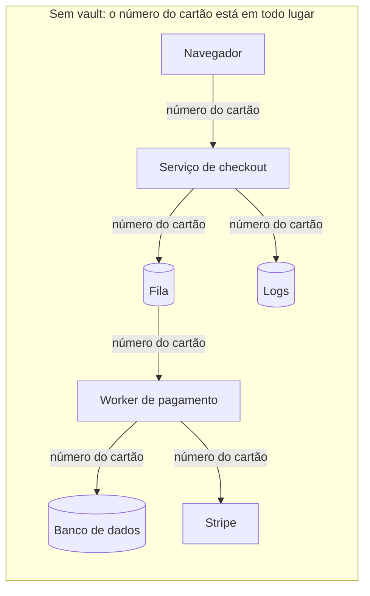

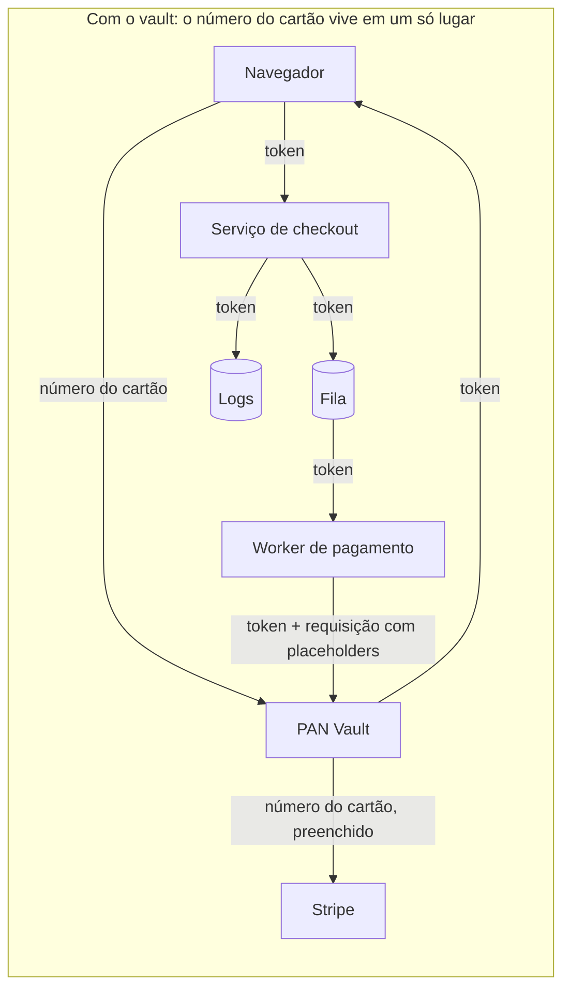

---

## 2. O que é um tokenizador (vault)

### A versão curta

Pense em um **guarda-volumes**. Você entrega seu casaco e recebe uma ficha numerada. A ficha não vale nada para um ladrão: é só um número, e não aquece ninguém. Só o guarda-volumes consegue associá-la de volta ao seu casaco, e ele só devolve o casaco sob regras rígidas.

O PAN Vault é esse guarda-volumes, e o casaco é o número do cartão:

- O navegador do cliente entrega o cartão ao vault.
- O vault o guarda a sete chaves e devolve um **token**, uma string aleatória como `tok_4f3a9c…`.
- Nossa plataforma armazena e repassa apenas o token.
- Quando a Stripe precisa do cartão real, a plataforma entrega ao vault o token junto com a requisição que quer fazer, deixando lacunas onde vão os dados do cartão. O vault verifica a requisição contra uma lista aprovada, preenche as lacunas e ele mesmo faz a chamada à Stripe. O cartão vai direto do vault para a Stripe, e nossa plataforma nunca encosta nele.

Um token não é um número de cartão criptografado. Ele é pura aleatoriedade, sem nenhuma relação matemática com o cartão, então nem um poder computacional ilimitado consegue transformar um token de volta em um número de cartão. O único caminho de volta é perguntar ao vault, e o vault não devolve números de cartão para ninguém.

### Em profundidade

Existem vários tipos de tokenização. Este vault usa **tokenização aleatória baseada em vault**:

| Abordagem | Como o token é gerado | O token pode ser revertido sem o vault? | Usado aqui? |
|---|---|---|---|
| Token aleatório + tabela de lookup | Bytes aleatórios; o vault armazena um mapeamento token → cartão criptografado | Não, não há nada para reverter | **Sim** |
| Format-preserving encryption (FPE) | O número do cartão é criptografado em outro número de 16 dígitos | Sim, com a chave | Não |
| Baseada em hash | Um hash unidirecional do número do cartão | Pode ser quebrado por força bruta: o espaço de PANs é pequeno e os BINs são públicos | Não |

O formato do token é `tok_` seguido de 32 caracteres hexadecimais minúsculos (16 bytes de um gerador aleatório criptograficamente seguro). Ele não carrega nenhuma informação: nem BIN, nem os quatro últimos dígitos, nem a validade. O vault retorna `last4` e a validade separadamente para que a UI de checkout possa exibir "Visa final 4242". Esses valores não são secretos segundo o PCI DSS.

Duas propriedades diferenciam este vault de um simples serviço de "criptografar e armazenar":

1. **Ele nunca retorna um número de cartão.** Não existe endpoint de "detokenize", nem mesmo um de administração ou de debug.
2. **Ele age sobre o cartão em vez de entregá-lo.** Quem chama monta a requisição para o provedor com **placeholders** como `{{pan}}` e informa um token. O vault verifica a requisição contra um **catálogo** revisado e compilado no binário, com os endpoints e campos permitidos, preenche o cartão e sua própria credencial do provedor e a envia a um host escolhido pelo catálogo.

Esse modelo de "fazer proxy, não revelar" foi projetado para manter o back-end da plataforma fora do escopo PCI, sujeito à definição de escopo feita pelo assessor. A página de checkout é outra questão (veja [§5](#5-como-o-vault-reduz-nosso-escopo)).

---

## 3. PCI DSS em termos simples

### A versão curta

O **PCI DSS** (Payment Card Industry Data Security Standard) é o conjunto de regras que toda empresa que lida com números de cartão precisa seguir. Ele é escrito pelas principais bandeiras de cartão (Visa, Mastercard, American Express, Discover e JCB) por meio de uma organização chamada **PCI Security Standards Council**.

O conjunto de regras tem doze requisitos amplos, como "proteger os dados de cartão armazenados", "restringir o acesso", "registrar e monitorar tudo" e "testar a segurança regularmente". Cada requisito se desdobra em centenas de verificações detalhadas.

A ideia central é o **escopo**. As regras se aplicam integralmente a todo sistema que armazena, processa ou transmite números de cartão. Elas também se aplicam a todo sistema conectado a esses sistemas ou que possa afetar a segurança deles. Essa zona se chama **Cardholder Data Environment (CDE)**. Tudo o que estiver dentro dela precisa cumprir o conjunto completo de regras e ser verificado por um auditor, muitas vezes todo ano.

### Em profundidade

**Os doze requisitos**, agrupados em seis objetivos:

| Objetivo | Requisitos |
|---|---|
| Construir e manter uma rede e sistemas seguros | 1. Controles de segurança de rede · 2. Configurações seguras |
| Proteger os dados da conta | 3. Proteger os dados da conta armazenados · 4. Proteger os dados em trânsito com criptografia forte |
| Manter um programa de gestão de vulnerabilidades | 5. Proteger contra software malicioso · 6. Desenvolver e manter sistemas e software seguros |
| Implementar controle de acesso forte | 7. Restringir o acesso por necessidade de conhecer · 8. Identificar usuários e autenticar o acesso · 9. Restringir o acesso físico |
| Monitorar e testar as redes regularmente | 10. Registrar e monitorar todo acesso · 11. Testar a segurança regularmente |
| Manter uma política de segurança da informação | 12. Apoiar a segurança com políticas e programas organizacionais |

**Quem verifica a conformidade, e como?** Isso depende do volume de transações (o "nível" do merchant ou do prestador de serviços) e de como os dados de cartão são tratados:

- **Organizações grandes** (Nível 1) precisam de uma avaliação anual presencial feita por um **Qualified Security Assessor (QSA)**. Ela produz um **Report on Compliance (ROC)** e um **Attestation of Compliance (AoC)**.
- **Organizações menores** podem preencher um **Self-Assessment Questionnaire (SAQ)**. O tipo de SAQ reflete quanto dado de cartão elas tocam:
  - **SAQ A**: o tratamento do cartão é totalmente terceirizado, por exemplo uma página de pagamento hospedada pelo provedor. É o questionário mais curto.
  - **SAQ A-EP**: e-commerce em que o site do merchant pode afetar a segurança da página de pagamento, mesmo que o cartão vá para outro lugar.
  - **SAQ D**: todo o resto, incluindo quem armazena números de cartão. Na prática, é o padrão completo.
- A maioria dos níveis também exige **varreduras externas trimestrais de vulnerabilidades** feitas por um Approved Scanning Vendor (ASV), além de varreduras internas e testes de intrusão periódicos.

**Regras de escopo que importam para nós:**

- **Dado de cartão criptografado continua sendo dado de cartão.** Ele permanece em escopo, a menos que o sistema que o guarda não tenha acesso às chaves de descriptografia. É por isso que o vault mantém sua chave de criptografia de chaves em um projeto separado, em um hardware security module.
- **Sistemas "conectados" também estão em escopo.** Um sistema que consegue alcançar o CDE, ou que poderia afetar sua segurança, é incluído, a menos que esteja devidamente segmentado.
- **Tokens não são dados de cartão.** Um sistema que só lida com tokens, e não consegue usá-los para recuperar o cartão, pode sair do escopo. A orientação de tokenização do PCI SSC descreve isso.
- **Dados de autenticação sensíveis (o CVV) não podem ser armazenados após a autorização**, nem mesmo criptografados. O vault os mantém apenas em memória e os usa no máximo uma vez. Eles expiram 15 minutos após a tokenização e são apagados da memória cerca de um minuto depois, a menos que tenham sido usados ou descartados antes.

> A palavra final sobre o escopo é sempre do seu assessor. Este documento explica como o vault foi projetado para minimizar o escopo; ele não é uma determinação de conformidade.

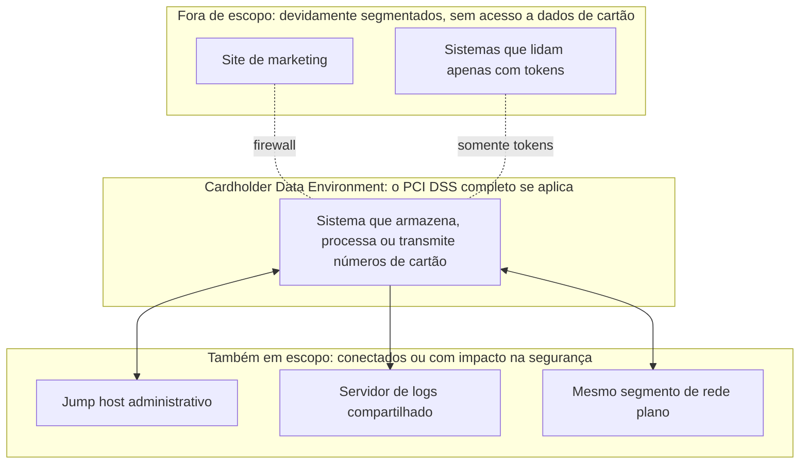

---

## 4. Por que reduzir o escopo PCI é tão importante

### A versão curta

Todo sistema dentro da zona PCI precisa ser blindado, documentado, monitorado, varrido, atualizado com patches em um cronograma e apresentado a um auditor. Isso custa tempo e dinheiro, e deixa os times mais lentos. Uma mudança em um sistema em escopo pode exigir revisão e evidências extras.

Se os números de cartão só existem dentro de um serviço minúsculo e feito para esse fim, só esse serviço carrega o fardo pesado. O restante da plataforma pode andar rápido. Também é mais seguro: um atacante que invade a plataforma só encontra tokens, que não valem nada para ele.

### Em profundidade

| Dimensão | Escopo grande (cartões circulam pela plataforma) | Escopo pequeno (cartões confinados ao vault) |
|---|---|---|
| **Esforço de auditoria** | Todo serviço, banco de dados, fila, pipeline de logs, runner de CI/CD e caminho administrativo é avaliado | Um serviço, seu banco de dados, o KMS e os secrets |
| **Velocidade de engenharia** | Controle de mudanças, segregação de funções e coleta de evidências para todos os times | A maioria dos times faz entregas normalmente; só mudanças no vault precisam do processo rigoroso |
| **Superfície de ataque** | Centenas de componentes, qualquer um dos quais pode vazar um número de cartão | Um pacote Go (cerca de 4.000 linhas) e quatro funções SQL, que mantém o mesmo tamanho à medida que provedores são adicionados |
| **Impacto de um vazamento** | Comprometer a plataforma significa vazamento de cartões e investigação forense | Comprometer a plataforma expõe tokens, que são inúteis fora do vault |
| **Logs e observabilidade** | Os logs precisam ser sanitizados ou tratados como dados de cartão | Os logs são livres de dados de cartão por construção |
| **Ferramentas de terceiros** | APM, rastreadores de erros e analytics correm o risco de receber números de cartão | Nenhum número de cartão chega até elas |
| **Custo** | Varreduras, testes de intrusão, hardening e monitoramento em todo o parque | Concentrado em um componente pequeno e estável |

Reduzir o escopo é também uma estratégia de segurança por si só, não apenas burocracia. Significa menos lugares para defender, menos pessoas com acesso e menos maneiras de cometer um erro.

---

## 5. Como o vault reduz nosso escopo

### A versão curta

O vault traça uma linha firme ao redor do número do cartão:

- **Dentro da linha:** o próprio vault, seu banco de dados privado e suas chaves. Eles ficam em um projeto de nuvem dedicado e blindado.
- **Fora da linha:** todo o resto. A plataforma armazena tokens, chama o vault com tokens e recebe de volta a resposta do provedor com qualquer número de cartão apagado.

O cartão vai direto do navegador do cliente para o vault, e direto do vault para o provedor de pagamentos. A plataforma nunca fica no meio.

### Em profundidade

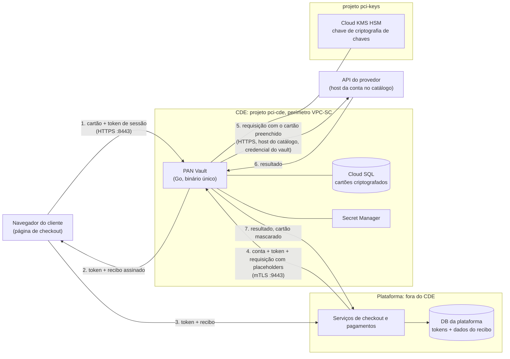

**O que a plataforma vê:** tokens, `last4`, mês e ano de validade, o BIN (os primeiros 6 ou 8 dígitos) e o nome do titular que vêm no recibo assinado (veja [§6.2](#62-o-recibo-assinado)), e respostas dos provedores com qualquer número de cartão ecoado substituído por `****4242`.

**O que a plataforma nunca vê:** um número de cartão completo ou um CVV. Não existe API que os retorne.

**Onde a linha é imposta:**

| Fronteira | Mecanismo |
|---|---|
| Navegador → vault | Um listener público dedicado que atende apenas `POST /tokenize`. Ele exige correspondência exata do `Origin` e um token de sessão de curta duração emitido pela plataforma. |
| Plataforma → vault | Um listener interno separado que exige um certificado de cliente (mTLS) assinado por uma única CA fixada. Ele atende apenas `POST /proxy` e `GET /healthz`. |
| Vault → banco de dados | A role de banco do vault (`vault_app`) só pode chamar três funções: `put_card`, `get_card` e `list_deks`. Ela não tem nenhum acesso a tabelas. Adicionar uma chave (`add_dek`) exige uma role separada, `vault_rotator`. |
| Vault → KMS | A chave de criptografia de chaves fica em outro projeto e nunca sai do HSM. |
| Vault → internet | Apenas os hosts das contas do catálogo deste ambiente, imposto no código e pelo firewall de egress da VPC. |

**Uma ressalva honesta sobre a página de checkout.** O número do cartão passa, sim, pelo navegador do cliente, dentro de uma página servida pela nossa plataforma. Quem controla o JavaScript dessa página poderia, em teoria, mudar o destino do cartão. Por isso, a página que hospeda o formulário do cartão, e os sistemas que a servem, normalmente continuam em um escopo reduzido (comparável ao SAQ A-EP para um merchant). O PCI DSS v4.0 também adiciona requisitos de gestão e monitoramento de scripts em páginas de pagamento. O vault foi projetado para tirar o back-end (APIs, bancos de dados, filas, logs, workers) do escopo, sujeito à definição de escopo feita pelo assessor. Ele não tira a própria página de pagamento. Servir o formulário do cartão a partir de uma origem controlada pelo vault, por exemplo em um iframe, reduziria isso ainda mais e é um possível passo futuro.

---

## 6. Como o vault funciona, passo a passo

### A versão curta

O vault faz exatamente duas coisas:

1. **Tokenizar.** Ele recebe um cartão do navegador e, opcionalmente, o nome do titular. Ele verifica o cartão, criptografa, armazena e retorna um token, junto com um **recibo assinado**: um registro à prova de adulteração dos primeiros e últimos dígitos do cartão, da validade e do nome, que a plataforma pode guardar.
2. **Fazer proxy.** A plataforma envia ao vault um token, o nome de uma das nossas contas em provedores de pagamento e a requisição completa que quer enviar a esse provedor. A requisição tem lacunas, como `{{pan}}`, onde vão os dados do cartão. O vault verifica a requisição contra um conjunto de regras revisado (o **catálogo**). Se a requisição passar, o vault descriptografa o cartão, preenche as lacunas e sua própria senha do provedor, e envia a requisição ao provedor dessa conta. Ele retorna a resposta com qualquer número de cartão apagado.

Pense em uma carta-modelo. A plataforma escreve a carta e deixa lacunas para o cartão. O vault a confere contra um modelo aprovado: o destinatário certo, lacunas apenas nos lugares aprovados, nada que faça o provedor guardar o cartão. Depois, o vault preenche as lacunas, assina com a nossa própria assinatura e a envia para um endereço que o próprio vault escolhe. A plataforma nunca vê a carta preenchida.

Ele não faz mais nada.

### Em profundidade

#### 6.1 Tokenização: navegador → vault

Antes de exibir o formulário do cartão, a plataforma emite um **token de sessão** para aquele checkout:

```
v1.<expires_unix>.<hex(HMAC-SHA256(key, "v1." + expires_unix))>
```

Ele vale por no máximo 15 minutos. Ele não está vinculado a um cartão e prova que "este navegador foi enviado aqui pela nossa plataforma". Isso impede que estranhos na internet usem o vault como um validador gratuito de números de cartão.

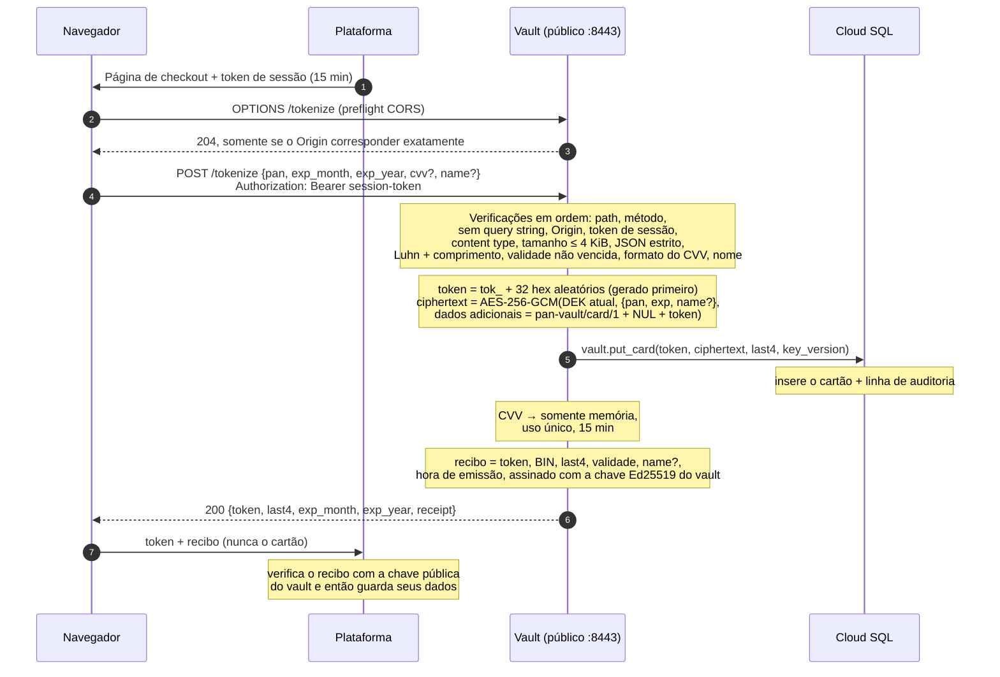

Detalhes importantes:

- **O CVV nunca é armazenado.** Ele fica em um cache em memória, como bytes que são sobrescritos quando a entrada é removida (melhor esforço, como toda limpeza de memória em Go). Ele é removido quando uma chamada a `/proxy` o lê, quando o provedor aceita com um 2xx qualquer chamada a `/proxy` para aquele cartão (veja 6.3 abaixo), ou quando expira, 15 minutos após a tokenização. Entradas expiradas são removidas a cada 60 segundos, e também quando o cache está cheio, então mesmo uma instância ociosa guarda um CVV expirado por no máximo cerca de um minuto. O cache guarda no máximo 50.000 CVVs. Quando está cheio, `/tokenize` ainda armazena o cartão e retorna 200, mas não guarda o CVV em cache e registra `ALERT cvv_cache_full` (no máximo uma vez por segundo). Uma requisição posterior com `{{cvv}}` para esse cartão recebe o 409 de sempre. CVVs válidos nunca são descartados para abrir espaço.
- **O nome do titular é opcional.** Se informado, deve ter de 1 a 100 caracteres de UTF-8 válido, sem caracteres de controle (`"name": null` é rejeitado). Ele é criptografado junto com o cartão e só é usado quando uma requisição ao provedor tem um placeholder `{{name}}`. O vault só o retorna dentro do recibo assinado (veja 6.2 abaixo), para o navegador que o enviou. A resposta de um provedor também pode ecoá-lo (o `card.name` de um token da Stripe, por exemplo), e essa resposta chega à plataforma como está: o vault mascara apenas números de cartão, não nomes. Um cartão tokenizado sem nome não consegue preencher `{{name}}`: essa chamada a `/proxy` recebe `409 {"error":"name unavailable"}`.
- **A resposta traz um recibo assinado.** Além de `token`, `last4` e a validade, que a página de checkout pode exibir, `/tokenize` retorna `receipt`, que também carrega o BIN e o nome (veja 6.2 abaixo). O BIN e o nome nunca aparecem como campos de primeiro nível, e o recibo nunca é registrado em log.
- **Uma query string é rejeitada de imediato.** Isso garante que um número de cartão nunca vá parar em uma URL e, portanto, nunca em nenhum log baseado em URL pelo caminho.
- **O navegador recebe o mesmo formato de erro, seja qual for o problema**: `{"error":"invalid pan"}` e semelhantes. Esse formato nunca ecoa a entrada.

#### 6.2 O recibo assinado

A plataforma precisa de alguns dados de cada cartão: a bandeira e o emissor, como exibi-lo ao cliente e quando ele vence. Ela não pode pedi-los ao vault depois, porque o vault não tem nenhum endpoint que retorne dados de cartão. Também não pode confiar que o navegador os informe, porque quem controlar o JavaScript da página de checkout poderia informar qualquer coisa. Por isso `/tokenize` também retorna um **recibo**: uma declaração curta dos dados do cartão, assinada pelo vault.

```
rcpt.v1.<base64url(payload JSON, no padding)>.<base64url(Ed25519 signature over "rcpt.v1." + base64url payload, no padding)>
```

O payload é um JSON compacto com estas chaves, nesta ordem:

```json
{"token":"tok_…","bin":"42424242","last4":"4242","exp_month":"12","exp_year":"2030","name":"JANE Q DOE","iat":1793456789}
```

- `token`: o token emitido para este cartão.
- `bin`: o **BIN** do cartão, seus primeiros 8 dígitos quando o número do cartão tem 16 dígitos ou mais, e caso contrário seus primeiros 6. Junto com `last4`, isso fica dentro dos limites de truncamento do PCI DSS (no máximo os primeiros 8 e os últimos 4 dígitos de um número de cartão com 16 dígitos ou mais, e os primeiros 6 e os últimos 4 de um mais curto), então até um cartão de 13 dígitos mantém 3 dígitos ocultos.
- `last4`, `exp_month`, `exp_year`: os mesmos valores da resposta.
- `name`: o nome do titular exatamente como informado. É omitido quando o cartão foi tokenizado sem nome.
- `iat`: quando o vault emitiu o recibo, em segundos Unix.

**Assinado com Ed25519, verificado com uma chave pública.** O vault assina com uma chave privada Ed25519 cuja semente só o vault tem (veja [§9](#9-operando-com-segurança)). A plataforma verifica com a **chave pública** correspondente, que não é secreta. Assim, o serviço de checkout, as ferramentas de suporte e os relatórios podem verificar recibos, e nenhum deles consegue criar um. O payload é codificado uma única vez e a assinatura cobre exatamente esses bytes, então quem verifica nunca o serializa de novo. A [§11.4](#114-verificando-um-recibo) mostra como verificar.

**O que a plataforma faz com ele:**

1. O navegador encaminha `receipt` para a plataforma junto com o token.
2. A plataforma verifica o recibo com a chave pública do vault, e confere que o `token` dele é o token que ela recebeu, antes de guardar qualquer coisa dele. Um recibo inválido é rejeitado por inteiro, nunca aceito em parte.
3. A plataforma guarda o BIN, os últimos quatro, a validade e o nome junto ao token.

**Por que a plataforma pode guardar esses dados.** Um número de cartão truncado ao BIN e aos últimos quatro, mesmo com a validade e o nome, não é dado do portador do cartão (CHD). O back end da plataforma continua fora do CDE enquanto guardar apenas esses dados e seguir três regras:

- **Clientes veem apenas os últimos quatro.** O BIN junto com os últimos quatro só pode ser exibido para funcionários com necessidade de negócio (requisito 3.4.1 do PCI DSS).
- **Nenhum hash do número do cartão.** Nunca guardar um hash do número do cartão junto ao número truncado: juntos eles estreitam uma busca por força bruta, e o PCI trata esse par como uma falha de controle. O vault nunca produz um hash assim.
- **A plataforma deriva os detalhes do cartão a partir do BIN.** Bandeira, emissor, país e tipo de cartão vêm dos dados de BIN da própria plataforma (uma base licenciada ou regras de prefixo), que a plataforma mantém atualizados sem alterar o vault.

O recibo nunca é registrado em log, nem a semente que o assina. Um recibo contém no máximo 8 + 4 dígitos do número do cartão, em campos separados, então nunca parece um número de cartão para a varredura de vazamentos nos logs ([§7.6](#76-nada-sensível-nos-logs-por-construção)).

#### 6.3 Proxy: plataforma → vault → provedor

A plataforma envia um **envelope** JSON de no máximo 64 KiB. Campos desconhecidos são rejeitados:

```json
{
  "account": "stripe_test",
  "token": "tok_4f3a9c…",
  "request": {
    "method": "POST",
    "path": "/v1/tokens",
    "headers": { "Idempotency-Key": "ord-123" },
    "body": "card[number]={{pan}}&card[exp_month]={{exp_month}}&card[exp_year]={{exp_year}}&card[cvc]={{cvv}}&card[name]={{name}}"
  }
}
```

`body` é o body bruto do provedor como string, no formato do provedor (`json` ou `form`). O vault envia exatamente esses bytes, substituindo apenas os placeholders.

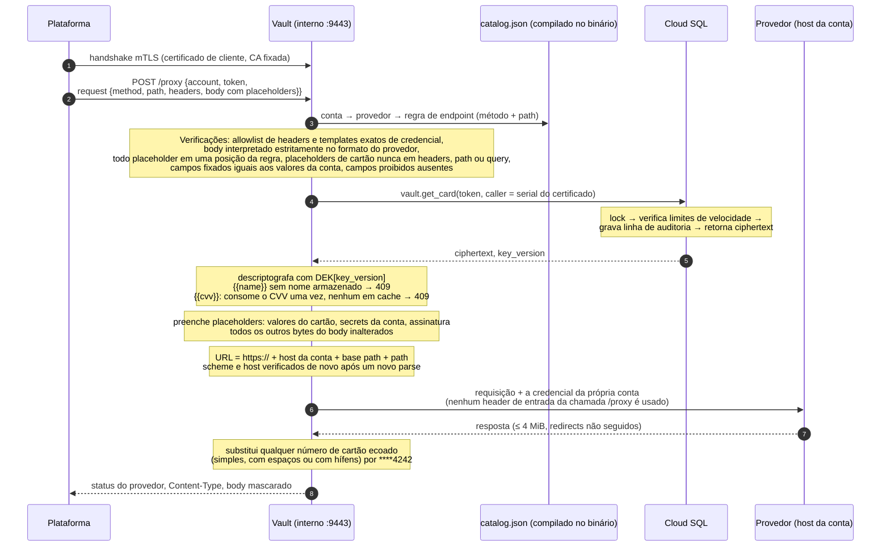

Detalhes importantes:

- **A plataforma escreve a requisição. O catálogo decide o que pode ser enviado.** `catalog.json` é compilado no binário. Para cada provedor, ele lista os endpoints permitidos (método e path). Para cada endpoint, ele informa as posições exatas no body onde cada placeholder pode aparecer, os templates de header de credencial, os **pins** (campos que devem ser iguais a um dos valores da conta, como o `merchantAccount` da Adyen) e os campos **proibidos** (flags de salvamento do cartão). Qualquer outra coisa é rejeitada antes de o banco de dados ser tocado.
- **Placeholders** formam um vocabulário fixo:

  | Placeholder | Vira | Permitido em |
  |---|---|---|
  | `{{pan}}`, `{{cvv}}`, `{{name}}` | número do cartão, CVV em cache, nome do titular armazenado | posições do body listadas na regra |
  | `{{exp_month}}` / `{{exp_month:int}}` | `"03"` / `3` | posições do body listadas na regra |
  | `{{exp_year}}` / `{{exp_year:yy}}` / `{{exp_year:int}}` | `"2030"` / `"30"` / `2030` | posições do body listadas na regra |
  | `{{exp:yyyy/mm}}` / `{{exp:mm/yy}}` | `"2030/03"` / `"03/30"` | posições do body listadas na regra |
  | `{{secret:NAME}}` | o secret NAME da conta | templates de header ou posições do body listados na regra |
  | `{{basic:NAME}}` | base64(secret NAME + ":") | templates de header listados na regra |
  | `{{signature}}` | saída do signer nomeado do endpoint (ex.: `payu`) | templates de header ou posições do body listados na regra |

  Um placeholder deve ser um valor inteiro (nada de `"{{exp_month}}/{{exp_year}}"`). Cada placeholder de cartão pode aparecer no máximo uma vez. Placeholders de cartão nunca são permitidos em um header, no path ou na query. Qualquer coisa que pareça um placeholder mas não seja um destes, ou que esteja em qualquer outro lugar, é rejeitada. Ela nunca é enviada literalmente.
- **A conta escolhe o destino e a credencial.** A plataforma informa o nome de uma conta, como `stripe_test`. A URL é sempre `https://` + o host da conta + seu base path + o path da requisição, e o vault verifica de novo o scheme e o host depois de montá-la. A plataforma não pode indicar um host.
- **A credencial é do vault.** Os secrets das contas são carregados do Secret Manager no boot. Um header de credencial deve ser exatamente seu template do catálogo (por exemplo `Authorization: Bearer {{secret:secretKey}}`). A plataforma pode enviar essa string de template ou omitir o header, e o vault a renderiza em ambos os casos. Qualquer outro valor, incluindo um `authorization: Bearer sk_attacker` em minúsculas, é rejeitado. Da mesma forma, um campo de credencial no body aceita apenas seu placeholder do vault. Nenhum header HTTP da própria chamada a `/proxy` é usado.
- **Os headers da plataforma vão em `request.headers`, e só três são permitidos:** `Accept`, `Idempotency-Key` e `X-Idempotency-Key`, cada um com 1 a 1024 bytes de ASCII imprimível. Qualquer outro header é rejeitado com `header not allowed`, e não descartado silenciosamente, para que bugs da plataforma apareçam. O próprio vault define `Host`, `Content-Type` (a partir do formato do provedor), `Content-Length` e `User-Agent: pan-vault/1`. Só o status, o `Content-Type` e o body voltam.
- **O CVV é usado no máximo uma vez, e só quando todas as verificações passam.** Se o body usa `{{cvv}}` e não há CVV em cache (já usado, expirado ou tokenizado em outra instância), a resposta é `409 {"error":"cvv unavailable"}`. A plataforma reenvia sem o campo do CVV, por exemplo para uma cobrança com cartão salvo. O vault nunca edita o body para remover um campo. Uma resposta 2xx do provedor significa que o cartão saiu do vault, então o vault também descarta qualquer CVV ainda em cache para aquele token, tenha a requisição usado `{{cvv}}` ou não, e mesmo quando depois se recusa a repassar a resposta (uma resposta comprimida vira um `502`). Uma nova tentativa que use `{{cvv}}` recebe então o 409. Qualquer outro status mantém em cache um CVV não usado para uma nova tentativa. O descarte só alcança a instância que guarda o CVV. `/tokenize` e `/proxy` chegam por load balancers diferentes, então um CVV em cache em outra instância fica lá até expirar: 15 minutos após a tokenização mais no máximo uma varredura, cerca de 16 minutos no pior caso.
- **Cada ciphertext só abre com o próprio token.** Um cartão é criptografado com seu token como dados adicionais do AES-GCM (`pan-vault/card/1`, um byte NUL e depois o token). Um ciphertext copiado para a linha de outro token não é descriptografado e recebe `500` e `ALERT decrypt_failed`. Nada é enviado ao provedor. Se a versão de chave do cartão for uma que esta instância ainda não tem (uma chave adicionada há instantes), o vault primeiro atualiza suas chaves a partir do banco de dados, no máximo uma vez a cada 10 segundos (veja §9). Isso pode segurar a requisição por até cerca de 30 segundos, dentro do write timeout de 60 segundos do listener interno. Se uma atualização lenta for seguida de um provedor lento, esse timeout pode expirar antes de a resposta ser escrita. A plataforma deve tratar isso como qualquer timeout do provedor e tentar de novo com o mesmo `Idempotency-Key`.
- **As rejeições são específicas e nunca ecoam a entrada.** Uma falha de política é um `400` com uma mensagem fixa: `unknown account`, `endpoint not allowed`, `header not allowed`, `invalid placeholder use`, `pinned field mismatch`, `forbidden field` ou `invalid request body`. Uma vez conhecida a conta, toda falha de regra também dispara `ALERT proxy_policy` (veja [§7.6](#76-nada-sensível-nos-logs-por-construção)). Uma conta desconhecida, um token malformado ou um envelope malformado é rejeitado sem alerta.
- **Redirects nunca são seguidos.** O vault ignora `HTTP_PROXY`, recusa respostas comprimidas que não consegue inspecionar e nunca retorna um body truncado. O mascaramento tem um limite preciso: o vault mascara apenas o número deste mesmo cartão, como dígitos contínuos ou em grupos de quatro separados por espaços ou por hífens. Outros agrupamentos (como o 4-6-5 da Amex) e qualquer outro dado que um provedor retorne, como um nome ou uma mensagem de erro, chegam à plataforma como estão, e é por isso que as respostas documentadas de cada endpoint do catálogo são revisadas antes de ele ser adicionado.

#### 6.4 A vida de um cartão

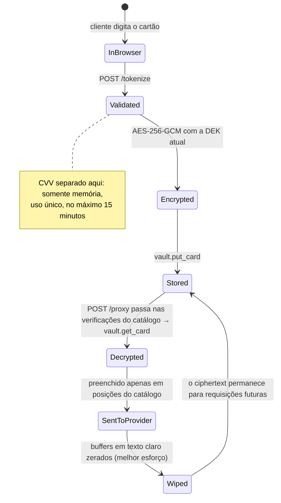

#### 6.5 O catálogo atual

O primeiro `catalog.json` vem **apenas com a Stripe**, porque a Stripe é o único provedor que conseguimos verificar no CI (por meio do `stripe-mock` oficial da Stripe). Adyen, Mercado Pago, PayU Latam e Pagar.me já estão modelados no catálogo sintético da suíte de testes. Cada um entrará como sua própria mudança somente de dados, depois de verificado contra o sandbox do respectivo provedor.

| Conta (env) | Provedor (formato) | Endpoint | O que cria | Posições do cartão | Campos proibidos |
|---|---|---|---|---|---|
| `stripe_test` (dev) | `stripe` (form) | `POST /v1/tokens` | Um token de cartão de uso único (`tok_…`) | `card[number]`, `card[exp_month]`, `card[exp_year]`, `card[cvc]`, `card[name]` | `customer` (Connect: um token clonado do cartão salvo de um customer) |

Então o fluxo da Stripe é: o vault cria um `tok_…` de uso único via `POST /v1/tokens`, e a plataforma, com sua própria chave da Stripe, faz a cobrança com ele ou cria um PaymentMethod a partir dele (por exemplo `POST /v1/payment_methods` com `type=card&card[token]=tok_…`). Essas chamadas não carregam dados de cartão, então não passam pelo vault. O próprio vault nunca chama `POST /v1/payment_methods` com dados de cartão: um PaymentMethod de cartão é reutilizável e pode ser vinculado a um customer, o que é armazenamento no provedor, por isso esse endpoint não está no catálogo.

Todo endpoint do catálogo carrega dados de cartão e lista uma posição para `{{pan}}`, e toda requisição a `/proxy` deve conter `{{pan}}`. A credencial do vault só é emprestada a chamadas que carregam cartão. Qualquer outra coisa (um pagamento com um token do provedor, um reembolso, uma consulta, um token `pii` da Stripe) é chamada da própria plataforma, feita com as chaves dela.

Ainda não existe conta de prod, então `egress-hosts.prod.txt` está vazio. Para adicionar um provedor ou uma conta, veja [§11](#11-para-desenvolvedores).

---

## 7. Como o vault nos mantém seguros

### A versão curta

O vault parte do princípio de que as coisas vão dar errado e limita o estrago quando isso acontecer:

- **Se a plataforma for invadida**, o atacante ainda assim não consegue obter números de cartão. Ele só consegue pedir ao vault que envie requisições permitidas pelo conjunto de regras, para as nossas próprias contas nos provedores, com os dados do cartão apenas em campos aprovados, a uma taxa limitada.
- **Se o banco de dados for roubado**, o atacante obtém dados embaralhados. A chave para desembaralhá-los fica em um sistema separado, protegido por hardware.
- **Se alguém na internet atacar o vault**, o endpoint de pagamento é inalcançável sem um certificado especial. O endpoint de cartão é inútil sem uma ficha recente emitida pelo nosso checkout.
- **Se algo inesperado acontecer**, o vault recusa em vez de tentar adivinhar.

### Em profundidade

#### 7.1 De quem nos defendemos

| | Adversário | O que ele pode fazer | A que o design o limita |
|---|---|---|---|
| **A** | **Plataforma comprometida**, ou um insider de posse do certificado de cliente da plataforma | Chamar `/proxy` com qualquer token e qualquer requisição ao provedor | Apenas endpoints do catálogo das nossas próprias contas, nos hosts que o catálogo define. Dados de cartão apenas em posições da regra, nunca em headers ou URLs. Campos fixados da conta devem corresponder, campos de salvamento do cartão são proibidos, apenas três headers da plataforma são permitidos, e a credencial é sempre a do vault. Sem leituras em massa. Os lookups têm rate limit dentro do banco de dados, que a plataforma não consegue alterar. |
| **B** | **Processo do vault comprometido** (execução de código, build malicioso) | Tem as chaves de dados e a role do DB | O acesso ao DB é feito apenas por funções de uma única linha, sem leitura de tabelas. Os limites de velocidade ficam no banco de dados. O egress tem firewall restrito aos provedores. Veja a limitação conhecida em [§10](#10-limitações-conhecidas-e-próximos-passos). |
| **C** | **Credenciais do banco de dados roubadas** | Chamar `get_card` | Obtém apenas ciphertext AES-256-GCM. A chave não está no banco de dados. |
| **D** | **Atacante na internet** | Alcançar `/tokenize` | Não consegue alcançar `/proxy` de forma alguma (exige mTLS). Não consegue usar `/tokenize` como oráculo de validade de cartões sem um token de sessão emitido pela plataforma. |
| **E** | **Provedor de pagamentos malicioso** | Recebe números de cartão legitimamente | Fora do escopo do vault. A allowlist de egress impede que o tráfego seja redirecionado para outro provedor. |

Um navegador ou uma página de checkout adulterados também não conseguem forjar os dados do cartão: o BIN, os últimos quatro, a validade e o nome que a plataforma guarda vêm de um recibo assinado pelo vault (veja [§6.2](#62-o-recibo-assinado)), e só o vault tem a chave de assinatura.

Fora do escopo por design: comprometimento do owner do projeto de nuvem ou do admin do KMS, um toolchain Go comprometido, ataques de canal lateral e ataques físicos. Eles são cobertos pelos controles de nuvem descritos em [§9](#9-operando-com-segurança).

#### 7.2 Camadas de defesa

Nenhum controle isolado é considerado suficiente. Um atacante precisa derrotar cada camada, uma de cada vez:

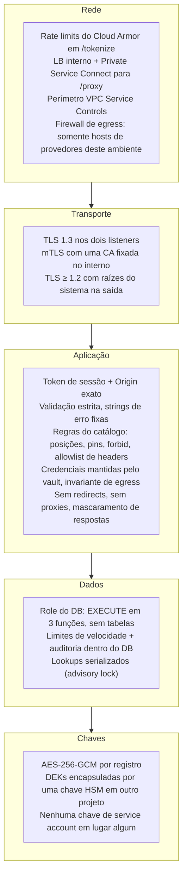

#### 7.3 O que acontece com um atacante que controla a plataforma

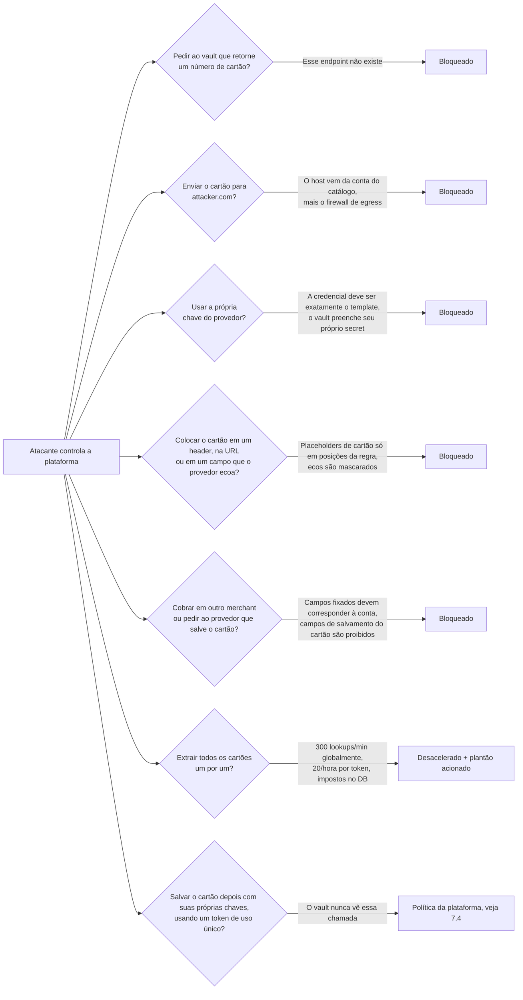

#### 7.4 O que o vault não consegue impor: tokens de hand-off

Alguns endpoints do catálogo criam um **hand-off de uso único**: hoje um token da Stripe (`/v1/tokens`) e, futuramente, um token de cartão do Mercado Pago. A plataforma então usa esse token com suas próprias chaves do provedor, por exemplo para fazer a cobrança.

Com suas próprias chaves, a plataforma também poderia pedir ao provedor que **salve** o cartão, por exemplo criando um PaymentMethod a partir do token da Stripe e vinculando-o a um customer. Essa chamada não carrega dados de cartão e nunca passa pelo vault, então o vault não consegue impedi-la. Isso não quebra a confidencialidade: o cartão fica em um provedor certificado PCI, na nossa própria conta, e a plataforma continua sem nunca ver o número do cartão. Mas quebra o objetivo de que o vault seja o único lugar onde os cartões vivem.

**Portanto, esta é uma regra da plataforma: a plataforma nunca deve salvar, vincular ou reutilizar um cartão por meio de um token de hand-off.** O code review da plataforma e o monitoramento do lado do provedor precisam garantir isso.

#### 7.5 Coisas que o vault deliberadamente nunca faz

- Armazenar um CVV, dados da tarja magnética, um PIN ou um PIN block.
- Enviar uma requisição ao provedor que o catálogo não permite. A plataforma não pode escolher o host, a credencial, o valor de um campo que seleciona a conta nem qualquer lugar para o cartão fora de uma posição da regra. Não existe modo de pass-through livre.
- Enviar dados de cartão a um endpoint que armazena o cartão no provedor, ou que envia dados para uma URL escolhida por quem chama.
- Acumular código específico de provedor. Provedores, endpoints e contas são dados do catálogo. O único código de provedor permitido é um pequeno signer nomeado (hoje apenas `payu`).
- Oferecer qualquer endpoint que retorne, liste, pesquise, conte ou exclua cartões.
- Seguir redirects HTTP de provedores.
- Registrar em log bodies ou headers de requisições ou respostas, em qualquer nível de log.
- Ler configuração, ou o catálogo, de um arquivo ou do banco de dados em tempo de execução.
- Executar migrations de banco de dados.
- Terminar o TLS do listener interno em um load balancer. Ele termina no vault, para que o próprio vault veja e registre o certificado de cliente.

#### 7.6 Nada sensível nos logs, por construção

Há exatamente uma linha de log de acesso por requisição:

```
2026-10-30T15:04:05Z req listener=internal method=POST path=/proxy status=200 dur=183ms caller=0A1B2C
```

- Paths e métodos só são registrados se forem valores conhecidos. Qualquer outra coisa vira `path=other` e `method=other`, para que um número de cartão digitado em uma URL não chegue ao log.
- As únicas outras linhas são mensagens de boot e estas linhas de `ALERT`. Uma mensagem de boot imprime a chave pública dos recibos (`receipt public key=…`), que é pública por design. Os recibos e a semente que os assina nunca são registrados. Os nomes de conta e endpoint vêm do catálogo, nunca da requisição:

| Alerta | Significado |
|---|---|
| `ALERT proxy_policy account=… endpoint=… reason=…` | Uma requisição a `/proxy` violou uma regra do catálogo. `reason` é um de `endpoint`, `header`, `body`, `placeholder`, `pin` ou `forbidden_field`, e `endpoint=-` significa que nenhum endpoint correspondeu. Possível plataforma comprometida. No máximo uma linha por segundo. |
| `ALERT velocity token=… caller=… account=…` | Um limite de lookups foi atingido. Possível extração em massa. |
| `ALERT pan_echo account=… endpoint=… token=…` | Um provedor ecoou um número de cartão. Ele foi mascarado, mas investigue. |
| `ALERT decrypt_failed token=… key_version=… account=…` | Corrupção do ciphertext ou da chave, ou um ciphertext copiado para a linha de outro token. Isso nunca deveria acontecer. |
| `ALERT egress_invariant account=…` | Uma requisição estava prestes a sair para um host inesperado. Isso deveria ser inalcançável. |
| `ALERT session_token_invalid reason=…` | Token de sessão inválido, expirado ou forjado. No máximo uma linha por segundo. |
| `ALERT cvv_cache_full` | O cache de CVV está cheio (50.000 entradas). Novos cartões continuam sendo armazenados, mas o CVV deles não vai para o cache. Possível enxurrada de `/tokenize`. No máximo uma linha por segundo. |

A suíte de testes comprova isso. Todo teste registra logs em um buffer compartilhado. Ao final da execução, o buffer é varrido em busca de qualquer sequência de 13 a 19 dígitos que passe na verificação de Luhn, incluindo sequências com espaços ou hífens e sequências escondidas dentro de cadeias de dígitos mais longas. Ele também é varrido em busca do CVV de teste, dos secrets de provedor de teste e do nome de titular de teste. Qualquer ocorrência quebra o build.

---

## 8. Por que ele foi construído dessa forma

### A versão curta

O vault é deliberadamente **pequeno, simples e rigoroso**:

- **Pequeno**, para que uma pessoa consiga lê-lo inteiro de uma vez e identificar qualquer coisa errada. Ele também continua pequeno à medida que adicionamos provedores de pagamento: um novo provedor é uma entrada revisada em um conjunto de regras, não código novo.
- **Simples**: sem frameworks, sem truques espertos e com apenas uma biblioteca externa. Cada pedaço extra de código é mais uma coisa que pode ser atacada.
- **Rigoroso**: na dúvida, ele diz não.

Código de segurança fácil de ler é mais fácil de confiar.

### Em profundidade

Cada decisão abaixo apresenta a escolha, o motivo e o trade-off que aceitamos.

**Um pacote Go, um punhado de arquivos, sem subpacotes.**
*Por quê:* um revisor ou auditor ainda consegue ler o serviço inteiro de cima a baixo, e nada se esconde em um canto de uma árvore de pacotes: é um único `package main` na raiz do repositório. Os arquivos são divididos por responsabilidade para que o núcleo de segurança (`scan.go`, `policy.go`, `render.go`, `catalog.go`) possa ser auditado isoladamente, sem precisar passar pelo boot e pelo encanamento HTTP. A divisão não adiciona abstração: nenhuma API exportada, interface ou generics, e qualquer arquivo pode usar qualquer coisa do pacote, exatamente como quando era um único arquivo. *Trade-off:* quem lê pula entre arquivos em vez de rolar um só, e as fronteiras entre arquivos são uma convenção, não uma barreira imposta pelo compilador. Ainda há alguma repetição. Repetição é preferível a abstração, porque abstração esconde comportamento.

**Biblioteca padrão mais exatamente uma dependência (pgx, o driver do Postgres).**
*Por quê:* todo módulo de terceiros é risco de supply chain dentro do CDE. Não há framework HTTP, biblioteca de logging, ORM nem SDK de nuvem. As APIs do Google são chamadas com `net/http` puro. *Garantido por:* `make deps-check` (go.mod e uma baseline do go.sum) e `make vendor-check` (o código vendorizado deve corresponder ao módulo oficial byte a byte). *Trade-off:* um pouco mais de código para as chamadas ao KMS e ao Secret Manager.

**Um vault enxuto: a plataforma monta a requisição, o catálogo a delimita.**
*Por quê:* precisamos de muitos provedores (primeira leva: Stripe, Adyen, Mercado Pago, PayU Latam e Pagar.me) e de várias contas por provedor. Se cada operação de provedor fosse uma função Go, o código do vault cresceria a cada provedor. Em vez disso, a plataforma monta a requisição completa para o provedor com placeholders, e o vault apenas a verifica contra as regras, a preenche e a envia. Adicionar um provedor, um endpoint ou uma conta é uma mudança somente de dados em `catalog.json`, mais os secrets no Secret Manager. *Trade-off:* as regras do catálogo carregam o peso de segurança que antes era do código que montava as requisições, então toda mudança no catálogo passa por um checklist de revisão rigoroso (veja [§11](#11-para-desenvolvedores)).

**O catálogo é código, não configuração.**
*Por quê:* `catalog.json` é embutido no binário em tempo de build e nunca é lido do disco, de um banco de dados ou do ambiente em tempo de execução. Uma allowlist editável em tempo de execução seria a primeira coisa que um atacante editaria. Ele é validado estritamente no boot e por um teste unitário: chaves desconhecidas, duplicatas, paths ou hosts inválidos, placeholders ou signers desconhecidos e secrets ausentes são todos fatais. Como os builds são reproduzíveis, o digest da imagem atesta o catálogo exato que está rodando em produção. Toda conta é marcada como `dev` ou `prod`, então a mesma imagem revisada é promovida de dev para prod e carrega apenas as contas do seu próprio ambiente. *Trade-off:* adicionar um provedor ainda é um release, só que não uma mudança de código.

**Placeholders em posições exatas, nunca uma linguagem de templates.**
*Por quê:* o vocabulário é fixo (`{{pan}}`, `{{cvv}}`, `{{name}}`, formatos de validade, `{{secret:…}}`, `{{basic:…}}`, `{{signature}}`). Um placeholder deve ser um valor inteiro, em uma posição indicada pela regra. Os parsers de body para `json` e `form` são estritos: chaves duplicadas, dados sobrando no final, codificação inválida, placeholders escapados ou percent-encoded e chaves de formulário fora de uma gramática restrita são todos rejeitados. Os bytes enviados são exatamente os bytes verificados mais as substituições, então nenhuma diferença de parser entre o vault e o provedor consegue mover o cartão de lugar. *Trade-off:* um provedor que precise de um `{{` literal em seus dados, ou de um valor concatenado, não é suportado até adicionarmos um formato para isso. XML pode ser adicionado depois como mais um parser, sem mudar o modelo.

**Verificar, não reescrever.**
*Por quê:* campos fixados (como o `merchantAccount` da Adyen) são verificados contra os valores da conta, e verifica-se que os campos proibidos estão ausentes. O vault nunca sobrescreve nem remove nada da requisição da plataforma: uma divergência é rejeitada. Headers desconhecidos são rejeitados, não descartados. Assim, um bug ou ataque da plataforma aparece como um erro e um alerta, em vez de ser "corrigido" silenciosamente. *Trade-off:* a plataforma precisa acertar cada requisição com exatidão.

**Signers nomeados, não uma linguagem de assinatura.**
*Por quê:* alguns provedores assinam cada requisição (a PayU faz hash da API key, do merchant ID, da referência e do valor). Uma "receita de assinatura" genérica no catálogo seria uma pequena linguagem de programação dentro da allowlist. Em vez disso, cada esquema é uma pequena função Go nomeada (hoje apenas `payu`) que lê secrets da conta e campos do body, nunca dados de cartão. Este é o único código Go específico de provedor permitido. *Trade-off:* um provedor com um novo esquema de assinatura precisa de uma nova função revisada.

**Fail closed.**
*Por quê:* uma entrada ambígua, uma configuração ausente ou um estado inesperado significam rejeição. Por exemplo: chaves JSON duplicadas, um header `Origin` duplicado, `"cvv": null`, um campo do body que difere de um campo verificado apenas em maiúsculas e minúsculas, uma resposta comprimida do provedor ou uma URL de banco de dados sem verificação de certificado em produção. *Trade-off:* um cliente incomum, mas legítimo, pode receber um `400` e ter que se ajustar.

**Acesso ao banco de dados apenas por funções `SECURITY DEFINER`.**
*Por quê:* a role da aplicação, `vault_app`, não pode fazer `SELECT` em nenhuma tabela. Ela só pode chamar `put_card`, `get_card` e `list_deks`. Um vault comprometido não consegue executar `SELECT * FROM cards`. Todo lookup é auditado, e a auditoria não pode ser contornada pela aplicação. *Trade-off:* mudanças de schema passam por um pipeline de migrations executado por uma role owner separada, nunca pelo vault.

**Limites de velocidade dentro do banco de dados, serializados com um lock.**
*Por quê:* limites impostos na aplicação poderiam ser desligados por quem controla a aplicação. No banco de dados, eles ficam fora do alcance da plataforma e da aplicação: 300 lookups por minuto globalmente e 20 por hora por token. Um advisory lock faz com que requisições paralelas entrem em fila, em vez de todas passarem pela contagem ao mesmo tempo. Sem o lock, 50 lookups simultâneos deixam passar 27 ou 28 em vez de 20. *Trade-off:* os lookups rodam um de cada vez, a alguns milissegundos cada. Isso é muito mais do que o limite permite de qualquer forma.

**Envelope encryption com uma chave protegida por HSM.**

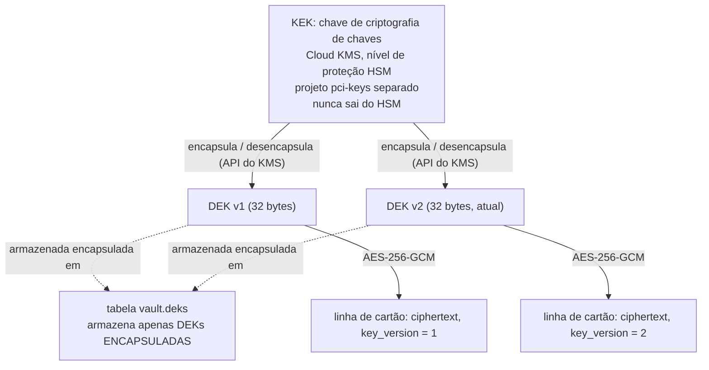

*Por quê:* o banco de dados guarda apenas ciphertext e chaves encapsuladas. Desencapsular exige uma chamada ao KMS em outro projeto, com seu próprio IAM e seus próprios audit logs. Cada registro usa um nonce aleatório novo de 12 bytes e carrega seu token como dados adicionais autenticados (`pan-vault/card/1`, um byte NUL e depois o token), então um ciphertext só é descriptografado com o token com que foi gravado. Recomendamos uma nova chave de dados por mês. Assim cada chave cobre cerca de um mês de cartões, o que mantém pequeno o conjunto de chaves antigas que cada instância desencapsula no boot (umas doze por ano), ao custo de uma chave de dados exposta revelar até um mês de cartões em vez de um dia. A chave do KMS é rotacionada a cada 90 dias. O decrypt do KMS aceita versões mais antigas da chave, então as DEKs encapsuladas continuam legíveis após uma rotação do KMS, mas continuam encapsuladas pela versão que as encapsulou: reencapsular as DEKs existentes com a versão mais recente da chave do KMS é trabalho da v1.1. *Trade-off:* o boot depende da disponibilidade do KMS, e as chaves de dados antigas são mantidas para que os cartões antigos continuem legíveis. A recriptografia das linhas antigas está planejada para a v1.1.

**Dois listeners, dois modelos de confiança.**
*Por quê:* o listener voltado para o navegador e o listener voltado para a plataforma têm chamadores completamente diferentes. Portas, configurações de TLS e handlers separados significam que um bug de um lado não consegue expor o outro. *Trade-off:* dois load balancers para operar.

**Sem redirects, sem proxies, TLS estrito na saída.**
*Por quê:* um redirect ou uma variável de ambiente `HTTP_PROXY` poderia enviar um cartão silenciosamente para outro lugar. O cliente de saída ignora ambos, verifica TLS 1.2 ou superior contra as raízes do sistema e limita as respostas a 4 MiB. *Trade-off:* nenhum na prática.

**Um container `scratch`, executado como não root, com builds reproduzíveis.**
*Por quê:* a imagem contém o binário, os certificados de CA e um arquivo passwd de uma linha, e nada mais: nem shell, nem gerenciador de pacotes. O build é reproduzível, então dois builds do mesmo commit produzem o mesmo digest, e qualquer pessoa pode verificar que uma imagem em execução veio de código revisado, catálogo incluído. *Trade-off:* não há shell para debugging. Isso é intencional, já que ninguém deveria estar fazendo debugging dentro do CDE.

**Sem chaves de service account, sem arquivos de configuração.**
*Por quê:* as credenciais vêm do servidor de metadados do GCE (Workload Identity) e do Secret Manager no boot. A configuração vem apenas de variáveis de ambiente. Não há nada em disco para roubar ou adulterar. *Trade-off:* o desenvolvimento local usa variáveis `VAULT_DEV_*` explícitas, e o binário se recusa a iniciar se alguma delas estiver definida em produção.

**Testado como se importasse.**
*Por quê:* toda a lista de testes da spec está implementada. Isso inclui a varredura de vazamentos nos logs, testes de privilégios do banco de dados contra um Postgres real, uma execução end-to-end sobre listeners mTLS reais, rotação de chaves, testes negativos para cada regra do catálogo contra um catálogo sintético que modela os cinco provedores da primeira leva, e uma verificação do formato das requisições que envia requisições montadas pela plataforma, através do `catalog.json` real, para o mock oficial da API da Stripe (`stripe-mock`). *Trade-off:* o arquivo de testes é maior que o código, o que é normal para software de segurança.

---

## 9. Operando com segurança

### A versão curta

O vault só é tão seguro quanto o ambiente em que roda. Ele pertence a projetos de nuvem próprios e blindados, sem acesso humano permanente. Suas chaves são rotacionadas em um cronograma, e toda linha de `ALERT` aciona alguém do plantão.

### Em profundidade

**Estrutura na nuvem** (Google Cloud):

| Projeto | Contém |
|---|---|
| `pci-cde-<env>` | VMs do vault (managed instance group de 2 Shielded VMs, Container-Optimized OS, sem SSH), Cloud SQL (Postgres 18, IP privado, CMEK, pgaudit), Secret Manager. Nada mais, nunca. |
| `pci-keys-<env>` | Key ring do Cloud KMS com a chave de criptografia de chaves protegida por HSM. |
| `pci-logs` | Sink de audit logs com Bucket Lock, retidos por pelo menos um ano. |

As org policies na pasta `pci` proíbem IPs externos e a criação de chaves de service account, e exigem Shielded VMs e CMEK. Não há IAM humano permanente no projeto do CDE: o acesso break-glass tem tempo limitado e passa pelo Access Approval.

**Rotação de chaves:**

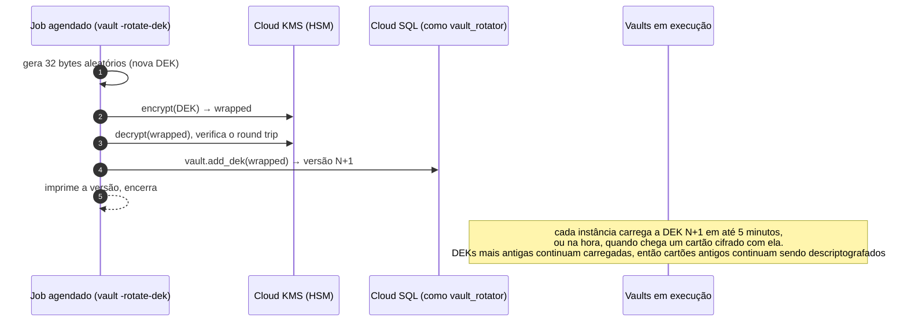

**Cronograma de rotação e atualização de chaves.** Rode `vault -rotate-dek` uma vez por mês (o trade-off está em [§8](#8-por-que-ele-foi-construído-dessa-forma)). Depois disso, nenhum restart é necessário. Toda instância relê a lista de chaves a cada 5 minutos, e uma instância que encontra um cartão cifrado com uma versão de chave que ela não tem atualiza na hora, no máximo uma vez a cada 10 segundos, com limite de 30 segundos por atualização. Chaves novas se somam às que a instância já tem e nenhuma é removida, então um restart gradual não é mais necessário e não causa mais `decrypt_failed`. Resta um caso: se o KMS ou o banco de dados estiver inacessível no momento em que uma instância encontra pela primeira vez uma nova versão de chave, ou se a última atualização dessa instância tiver terminado menos de 10 segundos antes, quando a chave ainda não existia, as requisições de cartões cifrados com essa chave falham nessa instância com `decrypt_failed` por até 10 segundos (o limite de frequência da atualização), e funcionam assim que uma atualização der certo.

**Respondendo a alertas:**

| Alerta | Severidade | Primeiros passos |
|---|---|---|
| `pan_echo` | Acionar o plantão imediatamente | Descobrir qual conta e qual endpoint ecoaram um número de cartão. O vault o mascarou, mas confirme que nada mais o capturou. |
| `decrypt_failed` | Acionar o plantão imediatamente | Possível corrupção de chave ou de dados, ou um ciphertext copiado para a linha de outro token. Verifique o estado da chave no KMS e as versões de DEK. |
| `egress_invariant` | Acionar o plantão imediatamente | Deveria ser impossível. Trate como um possível comprometimento do binário do vault. |
| `proxy_policy` | Acionar o plantão | A plataforma enviou uma requisição que o catálogo proíbe. Possível plataforma comprometida. Correlacione com as linhas de log de acesso de `/proxy` com `status=400` no mesmo horário para encontrar o certificado de cliente (`caller=`). Um pico logo após um deploy da plataforma provavelmente é um bug da plataforma. |
| `velocity` | Acionar o plantão | Possível tentativa de extração em massa. Verifique qual serial de certificado de cliente (`caller=`) fez os lookups. |
| `session_token_invalid` (pico de taxa) | Notificar | Card testing ou checkout mal configurado. Verifique o Cloud Armor. |
| `cvv_cache_full` | Notificar | O cache de CVV atingiu o limite de 50.000 entradas. Os checkouts continuam funcionando, mas cartões tokenizados nesse meio-tempo não têm CVV em cache, então requisições com `{{cvv}}` para eles recebem 409. Verifique o Cloud Armor e o tráfego de `/tokenize` em busca de uma enxurrada. |

**Pré-requisitos de deploy:**

- **TLS do banco de dados.** Em produção, `VAULT_DB_URL` precisa verificar o certificado do servidor, ou o vault não sobe. Use `sslmode=verify-ca&sslrootcert=/path/to/server-ca.pem` com a CA de servidor do Cloud SQL. `verify-full` normalmente falha contra um IP privado.
- **Identidades no Cloud SQL.** O vault e o job de rotação rodam cada um com sua própria service account do IAM, por exemplo `pan-vault@pci-cde-<env>.iam.gserviceaccount.com` (serviço) e `pan-vault-rotator@pci-cde-<env>.iam.gserviceaccount.com` (rotação). Cada uma é adicionada à instância do Cloud SQL como usuário de banco de dados do IAM, cujo nome de usuário no Postgres é o e-mail da conta sem `.gserviceaccount.com`. Em seguida o pipeline de migrações, conectado como `vault_owner`, concede a cada uma sua role:

  ```sql
  GRANT vault_app     TO "pan-vault@pci-cde-<env>.iam";
  GRANT vault_rotator TO "pan-vault-rotator@pci-cde-<env>.iam";
  ```

  `VAULT_DB_URL` usa esse nome de usuário do IAM, codificado para URL e sem senha, por exemplo `postgres://pan-vault%40pci-cde-<env>.iam@<private-ip>:5432/vault?sslmode=verify-ca&sslrootcert=…`. Em produção, o vault envia como senha o access token da sua service account (autenticação de banco de dados do IAM no Cloud SQL).
- **Smoke test no Cloud SQL.** Antes do primeiro deploy em um ambiente, e depois de qualquer mudança nos seus usuários do IAM ou roles de banco, verifique contra a instância real do Cloud SQL que a conta de serviço consegue fazer login com seu token do IAM e chamar `put_card`, `get_card` e `list_deks`, mas não consegue ler nenhuma tabela nem chamar `add_dek`, e que a conta do rotator consegue chamar `add_dek`. Isso é uma etapa do pipeline de deploy, não um teste deste repositório.
- **Uma conta revisada para o ambiente.** O vault se recusa a subir quando o catálogo não tem nenhuma conta para o seu `VAULT_ENV` (`catalog has no accounts for env=prod`), porque um vault que não consegue enviar um cartão para lugar nenhum pareceria saudável mesmo assim. Por isso, o primeiro deploy em prod precisa de uma conta de prod revisada em `catalog.json`, com seu host em `egress-hosts.prod.txt`.
- **Health checks.** Os load balancers verificam os dois listeners com health checks TCP simples: a porta aceita conexões. A prontidão real é verificada à parte, por um monitor que tem um certificado de cliente da plataforma e chama `GET /healthz` via mTLS, o que também testa a cadeia de certificados e o banco de dados. De propósito, não existe rota de saúde sem autenticação. O listener interno exige um certificado de cliente no handshake TLS de toda conexão, e o vault não serve nada além de `/tokenize`, `/proxy` e `/healthz`, então uma rota para as sondas significaria um endpoint novo ou um mTLS mais fraco no listener que serve `/proxy`.
- **Acesso a dados brutos de cartão em cada provedor.** Por padrão, a Stripe recusa requisições de API que contenham números de cartão completos. O acesso em live mode exige aprovação da Stripe, respaldada por evidências PCI (normalmente um SAQ D ou um Attestation of Compliance). Outros provedores têm barreiras semelhantes, como a "API PCI Payments role" da Adyen.
- **Secrets das contas.** Todo secret indicado por uma conta do catálogo do ambiente precisa existir no Secret Manager e ser legível pela service account do vault, ou o vault não sobe.
- **Certificados de cliente da plataforma.** A CA em `VAULT_CLIENT_CA` deve emitir certificados apenas para os serviços da plataforma que têm permissão para chamar `/proxy`.
- **Firewall de egress.** Para cada host de provedor em `egress-hosts.dev.txt` ou `egress-hosts.prod.txt`, o firewall daquele ambiente deve permitir apenas as faixas de IP publicadas por aquele provedor. O firewall de prod permite apenas hosts de prod.
- **Chave de assinatura dos recibos.** A semente dos recibos são 32 bytes aleatórios, guardados no Secret Manager como exatamente 64 caracteres hexadecimais sem quebra de linha no final (por exemplo `openssl rand -hex 32 | tr -d '\n' | gcloud secrets create receipt-key --data-file=-`). `VAULT_RECEIPT_KEY_SECRET` a nomeia, e a service account do vault precisa conseguir lê-la, ou o vault não sobe. A plataforma só precisa da chave pública, nunca da semente. Leia a chave da linha de log de boot `receipt public key=<base64url>`, ou derive-a da semente com este programa em Go (`gcloud secrets versions access latest --secret=receipt-key | go run pubkey.go`):

  ```go
  package main

  import (
  	"crypto/ed25519"
  	"encoding/base64"
  	"encoding/hex"
  	"fmt"
  	"io"
  	"os"
  	"strings"
  )

  func main() {
  	in, _ := io.ReadAll(os.Stdin)
  	seed, err := hex.DecodeString(strings.TrimSpace(string(in)))
  	if err != nil || len(seed) != ed25519.SeedSize {
  		fmt.Fprintln(os.Stderr, "expected 64 hex characters")
  		os.Exit(1)
  	}
  	fmt.Println(base64.RawURLEncoding.EncodeToString(ed25519.NewKeyFromSeed(seed).Public().(ed25519.PublicKey)))
  }
  ```

  **Rotacionar** significa uma semente nova e, portanto, uma chave pública nova. Adicione a semente nova como uma nova versão do segredo (o vault lê a versão mais recente no boot), adicione a chave pública dela à lista de chaves públicas aceitas pela plataforma e então reinicie os vaults. Remova a chave antiga quando todas as instâncias estiverem usando a semente nova e os checkouts iniciados antes da troca tiverem terminado.
- **Política de tokens de hand-off.** O código da plataforma nunca deve salvar, vincular ou reutilizar um cartão por meio de um token de uso único retornado pelo vault (veja [§7.4](#74-o-que-o-vault-não-consegue-impor-tokens-de-hand-off)).

---

## 10. Limitações conhecidas e próximos passos

**Lookups com rollback não são contados (aceito para a v1, risco RR-1).** Alguém de posse da própria role de banco do vault (adversário B, na prática um processo do vault comprometido) pode consultar um cartão dentro de uma transação e fazer rollback, o que apaga a linha de auditoria e sua contagem no rate limit. A plataforma não consegue fazer isso, o `pgaudit` continua registrando toda chamada, e uma escrita de auditoria fora da transação de quem chama está planejada para a v1.1. A entrada completa, com os controles compensatórios, a decisão, seu responsável e o gatilho de revisão, está no [registro de riscos](docs/risk-register.md).

**CVV e múltiplas instâncias.** O cache de CVV vive na memória de cada instância. Se uma chamada a `/proxy` cair em uma instância diferente da chamada a `/tokenize`, o CVV não estará disponível, e uma requisição que usa `{{cvv}}` recebe `409 {"error":"cvv unavailable"}`. A plataforma pode reenviá-la sem o campo do CVV. O mesmo vale para o descarte: o 2xx de um provedor descarta o CVV apenas na instância que atendeu a chamada a `/proxy`, então um CVV em cache em outra instância fica lá até expirar, cerca de 16 minutos no máximo. Esse é um trade-off deliberado: compartilhar o CVV entre instâncias significaria armazená-lo em algum lugar.

**Tokens de hand-off podem ser salvos pela plataforma.** Depois que o vault retorna um token de uso único, a plataforma poderia usar suas próprias chaves do provedor para salvar o cartão no provedor. O vault nunca vê essa chamada, então isso é uma regra da plataforma, não um controle do vault. Veja [§7.4](#74-o-que-o-vault-não-consegue-impor-tokens-de-hand-off).

**A página de checkout continua parcialmente em escopo.** Veja [§5](#5-como-o-vault-reduz-nosso-escopo).

**Planejado para a v1.1:** recriptografar cartões antigos com a chave mais recente (`rewrap_card`), reencapsular as DEKs existentes com a versão mais recente da chave do KMS, a escrita de auditoria fora da transação de quem chama que fecha o RR-1, uma função de retenção e expurgo com sua própria role, e ajuste fino do Cloud Armor a partir de tráfego real.

**Próximas entradas do catálogo:** Adyen, Mercado Pago, PayU Latam e Pagar.me, cada uma após a verificação no sandbox. Um formato de body `xml` e mais signers nomeados só serão adicionados quando um provedor real precisar deles.

---

## 11. Para desenvolvedores

### A versão curta

Tudo é conduzido por `make`. `make ci` executa as verificações pelas quais toda mudança precisa passar, e `make ci-all` adiciona as verificações de banco de dados, de `stripe-mock` e de imagem reproduzível. O vault lê suas configurações apenas de variáveis de ambiente. A lista de provedores de pagamento e de contas fica em `catalog.json`, que é embutido no binário. Adicionar um provedor ou uma conta significa editar esse arquivo, adicionar o secret correspondente no Secret Manager e atualizar a lista de hosts de egress. Nenhuma mudança em código Go. O GitHub Actions executa as mesmas verificações em todo pull request, e git hooks opcionais (`make hooks`) executam as rápidas antes de cada commit e de cada push.

### Em profundidade

**Requisitos:** Go 1.27.3 (baixado automaticamente via `GOTOOLCHAIN`), Docker, `psql`, `curl`, `make`.

| Comando | O que faz |
|---|---|
| `make build` | Binário estático e reproduzível `./vault` |
| `make test` | Testes unitários com o race detector. Os testes de integração são pulados, a menos que um DB esteja configurado. |
| `make lint` | gofmt, go vet, staticcheck (versão fixada, instalado em `.tools/`) |
| `make vuln` | govulncheck |
| `make deps-check` / `make vendor-check` | Allowlist de dependências, baseline do go.sum, código vendorizado corresponde ao upstream |
| `make docs-check` | Os três READMEs não repetem nenhuma das afirmações retiradas e têm o mesmo número de títulos, linhas de tabela e diagramas Mermaid |
| `make comment-check` | Nenhum arquivo Go faz referência à spec ou aos documentos de design (`SPEC-DECISION`, `§`, `design doc`) |
| `make gitleaks` | Varredura de secrets em todo o histórico do git (gitleaks, versão fixada, allowlist em `.gitleaks.toml`) |
| `make ci` | lint + vuln + deps-check + vendor-check + docs-check + comment-check + gitleaks + test + build |
| `make itest` | Sobe um Postgres 18 no Docker, aplica `schema.sql` e executa os testes de DB e end-to-end. Altere a porta com `PG_PORT=…`. |
| `make stripe-mock-test` | Envia requisições montadas pela plataforma, através dos endpoints da Stripe do `catalog.json` embutido, para o `stripe-mock` oficial. Altere a porta com `STRIPE_MOCK_PORT=…`. |
| `make image` / `make image-repro` | Gera a scratch image e imprime seu digest, ou a gera duas vezes e verifica se os digests coincidem |
| `make ci-all` | Tudo o que está acima |
| `make fuzz` / `make fuzz-long` | Executa cada fuzz target por 20 segundos, ou por `FUZZTIME` (padrão 10 minutos). Um input que falha é salvo em `testdata/fuzz/`; faça commit dele junto com a correção e `make test` o executa de novo. |
| `make commit-check` | Verifica cada mensagem de commit em `COMMIT_RANGE` (padrão `origin/main..HEAD`) contra a regra de conventional commits |
| `make hooks` | Instala os git hooks (lefthook) neste clone |

`TestStripeLive` envia as mesmas requisições para a API real da Stripe em test mode. Ele só roda quando `VAULT_TEST_STRIPE_SECRET` contém uma chave de test mode (`sk_test_…`), que nunca é impressa.

**Integração contínua.** Quatro workflows do GitHub Actions, cada um com seu badge no topo deste arquivo, são as verificações obrigatórias: **CI** (`make ci`, mais um job que roda `make commit-check` sobre os commits do pull request ou do push), **Integration** (`make itest` e `make stripe-mock-test`), **Image** (`make image-repro` e depois `make image`, guardando o digest como artefato do build) e **Fuzz** (`make fuzz` em pull requests, `make fuzz-long` toda noite). A proteção da branch `main` deve exigir os quatro. A `main` recebe squash merges cuja mensagem de commit é o título do pull request com o sufixo ` (#N)` que o GitHub adiciona, por isso o job de commits também verifica esse título, sufixo incluído, com a mesma regra.

**Git hooks.** `make hooks` instala hooks do [lefthook](https://github.com/evilmartians/lefthook) no seu clone (opcional). Antes de cada commit, eles verificam se os arquivos Go em stage estão formatados com gofmt, varrem as mudanças em stage com o gitleaks e rejeitam arquivos Go que façam referência à spec ou aos documentos de design. Cada mensagem de commit precisa ser um conventional commit (`feat: …`, `fix(scan): …`, com no máximo 72 caracteres depois do tipo), e cada push roda `make ci`. O CI também roda todas essas verificações, então pular um hook não pula a verificação.

#### 11.1 Configuração (somente ambiente)

| Variável | Obrigatória | Finalidade |
|---|---|---|
| `VAULT_ENV` | sim | `dev` ou `prod`. Também seleciona quais contas do catálogo são carregadas. |
| `VAULT_PUBLIC_ADDR` / `VAULT_INTERNAL_ADDR` | não | Padrões `:8443` e `:9443` |
| `VAULT_CERT`, `VAULT_KEY` | sim | Certificado e chave do servidor (caminhos PEM) |
| `VAULT_CLIENT_CA` | sim | A única CA para os certificados de cliente da plataforma |
| `VAULT_ALLOW_ORIGIN` | sim | Origem exata do checkout, ex.: `https://checkout.example.com` |
| `VAULT_DB_URL` | sim | URL `postgres://`. Produção exige TLS verificado. |
| `VAULT_KMS_KEY` | prod | `projects/P/locations/L/keyRings/R/cryptoKeys/K` |
| `VAULT_SESSION_HMAC_SECRET` | prod | Nome do recurso no Secret Manager da chave HMAC de sessão |
| `VAULT_RECEIPT_KEY_SECRET` | prod | Nome do recurso no Secret Manager da semente de assinatura dos recibos (64 caracteres hexadecimais, veja [§9](#9-operando-com-segurança)) |
| `VAULT_DEV_DEK_HEX`, `VAULT_DEV_SESSION_HMAC_HEX` | somente dev | Substitutos locais da DEK e da chave HMAC de sessão |
| `VAULT_DEV_RECEIPT_KEY_HEX` | somente dev | Substituto local da semente de assinatura dos recibos (64 caracteres hexadecimais) |
| `VAULT_DEV_SECRET_<ACCOUNT>_<NAME>` | somente dev | Substituto local de um secret de conta do catálogo (veja abaixo) |

Os secrets de provedores não são variáveis de ambiente. Cada conta do catálogo indica seus secrets pelo nome do recurso no Secret Manager, e o vault carrega no boot todos os secrets de todas as contas do seu ambiente. **O boot falha se algum deles estiver ausente ou inválido.** `VAULT_STRIPE_SECRET` e `VAULT_DEV_STRIPE_SECRET` não existem mais.

**Variáveis de secret em dev.** Em dev, um secret de conta pode vir de `VAULT_DEV_SECRET_<ACCOUNT>_<NAME>` em vez do Secret Manager. O nome é formado pelo nome da conta e do secret, em maiúsculas, com todo caractere fora de `[A-Z0-9]` substituído por `_`. Por exemplo, a conta `stripe_test` com o secret `secretKey` vira `VAULT_DEV_SECRET_STRIPE_TEST_SECRETKEY`. Os valores devem ser ASCII imprimível, sem espaços em branco. Qualquer nome `VAULT_DEV_*` que não seja uma das variáveis acima, ou a variável do secret de uma conta de dev, impede o boot em dev, para que um erro de digitação não caia silenciosamente no Secret Manager. Qualquer variável `VAULT_DEV_*` impede o boot em prod.

`vault -rotate-dek` (executado como `vault_rotator`) precisa apenas de `VAULT_ENV`, `VAULT_DB_URL` e `VAULT_KMS_KEY`.

#### 11.2 O catálogo de provedores (`catalog.json`)

`catalog.json` é embutido no binário em tempo de build (`go:embed`) e validado estritamente no boot e por `TestEmbeddedCatalog`. Ele tem duas partes:

- **`providers`**: cada provedor tem um `format` de body (`json` ou `form`) e uma lista de `endpoints`. Um endpoint tem um `id`, um `method`, um `path` (segmentos como `{id}` correspondem a `[A-Za-z0-9_-]{1,128}`), `"card_data": true` e `positions`:
  - `card_data` deve ser `true`: todo endpoint carrega dados de cartão. Chamadas sem dados de cartão são da plataforma, feitas com as chaves dela, e `/proxy` rejeita uma requisição que não contenha `{{pan}}`;
  - `positions`: o endereço no body de cada placeholder permitido, incluindo uma posição para `{{pan}}`. Os endereços são JSON Pointers para `json` (`/paymentMethod/number`) e nomes de campo para `form` (`card[number]`).

  Opcionalmente, ele também tem:
  - `query`: as chaves de query permitidas;
  - `headers`: templates exatos de header de credencial, como `"Authorization": "Bearer {{secret:secretKey}}"`;
  - `pins`: campos que devem ser iguais a um valor da conta (`{"account": "merchantAccount"}`) ou a um literal (`{"literal": "SUBMIT_TRANSACTION"}`);
  - `forbid`: campos que devem estar ausentes (`[]`) ou ser iguais a um dos literais listados (`[false]`);
  - `signer`: um signer nomeado, hoje apenas `payu`.
- **`accounts`**: cada conta indica seu `provider`, seu `env` (`dev` ou `prod`), seu `host`, um `base_path` opcional, seus `secrets` (nome → recurso do Secret Manager, ex.: `projects/pci-cde-dev/secrets/stripe-test-secret-key`) e `values` não secretos (IDs de merchant ou de conta usados por pins e signers).

Um vault carrega apenas as contas cujo `env` corresponde a `VAULT_ENV` e trata as demais como desconhecidas. Os nomes de campos de formulário devem corresponder a `^[A-Za-z0-9_-]+(\[[A-Za-z0-9_-]+\])*(\[\])?$`: sem `.`, e `[]` apenas no final, então `metadata[order.id]` é rejeitado.

O primeiro catálogo vem apenas com a Stripe (veja [§6.5](#65-o-catálogo-atual)). Adyen, Mercado Pago, PayU Latam e Pagar.me entram após a verificação no sandbox, cada um em seu próprio pull request somente de dados.

**Para adicionar um provedor, um endpoint ou uma conta:**

1. **Edite `catalog.json`.** É uma mudança somente de dados. Se o formato da requisição precisar de algo que o formato de regras não tem (um novo formato de body, signer ou placeholder), pare: isso é uma mudança de código, com sua própria revisão de design.
2. **Crie o secret no Secret Manager** no projeto do ambiente da conta, com o nome de recurso que o catálogo indica. Para dev local, defina a variável `VAULT_DEV_SECRET_<ACCOUNT>_<NAME>` correspondente.
3. **Atualize a lista de hosts de egress.** `egress-hosts.dev.txt` e `egress-hosts.prod.txt` devem listar exatamente os hosts das contas daquele ambiente (`TestEgressHostsMatchCatalog` verifica isso), e a regra de firewall de egress correspondente deve permitir apenas as faixas de IP publicadas por aquele provedor.
4. **Adicione uma requisição de exemplo** para cada novo endpoint em `embeddedFixtures` no `catalog_test.go`. Se a mudança introduzir um formato novo, adicione-o também ao catálogo sintético de testes (`testCatalogJSON`) e aos seus testes.
5. **Preencha o checklist de revisão** na descrição do pull request (ele fica no `CLAUDE.md`, "Catalog changes"). A descrição deve linkar o documento do provedor que mostra que cada endpoint de cartão faz uma cobrança ou cria um token de uso único, nunca um que armazene o cartão. Ela também deve listar toda flag de salvamento ou reutilização do cartão que o endpoint tenha, e a entrada de `forbid` que cobre cada uma.

#### 11.3 Estrutura do repositório

O serviço é um único pacote Go (`package main`) na raiz do repositório:

- `main.go`: configuração, variáveis de dev, pool do banco de dados, carregamento e rotação de DEKs, secrets, CA de cliente, listeners, `main()`.
- `gcp.go`: access token do servidor de metadados, encrypt/decrypt do KMS e Secret Manager, via REST puro.
- `card.go`: validação do cartão, criptografia, formato do token e o cache de CVV em memória.
- `vault.go`: estado do vault, logging, o guard de requisições, bodies de erro.
- `tokenize.go`: tokens de sessão e o `POST /tokenize` público com CORS.
- `receipt.go`: o recibo assinado do cartão: a regra do BIN, a assinatura e `verifyReceipt`, o verificador de referência.
- `scan.go`: o vocabulário de placeholders e os scanners estritos de JSON e de form.
- `catalog.go`: o `catalog.json` embutido e seu parser.
- `policy.go`: as verificações das requisições a `/proxy`.
- `render.go`: preenchimento de placeholders, templates de header, signers e a URL da conta.
- `outbound.go`: o cliente de saída para os provedores e o mascaramento de PAN nas respostas dos provedores.
- `proxy.go`: o `POST /proxy` interno e o `GET /healthz`.
- `db.go`: chamadas às quatro funções SQL.

Os testes ficam ao lado do código, nos arquivos `*_test.go` correspondentes (`boot_test.go` cobre `main.go` e `gcp.go`; `integration_test.go` contém os testes de banco de dados, end-to-end e da Stripe; `fuzz_test.go` contém os fuzz targets, com seus inputs salvos em `testdata/fuzz/`). Os helpers de teste compartilhados e o `TestMain` que faz a varredura de vazamentos ficam em `helpers_test.go`.

Outros arquivos: `catalog.json` (provedores e contas, compilado no binário), `egress-hosts.dev.txt` / `egress-hosts.prod.txt` (hosts de egress por ambiente, verificados contra o catálogo), `schema.sql` (tabelas, funções e roles, aplicado pelo CI como `vault_owner`), `Makefile`, `Dockerfile`, `deps-baseline.txt`, `vendor/`, `CLAUDE.md` (regras para agentes de IA de programação, incluindo o checklist de revisão do catálogo e as limitações conhecidas), `LICENSE` (MIT), `lefthook.yml` (git hooks), `.gitleaks.toml` (allowlist da varredura de secrets), `scripts/` (as verificações de mensagens de commit e de comentários compartilhadas pelos hooks e pelo CI), `.github/workflows/` (CI, Integration, Image, Fuzz), `docs/` (a revisão de arquitetura de segurança e o registro de riscos).

#### 11.4 Verificando um recibo

Qualquer linguagem com Ed25519 consegue verificar um recibo (formato na [§6.2](#62-o-recibo-assinado)). Divida-o em `.`: devem existir exatamente quatro partes, e as duas primeiras devem ser `rcpt` e `v1`. As duas últimas devem ser base64url sem padding e não vazias (apenas `A–Z`, `a–z`, `0–9`, `-` e `_`, sem `=`). Decodifique a quarta parte em uma assinatura de 64 bytes, e verifique-a com a chave pública do vault sobre os bytes ASCII de `rcpt.v1.` seguidos da terceira parte exatamente como recebida. Só então decodifique a terceira parte, e interprete-a como um único objeto JSON com apenas as chaves do recibo, escritas exatamente, cada uma no máximo uma vez e sem nada depois, em que toda chave exceto `name` está presente e não vazia, e `iat` é positivo. Qualquer outra coisa invalida o recibo inteiro: nunca o conserte, recodifique ou aceite em parte. Depois confira que `token` é o token que o navegador enviou. A versão em Go abaixo segue `verifyReceipt` em `receipt.go`, que os testes do vault executam contra os recibos que ele assina:

```go
package receipt

import (
	"bytes"
	"crypto/ed25519"
	"encoding/base64"
	"encoding/json"
	"errors"
	"io"
	"strings"
)

// Receipt is what a vault receipt states about a card.
type Receipt struct {
	Token    string `json:"token"`
	BIN      string `json:"bin"`
	Last4    string `json:"last4"`
	ExpMonth string `json:"exp_month"`
	ExpYear  string `json:"exp_year"`
	Name     string `json:"name,omitempty"`
	IAT      int64  `json:"iat"`
}

var ErrInvalid = errors.New("invalid receipt")

const b64url = "ABCDEFGHIJKLMNOPQRSTUVWXYZabcdefghijklmnopqrstuvwxyz0123456789-_"

var receiptKeys = map[string]bool{"token": true, "bin": true, "last4": true,
	"exp_month": true, "exp_year": true, "name": true, "iat": true}

// Verify returns the contents of receipt s if the vault key behind pub signed it.
func Verify(pub ed25519.PublicKey, s string) (Receipt, error) {
	if len(pub) != ed25519.PublicKeySize {
		return Receipt{}, ErrInvalid
	}
	parts := strings.SplitN(s, ".", 5)
	if len(parts) != 4 || parts[0] != "rcpt" || parts[1] != "v1" {
		return Receipt{}, ErrInvalid
	}
	// Go's base64 decoder skips CR and LF, so check the alphabet first.
	for _, p := range parts[2:] {
		if p == "" || strings.Trim(p, b64url) != "" {
			return Receipt{}, ErrInvalid
		}
	}
	b64 := base64.RawURLEncoding.Strict()
	sig, err := b64.DecodeString(parts[3])
	if err != nil || len(sig) != ed25519.SignatureSize ||
		!ed25519.Verify(pub, []byte("rcpt.v1."+parts[2]), sig) {
		return Receipt{}, ErrInvalid
	}
	payload, err := b64.DecodeString(parts[2])
	if err != nil || !exactKeys(payload) {
		return Receipt{}, ErrInvalid
	}
	dec := json.NewDecoder(bytes.NewReader(payload))
	dec.DisallowUnknownFields()
	var r Receipt
	if err := dec.Decode(&r); err != nil {
		return Receipt{}, ErrInvalid
	}
	var extra json.RawMessage
	if err := dec.Decode(&extra); err != io.EOF {
		return Receipt{}, ErrInvalid
	}
	if r.Token == "" || r.BIN == "" || r.Last4 == "" || r.ExpMonth == "" || r.ExpYear == "" || r.IAT <= 0 {
		return Receipt{}, ErrInvalid
	}
	return r, nil
}

// exactKeys reports whether payload is one JSON object whose keys are receipt keys, spelled
// exactly and each at most once. On its own, encoding/json matches keys case-insensitively and
// lets a repeated key overwrite an earlier one.
func exactKeys(payload []byte) bool {
	dec := json.NewDecoder(bytes.NewReader(payload))
	if t, err := dec.Token(); err != nil || t != json.Delim('{') {
		return false
	}
	seen := map[string]bool{}
	for dec.More() {
		t, err := dec.Token()
		k, ok := t.(string)
		if err != nil || !ok || !receiptKeys[k] || seen[k] {
			return false
		}
		seen[k] = true
		var v json.RawMessage
		if err := dec.Decode(&v); err != nil {
			return false
		}
	}
	t, err := dec.Token()
	return err == nil && t == json.Delim('}')
}
```

---

## 12. Glossário

| Termo | Significado |
|---|---|
| **AoC** | Attestation of Compliance: o resumo assinado de uma avaliação PCI. |
| **ASV** | Approved Scanning Vendor: executa as varreduras externas trimestrais de vulnerabilidades. |
| **Catálogo** | `catalog.json`: a lista, compilada no binário, de provedores, endpoints permitidos e nossas contas, contra a qual toda requisição a `/proxy` é verificada. |
| **BIN / IIN** | Os primeiros 6 ou 8 dígitos de um número de cartão, que identificam a bandeira e o banco emissor. Os emissores estão migrando para BINs de 8 dígitos. O recibo do vault carrega os primeiros 8 dígitos de um número de cartão com 16 dígitos ou mais, e os primeiros 6 de um mais curto. |
| **CDE** | Cardholder Data Environment: as pessoas, processos e sistemas que lidam com dados de cartão, mais tudo o que estiver conectado a eles. |
| **CHD** | Cardholder Data: o PAN, mais o nome, a validade e o código de serviço quando armazenados junto com ele. |
| **CMEK** | Customer-Managed Encryption Keys: armazenamento em nuvem criptografado com chaves que nós controlamos. |
| **CVV / CVC** | O código de segurança de 3 ou 4 dígitos. Dado de autenticação sensível, nunca armazenado após a autorização. |
| **DEK** | Data-Encryption Key: a chave AES de 32 bytes que criptografa os registros de cartão. |
| **Envelope encryption** | Criptografar dados com uma DEK e depois criptografar (encapsular) a DEK com uma KEK. |
| **Token de hand-off** | Um token de uso único ou um payment method não vinculado que um provedor cria a partir de um cartão, e que a plataforma depois usa com suas próprias chaves. |
| **HSM** | Hardware Security Module: hardware resistente a adulteração que guarda chaves e nunca as exporta. |
| **Chave de idempotência** | Um ID escolhido por quem chama que permite ao provedor eliminar com segurança requisições duplicadas por retentativa. |
| **KEK** | Key-Encryption Key: encapsula as DEKs; fica no Cloud KMS no nível de proteção HSM. |
| **Verificação de Luhn** | Um checksum embutido nos números de cartão que detecta erros de digitação. |
| **mTLS** | Mutual TLS: os dois lados apresentam certificados, então o servidor sabe exatamente qual cliente está chamando. |
| **PAN** | Primary Account Number: o número do cartão. |
| **PCI DSS** | Payment Card Industry Data Security Standard. |
| **PCI SSC** | PCI Security Standards Council: a entidade que publica o PCI DSS. |
| **Placeholder** | Um marcador como `{{pan}}` que a plataforma escreve onde o vault deve preencher dados do cartão, um secret ou uma assinatura. |
| **QSA** | Qualified Security Assessor: um auditor certificado para avaliar a conformidade PCI. |
| **Recibo (receipt)** | A declaração assinada pelo vault que `/tokenize` retorna com um token: o BIN, os últimos quatro, a validade e o nome (quando informado) do cartão, e quando foi emitida, assinada com Ed25519 para que a plataforma possa verificá-la com uma chave pública. |
| **ROC** | Report on Compliance: o relatório completo de avaliação de um QSA. |
| **SAD** | Sensitive Authentication Data: CVV, PIN, dados completos da tarja magnética ou do chip. |
| **SAQ** | Self-Assessment Questionnaire (A, A-EP, D, …), para organizações elegíveis à autoavaliação. |
| **Escopo** | O conjunto de sistemas aos quais o PCI DSS se aplica. |
| **Signer** | Uma pequena função nomeada no vault que calcula a assinatura da requisição de um provedor (hoje apenas `payu`). |
| **Token de sessão** | Uma ficha HMAC de curta duração que a plataforma entrega ao navegador para que ele possa chamar `/tokenize`. |
| **Token** | Um substituto aleatório para um cartão (`tok_` + 32 caracteres hexadecimais). Não vale nada fora do vault. |
| **Limite de velocidade** | Um teto para a frequência com que cartões podem ser consultados, para impedir a extração em massa. |
| **VPC-SC** | VPC Service Controls: um perímetro do Google Cloud que impede que dados saiam de um conjunto de projetos. |
