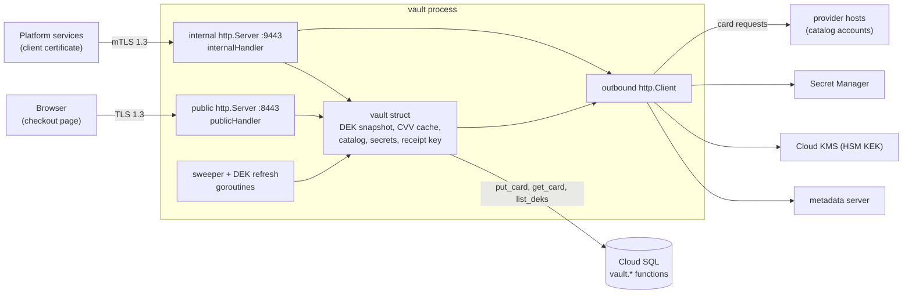
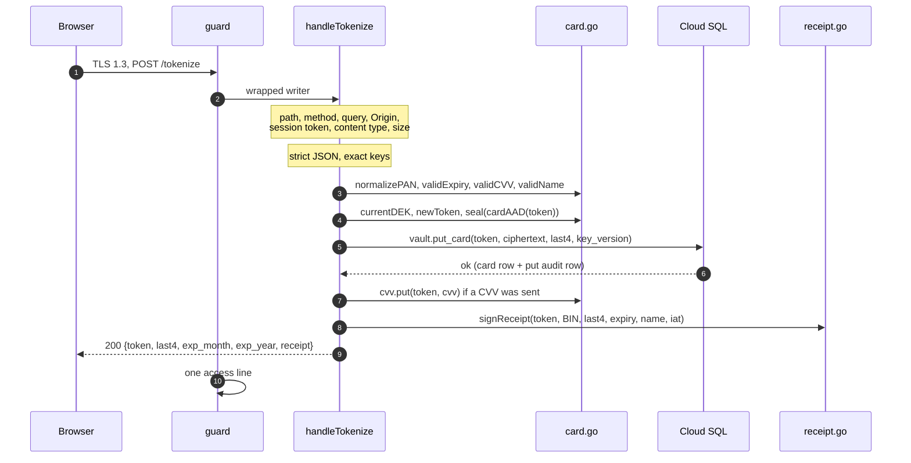
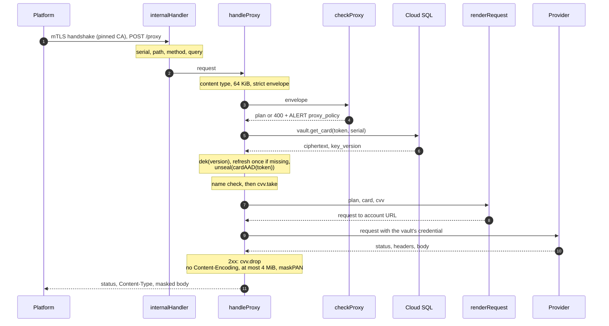

# Architecture

This page is for engineers and reviewers who want to understand how the vault is put together: which components exist, what state the process holds, and how a `/tokenize` or `/proxy` request moves through the code. The plain-language walk-through is in [README §6](../../README.md#6-how-the-vault-works-step-by-step) and the file list in [README §11.3](../../README.md#113-repository-layout); this page goes one level deeper and names the function behind each step.

## The shape of the process

The vault is one Go binary (`package main`) that, once booted, runs:

- two `http.Server`s, each with its own handler, TLS configuration and timeouts (`main.go`, `newServers`);
- two background goroutines: the CVV cache sweeper (`card.go`, `cvvCache.run`, every `cvvSweepEvery` = 60 s) and the DEK refresh loop (`vault.go`, `refreshLoop`, every `dekRefreshEvery` = 5 minutes);
- one shared outbound `http.Client` (`outbound.go`, `newOutboundClient`), used for the metadata server, KMS, Secret Manager and the providers alike (`main.go`, `main`: "the single shared client").

There is no other listener, no admin port, no metrics endpoint and no unauthenticated health route.

## Two listeners, two handlers

The two servers share only the server certificate and the `vault` value. Everything that decides who may call what is separate (`main.go:643-674`):

| | Public listener | Internal listener |
|---|---|---|
| Default address | `:8443` (`VAULT_PUBLIC_ADDR`) | `:9443` (`VAULT_INTERNAL_ADDR`) |
| Handler | `v.publicHandler()` = `guard("public", handleTokenize)` (`tokenize.go`) | `v.internalHandler()` (`proxy.go`) |
| Routes | `POST`/`OPTIONS /tokenize` only | `POST /proxy`, `GET /healthz` only |
| TLS | `MinVersion: tls.VersionTLS13`, no client authentication | `MinVersion: tls.VersionTLS13`, `ClientAuth: tls.RequireAndVerifyClientCert`, `ClientCAs` = the single CA from `VAULT_CLIENT_CA` |
| `ReadHeaderTimeout` / `ReadTimeout` | 5 s / 10 s | 5 s / 10 s |
| `WriteTimeout` | 30 s | 60 s (covers an on-demand key refresh, at most 30 s, or a provider call, at most 30 s, though not both at their limits) |
| `IdleTimeout`, `MaxHeaderBytes` | 60 s, 16 KiB | 60 s, 16 KiB |
| Request body cap | `maxPublicBody` = 4 KiB | `maxInternalBody` = 64 KiB |
| `ErrorLog` | `io.Discard` | `io.Discard` |

There is no shared `http.ServeMux`. `handleTokenize` refuses any path that is not exactly `/tokenize` (`r.URL.Path != "/tokenize" || r.URL.RawPath != ""` → 404), and `internalHandler` routes with a `switch` over exactly `/proxy` and `/healthz`. Neither handler can reach the other's code, so a routing mistake on one listener cannot expose the other's endpoint. `net/http`'s own error log is discarded on both, because its lines are neither boot nor `ALERT` lines and can quote client input.

The client CA file must hold exactly one PEM `CERTIFICATE` block with `CA:TRUE` (`main.go`, `loadClientCA`); a second block or a non-CA certificate refuses boot. Why the listeners are isolated, and what that buys against an internet attacker, is covered in [the threat model](threat-model.md#listener-isolation-why-an-internet-attacker-cannot-reach-proxy).

## The `guard` middleware

Every request on both listeners passes through `vault.guard` (`vault.go`). It does three things:

1. **Status capture.** It wraps the `ResponseWriter` in a `statusWriter`, which records the first status written (or 200 on the first `Write`).
2. **Exactly one access line.** After the handler returns, it logs `req listener=<public|internal> method=<m> path=
 status=<s> dur=<n>ms`, plus `caller=<serial>` on the internal listener (`callerSerial`). The method and path are passed through `logMethod` and `logPath`, which print only `GET`/`POST`/`OPTIONS` and `/tokenize`/`/proxy`/`/healthz` literally, and `other` for everything else, so a card number typed into a URL path never reaches the log.
3. **Panic recovery.** A panic becomes `500 {"error":"internal error"}` if nothing was written yet. If the response had already started, `guard` logs the line and then re-panics with `http.ErrAbortHandler`, so `net/http` drops the connection instead of delivering a truncated success. The panic value is never logged, because it could carry card data.

`guard` is the only place an access line is written. Handlers add only `ALERT` lines, through `vault.logf`, which prefixes an RFC 3339 UTC timestamp and is called only with fixed format strings and non-sensitive values. The log format is listed in [the logging reference](../reference/logging.md).

## What the `vault` struct holds

All process state lives in one `vault` value built by `newVault` (`main.go`) after boot. The fields fall into five groups (`vault.go`):

| Group | Fields | Written | Concurrency |
|---|---|---|---|
| Database seam | `putCard`, `getCard`, `ping` | once, by `newVault` | Function values. Production wires them to `dbPutCard`/`dbGetCard`/`db.PingContext`, each `putCard`/`getCard` call under `dbCallTimeout` = 5 s; tests wire an in-memory fake. This is the only seam in the package; there are no interfaces. |
| Key material | `keys atomic.Pointer[dekSet]`, `refreshDEKs`, `refreshMu`, `lastRefresh` | `keys` by boot and by each refresh | Readers call `v.dek(version)` / `v.currentDEK()` and load the snapshot without locking. A refresh builds a new `dekSet` (sharing the DEK slices it already held) and swaps the pointer; a published set is never modified. `refreshMu` makes refreshes single-flight; `lastRefresh` enforces `dekRefreshMinGap` = 10 s. |
| Secrets | `hmacKey` (session HMAC key), `receiptPriv`/`receiptPub` (Ed25519), `catalog` (with each account's `secrets` map) | once, at boot | Read-only after boot. The receipt seed is zeroed in `newVault` once the private key is derived. |
| Per-request caches | `cvv *cvvCache` | by `/tokenize` (`put`), `/proxy` (`take`, `drop`) and the sweeper | One `sync.Mutex` around a map of `token → cvvEntry{cvv []byte, exp}`, capped at `cvvCacheMax` = 50,000. See [the CVV lifecycle](cvv-lifecycle.md). |
| Alert limiters | `lastSessionAlert`, `lastPolicyAlert`, `lastCVVAlert` (`atomic.Int64`) | by the alert helpers in `tokenize.go` | Each holds the Unix second of the last alert of its kind; a compare-and-swap lets at most one line per second through, per kind, so one flood cannot hide another alert. |

Two other fields are plain configuration: `allowOrigin` (the exact `VAULT_ALLOW_ORIGIN`) and `client` (the shared outbound client). `now` and `log` exist so tests can control the clock and capture output.

Tokens are not held as state. `newToken` (`card.go`) draws 16 bytes from `crypto/rand` per call and returns `tok_` plus 32 lowercase hex characters.

## Data stores and external systems

| System | What the vault does with it | When | Code |
|---|---|---|---|
| Cloud SQL (PostgreSQL 18) | Calls exactly four `SECURITY DEFINER` functions: `vault.put_card`, `vault.get_card`, `vault.list_deks` (as `vault_app`) and `vault.add_dek` (as `vault_rotator`, from `vault -rotate-dek` only). No table name appears in Go. The pool is capped at 16 open connections. | Every request; boot and refresh for `list_deks` | `db.go`, `main.go` (`openDB`), `schema.sql` |
| GCE metadata server | Fetches the service account's access token, cached until 60 s before expiry. In prod the token is also the database password (Cloud SQL IAM authentication), set before every new connection. | Boot, refresh, new DB connections | `gcp.go` (`tokenSource.token`), `main.go` (`openDB`) |
| Cloud KMS | Unwraps every DEK at boot, unwraps only new versions on refresh, wraps and round-trip-checks a new DEK in `-rotate-dek`. The key-encryption key never leaves the HSM. | Boot, refresh, rotation | `gcp.go` (`kmsDecrypt`, `kmsEncrypt`), `main.go` (`loadDEKs`, `unwrapDEKs`, `rotateDEK`) |
| Secret Manager | Reads the session HMAC key, the receipt seed and every secret of every catalog account of this environment. All or nothing: a missing secret fails the boot. | Boot only | `gcp.go` (`accessSecret`), `main.go` (`loadSecrets`, `loadAccountSecrets`) |
| Provider hosts | Receives the rendered card request at `https://` + account host + base path + path. TLS 1.2 or higher against system roots, no redirects, no environment proxy, 30 s timeout, response capped at 4 MiB. | `/proxy` | `render.go` (`accountURL`), `outbound.go` |

Errors from all of these are reduced to fixed phrases before they can reach a log: `dbErr` keeps only the function name and SQLSTATE, and `gcpCall` keeps only a status code or a fixed phrase, never a URL, body or transport error. How the keys relate to each other is the subject of [the cryptography page](cryptography.md); the schema is in [the database reference](../reference/database.md).

## Boot order

`main` (`main.go`) does the cheap, local checks first, so a bad deployment fails before any network call:

1. Parse the environment (`loadConfig`); refuse any `VAULT_DEV_*` variable in prod (`devVarSet`).
2. Load the server key pair and the client CA.
3. Parse the embedded catalog for `VAULT_ENV` (`parseCatalog`), refuse an empty account set, check the dev secret variable names (`checkDevSecretVars`).
4. Open the database pool (`openDB`) and ping it.
5. Load and unwrap every DEK (`loadDEKs`).
6. Load the session HMAC key and receipt seed (`loadSecrets`), then every account secret (`loadAccountSecrets`).
7. Build the vault (`newVault`), log `receipt public key=<base64url>`, wire `refreshDEKs`, start the sweeper and refresh goroutines.
8. Bind both sockets with `net.Listen`, then serve; log `listening …` and `ready`.

Any failure logs `boot failed: <reason>`, built from variable names and fixed phrases, and exits 1. The one exception is an empty key table, which logs the bare message `no DEKs found; run vault -rotate-dek first` (`errNoDEKs`) without the prefix. On `SIGTERM`/`SIGINT` both servers drain concurrently within `shutdownTimeout` = 20 s. Every variable is described in [the configuration reference](../reference/configuration.md).

## Files and what each one owns

The package is split by responsibility so the security core can be read on its own. The split is a convention: any file can call anything in the package. The "must not" column states rules the code follows today; most are also written as comments next to the code.

| File | Owns | Must not |
|---|---|---|
| `main.go` | Environment parsing, dev-variable rules, DB pool, DEK load/unwrap/refresh wiring, secret loading, rotation, client CA, both `http.Server`s, `main()` and shutdown | Read configuration from files (only the certificate, key and CA paths are files); put a value into an error string (errors name variables, never values); start listeners before every secret has loaded |
| `vault.go` | The `vault` struct, `msg*` error constants, `logf`, `guard`, `statusWriter`, `writeJSON`/`writeError`, `callerSerial`, DEK snapshot accessors and `refresh` | Log a request-controlled value; write an error body outside the fixed `msg*` set |
| `tokenize.go` | Session tokens (`checkSession`), the three rate-limited alert helpers, `POST /tokenize` and CORS, `jsonContentType`, `exactKeys` | Echo input in any response; return the BIN or the name outside the receipt; accept a query string |
| `card.go` | PAN normalisation and Luhn, expiry/CVV/name validation, token format, AES-256-GCM `seal`/`unseal` with `cardAAD`, `zero`, the CVV cache | Put the CVV into the `card` record; seal or unseal without the token as additional data; evict a live CVV |
| `receipt.go` | The BIN rule (`cardBIN`), `signReceipt`, `verifyReceipt` (the reference verifier) | Carry more than the BIN and last four; log a receipt or the seed |
| `proxy.go` | `internalHandler` routing, `handleProxy` orchestration, `handleHealthz` | Use any inbound HTTP header of the `/proxy` call in the provider request; log a request or response body |
| `policy.go` | The envelope type, `checkProxy`, endpoint matching, query and header checks | Touch the network or the database (it runs before `get_card`); rewrite or drop anything in the request |
| `scan.go` | The placeholder vocabulary, the strict JSON walker and form parser, `scanBody`, `readField`, `encodeValue`, `substitute` | Let a `{{` through that is neither a vocabulary placeholder at a recorded span nor an error |
| `render.go` | `renderRequest`, header templates, the `payu` signer, `accountURL` (the egress invariant) | Put a card value anywhere but an occurrence span; build a URL whose scheme or host differs from the account's |
| `catalog.go` | The embedded `catalog.json` (`go:embed`) and its strict parser | Read a catalog from disk, the database or the environment at runtime |
| `outbound.go` | The provider client, `maskPAN` | Follow a redirect; read `HTTP_PROXY`/`HTTPS_PROXY`; accept TLS below 1.2 |
| `db.go` | Calls to the four SQL functions, `dbErr` | Name a table; open a transaction (every call is one autocommit statement) |
| `gcp.go` | Metadata token, KMS encrypt/decrypt, Secret Manager access over `net/http` | Use a cloud SDK; put a URL, body or transport error into an error |

## The `/tokenize` path

A browser request on the public listener, from handshake to response. Each step that fails returns immediately with a fixed error body.

| # | Step | Failure | Where |
|---|---|---|---|
| 1 | TLS 1.3 handshake; no client certificate requested | handshake fails | `main.go`, `newServers` |
| 2 | `guard` starts the timer and wraps the writer | | `vault.go`, `guard` |
| 3 | Path is exactly `/tokenize`, not percent-encoded | 404 `not found` | `tokenize.go`, `handleTokenize` |
| 4 | Method is `POST` or `OPTIONS` | 405 `method not allowed` | same |
| 5 | No query string, not even a bare `?` | 400 `query string not allowed` | same |
| 6 | Exactly one `Origin` header, byte-equal to `VAULT_ALLOW_ORIGIN` | 403 `origin not allowed` | same, `singleHeader` |
| 7 | `OPTIONS`: answer the preflight with 204 and the CORS headers, done | | same |
| 8 | Exactly one `Authorization` header holding a valid session token (format, then HMAC, then the 15-minute window) | 401 `unauthorized` and `ALERT session_token_invalid reason=…` | `checkSession`, `alertSession` |
| 9 | `Content-Type` is `application/json` (optional `charset=utf-8`) | 400 | `jsonContentType` |
| 10 | Body at most 4 KiB | 413 `request body too large` | `handleTokenize` |
| 11 | Strict decode: one object, only `pan`, `exp_month`, `exp_year`, `cvv`, `name`, each spelled exactly and at most once, nothing after it | 400 `invalid request body` | `exactKeys`, `DisallowUnknownFields` |
| 12 | Normalise the PAN (strip spaces and hyphens, 13–19 ASCII digits, Luhn) | 400 `invalid pan` | `card.go`, `normalizePAN` |
| 13 | Expiry `01`–`12` / four digits, not before the current UTC month | 400 `invalid expiry` | `validExpiry` |
| 14 | CVV absent, or 3–4 digits (`"cvv": null` is rejected) | 400 `invalid cvv` | `validCVV` |
| 15 | Name absent, or 1–100 runes of valid UTF-8 without control characters or U+FFFD (`"name": null` is rejected) | 400 `invalid name` | `validName` |
| 16 | Take the current DEK from the snapshot | 500 | `vault.go`, `currentDEK` |
| 17 | Marshal `card{pan, exp_month, exp_year, name}`, draw the token, seal under AES-256-GCM with `pan-vault/card/1\x00` + token as additional data, zero the plaintext | | `card.go`, `newToken`, `seal`, `cardAAD` |
| 18 | `vault.put_card(token, ciphertext, last4, key_version)`, which also writes the `put` audit row | 500 (error never logged) | `db.go`, `dbPutCard` |
| 19 | Cache the CVV, if any, for 15 minutes; a full cache stores nothing and raises `ALERT cvv_cache_full` | (request still succeeds) | `card.go`, `cvvCache.put`; `tokenize.go`, `alertCVVCacheFull` |
| 20 | Sign the receipt over token, BIN, last4, expiry, name and `iat` | | `receipt.go`, `cardBIN`, `signReceipt` |
| 21 | 200 `{token, last4, exp_month, exp_year, receipt}` with `Cache-Control: no-store` | | `vault.go`, `writeJSON` |
| 22 | `guard` writes the access line | | `vault.go`, `guard` |

The order is deliberate. The token is drawn before sealing because it is part of the additional data. The CVV is cached and the receipt signed only after `put_card` succeeds, so neither ever refers to a token that does not exist.

## The `/proxy` path

A platform request on the internal listener. Steps 4–8 touch no network and no database; nothing is looked up until the request has passed every catalog check.

| # | Step | Failure | Where |
|---|---|---|---|
| 1 | TLS 1.3 handshake with a client certificate that chains to the pinned CA | handshake fails, no handler runs | `main.go`, `newServers` |
| 2 | `guard` starts the timer | | `vault.go`, `guard` |
| 3 | Certificate serial present and non-negative, then path (`/proxy`), method (`POST`), no query | 401 / 404 / 405 / 400 | `proxy.go`, `internalHandler`; `vault.go`, `callerSerial` |
| 4 | `Content-Type: application/json`, body at most 64 KiB | 400 / 413 | `proxy.go`, `handleProxy` |
| 5 | Strict envelope decode: `jsonStrict` (one value, no duplicate keys at any depth, valid UTF-8), exact keys `account`, `token`, `request` and `method`, `path`, `headers`, `body` | 400 `invalid request body` | `scan.go`, `jsonStrict`; `tokenize.go`, `exactKeys` |
| 6 | Token format `tok_` + 32 hex, account known in this environment | 400 `invalid token` / `unknown account` (no alert) | `policy.go`, `checkProxy` |
| 7 | Endpoint: method and path match exactly one catalog rule, query keys allowed | 400 `endpoint not allowed`, `reason=endpoint` | `matchEndpoint`, `validProxyQuery` |
| 8 | Headers, body parse, placeholder positions and the mandatory `{{pan}}`, pins, `forbid`, signer inputs | 400 with the matching message and `ALERT proxy_policy` | `checkProxyHeaders`, `scan.go` `scanBody`/`readField`, `checkProxy` |
| 9 | `vault.get_card(token, caller serial)`: advisory lock, velocity limits, `get` audit row, ciphertext | 429 + `ALERT velocity`, 400 `unknown token`, 500 | `db.go`, `dbGetCard`; `schema.sql` |
| 10 | Find the DEK for `key_version`; if missing, one rate-limited refresh, then look again | A client that disconnected during the refresh gets no response, and its CVV stays cached; otherwise falls through to step 11 | `vault.go`, `dek`, `refresh` |
| 11 | `unseal` with `cardAAD(token)`, decode the card | 500 + `ALERT decrypt_failed` | `card.go`, `unseal` |
| 12 | `{{name}}` requested but none stored | 409 `name unavailable` | `proxy.go`, `handleProxy` |
| 13 | `{{cvv}}` requested: take it from the cache (single use) | 409 `cvv unavailable` | `card.go`, `cvvCache.take` |
| 14 | Render: account URL with the egress invariant, substitutions, header templates, signer, `Content-Type`, `User-Agent: pan-vault/1` | 500 (+ `ALERT egress_invariant` for a URL failure) | `render.go`, `renderRequest`, `accountURL` |
| 15 | Send with the shared client | 502 `provider unreachable` | `outbound.go`, `newOutboundClient` |
| 16 | On a 2xx, drop any CVV still cached for the token | | `card.go`, `cvvCache.drop` |
| 17 | Refuse a `Content-Encoding`; read at most 4 MiB; never relay a truncated body | 502 | `proxy.go`, `handleProxy` |
| 18 | Mask this card's number (plain, space- or hyphen-grouped in fours) | `ALERT pan_echo` if found | `outbound.go`, `maskPAN` |
| 19 | Relay the provider's status, `Content-Type` and masked body, with `Cache-Control: no-store` | | `proxy.go`, `handleProxy` |
| 20 | `guard` writes the access line with `caller=` | | `vault.go`, `guard` |

Three orderings matter. Policy before `get_card`: a rejected request costs no database lookup and no velocity count (`TestProxyNoDBOnPolicyError`). Name before CVV: a request refused for a missing name leaves the single-use CVV cached. CVV last: it is taken only when nothing but rendering and sending is left, so a policy, velocity or decryption failure never consumes it. The design reasons behind steps 7–8 and 14 are in [the proxy design page](proxy-design.md).

## See also

- [Threat model](threat-model.md): who the architecture defends against.
- [Proxy design](proxy-design.md): why the platform builds the request and the vault only fills it.
- [Cryptography](cryptography.md) and [CVV lifecycle](cvv-lifecycle.md).
- [API reference](../reference/api.md), [limits](../reference/limits.md), [logging](../reference/logging.md).
