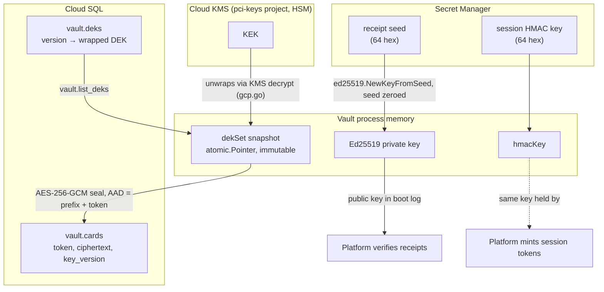
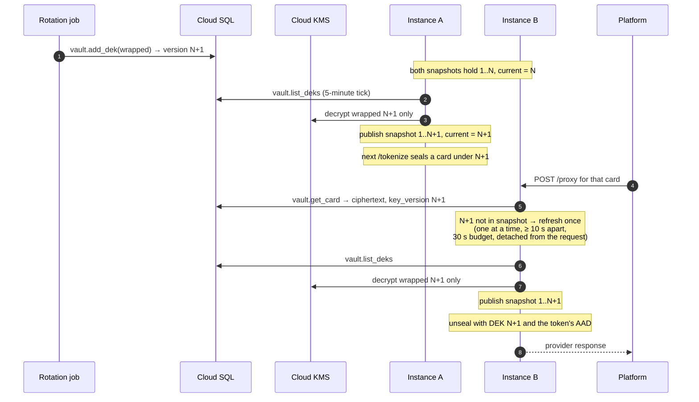

# Cryptography

This page is for engineers, security reviewers and auditors who want to understand how PAN Vault uses keys: how a card is encrypted at rest, how data keys reach a running instance and stay current during rotation, and how the session token and the signed receipt work. It explains the reasons and the trade-offs. The README's [§8](../../README.md#8-why-it-is-built-the-way-it-is) gives the summary and [§9](../../README.md#9-running-it-safely) the operating procedure; exact formats are in the [receipt reference](../reference/receipt.md) and the [configuration reference](../reference/configuration.md).

## The four keys

The vault holds four kinds of key material. Each has one job, and none can stand in for another.

| Key | Algorithm | Where it lives | Job |
|---|---|---|---|
| Key-encryption key (KEK) | Cloud KMS symmetric key | Cloud KMS, in the separate `pci-keys-<env>` project, HSM protection level (deployment, README §9) | Wraps and unwraps data keys. Never leaves KMS. |
| Data-encryption keys (DEKs) | AES-256-GCM, 32 bytes | Wrapped in `vault.deks`; unwrapped only in the vault's memory | Seal and open card records. |
| Session HMAC key | HMAC-SHA256, 32 bytes | Secret Manager (`VAULT_SESSION_HMAC_SECRET`); the platform holds the same key | Authenticates the browser's session token on `/tokenize`. |
| Receipt signing seed | Ed25519, 32-byte seed | Secret Manager (`VAULT_RECEIPT_KEY_SECRET`); only the vault | Signs the receipt `/tokenize` returns. The platform holds only the public key. |



## Envelope encryption

### Why two levels of key

A card could be encrypted directly with a KMS call. The vault does not do that: every `/tokenize` and every `/proxy` would then need a KMS round trip, and a KMS outage would stop all traffic. Instead it uses envelope encryption. Cards are sealed locally with a DEK, and the DEK itself is stored only in wrapped form, encrypted by the KEK in KMS.

The result is that the database never holds anything usable on its own. `vault.cards` holds ciphertext and `vault.deks` holds wrapped keys. Opening a card needs a KMS decrypt in another project, with its own IAM and audit log. An attacker with stolen database credentials who can call `get_card` (adversary C in [README §7.1](../../README.md#71-who-we-defend-against)) gets ciphertext and nothing to open it with, and so does anyone holding a copy of the database.

KMS is reached over plain `net/http` (`gcp.go`), not through a cloud SDK. `kmsPost` sends `POST {kmsBaseURL}{key}:decrypt` with a bearer token from the metadata server (`tokenSource`, which requires the `Metadata-Flavor: Google` response header and caches the token until 60 seconds before it expires). The key name must match `kmsKeyRe` exactly, because it is concatenated into the URL and a `..`, `?` or extra path segment could otherwise point the call at another resource. Responses are capped at 64 KiB (`maxGCPResponse`), the response buffer is zeroed after decoding, and errors carry only a status code or a fixed phrase. `kmsDecrypt` refuses any plaintext that is not exactly 32 bytes.

In production that same access token is also the Cloud SQL password (IAM database authentication, `openDB`). Because it also authorizes KMS decrypt, `openDB` refuses to boot unless every database connection path verifies the server certificate (`sslmode=verify-ca`, `verify-full`, or `require` with `sslrootcert`).

### Where DEKs come from

DEKs are created only by `vault -rotate-dek`, which runs as the `vault_rotator` role (`rotateDEK` in `main.go`):

1. Draw 32 random bytes.
2. Wrap them with KMS encrypt.
3. Unwrap the result with KMS decrypt and compare it with the original (`hmac.Equal`).
4. Only if they match, store the wrapped value with `vault.add_dek`, which assigns version `max(version) + 1`.

Step 3 exists because a wrapped value that cannot be unwrapped would make every later boot fail. Checking the round trip before storing keeps such a value out of the database. The serving role, `vault_app`, cannot call `add_dek` at all (`schema.sql` grants it only to `vault_rotator`), so a compromised serving process cannot plant a key.

The highest version is the current one: new cards are sealed under it. Older versions stay, so cards sealed under them still open.

### The in-memory snapshot

A running vault keeps its DEKs in a `dekSet` (`vault.go`): a map from version to 32-byte DEK, plus the current version. The vault holds it behind an `atomic.Pointer[dekSet]`.

- **Readers never lock.** `dek(version)` and `currentDEK()` load the pointer and read the map. A request never waits for a refresh to read keys it already has.
- **A published snapshot is never modified.** A refresh builds a new map and swaps the pointer. A reader that loaded the old pointer keeps a consistent view; there is no torn read and no map written while another goroutine reads it.
- **Keys only accumulate.** `unwrapDEKs` copies every DEK the old snapshot holds and adds only versions it lacks. The DEK slices already held are shared, not unwrapped again. No version is ever removed from a snapshot, so a card that opened yesterday still opens today.

In dev, `VAULT_DEV_DEK_HEX` supplies one DEK as version 1 and neither the database nor KMS is used; `dekRefresher` then returns a function that does nothing.

## Keeping the snapshot current

Rotation adds a DEK version while instances are running. Instances must learn about it without a restart, and the first instance to learn about it starts sealing new cards under it at once. That second fact drives the design.



Instance B has not reached its own 5-minute tick, yet it must open a card that A sealed under a key B has never seen. Without the on-demand refresh, B would answer `500` with `ALERT decrypt_failed` until its timer fired.

### The rules and why each exists

The rules live in `refresh` and `refreshLoop` (`vault.go`), `dekRefresher` and `unwrapDEKs` (`main.go`) and step 5 of `handleProxy` (`proxy.go`).

| Rule | Value | Why |
|---|---|---|
| Periodic refresh | `dekRefreshEvery = 5 * time.Minute` | An instance usually learns a new key before any request needs it, so the on-demand path is the exception. |
| On-demand refresh | when `v.dek(keyVersion)` misses in `/proxy` | Two instances refresh at different moments; the one that is behind must still open cards the other already seals under the new key. |
| Single-flight | `refreshMu` | Concurrent misses must not each call `list_deks` and KMS. Callers that queue behind a refresh in flight reach the rate-limit check after it ends and return without running again; the snapshot it published is already in place. |
| Minimum gap | `dekRefreshMinGap = 10 * time.Second`, counted from the end of the previous attempt, successful or not | Each refresh costs a `list_deks` call and possibly KMS calls. However many requests arrive for an unknown (possibly forged) key version, the cost stays at one refresh per window. A clock that stepped backwards (negative gap) does not suppress a refresh. |
| Time budget | `dekRefreshTimeout = 30 * time.Second`; the `list_deks` call inside it has its own 5 s `dbCallTimeout` | Bounds how long a slow KMS or database can hold the refresh, and with it every request queued behind it. It does not guarantee the response beats the internal listener's 60-second `WriteTimeout`: `get_card` (up to 5 s), a full refresh (30 s) and a slow provider (outbound timeout 30 s) can together exceed it. |
| Detached | `context.WithTimeout(context.WithoutCancel(ctx), dekRefreshTimeout)` | If the refresh used the request's context, a client that disconnects would cancel it. The failed attempt would still count for the 10-second gap, suppressing refreshes for every other request in that window. |
| Unwrap only new versions | `unwrapDEKs(…, have)` | KMS work is proportional to what changed, not to the number of keys held. |
| All or nothing | any KMS failure fails the whole call; DEKs this call unwrapped are zeroed, held ones are left alone | The code treats a failed unwrap of any version as a failed refresh, so no snapshot is ever published with some new versions missing. |
| A failed refresh keeps the current snapshot | the pointer is swapped only on success | A KMS or database outage never makes an instance forget keys it holds. |
| Errors are not logged | `_ = v.refresh(ctx)` | KMS and database errors can carry detail the logs must not hold. A version still missing after the refresh fails as `ALERT decrypt_failed`. |

Two more details in `handleProxy`:

- After an on-demand refresh, the handler checks `ctx.Err()`. If the client has gone, it stops without a response. The CVV is taken only later in the handler, so it stays cached for the platform's retry.
- A version still missing after the refresh is not a special case: `unseal` is called with a nil DEK, fails, and the request is answered `500` with `ALERT decrypt_failed`.

One window remains, described operationally in [README §9](../../README.md#9-running-it-safely): if KMS or the database is unreachable when an instance first meets a new version, or its last refresh finished less than 10 seconds earlier, before the key existed, cards under that key fail on that instance with `decrypt_failed`. If the instance had just refreshed, that lasts up to 10 seconds. If KMS or the database stays unreachable, it lasts until a refresh succeeds; each attempt, failed or not, holds off the next for 10 seconds, so refreshes are retried at most every 10 seconds, on demand or on the 5-minute tick. The [rotation how-to](../how-to/rotate-keys.md) covers the procedure.

## Sealing a card

`card.go` seals each card with AES-256-GCM.

**The plaintext** is `json.Marshal(card{...})`: `pan` (normalized digits), `exp_month`, `exp_year`, and `name` when one was given (`omitempty`, so a card stored without a name has the same plaintext shape as before names existed, and old rows decode with an empty name). The CVV is never part of it.

**The key** must be exactly 32 bytes. `newGCM` refuses anything else, because `aes.NewCipher` would otherwise silently accept a 16- or 24-byte key and downgrade to AES-128 or AES-192.

**The nonce** is 12 random bytes from `crypto/rand` for every seal. The output is `nonce || ciphertext || tag` (16-byte tag). With random 96-bit nonces, the usual bound is about 2^32 seals per key before the chance of a nonce collision stops being negligible. The vault does not count seals; staying far below the bound depends on traffic volume and on following the recommended monthly DEK rotation.

**The additional data** is `"pan-vault/card/1\x00" + token` (`cardAAD`). It is authenticated but not stored. The token is drawn before sealing for exactly this reason (`handleTokenize`).

### The attack the additional data defeats

GCM proves that a ciphertext was produced under a given key and has not been altered. On its own it does not prove *which row* the ciphertext belongs to. Every card sealed under the same DEK is a valid ciphertext under that key.

Without the additional data, someone who can write to `vault.cards` (a database administrator, a tampered restore, anyone with table-level access) could copy the ciphertext of a victim's card into the row of a token they control. The next `/proxy` call for their token would decrypt the victim's card and send it to the provider: a charge on someone else's card, with the vault's own credential.

With the token bound in, the copied ciphertext fails authentication under its new token. `unseal` returns the single static error `errUnseal`, and `handleProxy` answers `500 {"error":"internal error"}` and logs `ALERT decrypt_failed token=… key_version=… account=…`. Nothing is sent to the provider. The same alert covers authentic plaintext that is not a card record, which can only mean corruption.

The prefix carries a version (`/1`) so that a future change to the binding cannot be confused with this one, and the NUL byte separates it from the token. The other columns of the row are not bound: a changed `key_version` selects a different DEK and fails authentication anyway, and the stored `last4` is not used to answer any request.

### Clearing memory

Plaintext buffers are zeroed after use (`zero` in `card.go`). This is best effort, and the code says so: Go may have copied the bytes elsewhere through string conversions, garbage-collector moves or register spills. Zeroing narrows exposure; it does not guarantee the bytes are gone. The PAN itself is held as a Go string inside `card` for the length of one request.

## The session token

The browser must show a session token on every `/tokenize`:

```
Authorization: Bearer v1.<expires_unix>.<hex HMAC-SHA256(key, "v1." + expires_unix)>
```

`checkSession` (`tokenize.go`) checks, in this order:

1. **Format**: exactly `Bearer ` (case-sensitive, one space), three dot-separated parts, `v1`, 1–19 decimal digits, exactly 64 lowercase hex characters.
2. **HMAC**: recomputed with the 32-byte key and compared with `hmac.Equal`, which takes the same time whether the first or the last byte differs, so the comparison leaks nothing about how close a forgery came. A key shorter than 32 bytes authenticates nothing.
3. **Window**: `expires_unix` must be in the future and at most `sessionMaxAhead` (15 minutes) ahead.

Checking the HMAC before the window means the reason `expired` is reported only for authentic tokens. The upper bound on the window means even the platform cannot mint a long-lived token by mistake. Failures are answered `401 {"error":"unauthorized"}` and logged as `ALERT session_token_invalid reason=<format|hmac|expired>`, at most once per second.

**Why the platform mints it.** The platform is the party that knows a real checkout has started. If the vault minted session tokens, it would need an endpoint that hands them out, and that endpoint would need its own authentication, which moves the problem rather than solving it. With a shared HMAC key the vault stays stateless: it stores no sessions and needs no endpoint beyond `/tokenize`.

**Why HMAC here and a signature for receipts.** Both parties that hold the session key are meant to: the platform must create tokens and the vault must check them. A symmetric MAC is the simple, fast fit. The token is not bound to a card and is not single-use; within its 15 minutes it can tokenize more than one card. Its job is to stop strangers from using `/tokenize` as a card-validity oracle, with Cloud Armor rate limits on the public endpoint as the second layer.

## The signed receipt

`/tokenize` returns a receipt that states which token was issued and the truncated card facts (`bin`, `last4`, expiry, `name`, `iat`):

```
rcpt.v1.<base64url(payload)>.<base64url(Ed25519 signature over "rcpt.v1." + payload part)>
```

The format and the verification steps are in the [receipt reference](../reference/receipt.md) and [README §11.4](../../README.md#114-verifying-a-receipt). This section explains the choices.

### Why a signature, not an HMAC

With an HMAC, every service that checks a receipt would hold the key that creates receipts. Checkout, support tools and reporting could each forge card facts, and a leak from any of them would let an attacker mint receipts for card numbers that were never tokenized. With Ed25519 the platform verifies with a **public key** and never holds a secret for receipts at all. Only the vault holds the seed.

The seed is 32 bytes from Secret Manager. `newVault` derives the key pair with `ed25519.NewKeyFromSeed` and zeroes the seed immediately; the private key holds its own copy. The public key is logged at boot as `receipt public key=<base64url>`, the form the platform configures. `signReceipt` panics on a key of the wrong length rather than issue an unsigned receipt (the request guard turns the panic into a `500`).

### Why the signature covers the encoded bytes

The payload is encoded once (`encodeReceipt`: compact JSON, fixed key order, HTML escaping off) and the signature covers `rcpt.v1.` plus the base64url text of exactly those bytes. A verifier never re-serializes anything, so two JSON libraries that format numbers or escape characters differently cannot disagree about what was signed. The prefix is inside the signed bytes, so a receipt cannot be relabelled as another scheme or version.

### Why verify before parse, and why the bounds

`verifyReceipt` (`receipt.go`) is the reference verifier. Its order is deliberate:

1. **Reject input longer than 2048 bytes** (`maxReceiptLen`). The longest receipt the vault issues is 1097 bytes (a 100-rune name whose every rune JSON-escapes to six bytes, 8 + 4 digits, the largest `iat`), so the cap rejects nothing genuine and fixes the cost of hostile input.
2. **Split into at most five parts** (`strings.SplitN(s, ".", 5)`), so an input made of dots costs no more than a valid one.
3. **Require the signature part to be exactly 86 characters**, the unpadded base64url length of a 64-byte signature, before scanning or decoding it.
4. **Check the alphabet**, because Go's base64 decoder skips CR and LF: a part with a newline inserted would otherwise decode to the same bytes. Decoding is `Strict`, so each payload and signature has exactly one accepted spelling.
5. **Verify the signature**, over `rcpt.v1.` plus the payload part exactly as received.
6. **Only then decode and parse the payload**: one JSON object, exactly the receipt's keys, each once, nothing after it.

Verifying first means unauthenticated bytes never reach the JSON decoder. A parser bug, a pathological nesting depth or an ambiguous duplicate key in attacker-supplied JSON cannot matter, because only bytes the vault signed are parsed. The strict parse still runs afterwards, so a payload that two JSON parsers could read differently is rejected even when signed.

### What the receipt carries

`cardBIN` returns the first 8 digits only for a 16-digit number and the first 6 otherwise. The PCI SSC truncation table allows first 8 and last 4 only for 16-digit numbers; other lengths would need the card brand's confirmation, which the vault does not have. With the last four, digits always stay hidden, even for a 13-digit card. The BIN and the name reach the browser only inside the receipt, never as top-level `/tokenize` fields, and the receipt is never logged.

## Dev keys and production secrets

Each production secret has a dev stand-in: `VAULT_DEV_DEK_HEX`, `VAULT_DEV_SESSION_HMAC_HEX`, `VAULT_DEV_RECEIPT_KEY_HEX` (exactly 64 hex characters each, `decodeKey64`). The boundary between the two is enforced several times, so one missed check does not let a dev key into production:

| Check | Where |
|---|---|
| Each fixed dev variable refuses a `VAULT_ENV=prod` boot | `loadConfig` |
| Any `VAULT_DEV_*` name at all, even empty, refuses a prod boot | `devVarSet`, called from `main` |
| An unknown `VAULT_DEV_*` name refuses a dev boot, so a typo cannot silently fall back to Secret Manager | `checkDevSecretVars` |
| A dev DEK is refused outside dev | `loadDEKs` |
| Dev session or receipt keys are refused outside dev | `loadSecrets` |

**Zero on failure.** `loadSecrets` loads the session HMAC key and then the receipt seed through `loadKey32`. A Secret Manager payload must be exactly 64 hex characters; the raw payload is zeroed once decoded, and a key that is not 32 bytes is zeroed and refused. If the receipt seed fails, the already-loaded HMAC key is zeroed and neither is returned. If a later boot step fails (loading the catalog account secrets), `main` zeroes both. Dev keys are handed over as the config's own slices rather than copies, so zeroing a returned key also clears the config's copy. Secret Manager responses also pass a CRC32C check when `dataCrc32c` is present (`accessSecret`).

Error messages name the variable, never the value.

## What is deliberately not done

- **No re-encryption on rotation.** A new DEK seals new cards only. Existing rows stay sealed under the DEK that sealed them, which is why every instance keeps every version. Re-encrypting old cards (`rewrap_card`) is planned for v1.1.
- **No key retirement.** No DEK is ever removed from the database or from a running snapshot, and DEKs stay in memory for the life of the process. Retiring a key safely needs re-encryption first.
- **No DEK rewrap under a newer KMS key version.** KMS decrypt accepts older key versions, so wrapped DEKs stay readable after a KMS rotation, but they stay wrapped under the version that wrapped them. Rewrapping is v1.1 work.
- **No receipt key rotation inside the vault.** A new seed means a new public key; the ordered procedure is in [README §9](../../README.md#9-running-it-safely).

The list of planned work is in [README §10](../../README.md#10-known-limitations-and-what-comes-next).

## See also

- [CVV lifecycle](cvv-lifecycle.md): the one secret the vault holds only in memory.
- [Design decisions](design-decisions.md): token-bound additional data, refresh rules and receipts as decisions.
- [Threat model](threat-model.md): the adversaries these keys defend against.
- [Rotate keys](../how-to/rotate-keys.md) and [Respond to alerts](../how-to/respond-to-alerts.md).
