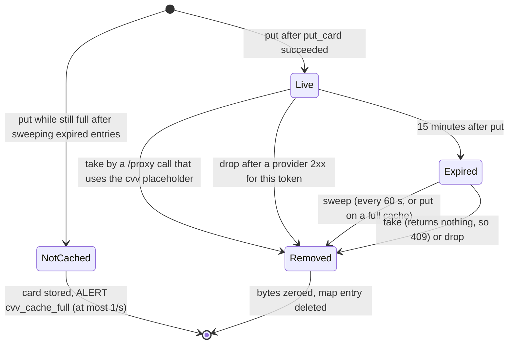

# CVV lifecycle

This page is for engineers and reviewers who want to understand how PAN Vault handles the card security code: why it holds the CVV at all, why only in memory, how the cache is bounded, when an entry disappears, and what is left over when there are two instances. [README §6.1](../../README.md#61-tokenize-browser--vault) and [§10](../../README.md#10-known-limitations-and-what-comes-next) state the behaviour in brief; this page explains the reasons and the residual risks.

## Why the vault holds the CVV at all

The CVV exists to prove, at authorization time, that the customer has the physical card. A provider asks for it when the card is first handed over, for example when the vault calls Stripe's `POST /v1/tokens` with `card[cvc]={{cvv}}`. After that hand-off the CVV has no further use: a later charge with the provider's token, or a card-on-file payment, goes without it.

So the vault needs the CVV once, for a short time, between the browser's `/tokenize` and the platform's first `/proxy` call that uses `{{cvv}}`. It does not need it after that, and it must never keep it: the CVV is sensitive authentication data, and the vault's rule is that it is never persisted anywhere, including the database, temporary files and logs.

## Why memory only

The alternative to memory is some form of storage: the cards table, a separate table, a cache service, a file. Each would make the CVV durable, backed up and readable by whoever can read that store. Keeping it in the process's memory means:

- it is gone when the process exits, crashes or is replaced;
- it never reaches a backup, a replica or a log;
- nothing that cannot read the vault process's memory can read it.

The price is that the CVV is per instance, which is the subject of [the cross-instance residual](#the-cross-instance-residual) below.

## The cache

The cache is `cvvCache` in `card.go`: a map keyed by token, guarded by one mutex.

| Property | Value | Code |
|---|---|---|
| Key | the card's token (`tok_` + 32 hex) | `map[string]cvvEntry` |
| Value | the CVV as `[]byte`, and its expiry time | `cvvEntry{cvv []byte, exp time.Time}` |
| Time to live | 15 minutes from `put` | `cvvCacheTTL = 15 * time.Minute` |
| Sweep interval | every 60 seconds | `cvvSweepEvery = 60 * time.Second`, `run` |
| Capacity | 50,000 live entries | `cvvCacheMax = 50_000` |
| Expiry boundary | expired from exactly `put + ttl` onward | `sweepLocked`: `!now.Before(e.exp)` |

**Why `[]byte`.** A Go string cannot be overwritten. Holding the CVV as a byte slice lets `removeLocked` zero it when the entry is removed, whichever way it is removed. Removal and zeroing happen under the mutex, so a concurrent `take` or `drop` for the same token finds the entry either intact or gone, never half-zeroed. Zeroing is best effort, like all clearing of Go memory (see [the honest residual](#the-honest-residual)).

**Only after the card is stored.** `handleTokenize` calls `put` only after `vault.put_card` has succeeded. A request that fails to store its card leaves no CVV behind.

### The operations

- **`put(token, cvv)`** removes any existing entry for the token, then caches the CVV until `now + ttl`. Below the cap it does not sweep, so `put` stays cheap however many entries are pending. At the cap it first removes every expired entry; if the cache is still full, it caches nothing and returns `false`.
- **`take(token)`** removes the entry and returns the CVV, or `""` if there is no entry or it has expired. It removes an expired entry too. Concurrent callers for the same token get the CVV at most once: this is what makes the CVV **single use**.
- **`drop(token)`** removes and zeroes the entry if there is one, and does nothing otherwise.
- **`sweep` / `run`** remove every expired entry. `run` calls `sweep` on a 60-second ticker until the background context is cancelled at shutdown. Without it, expired CVVs would stay until the cache next filled up.

An expired entry is unusable from the moment it expires: `take` checks the expiry itself. The sweep only decides how long the expired bytes stay in memory before they are zeroed, which is at most about 60 seconds after expiry, so the cached copy exists for at most about 16 minutes after tokenization. Other copies are not cleared at all (see [the honest residual](#the-honest-residual)).

### Why a full cache refuses instead of evicting

Without a cap, a flood of `/tokenize` calls with CVVs would pin memory without limit. With a cap, there are two choices when it is full: evict a live entry, or refuse the new one.

Evicting would let an attacker who can call `/tokenize` (with a valid session token) push out the CVVs of real customers who are mid-checkout, and their `{{cvv}}` hand-offs would fail. Refusing confines the damage to the cards tokenized during the flood. Those cards are still stored and `/tokenize` still answers `200`; only their CVV is not cached, and a later `{{cvv}}` request for them gets the ordinary `409`. `handleTokenize` then logs `ALERT cvv_cache_full`, at most once per second on its own limiter, so the alert neither hides nor is hidden by the session and policy alerts.

The refusal path has a cost: while the cache is full of live entries, each CVV-carrying `/tokenize` call sweeps the whole map under the mutex before refusing. That is bounded (50,000 entries) and lasts only while the flood keeps the cache full of entries younger than 15 minutes.

## When the CVV is used and when it is dropped

`handleProxy` (`proxy.go`) runs its steps in a fixed order, and the position of the CVV in that order is deliberate.

1. Every check that can fail on the platform's input or on the card comes first: the envelope, the catalog policy (`checkProxy`), `vault.get_card` (velocity and audit), decryption, and the `{{name}}` check (`409 name unavailable`).
2. Only then, if the request uses `{{cvv}}`, the CVV is taken. None cached means `409 {"error":"cvv unavailable"}`.
3. The request is rendered and sent.

Because the CVV is taken last, a request rejected for any other reason leaves it cached for a corrected retry. The name check comes before the take for the same reason. If an on-demand key refresh outlasts the client, the handler stops before the take, again leaving the CVV in place.

Once taken, the CVV is gone, even if the send fails afterwards (`502 provider unreachable`) or the provider declines. A retry that uses `{{cvv}}` then gets the 409. The vault cannot know whether a failed send reached the provider, and single use is the safer reading.

### The drop on any provider 2xx

After sending, if the provider answers with any 2xx status, `handleProxy` calls `v.cvv.drop(env.Token)`:

- **whether or not the request used `{{cvv}}`.** A 2xx means the provider accepted the card, so the card has left the vault. A CVV still cached for that token (because this request did not use it) has no remaining purpose and is dropped rather than left for 15 minutes.
- **even if the response is then refused.** The drop runs before the `Content-Encoding` check and the 4 MiB read. A compressed provider response becomes `502` and an oversized one too, but the provider did accept the card, so the CVV is dropped all the same.

Any other status leaves an unused CVV cached, because the platform may retry.

## The 409 contract

The vault answers `409 {"error":"cvv unavailable"}` whenever a request uses `{{cvv}}` and no live CVV is cached for the token: already used, already dropped, expired, refused by a full cache, never supplied, or cached on another instance. It never edits the platform's body to drop the CVV field and send the rest.

The reason is the vault's general rule: it verifies, it does not rewrite. A request that silently lost a field would be a request the platform did not write, sent to a provider with the vault's credential, and the platform would not know what the provider actually received. A 409 tells the platform exactly what happened and lets it decide.

**What the platform should do:** on `409 cvv unavailable`, resend the same request without the CVV field (and without `{{cvv}}`), for example as a card-on-file request. If the hand-off must carry the CVV, send the CVV-bearing request first and soon after tokenization. The [integration guide](../how-to/integrate-the-platform.md) covers the platform side.

## The cross-instance residual

Production runs two instances (README §9), and `/tokenize` and `/proxy` arrive through different load balancers: one public, for browsers, and one internal, for the platform over mTLS. The CVV cache lives in each instance's memory. Two consequences follow.

1. **A miss.** If the `/proxy` call lands on a different instance than the `/tokenize` call, the CVV is not there and a `{{cvv}}` request gets the 409. The platform retries without the CVV field.
2. **A survivor.** A provider 2xx drops the CVV only on the instance that handled the `/proxy` call. If the CVV was cached on the other instance, it stays there until it expires and is swept: about 16 minutes at most after tokenization. It is still in memory only, still single use and still unreachable from outside the process, but it outlives the hand-off.

### The stronger options, and why they were not taken

| Option | Why not |
|---|---|
| A shared CVV store (database table, Redis, Memorystore) | It is storage. The CVV would become durable, replicated and readable by whoever can read the store, which the vault's rules forbid outright. |
| Affinity: route a token's `/proxy` to the instance that served its `/tokenize` | The two calls come from different callers through different load balancers, so no session affinity connects them. The token is inside the JSON body, and the internal listener's TLS terminates in the vault, so the internal load balancer cannot read it to route on. |

The accepted trade-off is a CVV that can survive a hand-off by at most about 16 minutes, in memory, on one instance, against adding any place where the CVV is stored.

## Memory cost

Each entry is a 36-character token key, a byte slice of 3–4 bytes and an expiry time, plus map overhead. Measured on 2026-10-31 on a development workstation (see [Performance](performance.md)), a vault with a full cache (52,000 `/tokenize` calls with CVV at 64 concurrent clients) held about 44 MB resident, against 24.5 MB after 2,000 `/tokenize` calls. The two runs differ in concurrency and in call count, so the difference is an upper-bound estimate: a full cache costs at most about 20 MB of resident memory, garbage-collector headroom included.

## The honest residual

The `[]byte` copy in the cache is zeroed on removal. Other copies are not:

- **JSON decoding creates a string.** `handleTokenize` decodes the request into `tokenizeRequest`, whose `CVV` field is a `*string`. That string cannot be overwritten; it lives until the garbage collector reclaims its memory, which does not clear it. The final request body buffer is zeroed (`defer zero(body)`), but `io.ReadAll` builds it through intermediate buffers it discards as it grows, and each `json.Decoder` keeps its own internal copy of the body; none of those copies of the whole body is zeroed.
- **`take` returns a string.** `string(e.cvv)` copies the CVV before the cached bytes are zeroed, and that string is passed to `renderRequest`. The rendered request body (`plan.sent`) is zeroed after the provider's response has been read; the string is not.
- **Go may copy anything.** String conversions, garbage-collector moves and register spills can leave bytes elsewhere. `zero` in `card.go` says so: it narrows exposure but cannot guarantee the bytes are gone.

These copies are short-lived and live only in the vault's own memory, which an attacker can read only by already controlling the process (adversary B), at which point the DEKs are exposed too. They are recorded here so that nobody reads "zeroed" as "guaranteed gone".

## See also

- [Cryptography](cryptography.md): how the rest of the card is sealed.
- [Design decisions](design-decisions.md): the CVV cache bounds as a decision.
- [API reference](../reference/api.md) and [Limits](../reference/limits.md): the exact status codes and values.
- [Respond to alerts](../how-to/respond-to-alerts.md): what to do about `ALERT cvv_cache_full`.
