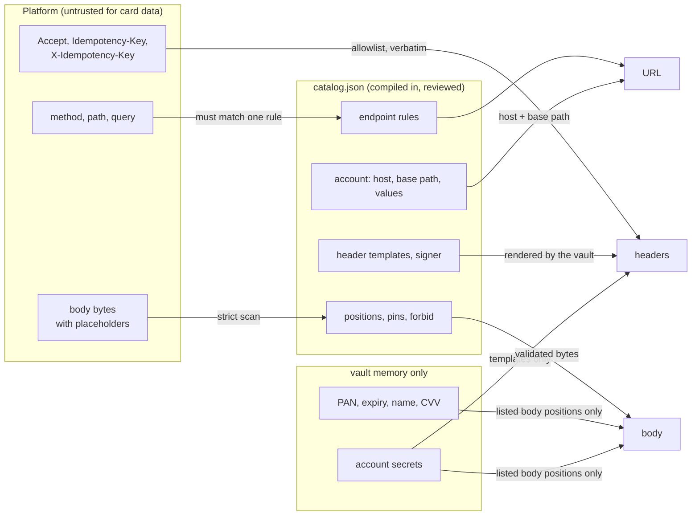

# Proxy design

This page is for engineers and reviewers who want to know why `/proxy` works the way it does: the platform builds the whole provider request with placeholders, and the vault only checks it against a compiled-in catalog, fills the placeholders, attaches its own credential and sends it. It covers the alternatives that were rejected, the properties the design gives, and where its limits are. The request flow itself is in [README §6.3](../../README.md#63-proxy-platform--vault--provider); the catalog format is in [the catalog reference](../reference/catalog.md).

## The problem

The vault must let the platform charge cards at several providers (Stripe today; Adyen, Mercado Pago, PayU Latam and Pagar.me are modelled in the test catalog) and several accounts per provider, without the platform ever seeing a card number, and without giving a compromised platform a way to move the card somewhere else. Three things have to be decided: who writes the provider request, who holds the provider credential, and what bounds the request.

## Alternatives that were rejected

**1. The vault builds each provider request itself.** Each provider operation would be a Go function in the vault that takes a token and a few business fields (amount, currency, reference) and assembles the provider's request.

- Every provider's request shapes, field names and quirks become code inside the PCI scope. The audited code grows with each provider and each API change.
- Every provider change is a code change and a release of the CDE component, with its review and evidence burden.
- The vault has to understand each provider's business semantics to build correct requests, which is exactly the knowledge the platform already has.

**2. A generic pass-through proxy.** The platform sends a URL, headers and a body with placeholders, and the vault fills them and forwards the request.

- The platform could point the card at any URL, any host, any header. A compromised platform sends the card to itself in one request.
- An allowlist of hosts alone is not enough: on an allowed host, the platform could still call an endpoint that stores the card, put the card in a field that comes back in the response, or use its own credential so the card lands in an account it controls.

**3. The platform holds the provider credentials, and the vault only injects card data.**

- A compromised platform with live provider keys can use those keys directly: call endpoints that return stored payment data, or create and attach payment methods, without the vault ever seeing the call.
- The credential would also have to travel through or around the vault, giving the platform a way to substitute its own.

## The chosen design

The platform writes the request; the catalog decides what may be sent; the account decides where it goes and with which credential; the vault fills in only what it alone holds.

| Part of the provider request | Written by | Bounded by |
|---|---|---|
| Destination host and base path | The account in `catalog.json` | Fixed per account; the platform names the account, never a host |
| Method, path, query | The platform | Must match exactly one endpoint rule of the account's provider; query keys must be listed |
| Headers | The platform for `Accept`, `Idempotency-Key`, `X-Idempotency-Key` only; the vault for credential templates, `Host`, `Content-Type`, `Content-Length`, `User-Agent: pan-vault/1` | `platformHeaders` and the endpoint's `headers` templates; anything else is rejected |
| Body | The platform, in the provider's format, with placeholders | Strict parse; each placeholder at a listed position; pins; `forbid` |
| Card values, CVV, account secrets, signature | The vault | Only at the positions and templates the catalog lists |

## The properties this gives

Each property below except one is enforced in code, mostly by `checkProxy` (`policy.go`) before any database call, and again where it matters by `renderRequest` (`render.go`) before any network call. The exception is the restriction to charge and single-use hand-off endpoints, which is enforced by catalog review.

**The bytes sent equal the validated bytes plus the substitutions.** `scanBody` records each placeholder's exact byte span; `renderRequest` re-checks that each span still holds exactly that placeholder, then `substitute` (`scan.go`) copies every other byte unchanged. No re-serialisation happens, so the vault checked exactly the bytes the provider receives: no difference between how two serialisers write the same data can creep in. This alone does not close disagreements between how the vault and the provider *parse* those bytes; that is the job of the strict scanners described [below](#why-the-scanners-are-strict).

**Card placeholders only at listed body positions.** A position maps one address (a JSON Pointer for `json`, a decoded field name for `form`) to exactly one placeholder (`catEndpoint.positions`). An occurrence anywhere else, or a different placeholder at that address, is `invalid placeholder use`. Each card placeholder kind may appear at most once, counting all expiry forms of one kind together (`{{exp_year}}` and `{{exp_year:yy}}` in one body are rejected). A placeholder must be the whole value: no concatenation.

**Never in headers, path or query.** A catalog header template may not hold a card placeholder (`parseCatEndpoint` refuses it). Platform header values and query values may not contain `{{` at all (`checkProxyHeaders`, `validProxyQuery`). Paths must match a rule segment by segment: literal segments exactly, and a `{name}` wildcard segment with a value the platform chooses within `[A-Za-z0-9_-]{1,128}` (`proxyWildcardRe`). `matchEndpoint` also refuses `%`, `//` and `..`.

**A mandatory `{{pan}}`.** Every catalog endpoint must declare `"card_data": true` and a `{{pan}}` position, and every request must contain a `{{pan}}` occurrence. The vault's credential is lent only to card-carrying calls. A refund, a query, a payment with a provider token or a Stripe `pii` token is the platform's own call, made with its own keys (`TestProxyEmbeddedCardOnly`).

**Pins are verified, never overwritten.** A pin requires a body field to equal an account value (`{"account": "merchantAccount"}`) or a literal (`{"literal": "SUBMIT_TRANSACTION"}`). Account values compare as strings only, so a JSON number never matches. The vault does not insert or fix the value: a missing or different value is `pinned field mismatch`.

**`forbid` closes save and reuse flags.** A forbidden address must be absent, or equal one of the listed literals (Adyen's `/storePaymentMethod` may be `false`). In a form body, a forbidden `customer` also forbids `customer[`, `customer[]`, `customer[x]` and `Customer[x]`, because bracket-parsing servers nest those under the same field.

**Case-variant aliases are refused.** A body field whose address differs from a position, pin, forbid or signer-input address only in letter case fails that check. Some provider parsers bind keys case-insensitively, so `/MerchantAccount` next to `/merchantAccount` could otherwise override a pinned value or supply a credential.

**Vault credentials only where the catalog puts them.** `{{secret:NAME}}` and `{{signature}}` may appear in an endpoint header template or at a listed body position; `{{basic:NAME}}` only in a header template. A credential header must equal its template exactly, unrendered, or be omitted; either way the vault renders and sets it. A credential body position, like every position, accepts only its placeholder, so a platform-supplied key at `/merchant/apiKey` is rejected rather than forwarded. `TestProxyForgedAuthorization` covers forged values in exact, lowercase and uppercase header names.

**Only charge or single-use hand-off endpoints.** Card data goes only to endpoints that charge, or that create a single-use token the platform then charges with its own keys. Endpoints that store the card at the provider, or that send data to a caller-chosen URL, are not admitted. This property is enforced by catalog review, not by the parser: the parser cannot know what a provider endpoint does with a card. The review checklist in `CLAUDE.md` ("Catalog changes") requires a link to the provider's documentation for each endpoint and a `forbid` entry for every save or reuse flag it accepts. Stripe's `POST /v1/payment_methods` is not in the catalog for this reason ([README §6.5](../../README.md#65-the-current-catalog)).

**One escape hatch for provider code: named signers.** Some providers sign each request. PayU, for example, hashes the API key, merchant ID, reference and amount. A general signature recipe in the catalog would be a small programming language inside the allowlist, so instead each scheme is a named Go function: today only `payu` (`render.go`, `signPayU`). A signer reads account secrets, account values and specific body fields (`payuSignerInputs`), never card data, and its inputs may not hold placeholders or case-variant aliases. An unknown signer name fails closed in the parser, in `checkProxy` and in `renderRequest`.

**Rejections are loud, not silent.** The vault never drops an unknown header or edits a body to remove a field. A violation is a `400` with a fixed message and `ALERT proxy_policy account=<a> endpoint=<id|-> reason=<r>`, so a platform bug or a platform compromise shows up immediately. Account and endpoint names in the alert come from the catalog, not the request. The alert is limited to one line per second (`alertPolicy`), so a burst shows as one line a second with the access log's `status=400` lines beside it. A malformed envelope, an invalid token and an unknown account are rejected without an alert, because no account is known yet to name in it.

## Why the catalog is compiled in

`catalog.json` is embedded with `go:embed` (`catalog.go`, `catalogJSON`) and parsed at boot by `parseCatalog`. It is never read from a file, the database, Secret Manager or the environment at runtime.

- **An allowlist that can be edited at runtime is the first thing an attacker edits.** With the catalog in the binary, changing it requires a build, a review and a deployment.
- **The image digest attests the catalog.** Builds are reproducible (`make image-repro`), so the digest of the running image identifies the exact catalog it enforces.
- **One image for both environments.** Every account is tagged `dev` or `prod`, and a vault loads only the accounts of its `VAULT_ENV`. The same reviewed image is promoted from dev to prod without a different catalog.
- **Validation is strict and early.** Unknown keys (spelled exactly: `"Format"` for `"format"` is refused), duplicate keys, invalid paths or hosts, overlapping endpoints, unknown placeholders or signers, a `{{basic:}}` at a body position, a missing `{{pan}}` position, more than 64 positions, and two account secrets sharing a dev variable all refuse the boot and fail `TestEmbeddedCatalog`.

The trade-off is that a provider change still needs a release. It does not need a code change.

## A new provider is a data change

Adding a provider, an endpoint or an account changes `catalog.json`, `egress-hosts.<env>.txt` and the test fixtures, and creates the account's secrets in Secret Manager. No Go changes. The pull request carries the review that the code cannot do: the provider document showing the endpoint charges or creates a single-use token, every save or reuse flag with its `forbid` entry, a check of form keys against the grammar, sandbox verification, and the endpoint's documented responses. `TestEmbeddedCatalog` fails without an example request in `embeddedFixtures`, and `TestEgressHostsMatchCatalog` fails if the egress host lists drift from the accounts.

Code is needed only when a provider needs a shape the rule format does not have: a new body format (XML, for example), a new placeholder modifier or a new signer. Those are deliberate code changes with their own review. The step-by-step procedure is in [Add a provider](../how-to/add-a-provider.md).

## Why the scanners are strict

`scan.go` has two body scanners. Both exist to make sure that the vault and the provider see the same fields, because a check performed on a different reading of the body than the provider's is no check at all.

**JSON** (`jsonWalk`, `scanBody`) uses `encoding/json`'s tokenizer but adds what that package does not enforce on its own:

- exactly one value, valid UTF-8, no trailing data, no BOM;
- no duplicate keys in any object, compared after decoding escapes (parsers disagree on which duplicate wins);
- no decoded U+FFFD in a key or string, because `encoding/json` silently turns a lone surrogate escape into U+FFFD where other parsers reject or keep it;
- no control character U+0000–U+001F in a key (DEL, U+007F, is not refused), so a parser that truncates at NUL cannot alias `merchantAccount\u0000` to `merchantAccount`;
- nesting at most `maxJSONDepth` = 64;
- a string containing `{{` after decoding must be, raw, exactly `"` + a vocabulary placeholder + `"`; an escaped spelling such as `"\u007b\u007bpan}}"`, which decodes to `{{pan}}`, or a key containing `{{` is `invalid placeholder use`.

**Form** (`formFields`, `validFormKey`, `scanBody`) is stricter than `url.ParseQuery`:

- every raw byte is visible ASCII (`0x21`–`0x7E`), spaces as `+`, everything else percent-encoded;
- `;` is rejected outright, because some parsers treat it as a separator;
- every segment is `key=value` with a non-empty key; percent escapes must be valid; decoded keys and values must be valid UTF-8;
- keys are unique unless they end in `[]`;
- decoded keys must match `^[A-Za-z0-9_-]+(\[[A-Za-z0-9_-]+\])*(\[\])?$`. No `.`, because PHP rewrites `a.b` to `a_b`; `[]` only at the end, because a mid-key `[]` appends to an array no name can address; and no malformed brackets (`customer]`, `a[b]c`), which bracket-parsing servers normalise onto other names;
- a value containing `{{` after percent-decoding must be, raw, exactly a vocabulary placeholder, and never under a repeatable `[]` key, since such a key names no single position.

Strictness errors take precedence over placeholder errors, and both are reported with fixed messages. The cost is that an unusual but legitimate body is refused and the platform has to adjust; the README discusses that trade-off in [§8](../../README.md#8-why-it-is-built-the-way-it-is).

## Why `{{basic:NAME}}` is header-only

`{{basic:NAME}}` renders `base64(secret + ":")`, the HTTP Basic credential encoding. Basic is an HTTP authentication scheme, so its only use is an `Authorization` header template such as `Basic {{basic:secretKey}}` (Pagar.me in the test catalog). The rule keeps the set of places a credential can appear as small as the providers need: `parseCatEndpoint` refuses `{{basic:}}` at a body position, and `renderRequest` fails closed if one ever reached a body. Secrets that a provider expects in the body use `{{secret:NAME}}` at a listed position instead (PayU's `/merchant/apiKey`).

## Memory bounds: an example of the class of issue

The `/proxy` envelope is attacker-controlled input of up to 64 KiB, parsed several times by `checkProxy` (once to find occurrences, again to read each pin, forbid and signer field). That makes resource use, not only correctness, part of the security surface. The change that introduced the current bounds (commit `7fe5a9e`) found that a body under the size cap, shaped as a long key over a wide array, or many placeholders under a long key, could make the JSON walker allocate memory growing with the square of the body size: each node stored its full JSON Pointer and each container a copy of its text, so a long key was copied once per descendant.

The fix has three parts:

- **Lazy pointers.** A `jsonNode` stores only its parent index and its own segment. `jsonPointer` assembles a pointer on demand, and `jsonPointerIs` compares a node against an address without building one at all. Containers keep a byte span instead of a copy (`scan.go`).
- **An occurrence cap.** `scanBody` refuses a 65th placeholder occurrence (`maxOccurrences` = 64) with `invalid placeholder use`, and `parseCatEndpoint` refuses an endpoint with more than 64 positions, so the cap can never refuse a request the catalog would accept.
- **A validate-only walk.** `jsonStrict` runs `jsonWalk` without recording nodes, so checking the envelope costs no memory per token.

Differential tests pin the behaviour by comparing the allocation of a body with and without the expensive feature: `TestJSONWalkMemoryBound`, `TestCheckProxyMemoryBound`, `TestScanOccurrenceCap` and `TestParseCatEndpointPositionCap`. The general lesson for this surface: any per-node or per-occurrence copy of attacker-sized data is a potential quadratic, and a new parser or rule should come with a test of that shape.

## Where the design stops

- **Responses are relayed, not rewritten.** The vault masks only this card's number (plain, or grouped in fours with single spaces or hyphens). Any other data in a provider response reaches the platform as is, which is why the catalog review includes each endpoint's documented responses.
- **Hand-off tokens.** After the vault creates a single-use provider token, the platform uses it with its own keys. The vault cannot stop the platform from asking the provider to save the card through that token ([README §7.4](../../README.md#74-what-the-vault-cannot-enforce-hand-off-tokens)).
- **Endpoint semantics.** Whether an endpoint charges, hands off or stores is a property of the provider's API, checked by review against the provider's documentation and sandbox, not by code.
- **Literal `{{` and concatenation.** A provider that needs a literal `{{` in its data, or a value built from two placeholders, is not supported until a format for it is added.

## See also

- [Catalog reference](../reference/catalog.md): every field of `catalog.json`.
- [Add a provider](../how-to/add-a-provider.md).
- [Threat model](threat-model.md): adversary A's attack tree uses these properties.
- [Design decisions](design-decisions.md) and [architecture](architecture.md).
