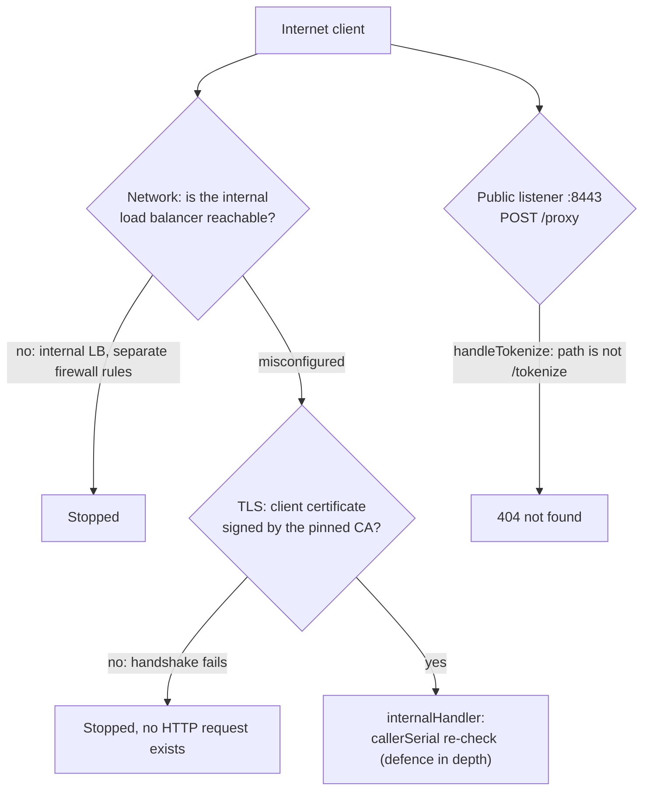

# Threat model

This page is for security reviewers, assessors and engineers changing security-relevant code. It takes the adversaries of [README §7.1](../../README.md#71-who-we-defend-against) and works through each one as an attack tree: what they control, what they want, every path they could try, and the control that stops or limits it, with the file that implements it. It also states what the vault assumes, where its protection ends, and which risks remain.

## What is being protected

| Asset | Where it exists | Primary protection |
|---|---|---|
| PAN, expiry, cardholder name | Browser → vault in TLS; sealed in `vault.cards`; in vault memory for one request; in the provider request | AES-256-GCM per record (`card.go`), DEKs wrapped by an HSM key in another project, no endpoint that returns a card |
| CVV | Vault memory only, at most 15 minutes, single use | `cvvCache` (`card.go`); never in the `card` record, the database or a log |
| DEKs | Wrapped in `vault.deks`; unwrapped in vault memory | KMS key-encryption key that never leaves the HSM |
| Provider account secrets | Secret Manager; vault memory | Only rendered into catalog header templates and body positions (`render.go`) |
| Session HMAC key | Secret Manager; vault and platform memory | Used only to verify session tokens (`tokenize.go`, `checkSession`) |
| Receipt signing seed | Secret Manager; vault memory (zeroed after deriving the private key) | Never logged; only the public key leaves the vault |

## Adversary A: compromised platform

**Controls:** the platform's code and its client certificate, so it can open mTLS connections to the internal listener and send any `/proxy` envelope with any token it has stored. It also holds the session HMAC key (it mints session tokens) and the receipt public key. An insider holding the platform's certificate is the same adversary.

**Wants:** card numbers or CVVs; to send a card somewhere it controls; to make our provider accounts store cards it can reuse later; to pull every card in bulk.

| Path the attacker tries | What stops it | Where |
|---|---|---|
| Ask the vault for a card number | There is no such endpoint. The internal listener serves `POST /proxy` and `GET /healthz` only, and `/proxy` returns only the provider's status, `Content-Type` and body, with this card's number masked. | `proxy.go`, `internalHandler`, `handleProxy`; `outbound.go`, `maskPAN` |
| Send the card to a host it controls | The envelope has no host field. The URL is `https://` + the account's catalog host + base path + path, re-checked after a reparse; any mismatch is `ALERT egress_invariant` and 500. Redirects are not followed and `HTTP_PROXY` is ignored. The egress firewall allows only this environment's provider hosts. | `render.go`, `accountURL`; `outbound.go`, `newOutboundClient`; `egress-hosts.<env>.txt` |
| Reach another path on the provider's host, such as a card-storage endpoint | The method and path must match exactly one catalog rule. Paths containing `%`, `//` or `..` never match; `accountURL` refuses dot segments and `%` again. | `policy.go`, `matchEndpoint`; `render.go`, `accountURL` |
| Put the card in a header, the path or the query | Card placeholders are allowed only at body positions the endpoint lists. Header templates may not hold card placeholders (refused when the catalog is parsed), platform header values may not contain `{{`, and query values may not contain `{{`. | `catalog.go`, `parseCatEndpoint`; `policy.go`, `checkProxyHeaders`, `validProxyQuery` |
| Put the card in a body field the provider echoes (a description, metadata) | Each position address maps to exactly one placeholder; `{{pan}}` is allowed only at its listed address (`card[number]` for Stripe). An echoed number is still masked as a backstop and raises `ALERT pan_echo`. | `policy.go`, `checkProxy`; `outbound.go`, `maskPAN` |
| Use its own provider key, so the card lands in an account it controls | A credential header must equal its catalog template exactly, or be omitted; the vault always renders it with its own secret. A credential body position accepts only its vault placeholder. Any other value is `header not allowed` or `invalid placeholder use` (`TestProxyForgedAuthorization` for headers; the "literal credential at secret position" case of `TestCheckProxyRejects`, `policy_test.go:215`, for the body). | `policy.go`, `checkProxyHeaders`, `checkProxy`; `render.go`, `renderRequest` |
| Borrow the vault's credential for a call without card data (a refund, a query, reading stored data) | Every catalog endpoint must have `"card_data": true` and a `{{pan}}` position, and every request must contain `{{pan}}` (`TestProxyEmbeddedCardOnly`). | `catalog.go`, `parseCatEndpoint`; `policy.go`, `checkProxy` |
| Charge into another merchant account, or change an account-selecting field | Pinned fields must equal the account's value or a literal; they are verified, never overwritten. A case-variant alias of a pinned field (`/MerchantAccount`) is also refused. | `policy.go`, `checkProxy` (pins, `caseVariant`) |
| Make the provider send data to a URL it controls (a return, callback or notification URL field) | **Only catalog review.** No code knows which body fields a provider treats as URLs. The catalog rule is that card data goes only to endpoints that charge or create a single-use hand-off token, never to one that sends data to a caller-chosen URL; such fields must be absent from the endpoint or covered by `forbid` or a pin. | `CLAUDE.md`, "Proxy and catalog rules" and "Catalog changes" |
| Keep using a leaked platform client certificate | **Not stopped until it expires or the CA is replaced.** The vault does no revocation checking (no CRL or OCSP; the internal TLS configuration only verifies the chain), and it reads the CA file once at boot. The levers are short certificate lifetimes, and replacing the pinned CA followed by a restart of every instance. | `main.go:657-672`, `loadClientCA` (`main.go:575-597`, read at `main.go:715`) |
| Ask the provider to save the card | `forbid` entries must be absent or equal an allowed literal; in a form body a forbidden `addr` also forbids every key starting with `addr[` in any letter case. Storage endpoints are kept out of the catalog by review. | `policy.go`, `checkProxy` (forbid); `CLAUDE.md` "Catalog changes" |
| Make the vault and the provider read the body differently (duplicate keys, case aliases, `;` separators, escaped or percent-encoded placeholders, lone surrogates, malformed form keys) | Strict JSON and form scanners reject each of these, and the bytes sent are exactly the validated bytes plus the substitutions. | `scan.go`, `jsonWalk`, `formFields`, `validFormKey`, `scanBody`; `render.go`, `substitute` |
| Pull every card, one lookup at a time | `vault.get_card` counts lookups inside the database under an advisory lock: 300 a minute globally, 20 an hour per token; over the limit is 429 and `ALERT velocity`. Every lookup writes an audit row with the client certificate serial. The platform cannot change the database. | `schema.sql`, `vault.get_card`; `proxy.go`, `handleProxy` |
| Replay a CVV | The CVV is taken once, only after every other check, and any provider 2xx drops it. | `card.go`, `cvvCache.take`, `drop`; `proxy.go`, `handleProxy` |
| Save the card later with its own provider keys, using a single-use hand-off token the vault returned | **Not stopped by the vault.** That call carries no card data and never reaches it. This is a platform rule, enforced by platform review and provider-side monitoring. | [README §7.4](../../README.md#74-what-the-vault-cannot-enforce-hand-off-tokens) |
| Exhaust the lookup budget | **Not stopped.** The global window is rolling, so about 300 committed lookups a minute keep it full indefinitely and deny lookups to legitimate traffic. Random unknown tokens count too, because `get_card` inserts the audit row before it looks the card up. 20 lookups of one token lock that token out for an hour. `ALERT velocity` fires on every refused lookup; it is not rate-limited like the other alerts. | `schema.sql`, `vault.get_card`; `proxy.go`, `handleProxy` |

What adversary A ends up with: the ability to make the vault send requests that the catalog allows, to our own provider accounts, at a bounded rate, with every request audited. The vault itself returns no card number or CVV. What the provider sends back is relayed as is, except that an echo of this card's number is masked in the forms listed under [what the vault assumes about the platform](#what-the-vault-assumes-about-the-platform); anything else a provider echoes depends on that provider's behaviour and on the catalog review of its documented responses. [README §7.3](../../README.md#73-what-happens-to-an-attacker-who-owns-the-platform) has the short form of this tree.

## Adversary B: compromised vault process

**Controls:** code execution inside the vault, either through a vulnerability or a malicious build. It then holds everything the process holds: the unwrapped DEKs, the account secrets, the session HMAC key, the receipt private key and any cached CVVs. It can use the `vault_app` database role and the service account's KMS permission.

**Wants:** every stored card.

| Path | What limits it | Where |
|---|---|---|
| Read the `cards` table directly | `vault_app` has no table privileges, only `EXECUTE` on `put_card`, `get_card` and `list_deks` (`TestIntegrationPrivileges`). | `schema.sql` (grants); `integration_test.go` |
| Enumerate tokens | No function lists or searches tokens. Tokens are 128 random bits (`newToken`). | `schema.sql`; `card.go`, `newToken` |
| Look up known tokens faster than the limits | The velocity limits apply, but a holder of `vault_app` can call `get_card` inside a transaction and roll it back, erasing the audit row and its count. This is accepted risk [RR-1](../risk-register.md#rr-1-rollback-bypass-of-lookup-accounting); `pgaudit` still records every call. | `schema.sql`; deployment |
| Read cards as they pass through | **Not stopped.** A compromised process sees every card tokenized or proxied while it runs. This is the trust the design places in the vault binary. | |
| Send cards to its own server | The in-code egress invariant is part of the compromised process, so the control that remains is the network egress firewall, which allows only this environment's provider hosts. That stops direct sends to arbitrary hosts only. | [Deploy on GCP](../how-to/deploy-on-gcp.md) |
| Exfiltrate through an allowed channel | **Limited, not stopped.** An allowed provider host can serve as a dead drop: the process writes a card into a metadata or description field with the vault's own key, and an accomplice reads it back with the platform's keys. Google APIs are reachable for KMS and Secret Manager; VPC Service Controls, not the egress firewall, limits which projects they reach. Standard output goes to Cloud Logging. Detection relies on provider-side monitoring and on the logs themselves. | Deployment; [README §9](../../README.md#9-running-it-safely) |
| Forge receipts or session tokens | **Possible**: it holds both keys. After a suspected compromise, both are rotated. | [Rotate keys](../how-to/rotate-keys.md) |
| Add a DEK or change the schema | `add_dek` needs `vault_rotator`; schema changes need the owner role, used only by the migration pipeline. | `schema.sql` |
| Get malicious code into the image | One direct dependency, enforced by `make deps-check` and `make vendor-check`; `govulncheck`, `staticcheck`, `gitleaks` in `make ci`; reproducible builds (`make image-repro`) so the running digest can be matched to reviewed source and catalog. A compromised Go toolchain is out of scope. | `Makefile`; `Dockerfile` |

Adversary B is the reason the controls around the process sit outside it: velocity and audit in the database, the key-encryption key in a separate project, egress in the network, and an image whose digest can be checked.

## Adversary C: stolen database credentials or a database copy

**Controls:** the ability to call the `vault.*` functions as `vault_app`, or a copy of the database (a backup, a snapshot).

**Wants:** card numbers from what the database holds.

| Path | What stops it | Where |
|---|---|---|
| Call `get_card` for a token | Returns only AES-256-GCM ciphertext (12-byte random nonce, 16-byte tag). The DEK is not in the database. | `card.go`, `seal`; `schema.sql` |
| Call `list_deks` (granted to `vault_app`) | Returns only wrapped DEKs. Unwrapping needs KMS decrypt on a key in a separate project, with its own IAM and audit logs. | `main.go`, `unwrapDEKs`; `gcp.go`, `kmsDecrypt` |
| Copy one row's ciphertext into another token's row (needs table write, for example a database administrator), so a charge for token X uses card Y | The ciphertext is sealed with `pan-vault/card/1\x00` + token as additional data, so it fails to open under any other token: 500 and `ALERT decrypt_failed`, nothing sent (`TestProxyCiphertextNotPortable`). | `card.go`, `cardAAD`; `proxy.go`, `handleProxy` |
| Read the database credential in transit | In prod the database password is the service account's access token, which also authorizes KMS decrypt, so `openDB` refuses to boot unless every connection path verifies the server certificate. | `main.go`, `openDB` |

A stolen access token for the vault's service account is therefore not adversary C. It carries the KMS permission as well, which makes it equivalent to part of adversary B.

## Adversary D: internet attacker

**Controls:** any network packet it can send to the public load balancer, and any browser-side behaviour it can script. It can visit the checkout page like a customer and so obtain a session token.

**Wants:** to reach `/proxy`; to use the vault to test stolen cards; to get data into logs; to crash or exhaust the service.

| Path | What stops or limits it | Where |
|---|---|---|
| Reach `/proxy` | Three independent layers; see the next section. | `main.go`, `newServers`; `tokenize.go`; `proxy.go` |
| Call `/tokenize` from a script | `Origin` must match exactly, but a non-browser client can set any `Origin`, so it is not the gate. The gate is the session token: an HMAC-SHA256 over `v1.<expires_unix>` with the platform's key, valid for at most 15 minutes. Failures are 401 and `ALERT session_token_invalid` (at most one a second). | `tokenize.go`, `checkSession` |
| Reuse a session token from a real checkout visit | **Possible within its lifetime.** The token is not single use and not bound to a card. What it buys is limited: `/tokenize` checks only format, Luhn and expiry, which anyone can compute offline, and never contacts a provider, so it is not a card-validity oracle. What remains is load: database rows and CVV cache entries. | `tokenize.go`, `checkSession`; `card.go` |
| Flood `/tokenize` | No application rate limit. The CVV cache stops at 50,000 entries without evicting live ones and raises `ALERT cvv_cache_full`; request rate is left to Cloud Armor. | `card.go`, `cvvCache.put`; deployment |
| Get a card number into a URL-based log | In the vault's own log: any request with a query string is refused with 400, and unknown paths are logged as `path=other`. A load balancer in front of the vault may already have logged the URL; that is the deployment's to configure. | `tokenize.go`, `handleTokenize`; `vault.go`, `logPath` |
| Crash the process with malformed input | Body caps (4 KiB), header cap (16 KiB), read timeouts, strict parsers, and `guard` recovers any panic per request. | `main.go`, `newServers`; `vault.go`, `guard` |
| Hand the platform forged card facts through a tampered browser | Receipts are Ed25519-signed by a key only the vault holds; the platform verifies them with the public key. | `receipt.go`, `signReceipt`, `verifyReceipt` |
| Change where the checkout page's JavaScript sends the card | **Outside the vault.** The page is served by the platform; see the caveat in [README §5](../../README.md#5-how-the-vault-shrinks-our-scope). | |

A fifth adversary in the README, a rogue payment provider (E), receives card numbers legitimately and is out of scope for the vault; the egress allowlist only stops a request from being redirected to a different provider.

## Listener isolation: why an internet attacker cannot reach `/proxy`

The two ports are protected differently. On the public port, the handler has no `/proxy` route, so a request there never reaches the `/proxy` code. On the internal port there are two independent layers: the network, which should give the internet no path to the port at all, and mutual TLS, which refuses any client without a certificate from the pinned CA. Each of the two is enough on its own, so a mistake in one does not expose the endpoint. The `callerSerial` re-check in the handler is defence in depth behind mutual TLS, not a third independent layer.

**Handler level.** The public server's handler is `guard("public", handleTokenize)` (`tokenize.go`, `publicHandler`). It has no route table: any path other than exactly `/tokenize`, `/proxy` included, is `404 not found` (`handleTokenize`, `r.URL.Path != "/tokenize"`). The reverse holds on the internal server: `internalHandler` routes only `/proxy` and `/healthz`, so `POST /tokenize` there is 404 (`proxy_test.go:143`). The public direction is tested as well: the "proxy path" and "healthz path" cases send `POST /proxy` and `GET /healthz` through `publicHandler` and get 404 (`tokenize_test.go:62-63`). The `/proxy` code is reachable only through the internal server's handler.

**TLS level.** The internal server's TLS configuration is `ClientAuth: tls.RequireAndVerifyClientCert` with `ClientCAs` holding exactly one CA certificate (`main.go:657-672`, `loadClientCA`). A client without a certificate signed by that CA fails the handshake: no HTTP request is parsed and no handler runs. The end-to-end test proves this over real listeners: a client without a certificate gets a transport error, and no `listener=internal` access line is written (`integration_test.go:424-436`). As defence in depth, `internalHandler` checks `callerSerial(r)` first and answers 401 when there is no usable certificate serial, before revealing anything about routing (`proxy.go:34-39`; tested by the `no client cert` cases in `proxy_test.go`). A negative serial counts as none (`vault.go`, `callerSerial`).

The TLS layer is only as strong as the CA behind it. It assumes that the CA in `VAULT_CLIENT_CA` issues certificates only to the platform services allowed to call `/proxy` ([README §9](../../README.md#9-running-it-safely)), and the vault does not check revocation: a leaked certificate stays accepted until it expires, or until the pinned CA is replaced and every instance restarted (the CA file is read once, at boot).

**Network level.** The internal listener's TLS terminates in the vault, never at a load balancer, so the vault itself sees and logs the client certificate. The deployment puts the two listeners behind separate load balancers with separate firewall rules: a public one for `:8443` (with Cloud Armor rate limits) and an internal one for `:9443`, reached through Private Service Connect, so the internal port has no internet-facing path at all ([README §7.2](../../README.md#72-layers-of-defense)). That requirement is part of the deployment, not of this repository: see [Deploy on GCP](../how-to/deploy-on-gcp.md).

## What the vault assumes about the platform

The platform is in scope for two jobs the vault cannot do for it: minting session tokens (it holds the HMAC key) and building `/proxy` envelopes (it decides what to charge). It is also trusted to verify receipts before storing their facts and to follow the hand-off token rule. The vault does **not** trust it with anything else, which is why a compromised platform is adversary A above. Even then it cannot:

- obtain a card number or CVV from the vault itself: no vault response carries one. A provider response is relayed as is, except that an echo of this card's number is masked in the forms described below; anything else a provider echoes, such as a CVV or expiry, depends on that provider's behaviour and on the catalog review;
- choose a destination: the account fixes the host and base path, and the platform cannot name a URL;
- replace the vault's provider credential, or read it from the vault: it is rendered by the vault and the vault never returns it. Provider responses are not scrubbed of it, though: a secret sent at a body position (PayU's `/merchant/apiKey`, for example) and echoed by the provider reaches the platform, so each endpoint's documented responses are reviewed for this too;
- exceed the database velocity limits, or skip the audit row (the vault's calls are single-statement autocommit, so the platform has no transaction to roll back);
- change pinned fields or set forbidden save and reuse flags.

The masking has a precise limit that the platform must know: only this card's number, as plain digits or grouped in fours with single spaces or hyphens, is masked. Other groupings (Amex's 4-6-5) and any other provider data, such as a name, reach the platform as is (`outbound.go`, `maskPAN`). That is why each endpoint's documented responses are reviewed before it enters the catalog.

## Memory-safety posture

- **Pure Go.** The binary is built with `CGO_ENABLED=0` (`Makefile`, `build`; `Dockerfile`), so no C code is linked into the vault.
- **No `unsafe` in the application.** No Go file at the repository root imports `unsafe`. In `vendor/`, `golang.org/x/text/cases/icu.go` imports it behind the `icu` build tag, which this build does not set, and `github.com/jackc/puddle/v2/log.go` uses only `unsafe.Sizeof`.
- **Panics are contained per request.** `guard` recovers a panic into a 500, or aborts the connection if the response had started, and never logs the panic value (`TestGuardRecoversPanic`, `TestGuardPanicAfterWrite`). The invariant panics in the code (`seal` with a DEK that is not 32 bytes, `signReceipt` without a valid key, `encodeValue` and `substitute` on a programming error) carry fixed messages and are recovered like any other. The one failure that is fatal by design is a `crypto/rand` failure, which the Go runtime turns into an unrecoverable crash (`card.go`, `newToken`).
- **Fuzzed parsers.** `fuzz_test.go` holds eight targets, each checking an invariant rather than only the absence of a crash. `make fuzz` runs each for 20 s on pull requests and `make fuzz-long` nightly.

  | Target | Function under test |
  |---|---|
  | `FuzzScanJSON` | `scanBody` with `json` |
  | `FuzzScanForm` | `scanBody` with `form` |
  | `FuzzParsePlaceholder` | `parsePlaceholder` |
  | `FuzzMaskPAN` | `maskPAN` |
  | `FuzzParseCatalog` | `parseCatalog` |
  | `FuzzCheckSession` | `checkSession` |
  | `FuzzNormalizePAN` | `normalizePAN` |
  | `FuzzVerifyReceipt` | `verifyReceipt` |

- **Bounded work per request.** Body caps, a JSON nesting cap (`maxJSONDepth` = 64), a placeholder occurrence cap (`maxOccurrences` = 64) and lazily built JSON Pointers keep the memory a single request can cost linear in its size; [the proxy design page](proxy-design.md#memory-bounds-an-example-of-the-class-of-issue) explains why.

## Residual risks

These remain with the current design and are stated so that they can be monitored or accepted explicitly:

- **Rolled-back lookups are not counted.** A holder of `vault_app` can bypass the velocity count and the audit row by rolling back. Accepted for v1 as [RR-1](../risk-register.md#rr-1-rollback-bypass-of-lookup-accounting).
- **A CVV can outlive its use on another instance.** A provider 2xx drops the CVV only on the instance that handled the `/proxy` call. A CVV cached on another instance stays until it expires: 15 minutes after tokenization plus at most one 60-second sweep. See [the CVV lifecycle](cvv-lifecycle.md).
- **Secrets are briefly present as Go strings.** `zero` overwrites byte slices on a best-effort basis, but values converted to strings cannot be zeroed: the normalised PAN and the CVV handed to `renderRequest`, account secrets (held as strings for the life of the process), and the base64 string of a DEK in a KMS request (`gcp.go`, `kmsPost`). The garbage collector may also have copied any buffer. `card.go`, `zero` documents this limit.
- **No application rate limit on `/tokenize`.** The session token gates it, but a valid token is reusable for its 15 minutes. Request rate is left to the infrastructure (Cloud Armor); the CVV cache cap bounds memory.
- **A compromised platform can hold the lookup budget full.** The global window is rolling, so about 300 committed lookups a minute, unknown tokens included, deny lookups to legitimate traffic for as long as they continue; 20 lookups of one token lock that token out for an hour. `ALERT velocity` is not rate-limited, so such an attack is loud.
- **Leaked client certificates stay valid.** No CRL or OCSP check, and the CA is read once at boot: revocation means short certificate lifetimes, or replacing the pinned CA and restarting every instance.
- **Hand-off tokens can be saved by the platform** with its own keys; the vault never sees that call.
- **The vault sees every card it processes.** A compromised vault binary (adversary B) reads cards in flight; the controls outside the process limit what it can fetch and where it can send.

## Out of scope

As in [README §7.1](../../README.md#71-who-we-defend-against): compromise of the cloud project owner or the KMS administrator, a compromised Go toolchain, side-channel and physical attacks, and a rogue payment provider. The checkout page's own integrity, the platform's handling of hand-off tokens and of provider responses, and the network and IAM configuration are the deployment's and the platform's responsibility; the vault documents what it needs from them.

## See also

- [Architecture](architecture.md): the components named on this page.
- [Proxy design](proxy-design.md): the catalog rules behind adversary A's tree.
- [Cryptography](cryptography.md): keys, sealing and rotation.
- [Respond to alerts](../how-to/respond-to-alerts.md): what to do when an `ALERT` fires.
- [Risk register](../risk-register.md).
