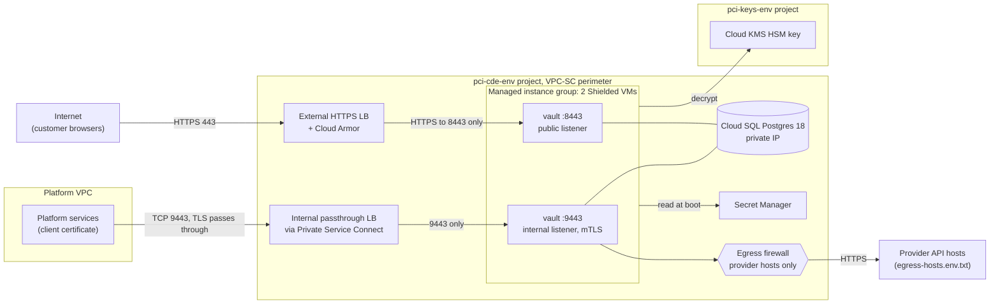

# Deploy the vault on Google Cloud

This guide is for the SRE who deploys PAN Vault to a Google Cloud environment (`dev` or `prod`). It covers the projects, the network front doors for the two listeners, identities, secrets, the first data key, health checks and the probes that keep the network separation honest. It assumes you know the vault's purpose; for the why, see [Running it safely](../../README.md#9-running-it-safely) and the [architecture](../explanation/architecture.md).

## What the binary enforces and what you must configure

The vault serves two listeners from one process (`main.go`, `newServers`):

| Listener | Default address | TLS | Serves | Caller |
|---|---|---|---|---|
| public | `:8443` (`VAULT_PUBLIC_ADDR`) | TLS 1.3 minimum (`MinVersion: tls.VersionTLS13`), no client certificate | `POST /tokenize` (and its `OPTIONS` preflight); every other path is `404` | Customer browsers, through the external load balancer |
| internal | `:9443` (`VAULT_INTERNAL_ADDR`) | TLS 1.3 minimum, `ClientAuth: tls.RequireAndVerifyClientCert` with `ClientCAs` = the one CA in `VAULT_CLIENT_CA` | `POST /proxy`, `GET /healthz`; every other path is `404` | Platform services holding a client certificate |

The binary cannot see IP addresses, load balancers or firewall rules; the right-hand column is yours to configure ([architecture](../explanation/architecture.md) explains the split).

| Enforced by the code | Required configuration (the binary cannot verify it) |
|---|---|
| Separate handlers: the public listener has no route to `/proxy` or `/healthz` (`publicHandler` in `tokenize.go`), the internal one has no route to `/tokenize` (`internalHandler` in `proxy.go`). | Two front doors: an external HTTPS load balancer for `:8443` only, and an internal front door reachable only from the platform's VPC for `:9443` only. |
| The internal listener refuses a TLS handshake without a client certificate chained to the configured CA. | No external forwarding rule, external IP or public route ever points at port 9443. |
| TLS for the internal listener ends in the vault, so the vault sees the client certificate and logs its serial (`caller=` in the access line). | The internal front door passes TCP through; it never terminates TLS. |
| Outbound provider requests go only to the catalog account's host over `https` (`accountURL` in `render.go`; a violation is `ALERT egress_invariant`). Redirects are never followed and `HTTP_PROXY`/`HTTPS_PROXY` are ignored (`newOutboundClient` in `outbound.go`). | VPC firewall ingress rules per port, an egress firewall that allows only the environment's provider hosts, and a VPC Service Controls perimeter. |
| `egress-hosts.<env>.txt` lists exactly the catalog hosts of that environment (`TestEgressHostsMatchCatalog` in `catalog_test.go`). | The egress firewall rule in the infra repo matches that file. The vault never reads the file at runtime. |

## Topology



The product names in the diagram (external Application Load Balancer, internal passthrough Network Load Balancer, Private Service Connect) are one way to build it. Any equivalent is fine if it meets the required configuration in this guide.

## Prerequisites

- The three projects from the README's cloud layout: `pci-cde-<env>` (the managed instance group of 2 Shielded VMs on Container-Optimized OS with no SSH, Cloud SQL Postgres 18 with private IP, CMEK and pgaudit, Secret Manager), `pci-keys-<env>` (the Cloud KMS key ring with the HSM-protected key-encryption key) and `pci-logs` (the audit log sink with Bucket Lock).
- A reviewed account for the environment in `catalog.json`. The vault refuses to boot without one (`boot failed: catalog has no accounts for env=prod`). Today the embedded catalog has only the `dev` account `stripe_test` and `egress-hosts.prod.txt` is empty, so a `prod` deploy needs a catalog change first (see [Add a provider](add-a-provider.md)).
- The image built from the repository with `make image` (or verified with `make image-repro`): a `scratch` image holding only `/vault`, the CA bundle at `/etc/ssl/certs/ca-certificates.crt` and a one-line `/etc/passwd`, running as UID/GID `65532` (`Dockerfile`). Both default ports are above 1024, so the non-root user can bind them.

## Steps

### 1. Create the service accounts and give them their permissions

1. Create two service accounts in `pci-cde-<env>`, for example `pan-vault@pci-cde-<env>.iam.gserviceaccount.com` (serving) and `pan-vault-rotator@pci-cde-<env>.iam.gserviceaccount.com` (DEK rotation).
2. Attach the serving account to the instance template. The vault takes every Google access token from the metadata server for `service-accounts/default` (`metadataTokenURL` in `gcp.go`); there are no service account keys. The VMs' access scopes must let that token call Cloud KMS, Secret Manager and Cloud SQL login, for example the `cloud-platform` scope with IAM doing the restriction.
3. Grant the serving account, for example:
   - KMS decrypt on the key-encryption key in `pci-keys-<env>` (`roles/cloudkms.cryptoKeyDecrypter`). The serving vault never calls KMS encrypt; only `vault -rotate-dek` does (`rotateDEK` in `main.go`).
   - Secret access on each secret it reads (`roles/secretmanager.secretAccessor`): the session HMAC key, the receipt seed and every account secret of the environment.
   - Cloud SQL IAM login (`roles/cloudsql.instanceUser`).
4. Grant the rotator account KMS encrypt and decrypt on the same key and Cloud SQL IAM login. It needs no secrets.

### 2. Prepare Cloud SQL

1. Apply `schema.sql` through the migration pipeline as `vault_owner`. The vault never runs migrations.
2. Add both service accounts to the instance as IAM database users. The Postgres user name is the email without `.gserviceaccount.com`.
3. Grant the roles, as `vault_owner`:

   ```sql
   GRANT vault_app     TO "pan-vault@pci-cde-<env>.iam";
   GRANT vault_rotator TO "pan-vault-rotator@pci-cde-<env>.iam";
   ```

4. Build `VAULT_DB_URL` with the IAM user name, URL-encoded, without a password, verifying the server certificate:

   ```
   postgres://pan-vault%40pci-cde-<env>.iam@<private-ip>:5432/vault?sslmode=verify-ca&sslrootcert=/path/to/server-ca.pem
   ```

   In `prod`, `openDB` (`main.go`) sends a current access token from the metadata server as the password before every new connection (cached until 60 s before it expires, `tokenSource` in `gcp.go`), and refuses to boot unless every connection path verifies the server (`VAULT_DB_URL must use sslmode=verify-ca or verify-full in prod`). `verify-full` usually fails against a private IP, so use `verify-ca` with Cloud SQL's server CA. The URL form is mandatory: the keyword/value form and the `service`, `servicefile` and `passfile` parameters refuse boot. The pool opens at most 16 connections per instance.
5. Run the smoke test against the real instance, before the first deploy and after any change to IAM users or roles. It is a deploy-pipeline step, not a repository test. Connected as the serving account with its IAM token:
   - login succeeds over verified TLS;
   - `SELECT * FROM vault.list_deks();` succeeds;
   - `SELECT has_function_privilege('vault.put_card(text,bytea,text,int)', 'EXECUTE'), has_function_privilege('vault.get_card(text,text)', 'EXECUTE');` returns `true, true`;
   - `SELECT has_function_privilege('vault.add_dek(bytea)', 'EXECUTE');` returns `false`;
   - `SELECT count(*) FROM vault.cards;` fails with a permission error (repeat for `vault.deks` and `vault.access_log`).

   Connected as the rotator account with its IAM token, `SELECT has_function_privilege('vault.add_dek(bytea)', 'EXECUTE');` returns `true`. Prefer this to a real `vault -rotate-dek`, which would add a DEK on every IAM change.

   Never call `vault.add_dek` with test bytes on a real database. At boot every instance unwraps every stored DEK through KMS and refuses to boot if any one fails (`unwrapDEKs` in `main.go`), and every refresh on running instances fails on the same row, so they never learn later DEKs either (`dekRefresher` in `main.go`). Neither `vault_app` nor `vault_rotator` can remove a row from `vault.deks`; the table owner `vault_owner` and a superuser can.

### 3. Create the secrets

Create these in Secret Manager in `pci-cde-<env>`. The vault reads `versions/latest` of each at boot only (`accessSecret` in `gcp.go`), and names must match `projects/<P>/secrets/<S>` with segments of `[A-Za-z0-9_-]`.

| Secret | Variable that names it | Value |
|---|---|---|
| Session HMAC key | `VAULT_SESSION_HMAC_SECRET` | Exactly 64 hex characters (32 bytes), nothing else (`loadKey32` in `main.go`). The platform holds the same key to mint session tokens. |
| Receipt signing seed | `VAULT_RECEIPT_KEY_SECRET` | Exactly 64 hex characters with no trailing newline, for example `openssl rand -hex 32 \| tr -d '\n' \| gcloud secrets create receipt-key --data-file=-`. |
| Account secrets | none: `catalog.json` names each by resource name, e.g. `projects/pci-cde-dev/secrets/stripe-test-secret-key` | Printable ASCII without whitespace (`validSecretValue` in `main.go`). |

A missing or invalid secret fails the boot (all or nothing for account secrets). Give the platform the receipt public key; see [Rotate keys](rotate-keys.md#receipt-signing-key) for how to derive it.

### 4. Create the first data key

Run the rotation job once, as the rotator account, from a Google Cloud compute resource whose attached service account is the rotator (the binary takes its token from the metadata server):

```
VAULT_ENV=prod VAULT_DB_URL='postgres://pan-vault-rotator%40pci-cde-<env>.iam@<private-ip>:5432/vault?sslmode=verify-ca&sslrootcert=…' \
VAULT_KMS_KEY=projects/pci-keys-<env>/locations/<L>/keyRings/<R>/cryptoKeys/<K> \
/vault -rotate-dek
```

It prints the new version (`1`) on standard output. Without a DEK the serving vault exits with `no DEKs found; run vault -rotate-dek first`. Schedule this job monthly afterwards ([Rotate keys](rotate-keys.md#data-encryption-keys-deks)).

### 5. Configure the instances

Set the environment of the container (the vault reads configuration only from environment variables; see [Configuration](../reference/configuration.md)):

| Variable | Production value |
|---|---|
| `VAULT_ENV` | `prod` |
| `VAULT_CERT`, `VAULT_KEY` | Paths to the server certificate and key (PEM), readable by UID 65532 |
| `VAULT_CLIENT_CA` | Path to a file with exactly one PEM `CERTIFICATE`, a CA (`loadClientCA` in `main.go`) |
| `VAULT_ALLOW_ORIGIN` | The exact checkout origin, `https://…` (http is refused in `prod`) |
| `VAULT_DB_URL` | From step 2 |
| `VAULT_KMS_KEY` | `projects/<P>/locations/<L>/keyRings/<R>/cryptoKeys/<K>` |
| `VAULT_SESSION_HMAC_SECRET`, `VAULT_RECEIPT_KEY_SECRET` | Resource names from step 3 |

With `VAULT_ENV=prod`, any variable whose name starts with `VAULT_DEV_`, even empty, refuses boot (`devVarSet` in `main.go`). How the files reach the container (for example read-only mounts) is up to the instance template; the vault only reads the paths.

A healthy boot logs, in order: `config loaded env=prod`, `deks loaded versions=… current=…`, `catalog loaded env=prod accounts=…`, `receipt public key=…`, `listening public=:8443 internal=:9443`, `ready`; any failure logs `boot failed: <reason>` and exits 1 (boot timeouts are in [Limits](../reference/limits.md), the lines in [Logging](../reference/logging.md)).

### 6. Build the public front door (port 8443)

1. Create an external HTTPS load balancer whose only backend is the instance group's port 8443, using HTTPS to the backend.
2. Attach a Cloud Armor policy with rate limiting on `/tokenize`.
3. The public listener accepts only TLS 1.3. Confirm that the load balancer's connection to the backend negotiates TLS 1.3; otherwise every request fails, and a TCP health check does not show it.
4. Do not route any other port to this backend service.

The vault itself rejects a wrong `Origin` (`403`), a missing or bad session token (`401`) and any path but `/tokenize` (`404`), but it cannot rate-limit by client: that is Cloud Armor's job.

### 7. Build the internal front door (port 9443)

1. Create an internal TCP passthrough load balancer whose only backend is the instance group's port 9443, for example an internal passthrough Network Load Balancer.
2. Publish it to the platform's VPC only, for example through a Private Service Connect service attachment that accepts only the platform's project.
3. Do not terminate TLS at this front door. The vault must receive the client's TLS handshake to verify the certificate and log its serial.
4. Never create an external forwarding rule, external IP or public route to port 9443.

### 8. Write the firewall rules

All of these are required configuration.

| Direction | Port | Allowed source or destination | Everything else |
|---|---|---|---|
| Ingress | 8443 | The external load balancer's documented proxy source ranges and Google's health-check source ranges | Denied |
| Ingress | 9443 | Only the range the internal front door delivers from (for example the Private Service Connect NAT subnet) and Google's health-check source ranges | Denied |
| Ingress | any other | none | Denied |
| Egress | 443 | The published IP ranges of the providers listed in `egress-hosts.<env>.txt`, and nothing else | Denied |
| Egress | Google APIs | Cloud KMS and Secret Manager, for example through Private Google Access inside the VPC-SC perimeter. The metadata server is not governed by VPC egress rules and needs no rule. | Denied |
| Egress | 5432 | The Cloud SQL private IP | Denied |

The VMs have no external IPs (an org policy denies them), so provider traffic leaves through NAT. It cannot go through an HTTP forward proxy: the vault ignores proxy settings. The `prod` egress rule allows only `prod` hosts.

### 9. Draw the VPC Service Controls perimeter

Put `pci-cde-<env>` and `pci-keys-<env>` in a VPC Service Controls perimeter that covers the services the vault uses (for example Cloud KMS, Secret Manager and Cloud SQL), so data in those services cannot be read from outside the perimeter.

### 10. Set up health checks and the readiness monitor

1. Give both load balancers plain TCP health checks: port 8443 for the external one, 9443 for the internal one. The vault binds its ports only after the whole boot has succeeded, so an open port means the boot completed. A TCP check makes no HTTP request and so writes no access-log line.
2. Run a separate readiness monitor inside the platform's VPC that holds a platform client certificate and calls `GET /healthz` over mTLS:

   ```
   curl --cacert vault-server-ca.pem --cert monitor.pem --key monitor.key https://<internal-address>:9443/healthz
   ```

   Expect `200 {"status":"ok"}`. `503 {"error":"unavailable"}` means the database did not answer a ping within 2 s (`handleHealthz` in `proxy.go`). There is deliberately no unauthenticated health route.

### 11. Run the two continuous probes

Run both on a schedule and alert when a result changes.

| Probe | From | Check | Expected |
|---|---|---|---|
| Public exposure | The internet | `curl -s -o /dev/null -w '%{http_code}' https://<public>/proxy` | `404`. The public listener has no `/proxy` route; any `2xx`, `401` or `405` means the wrong listener is exposed. |
| Public exposure | The internet | TCP connect to the public front door's address on port 9443, and to any address that might reach the internal front door | Connection fails |
| mTLS enforcement | Inside the platform VPC, without a client certificate | `curl --cacert vault-server-ca.pem https://<internal-address>:9443/healthz` | No HTTP response. Under TLS 1.3 the client completes its side of the handshake and the rejection arrives as a TLS alert on the first read, so curl typically exits 56 and `%{http_code}` is `000`; the check is still valid. An HTTP status of any kind means TLS is terminated before the vault or client authentication is off. |

A handshake rejected for a missing certificate never reaches a handler, so it writes no access-log line.

### 12. Deploy and check the logs

Roll out the instance group and confirm on each instance the six boot lines from step 5, then the first access lines:

```
… req listener=public method=POST path=/tokenize status=200 dur=…ms
… req listener=internal method=POST path=/proxy status=200 dur=…ms caller=<serial>
```

Every `ALERT` line must reach someone, at the severity [Respond to alerts](respond-to-alerts.md) gives it: most page, `session_token_invalid` and `cvv_cache_full` notify.

## Verification checklist

| # | Check | How | Enforced by |
|---|---|---|---|
| 1 | Only port 8443 is behind the external load balancer | Backend service configuration | Configuration |
| 2 | `GET https://<public>/proxy` is `404` from the internet | Probe in step 11 | Code (route) and configuration (LB) |
| 3 | Port 9443 is unreachable from the internet | Probe in step 11; no external forwarding rule targets 9443 | Configuration |
| 4 | The internal front door is passthrough and reachable only from the platform VPC | Load balancer and PSC configuration | Configuration |
| 5 | A connection to 9443 without a client certificate fails the handshake | Probe in step 11 | Code (`RequireAndVerifyClientCert`) |
| 6 | `/proxy` access lines carry `caller=<serial>` of a platform certificate | Access log | Code |
| 7 | Ingress rules allow 8443 and 9443 only from their front door and health-check ranges | Firewall rules | Configuration |
| 8 | Egress allows only the providers in `egress-hosts.<env>.txt`, Google APIs and Cloud SQL | Firewall rules diffed against the file | Configuration (the file itself is checked against the catalog by `TestEgressHostsMatchCatalog`) |
| 9 | Projects are inside the VPC-SC perimeter | Perimeter configuration | Configuration |
| 10 | `VAULT_ENV=prod` | Instance template. A `dev` value also boots, and skips the database TLS check | Configuration |
| 11 | No `VAULT_DEV_*` variable, `VAULT_DB_URL` with `sslmode=verify-ca` | The vault refuses to boot otherwise | Code, only once `VAULT_ENV=prod` |
| 12 | Serving account cannot read tables or call `add_dek` | Smoke test in step 2 | Database grants |
| 13 | At least one DEK exists | Boot line `deks loaded versions=… current=…` | Code |
| 14 | Session HMAC key and receipt seed are exactly 64 hex characters | The vault boots | Code |
| 15 | The platform accepts the receipt public key logged at boot | Compare `receipt public key=…` with the platform's configuration | Configuration |
| 16 | The readiness monitor gets `200 {"status":"ok"}` over mTLS | Monitor in step 10 | Code and configuration |
| 17 | Every `ALERT` line reaches someone at its runbook severity | Log-based alerting | Configuration |

## See also

- [Running it safely](../../README.md#9-running-it-safely) in the README
- [Configuration reference](../reference/configuration.md)
- [Rotate keys](rotate-keys.md)
- [Respond to alerts](respond-to-alerts.md)
- [Threat model](../explanation/threat-model.md)
