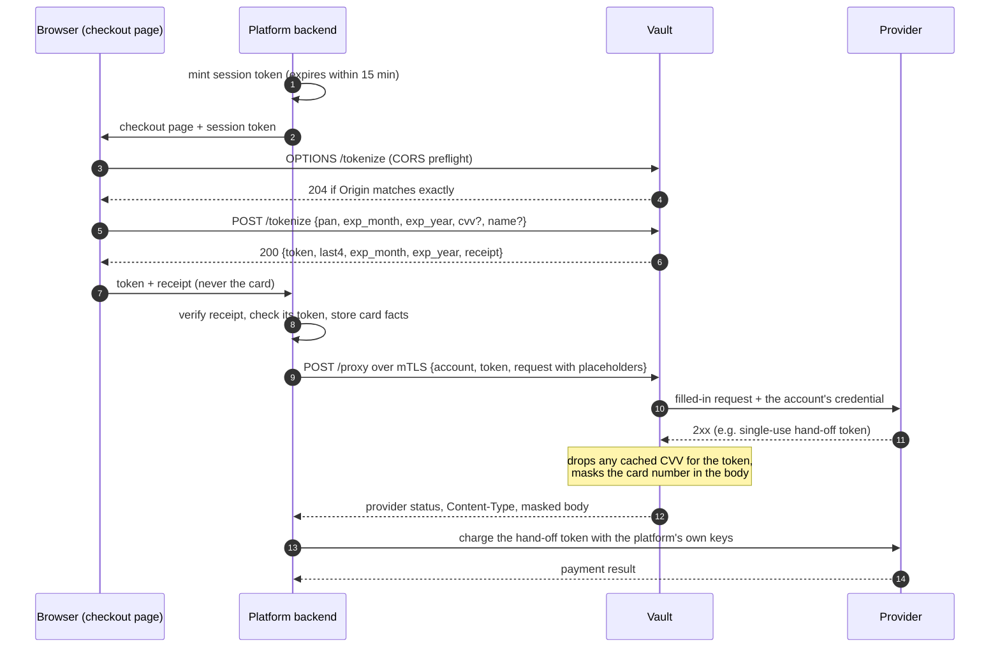

# Integrate the platform with the vault

This guide is for a platform engineer wiring a backend and a checkout page to the vault. It covers minting session tokens, calling `/tokenize` from the browser, verifying and storing the receipt, building `/proxy` requests, and handling every answer. For the exact field and error reference, see the [API reference](../reference/api.md). To try the vault on your machine first, follow the [local quickstart](../tutorials/local-quickstart.md).

## What you need from the vault's operators

| Item | Used for | Where it comes from |
|---|---|---|
| The checkout page's exact origin, configured as `VAULT_ALLOW_ORIGIN` | `/tokenize` accepts only that `Origin` | You give it to the operators, e.g. `https://checkout.example.com` |
| The session HMAC key (32 bytes, stored as 64 hex characters) | Minting session tokens | The same secret the vault reads through `VAULT_SESSION_HMAC_SECRET` |
| The receipt public key (unpadded base64url) | Verifying receipts | The vault's boot log line `receipt public key=<base64url>` |
| A client certificate from the CA in `VAULT_CLIENT_CA` | Calling `/proxy` and `/healthz` | The operators' CA |
| The catalog account names for your environment | The `account` field of `/proxy` | `catalog.json` (today only `stripe_test`, in dev) |

## The checkout at a glance



## 1. Mint session tokens

Mint a session token in your backend for every checkout page you render. It proves to the vault that the browser was sent by the platform. The format is checked by `checkSession` in `tokenize.go`:

```
v1.<expires_unix>.<hex(HMAC-SHA256(key, "v1." + expires_unix))>
```

- `expires_unix` is decimal Unix seconds, 1–19 digits.
- The MAC is exactly 64 lowercase hex characters, over the ASCII bytes `v1.` followed by the expiry digits.
- The vault accepts the token only while `now < expires_unix <= now + 900` by its own clock. An expiry more than 15 minutes ahead is refused like an expired one, so leave a margin for clock skew.
- The token isn't tied to a card and isn't single use: the page may call `/tokenize` with it as often as needed until it expires.
- A checkout page can stay open longer than the token lives. Give the page a way to fetch a fresh token from your backend, and when `/tokenize` answers `401`, fetch one and retry once.

A Go version, using only the standard library. The 14-minute lifetime is a suggestion, one minute short of the vault's limit to absorb clock skew; it is not a vault rule:

```go
// mintSession returns a session token for one checkout. key is the 32-byte session HMAC key
// (the 64 hex characters stored in Secret Manager, decoded).
func mintSession(key []byte, now time.Time) string {
	exp := strconv.FormatInt(now.Add(14*time.Minute).Unix(), 10)
	m := hmac.New(sha256.New, key)
	m.Write([]byte("v1." + exp))
	return "v1." + exp + "." + hex.EncodeToString(m.Sum(nil))
}
```

Every refused token is answered with `401 {"error":"unauthorized"}`, and the vault logs `ALERT session_token_invalid reason=<format|hmac|expired>` (at most once per second).

## 2. Call `/tokenize` from the checkout page

The page sends the card straight to the vault's public listener. The browser sets `Origin` itself. The page sends two headers: `Content-Type: application/json` and `Authorization: Bearer <session token>`. The preflight allows only those two.

```js
const res = await fetch("https://vault.example.com/tokenize", {
  method: "POST",
  headers: {
    "Content-Type": "application/json",
    "Authorization": "Bearer " + sessionToken,
  },
  // Leave cvv and name out when the fields are empty: "" is refused, not treated as absent.
  body: JSON.stringify({ pan, exp_month, exp_year, ...(cvv ? { cvv } : {}), ...(name ? { name } : {}) }),
});
const out = await res.json(); // {token, last4, exp_month, exp_year, receipt} or {error}
```

**Origin.** The `Origin` header must appear exactly once and equal `VAULT_ALLOW_ORIGIN` byte for byte. The preflight (`OPTIONS /tokenize`) answers `204` with `Access-Control-Allow-Origin: <your origin>`, `Access-Control-Allow-Methods: POST`, `Access-Control-Allow-Headers: Content-Type, Authorization` and `Access-Control-Max-Age: 600`.

**Body.** One JSON object of at most 4 KiB, with these keys spelled exactly, each at most once, and no others (the [API reference](../reference/api.md) has the complete rules):

| Key | Required | Rule |
|---|---|---|
| `pan` | yes | String. Spaces and hyphens are removed, then 13–19 ASCII digits passing the Luhn check. |
| `exp_month` | yes | String, exactly `"01"`–`"12"`. |
| `exp_year` | yes | String, exactly four digits. Year and month must not be before the current month in UTC. |
| `cvv` | no | String of 3–4 digits. Leave the key out when you have no CVV: `""` and `null` are refused, so an empty form field must not become `"cvv":""`. |
| `name` | no | Cardholder name: 1–100 characters of valid UTF-8, no control characters and no U+FFFD replacement character. Leave the key out when you have none: `""` and `null` are refused. Without a name, `/proxy` can't fill `{{name}}` later. |

Numbers instead of strings, unknown keys, repeated keys, keys in another letter case and trailing data are all `invalid request body`.

**Response.** `200` with exactly `{token, last4, exp_month, exp_year, receipt}`. The page may show `last4` and the expiry. It must forward `token` and `receipt` to your backend.

**Errors**, in the order the checks run. The first failing check answers. The first four answers carry no CORS headers, so the page can't read their body. Every later answer can be read.

| Status | Body `error` | Cause |
|---|---|---|
| 404 | `not found` | Path isn't exactly `/tokenize` (a percent-encoded spelling counts as different) |
| 405 | `method not allowed` | Method other than `POST` or `OPTIONS` (`Allow: POST, OPTIONS`) |
| 400 | `query string not allowed` | Any query string, even a bare `?` |
| 403 | `origin not allowed` | `Origin` missing, repeated or different |
| 401 | `unauthorized` | `Authorization` missing, repeated, malformed, forged or expired |
| 400 | `content type must be application/json` | Anything but `application/json`, optionally with `charset=utf-8` |
| 413 | `request body too large` | Body over 4 KiB |
| 400 | `invalid request body` | Not exactly one JSON object with the allowed keys and string values |
| 400 | `invalid pan` | Length, characters or Luhn check |
| 400 | `invalid expiry` | Format, or a month in the past |
| 400 | `invalid cvv` | Not 3–4 digits, `""` or `null` |
| 400 | `invalid name` | `""`, too long, control characters, U+FFFD, invalid UTF-8 or `null` |
| 500 | `internal error` | The card couldn't be stored |

## 3. Verify the receipt and store the card facts

The receipt is the only way the platform learns the card's BIN and name, and the only trustworthy source of its last four and expiry: the browser's own report could be forged. Its format is `rcpt.v1.<base64url payload>.<base64url Ed25519 signature>` (see the [receipt reference](../reference/receipt.md)).

1. Reject a receipt longer than 2048 bytes before looking at it, and cap the size of the request that carries it.
2. Verify it with the vault's public key. Use the reference verifier in the README ([§11.4](../../README.md#114-verifying-a-receipt)); it follows `verifyReceipt` in `receipt.go`. During a receipt key rotation, try each accepted public key and accept the receipt if any one verifies it.
3. Check that the receipt's `token` equals the token the browser sent with it.
4. If any check fails, reject the whole receipt. Never repair it or keep part of it.
5. Store `bin`, `last4`, `exp_month`, `exp_year` and `name` (absent when the card was tokenized without one) next to the token.

**The BIN rule.** `bin` holds the first 8 digits when the card number has exactly 16 digits, and the first 6 for every other length (`cardBIN` in `receipt.go`). Don't assume 8.

**What the platform may keep, and how.** The BIN and last four, with the expiry and name, are what the platform may hold. Three rules go with them ([README §6.2](../../README.md#62-the-signed-receipt)):

- Customers see only the last four. The BIN with the last four is for staff with a business need.
- Never store a hash of the card number next to these facts. The vault never produces one.
- Derive brand, issuer, country and card type from your own BIN data.

## 4. Set up the mTLS client

`/proxy` and `/healthz` live on the internal listener, which requires a client certificate on every connection.

- The certificate must chain to the one CA certificate in `VAULT_CLIENT_CA`. If it has an extended key usage extension, that extension must include `clientAuth` (or `anyExtendedKeyUsage`).
- The connection must use TLS 1.3.
- The certificate's serial number becomes your caller identity: the vault logs it as `caller=` on every internal request, in the uppercase hex form `openssl x509 -serial` prints (`callerSerial` in `vault.go`), and passes it to `vault.get_card` for the database audit row. Give each calling service its own certificate, so the audit trail tells them apart. A certificate with a negative serial is refused.
- Trust the issuer of the vault's server certificate (`VAULT_CERT`).
- Give your HTTP client a timeout of at least 60 seconds, the internal listener's write timeout. The vault itself waits up to 30 seconds for the provider.

`GET /healthz` with the client certificate answers `200 {"status":"ok"}` when the vault's database answers within 2 seconds, otherwise `503 {"error":"unavailable"}`. Use it for readiness monitoring.

## 5. Build a `/proxy` envelope

You build the whole provider request, with placeholders where the card and the credential go. The vault checks it against the compiled-in catalog, fills in the placeholders and sends it to the account's host.

Send `POST /proxy` with `Content-Type: application/json`, no query string, and a body of at most 64 KiB:

```json
{
  "account": "<catalog account>",
  "token": "tok_<32 lowercase hex>",
  "request": {
    "method": "POST",
    "path": "/provider/path",
    "headers": { "Idempotency-Key": "ord-123" },
    "body": "<the provider's raw body, as a string>"
  }
}
```

The top-level keys are exactly `account`, `token` and `request`, and the keys of `request` exactly `method`, `path`, `headers` and `body`. Unknown, repeated or differently cased keys are `invalid request body`. `body` is always a string holding the provider's body in the provider's format (`json` or `form`). The vault sends exactly those bytes with only the placeholders replaced.

### The account chooses the destination

`account` names a catalog account of the vault's environment. The account fixes the provider, host, base path and credential. You never name a host: the URL is always `https://` + account host + base path + your `path`.

### Method and path

`method` and `path` must match one endpoint of the account's provider exactly. The path starts with `/` and contains no `%`, `//` or `..`. A `{name}` segment in a catalog path matches 1–128 characters of `[A-Za-z0-9_-]`. A query string is allowed only when the endpoint lists its keys.

### Placeholders

| Placeholder | Becomes |
|---|---|
| `{{pan}}` | the card number |
| `{{cvv}}` | the cached CVV (single use) |
| `{{name}}` | the stored cardholder name |
| `{{exp_month}}` / `{{exp_month:int}}` | `"03"` / `3` |
| `{{exp_year}}` / `{{exp_year:yy}}` / `{{exp_year:int}}` | `"2030"` / `"30"` / `2030` |
| `{{exp:yyyy/mm}}` / `{{exp:mm/yy}}` | `"2030/03"` / `"03/30"` |
| `{{secret:NAME}}` | the account's secret `NAME` |
| `{{basic:NAME}}` | base64 of the secret `NAME` followed by `:` (header templates only) |
| `{{signature}}` | the output of the endpoint's named signer |

The rules, all enforced by `checkProxy` in `policy.go`:

- **The catalog decides the positions.** Each placeholder may appear only at a body address the endpoint lists for that exact placeholder. Look up your endpoint's `positions` in `catalog.json` (schema in the [catalog reference](../reference/catalog.md)).
- **A placeholder is a whole value.** In a `json` body it is the entire JSON string, `"{{pan}}"`. A `:int` form is written the same way, `"{{exp_month:int}}"`, and is replaced by a bare number. In a `form` body it is the entire field value, written raw: `card[number]={{pan}}`, not `%7B%7Bpan%7D%7D`.
- **Each card placeholder appears at most once.** `{{exp_year}}` and `{{exp_year:yy}}` count as the same one.
- **`{{pan}}` is required.** A request without it is refused: the vault's credential is only for card-carrying calls. Make calls without card data (payments with a provider token, refunds, queries) yourself, with the platform's own keys.
- **Other positions are optional.** You may leave out a listed field, but a listed field that is present must hold exactly its placeholder. A literal there, including your own API key, is refused.
- **`{{` anywhere else is refused**, never sent literally. Card placeholders are never allowed in headers, the path or the query.
- **Pins and forbidden fields.** A pinned field must be present and equal its pinned value: an account value or a literal. A forbidden field must be absent, or equal one of its allowed literals. In a `form` body, forbidding `customer` also forbids `customer[...]` keys in any letter case.

### Headers

Put platform headers in `request.headers`. No HTTP header of the `/proxy` call itself reaches the provider.

- Allowed: `Accept`, `Idempotency-Key` and `X-Idempotency-Key` (`platformHeaders` in `policy.go`), each 1–1024 bytes of printable ASCII without `{{`.
- A header named by the endpoint's credential template, such as `Authorization: Bearer {{secret:secretKey}}`, may be sent only as exactly that template string, or left out. The vault renders and sets it either way.
- Names are matched case-insensitively, and two names that differ only in case are refused.
- Anything else is refused with `header not allowed`. It is never dropped silently.
- The vault itself sets `Host`, `Content-Type` (from the provider's format), `Content-Length` and `User-Agent: pan-vault/1`.

### Example: a `form` provider (Stripe, in `catalog.json`)

The fixture `embeddedFixtures["stripe/tokens"]` in `catalog_test.go`, which must pass the embedded catalog's checks:

```json
{
  "account": "stripe_test",
  "token": "tok_0123456789abcdef0123456789abcdef",
  "request": {
    "method": "POST",
    "path": "/v1/tokens",
    "headers": {
      "Idempotency-Key": "ord-1",
      "Authorization": "Bearer {{secret:secretKey}}"
    },
    "body": "card[number]={{pan}}&card[exp_month]={{exp_month}}&card[exp_year]={{exp_year}}&card[cvc]={{cvv}}&card[name]={{name}}"
  }
}
```

The endpoint forbids `customer`, so adding `&customer=cus_123` is refused with `forbidden field`.

### Example: a `json` provider (Adyen, test catalog only)

Adyen is not in `catalog.json` yet. This example uses the `adyen_br` account of the synthetic `testCatalogJSON` in `helpers_test.go` (the `adyenBody` fixture). It shows an account pin (`merchantAccount` must equal the account's `AcmeBR_ECOM`) and a forbid list (`storePaymentMethod` may only be `false`). A real vault answers this envelope with `unknown account` until such an account ships in `catalog.json`:

```json
{
  "account": "adyen_br",
  "token": "tok_0123456789abcdef0123456789abcdef",
  "request": {
    "method": "POST",
    "path": "/v72/payments",
    "headers": {
      "Idempotency-Key": "ord-1",
      "X-API-Key": "{{secret:apiKey}}"
    },
    "body": "{\"amount\":{\"currency\":\"BRL\",\"value\":1000},\"reference\":\"ord-1\",\"merchantAccount\":\"AcmeBR_ECOM\",\"paymentMethod\":{\"type\":\"scheme\",\"number\":\"{{pan}}\",\"expiryMonth\":\"{{exp_month}}\",\"expiryYear\":\"{{exp_year}}\",\"cvc\":\"{{cvv}}\",\"holderName\":\"{{name}}\"},\"storePaymentMethod\":false}"
  }
}
```

## 6. Handle the answer

When every check passes and the provider answers, the vault relays the provider's status, its `Content-Type` and its body, with `Cache-Control: no-store` and `X-Content-Type-Options: nosniff`. No other provider header is relayed. Redirects are not followed: a 3xx comes back as is, without its `Location`. The card number, if the provider echoed it as plain digits or in groups of four separated by spaces or hyphens, is replaced by `****` and its last four.

The vault's own answers are always `{"error":"<fixed string>"}` with one of the strings below. A provider's error body is relayed unchanged, so tell the two apart by the body, not the status.

| Status | Body `error` | Cause | What to do |
|---|---|---|---|
| 401 | `unauthorized` | The client certificate has no usable serial (defence in depth: such a certificate is normally refused during the TLS handshake) | Use a certificate with a positive serial |
| 404 | `not found` | Path isn't exactly `/proxy` or `/healthz` | Fix the URL |
| 405 | `method not allowed` | `/proxy` with a method other than `POST` (`Allow: POST`), or `/healthz` with a method other than `GET` (`Allow: GET`) | Use the right method |
| 400 | `query string not allowed` | Any query string on the `/proxy` call itself | Put the provider's query in `request.path` |
| 400 | `content type must be application/json` | Wrong `Content-Type` on the `/proxy` call | Fix the client |
| 413 | `request body too large` | Envelope over 64 KiB | Fix the request |
| 400 | `invalid request body` | Envelope not strict JSON with the exact keys, or the provider body doesn't parse strictly in its format (alert reason `body`) | Fix the request |
| 400 | `invalid token` | `token` isn't `tok_` + 32 lowercase hex | Fix the request |
| 400 | `unknown account` | No such account in this environment | Check the account name |
| 400 | `endpoint not allowed` | No endpoint matches method, path and query | Use a catalog endpoint |
| 400 | `header not allowed` | A header outside the allowlist or not equal to its template | Remove it |
| 400 | `invalid placeholder use` | A placeholder outside its position, repeated, unknown, or `{{pan}}` missing | Fix the body |
| 400 | `pinned field mismatch` | A pinned field missing or different | Send the account's value |
| 400 | `forbidden field` | A forbidden field present | Remove it |
| 400 | `unknown token` | No card stored under this token | Check the token |
| 429 | `rate limit exceeded` | Velocity limit (below) | Back off; a burst pages the operators |
| 409 | `name unavailable` | `{{name}}` used, but the card was stored without a name | Resend without the name field |
| 409 | `cvv unavailable` | `{{cvv}}` used, but no CVV is cached on this instance | Resend without the CVV field |
| 500 | `internal error` | Database failure or timeout, a card that fails to decrypt, or an internal fault | Retry later; persistent failures are an operator matter |
| 502 | `provider unreachable` | Network error or timeout, a compressed response, or a response over 4 MiB | Retry with the same idempotency key |

Once the account is known, every catalog refusal also raises `ALERT proxy_policy account=<a> endpoint=<id|-> reason=<r>`, with reason `endpoint`, `header`, `body`, `placeholder`, `pin` or `forbidden_field`. It pages the operators. The alert is written at most once per second, so a burst of refusals produces fewer alert lines than refusals. `invalid token`, `unknown account` and a malformed envelope raise no alert.

**Velocity limits.** Every `/proxy` call that passes the catalog checks is one database lookup, whatever happens next (including 409s, `unknown token` and provider errors). `vault.get_card` in `schema.sql` refuses a lookup when there were already 300 lookups in the last minute across all callers, or 20 for the same token in the last hour. Lookups are also serialized across all callers, one at a time. Don't loop on retries.

## 7. Handle the CVV

The CVV is never stored. From the platform's side:

- **Where it lives.** Only in the memory of the vault instance that served `/tokenize`, usable for 15 minutes.
- **One use.** The first `/proxy` call that uses `{{cvv}}` and passes the catalog checks, the lookup, decryption and the name check takes the CVV, whatever the provider then answers. After a decline, retry without `{{cvv}}`.
- **Dropped on success.** A provider 2xx for a token drops any CVV still cached for it on that instance, even when the call didn't use `{{cvv}}`, and even when the vault then answers 502. So make the call that needs the CVV the first `/proxy` call for the token.
- **Other instances.** `/tokenize` and `/proxy` reach the vault through different load balancers, so a `/proxy` call can land on an instance that has no CVV for the token. It then gets `409 cvv unavailable`. A CVV cached on another instance stays there until it expires: about 16 minutes at most.
- **On a 409.** Resend the same request without the CVV field, for example without `&card[cvc]={{cvv}}`. The vault never edits your body to drop a field.

[The CVV lifecycle](../explanation/cvv-lifecycle.md) explains why it works this way.

## 8. Use idempotency keys

Send the provider's idempotency header in `request.headers` (`Idempotency-Key` or `X-Idempotency-Key`, as the provider expects). The vault forwards it unchanged.

Retry with the same key when the answer is a 502, a 500, or a timeout on your side. A timeout can happen even when the provider succeeded: a key refresh in the vault can hold a request for up to 30 seconds, and a slow provider after that can exceed the 60-second write timeout. If the first attempt used `{{cvv}}`, the retry can't, so its body differs. Whether the provider accepts a changed body under the same key is provider-specific.

## 9. Use the hand-off token, never save the card

Every catalog endpoint charges the card or creates a single-use hand-off token, such as the Stripe `tok_…` that `POST /v1/tokens` returns. You then use that token with the platform's own provider keys: with Stripe, charge it or create a PaymentMethod from it for that payment.

**Never save, attach or reuse a card through a hand-off token.** For example, never attach a PaymentMethod made from it to a customer, and never set it up for future use. That call carries no card data, so it never passes through the vault, and the vault can't stop it. This is a platform rule, enforced by platform code review and provider-side monitoring ([README §7.4](../../README.md#74-what-the-vault-cannot-enforce-hand-off-tokens)).

## See also

- [API reference](../reference/api.md)
- [Receipt reference](../reference/receipt.md)
- [Catalog reference](../reference/catalog.md)
- [Limits reference](../reference/limits.md)
- [Respond to alerts](respond-to-alerts.md)
- [Why the proxy works this way](../explanation/proxy-design.md)
