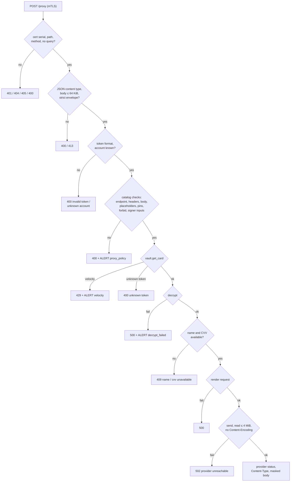

# HTTP API

This page is for engineers who call the vault or operate it. It describes both listeners completely: every endpoint, request field, header rule, check order, status code and fixed error string, as implemented in `tokenize.go`, `proxy.go`, `policy.go`, `render.go`, `scan.go`, `card.go`, `outbound.go` and `vault.go`.

## Listeners

| Listener | Default address | TLS | Client certificate | Routes |
|---|---|---|---|---|
| public | `:8443` (`VAULT_PUBLIC_ADDR`) | TLS 1.3 minimum | not requested | `POST /tokenize`, `OPTIONS /tokenize` |
| internal | `:9443` (`VAULT_INTERNAL_ADDR`) | TLS 1.3 minimum | required and verified against `VAULT_CLIENT_CA` (`tls.RequireAndVerifyClientCert`) | `POST /proxy`, `GET /healthz` |

Both listeners are built in `newServers` (`main.go`). Timeouts and header limits are listed in [Limits](limits.md#timeouts). There is no other route on either listener; `/healthz` exists only on the internal listener.

## Common behaviour

### Error bodies

Every error the vault's handlers write is a JSON object with one key, followed by a newline:

```json
{"error":"invalid pan"}
```

The value is always one of the fixed `msg*` constants in `vault.go`. Error bodies never carry request input, token values, provider error text or Go error strings.

The exception is a request that `net/http` rejects before the vault's handler runs, such as headers over `MaxHeaderBytes` (`431 Request Header Fields Too Large`) or a malformed request (`400 Bad Request`). `net/http` answers those itself, in plain text, and no access line is written.

| Constant | Text |
|---|---|
| `msgNotFound` | `not found` |
| `msgMethod` | `method not allowed` |
| `msgQuery` | `query string not allowed` |
| `msgContentType` | `content type must be application/json` |
| `msgTooLarge` | `request body too large` |
| `msgBadBody` | `invalid request body` |
| `msgInvalidPAN` | `invalid pan` |
| `msgInvalidExpiry` | `invalid expiry` |
| `msgInvalidCVV` | `invalid cvv` |
| `msgInvalidName` | `invalid name` |
| `msgUnauthorized` | `unauthorized` |
| `msgOrigin` | `origin not allowed` |
| `msgInvalidToken` | `invalid token` |
| `msgUnknownToken` | `unknown token` |
| `msgVelocity` | `rate limit exceeded` |
| `msgInternal` | `internal error` |
| `msgProvider` | `provider unreachable` |
| `msgUnavailable` | `unavailable` |
| `msgUnknownAccount` | `unknown account` |
| `msgEndpointNotAllowed` | `endpoint not allowed` |
| `msgHeaderNotAllowed` | `header not allowed` |
| `msgPlaceholder` | `invalid placeholder use` |
| `msgPinMismatch` | `pinned field mismatch` |
| `msgForbiddenField` | `forbidden field` |
| `msgCVVUnavailable` | `cvv unavailable` |
| `msgNameUnavailable` | `name unavailable` |

### Response headers

Every JSON response the vault writes itself (`writeJSON`, `vault.go`) carries:

| Header | Value |
|---|---|
| `Content-Type` | `application/json` |
| `Cache-Control` | `no-store` |
| `X-Content-Type-Options` | `nosniff` |

A relayed provider response on `/proxy` has its own header set (see [What is relayed](#what-is-relayed-from-the-provider)).

### Paths, methods and query strings

- A path must match exactly. A percent-encoded spelling of a route (for example `/%74okenize`) is `404 not found`.
- A query string is never accepted. Any query, including a bare trailing `?`, is `400 query string not allowed`.
- A wrong method on a known path is `405 method not allowed` with an `Allow` header.

### Panics

The `guard` middleware (`vault.go`) wraps both listeners. A panic becomes `500 {"error":"internal error"}`. If the response had already started, the connection is aborted instead, so the client never receives a truncated success.

### JSON content type rule

`jsonContentType` (`tokenize.go`) is used by both `POST` endpoints. The request must have exactly one `Content-Type` header; its media type, parsed with `mime.ParseMediaType`, must be `application/json` (case-insensitive), with no parameter or exactly one parameter, `charset=utf-8` (value case-insensitive).

| `Content-Type` | Accepted |
|---|---|
| `application/json` | yes |
| `Application/JSON` | yes |
| `application/json; charset=utf-8` | yes |
| `application/json; charset=UTF-8` | yes |
| `application/json; charset=latin1` | no |
| `application/json; charset=utf-8; x=y` | no |
| `text/json` | no |
| two `Content-Type` headers | no |

## Public listener

### `POST /tokenize`

Called by the checkout page in the browser. Stores a card and returns a token and a signed receipt.

#### Required headers

| Header | Rule |
|---|---|
| `Origin` | Present exactly once and byte-for-byte equal to `VAULT_ALLOW_ORIGIN`. |
| `Authorization` | Present exactly once: `Bearer v1.<exp>.<mac>` (see [Session token](#session-token)). |
| `Content-Type` | The [JSON content type rule](#json-content-type-rule). |

A repeated `Origin`, `Authorization` or `Content-Type` header is treated as invalid (`singleHeader`, `tokenize.go`).

#### Session token

`checkSession` (`tokenize.go`) validates:

```
Authorization: Bearer v1.<exp>.<mac>
```

| Part | Rule |
|---|---|
| scheme | exactly `Bearer ` (case-sensitive, one space) |
| `v1` | literal |
| `<exp>` | Unix seconds, `^[0-9]{1,19}$` |
| `<mac>` | `^[0-9a-f]{64}$`: lowercase hex of HMAC-SHA256(session key, `"v1." + <exp>`) |
| window | `now < exp <= now + 900` (`sessionMaxAhead = 15 * 60` seconds) |

Checks run format, then HMAC, then window. A failure is `401 unauthorized` and raises `ALERT session_token_invalid reason=<format|hmac|expired>` (at most once per second; see [Logging](logging.md#alert-lines)). A token whose `exp` is more than 15 minutes ahead is reported as `expired`. A missing or repeated `Authorization` header is reason `format`.

#### Request body

At most 4096 bytes (`maxPublicBody = 4 << 10`). One JSON object with only these keys, each spelled exactly and at most once; nothing may follow the object.

| Field | JSON type | Required | Rule | Error |
|---|---|---|---|---|
| `pan` | string | yes | Spaces and hyphens are stripped; the rest must be 13–19 ASCII digits and pass the Luhn check. Any other character (tab, dot, NBSP, full-width digit) rejects it. | `invalid pan` |
| `exp_month` | string | yes | Exactly `01`–`12` (`^(0[1-9]\|1[0-2])$`). | `invalid expiry` |
| `exp_year` | string | yes | Exactly four digits (`^[0-9]{4}$`), and (year, month) not before the current month in UTC. | `invalid expiry` |
| `cvv` | string | no | 3–4 ASCII digits. An absent key means no CVV. `"cvv": null` and `"cvv": ""` are rejected. | `invalid cvv` |
| `name` | string | no | 1–100 runes of valid UTF-8, no control rune (`unicode.IsControl`: C0, DEL, C1) and no U+FFFD. An absent key means no name. `"name": null` and `"name": ""` are rejected. | `invalid name` |

A missing `pan` decodes as `""` and is `invalid pan`; a missing `exp_month` or `exp_year` is `invalid expiry`. A value of the wrong JSON type (for example a number), an unknown key, a key in a different letter case (`"PAN"`), a duplicate key or trailing data is `invalid request body`.

Example:

```json
{"pan":"4242 4242 4242 4242","exp_month":"03","exp_year":"2030","cvv":"123","name":"JANE Q DOE"}
```

#### Check order

`handleTokenize` (`tokenize.go`) runs these checks in order; the first failure answers.

| # | Check | Failure |
|---|---|---|
| 1 | Path is exactly `/tokenize` (no percent-encoded form) | `404 not found` |
| 2 | Method is `POST` or `OPTIONS` | `405 method not allowed`, `Allow: POST, OPTIONS` |
| 3 | No query string | `400 query string not allowed` |
| 4 | `Origin` present once and equal to `VAULT_ALLOW_ORIGIN` | `403 origin not allowed` |
| 5 | `OPTIONS`: answer the preflight | `204` (see [CORS](#cors)) |
| 6 | Session token | `401 unauthorized` + `ALERT session_token_invalid` |
| 7 | Content type | `400 content type must be application/json` |
| 8 | Body at most 4096 bytes | `413 request body too large` |
| 9 | Body read error | `400 invalid request body` |
| 10 | Strict JSON decode (known keys, exact spelling, no duplicates, string types, no trailing data) | `400 invalid request body` |
| 11 | `pan` | `400 invalid pan` |
| 12 | `exp_month`, `exp_year` | `400 invalid expiry` |
| 13 | `cvv` | `400 invalid cvv` |
| 14 | `name` | `400 invalid name` |
| 15 | Current DEK present; card sealed and stored via `vault.put_card` | `500 internal error` |

#### CORS

| Response | CORS headers |
|---|---|
| `404`, `405`, `400 query string not allowed`, `403` | none |
| `204` preflight | `Access-Control-Allow-Origin: <VAULT_ALLOW_ORIGIN>`, `Access-Control-Allow-Methods: POST`, `Access-Control-Allow-Headers: Content-Type, Authorization`, `Access-Control-Max-Age: 600`, `Vary: Origin` |
| every `POST` response from step 6 on, errors included | `Access-Control-Allow-Origin: <VAULT_ALLOW_ORIGIN>`, `Vary: Origin` |

The preflight requires only steps 1–4; it does not read `Authorization` or the body.

#### Success response

`200`, with the [common response headers](#response-headers) and the CORS headers:

```json
{"token":"tok_0123456789abcdef0123456789abcdef","last4":"4242","exp_month":"03","exp_year":"2030","receipt":"rcpt.v1.eyJ0b2tlbiI6…"}
```

| Field | Value |
|---|---|
| `token` | `tok_` + 32 lowercase hex characters from 16 bytes of `crypto/rand` (`newToken`, `card.go`); matches `^tok_[0-9a-f]{32}$`. |
| `last4` | Last four digits of the normalised PAN. |
| `exp_month`, `exp_year` | The request values, unchanged. |
| `receipt` | `rcpt.v1.<base64url(payload)>.<base64url(Ed25519 signature)>`. Format, payload keys and verification rules: [Receipt](receipt.md). |

The BIN and the name are returned only inside the receipt, never as top-level fields. When a `cvv` was sent and the CVV cache is full, the card is still stored and the response is still `200`; the CVV is not cached and `ALERT cvv_cache_full` is logged (at most once per second).

#### Status matrix: public listener

| Status | Body | Cause |
|---|---|---|
| `200` | token response | Card stored |
| `204` | none | `OPTIONS /tokenize` preflight accepted |
| `400` | `query string not allowed` | Any query string |
| `400` | `content type must be application/json` | Content type rule failed |
| `400` | `invalid request body` | Read error or strict decode failure |
| `400` | `invalid pan` / `invalid expiry` / `invalid cvv` / `invalid name` | Field validation |
| `401` | `unauthorized` | Session token missing, repeated, malformed, forged or outside its window |
| `403` | `origin not allowed` | `Origin` missing, repeated or not equal to `VAULT_ALLOW_ORIGIN` |
| `404` | `not found` | Any path other than `/tokenize`, including `/healthz` and `/proxy` |
| `405` | `method not allowed` | Method other than `POST` or `OPTIONS` on `/tokenize` |
| `413` | `request body too large` | Body over 4096 bytes |
| `500` | `internal error` | No current DEK, encoding failure, `vault.put_card` failure or timeout, panic |

## Internal listener

### Client certificate

The TLS handshake requires a client certificate that chains to the single CA in `VAULT_CLIENT_CA` (`tls.RequireAndVerifyClientCert`, `main.go`). A connection without one never reaches HTTP. As defence in depth, `internalHandler` (`proxy.go`) also answers `401 unauthorized` when `callerSerial` returns `""`: no peer certificate, a nil serial, or a negative serial.

The caller identity is the leaf certificate's serial number as byte-wise uppercase hex, as `openssl x509 -serial` prints it (`0A1B2C`; zero is `00`). It is written to the access log (`caller=`), passed to `vault.get_card` for the audit row, and named in `ALERT velocity`. The inbound `Authorization` header is never used on this listener.

### Routing order

`internalHandler` checks, in order:

| # | Check | Failure |
|---|---|---|
| 1 | Client certificate serial present | `401 unauthorized` |
| 2 | Path is exactly `/proxy` or `/healthz` (no percent-encoded form) | `404 not found` |
| 3 | Method is the route's method (`POST` for `/proxy`, `GET` for `/healthz`) | `405 method not allowed`, `Allow: POST` or `Allow: GET` |
| 4 | No query string | `400 query string not allowed` |

### `POST /proxy`

Called by the platform. The platform builds the entire provider request with placeholders; the vault checks it against the compiled-in `catalog.json`, fills the placeholders, attaches the account's credential and sends it to the account's host.

#### Envelope

At most 65536 bytes (`maxInternalBody = 64 << 10`), with the [JSON content type rule](#json-content-type-rule).

```json
{
  "account": "stripe_test",
  "token": "tok_0123456789abcdef0123456789abcdef",
  "request": {
    "method": "POST",
    "path": "/v1/tokens",
    "headers": {"Idempotency-Key": "ord-123"},
    "body": "card[number]={{pan}}&card[exp_month]={{exp_month}}&card[exp_year]={{exp_year}}&card[cvc]={{cvv}}"
  }
}
```

Top-level keys (`envelopeFields`, `proxy.go`):

| Key | JSON type | Rule |
|---|---|---|
| `account` | string | A catalog account of this environment (`VAULT_ENV`). Accounts of the other environment are unknown. |
| `token` | string | `^tok_[0-9a-f]{32}$` (`tokenRe`, `card.go`). |
| `request` | object | Required. Keys below. |

`request` keys (`envelopeRequestFields`, `proxy.go`):

| Key | JSON type | Rule |
|---|---|---|
| `method` | string | Must equal the matched endpoint's method (catalog methods are `GET`, `POST`, `PUT`, `PATCH`, `DELETE`). |
| `path` | string | Provider path, optionally with `?query`. See [Path and query](#path-and-query). |
| `headers` | object of string → string | Optional. Platform headers. See [Platform headers](#platform-headers). |
| `body` | string | The provider's raw body in the provider's format (`json` or `form`), with placeholders. |

The envelope is decoded strictly: valid UTF-8, one JSON value, no trailing data, no duplicate key at any depth (`jsonStrict`, `scan.go`), and the top-level and `request` keys spelled exactly (`{"Account":…}` and `{"Method":…}` are unknown keys). Any failure, a wrong JSON type, or a `request` that is not an object is `400 invalid request body` with no alert.

#### Path and query

`matchEndpoint` (`policy.go`) matches the account's provider's endpoints by method and path:

- The path must start with `/` and contain no `%`, `//` or `..`.
- Each literal segment of the rule must match exactly; a `{name}` segment matches `^[A-Za-z0-9_-]{1,128}$`.
- Exactly one endpoint must match (the catalog parser refuses overlapping rules).
- A `?` followed by nothing is rejected.
- A query is allowed only if the endpoint lists query keys. It may contain only the bytes `A–Z a–z 0–9 . _ ~ % + = & [ ] -`, is parsed as a strict form body, and every key must be one the endpoint lists. A decoded value may not contain `{{` or a control character (U+0000–U+001F, U+007F).

Any failure here is `400 endpoint not allowed` (reason `endpoint`).

#### Platform headers

`request.headers` is the only way a header from the platform reaches a provider. No inbound HTTP header of the `/proxy` request itself is used. `checkProxyHeaders` (`policy.go`) applies these rules to each entry:

| Rule | Detail |
|---|---|
| Name canonicalisation | Names are canonicalised (`textproto.CanonicalMIMEHeaderKey`); two entries that canonicalise to the same name are rejected. |
| Endpoint template header | A header named by one of the endpoint's `headers` templates must equal the template exactly, placeholders unrendered (for example `Bearer {{secret:secretKey}}`). It is then dropped; the vault renders and sets every template header itself, whether or not the platform sent it. Any other value (for example `authorization: Bearer sk_…`) is rejected. |
| Global allowlist | Any other header must be one of `platformHeaders`: `Accept`, `Idempotency-Key`, `X-Idempotency-Key`. |
| Value | 1–1024 bytes, each byte `0x20`–`0x7E`, no `{{`. |

A header that fails any rule is rejected (`400 header not allowed`, reason `header`), never dropped.

#### Placeholder vocabulary

`parsePlaceholder` (`scan.go`) accepts exactly these spellings, with no whitespace. `NAME` matches `^[A-Za-z0-9_]{1,64}$`. Example values below use a card with expiry month `03` and year `2030`.

| Placeholder | Kind | Value | `json` body | `form` body | Allowed at |
|---|---|---|---|---|---|
| `{{pan}}` | card | Normalised PAN digits | `"4242424242424242"` | `4242424242424242` | body position |
| `{{cvv}}` | card | Cached CVV (taken once) | `"123"` | `123` | body position |
| `{{name}}` | card | Stored cardholder name | JSON string (`json.Marshal`) | `url.QueryEscape` (`JANE+Q+DOE`) | body position |
| `{{exp_month}}` | card | `MM` | `"03"` | `03` | body position |
| `{{exp_month:int}}` | card | Month as an integer | `3` (bare number) | `3` | body position |
| `{{exp_year}}` | card | `YYYY` | `"2030"` | `2030` | body position |
| `{{exp_year:yy}}` | card | Last two digits of the year | `"30"` | `30` | body position |
| `{{exp_year:int}}` | card | Year as an integer | `2030` (bare number) | `2030` | body position |
| `{{exp:yyyy/mm}}` | card | `YYYY/MM` | `"2030/03"` | `2030%2F03` | body position |
| `{{exp:mm/yy}}` | card | `MM/YY` | `"03/30"` | `03%2F30` | body position |
| `{{secret:NAME}}` | credential | The account's secret `NAME` | JSON string | `url.QueryEscape` | header template or body position |
| `{{basic:NAME}}` | credential | Standard base64 of secret `NAME` + `":"` | not allowed | not allowed | header template only |
| `{{signature}}` | credential | Output of the endpoint's named signer | JSON string | `url.QueryEscape` | header template or body position |

The only signer is `payu`: lowercase hex of the account's `hash` (`md5`, `sha1` or `sha256`) over `apiKey~merchantId~referenceCode~TX_VALUE.value~TX_VALUE.currency`, where `apiKey` is the account secret, `merchantId` the account value, and the three fields are read from the body at `/transaction/order/referenceCode`, `/transaction/order/additionalValues/TX_VALUE/value` and `/transaction/order/additionalValues/TX_VALUE/currency` (`signPayU`, `render.go`; `payuSignerInputs`, `policy.go`).

Placement rules, enforced by `scanBody` and `checkProxy`:

- A placeholder fills an entire value. In a `json` body it must be a whole JSON string value written without escapes (`"{{pan}}"`); a `:int` placeholder replaces the quotes too. In a `form` body it must be the raw, unencoded field value (`card[number]={{pan}}`), never under a key ending in `[]`.
- Each placeholder must sit at an address the endpoint lists in `positions`, and must be that address's placeholder. Addresses are JSON Pointers (RFC 6901) for `json` and decoded field names for `form`.
- A listed position that is present in the body must hold exactly its placeholder; any literal there is rejected. Positions other than the `{{pan}}` one may be omitted.
- Each card placeholder kind appears at most once (`{{exp_year}}` and `{{exp_year:yy}}` together count as the same kind twice).
- `{{pan}}` is required in every request.
- Any other text containing `{{` (in a key, a non-position value, a query value or a platform header value) is rejected; it is never sent literally.
- A body field whose address differs from a position, pin or forbid address only in letter case is rejected.

#### Check order

`handleProxy` (`proxy.go`) and `checkProxy` (`policy.go`) run in a fixed order; the first failure answers. `checkProxy` touches no network and no database.

| # | Check | Failure | Alert |
|---|---|---|---|
| 1 | Content type | `400 content type must be application/json` | none |
| 2 | Body at most 65536 bytes | `413 request body too large` | none |
| 3 | Body read | `400 invalid request body` | none |
| 4 | Strict envelope decode | `400 invalid request body` | none |
| 5 | `token` format | `400 invalid token` | none |
| 6 | `account` known in this environment | `400 unknown account` | none |
| 7 | Endpoint match: method, path, query | `400 endpoint not allowed` | `reason=endpoint`, `endpoint=-` |
| 8 | Platform headers | `400 header not allowed` | `reason=header` |
| 9 | `GET` or `HEAD` endpoint with a non-empty body (the catalog allows no `HEAD` endpoint, and no request to a `GET` endpoint can pass, since `{{pan}}` is required in the body) | `400 invalid request body` | `reason=body` |
| 10 | Body parses strictly in the provider's format | `400 invalid request body` | `reason=body` |
| 11 | No `{{` outside an allowed placeholder spelling | `400 invalid placeholder use` | `reason=placeholder` |
| 12 | Every placeholder at its position; listed positions hold only their placeholder; card kinds at most once; no case-variant position; `{{pan}}` present | `400 invalid placeholder use` | `reason=placeholder` |
| 13 | Pins: each pinned field present and equal to its account value or literal, no case variant | `400 pinned field mismatch` | `reason=pin` |
| 14 | Forbid: each forbidden field absent or equal to an allowed literal, no case variant; in `form`, no key starting with the field name + `[` in any case | `400 forbidden field` | `reason=forbidden_field` |
| 15 | Signer inputs (`payu`): each present, a string or number, no `{{`, no case variant | `400 invalid placeholder use` | `reason=placeholder` |
| 16 | `vault.get_card(token, caller)`: velocity limits and audit row | `429 rate limit exceeded` / `400 unknown token` / `500 internal error` | `ALERT velocity` on `429` |
| 17 | Decrypt (one rate-limited DEK refresh first if the key version is unknown) | `500 internal error` | `ALERT decrypt_failed` |
| 18 | `{{name}}` used and the card has no name | `409 name unavailable` | none |
| 19 | `{{cvv}}` used: take the cached CVV | `409 cvv unavailable` | none |
| 20 | Render the provider request (account URL, substitutions, headers) | `500 internal error` | `ALERT egress_invariant` if the URL check failed |
| 21 | Send | `502 provider unreachable` | none |
| 22 | Response has no `Content-Encoding`; body at most 4 MiB | `502 provider unreachable` | none |
| 23 | Mask the PAN and relay | provider status | `ALERT pan_echo` if a PAN was masked |

Policy alerts (`ALERT proxy_policy account=<a> endpoint=<id|-> reason=<r>`) are rate-limited to one line per second; the `400` is sent either way. An invalid token or an unknown account raises no alert. An unknown token still writes an audit row in `vault.get_card` before it is answered (see [Database](database.md)).

The name is checked before the CVV, so a `409 name unavailable` leaves a cached CVV in place. The CVV is taken only after every other check except rendering and sending. If the client disconnects while a DEK refresh is running, the handler returns without writing a response and the CVV stays cached. `net/http` then completes the request with an implicit `200` that no client receives, and the access line records `status=200` (the `statusWriter` default in `guard`, `vault.go`).



#### The outgoing request

`renderRequest` (`render.go`) builds the provider request from the checked plan:

| Part | Source |
|---|---|
| URL | `https://` + account `host` + account `base_path` + request path (with its `?query`). `accountURL` re-checks scheme and host on the built URL and on a reparse of its string form; a mismatch is `ALERT egress_invariant` and `500`. |
| Method | The endpoint's method. |
| Body | The request body with each placeholder span replaced; every other byte unchanged. |
| Endpoint template headers | Rendered from the account's secrets or the signer, set whether or not the platform sent them. |
| Platform headers | The entries of `request.headers` that passed the global allowlist. |
| `Content-Type` | `application/json` (`json` provider) or `application/x-www-form-urlencoded` (`form` provider). |
| `User-Agent` | `pan-vault/1` |
| `Host` | From the URL. |
| `Content-Length` | From the body. |
| `Accept-Encoding` | Not set by the vault; the Go transport requests `gzip` itself and decodes the response. |

The outbound client (`newOutboundClient`, `outbound.go`) never follows redirects, never reads `HTTP_PROXY`/`HTTPS_PROXY`, requires TLS 1.2 or later verified against the system roots, and has a 30-second overall timeout.

#### What is relayed from the provider

| Item | Behaviour |
|---|---|
| Status | The provider's status code, unchanged. A redirect status is relayed as is; it is not followed. |
| `Content-Type` | Copied when the provider sent one; otherwise no `Content-Type` is sent. |
| Other provider headers | Not relayed. The vault adds `Cache-Control: no-store` and `X-Content-Type-Options: nosniff`. |
| Body | At most 4 MiB (`maxProviderResponse = 4 << 20`). A longer body or a read error is `502 provider unreachable`; a truncated body is never relayed. |
| Compressed response | Any non-empty `Content-Encoding` left after the transport is `502 provider unreachable`, because masking cannot see inside compressed bytes. |
| PAN masking | `maskPAN` (`outbound.go`) replaces every occurrence of this card's PAN as plain digits, grouped in fours with single spaces, or grouped in fours with single hyphens, with `****` + last four. Other groupings, other card numbers, names and any other data are relayed unchanged. A replacement raises `ALERT pan_echo`. |
| CVV | A provider `2xx` drops any CVV still cached for the token on this instance, whether or not the request used `{{cvv}}`, and even if the response is then refused with `502`. Any other status leaves it cached. |

#### Status matrix: `POST /proxy`

| Status | Body | Cause |
|---|---|---|
| provider's | provider's body, masked | Request sent and response relayed |
| `400` | `query string not allowed` | Query on the `/proxy` URL itself |
| `400` | `content type must be application/json` | Content type rule failed |
| `400` | `invalid request body` | Read error, strict envelope failure, body parse failure (`reason=body`), body on a `GET` endpoint (`reason=body`) |
| `400` | `invalid token` | `token` does not match `^tok_[0-9a-f]{32}$` |
| `400` | `unknown account` | `account` not in this environment's catalog |
| `400` | `endpoint not allowed` | No endpoint matches method, path and query |
| `400` | `header not allowed` | A platform header failed the header rules |
| `400` | `invalid placeholder use` | Placeholder rules, missing `{{pan}}`, signer inputs |
| `400` | `pinned field mismatch` | A pin failed |
| `400` | `forbidden field` | A forbid rule failed |
| `400` | `unknown token` | No card stored under the token |
| `401` | `unauthorized` | No usable client certificate serial |
| `404` | `not found` | Path other than `/proxy` or `/healthz` |
| `405` | `method not allowed` | Method other than `POST`; `Allow: POST` |
| `409` | `name unavailable` | `{{name}}` used, card stored without a name |
| `409` | `cvv unavailable` | `{{cvv}}` used, no CVV cached on this instance |
| `413` | `request body too large` | Envelope over 65536 bytes |
| `429` | `rate limit exceeded` | Velocity limit in `vault.get_card` |
| `500` | `internal error` | Database error or timeout, decrypt failure, render or egress failure, panic |
| `502` | `provider unreachable` | Transport error or timeout, `Content-Encoding` present, response over 4 MiB or unreadable |

### `GET /healthz`

Readiness check for a monitor that holds a client certificate. `handleHealthz` (`proxy.go`) pings the database with a 2-second timeout (`healthzTimeout`). It checks nothing else. The ping error is never revealed.

| Status | Body | Cause |
|---|---|---|
| `200` | `{"status":"ok"}` | Database answered the ping within 2 seconds |
| `400` | `query string not allowed` | Any query string |
| `401` | `unauthorized` | No usable client certificate serial |
| `405` | `method not allowed` | Method other than `GET` (including `HEAD`); `Allow: GET` |
| `503` | `unavailable` | Ping failed or timed out |

## See also

- [Receipt](receipt.md): receipt format and verification.
- [Catalog](catalog.md): the `catalog.json` schema that defines endpoints, positions, pins and forbid rules.
- [Limits](limits.md): every size, rate and time limit.
- [Logging](logging.md): access lines and `ALERT` lines.
- [Database](database.md): `vault.get_card` and the velocity limits.
- [Integrate the platform](../how-to/integrate-the-platform.md)
- [Proxy design](../explanation/proxy-design.md) and [CVV lifecycle](../explanation/cvv-lifecycle.md)
- README: [How the vault works, step by step](../../README.md#6-how-the-vault-works-step-by-step)
