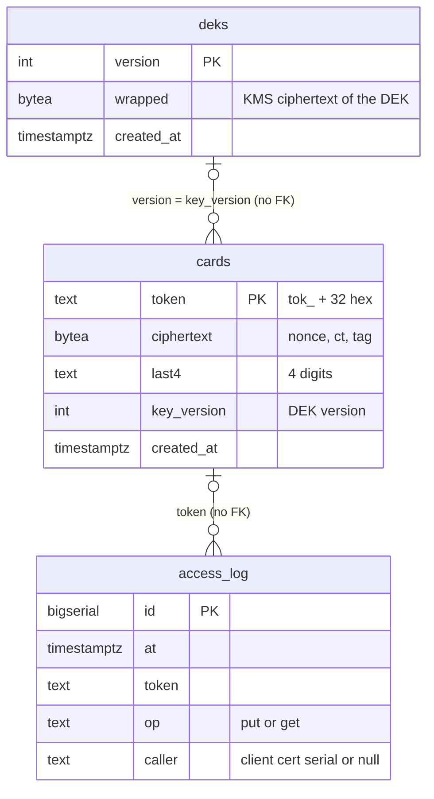
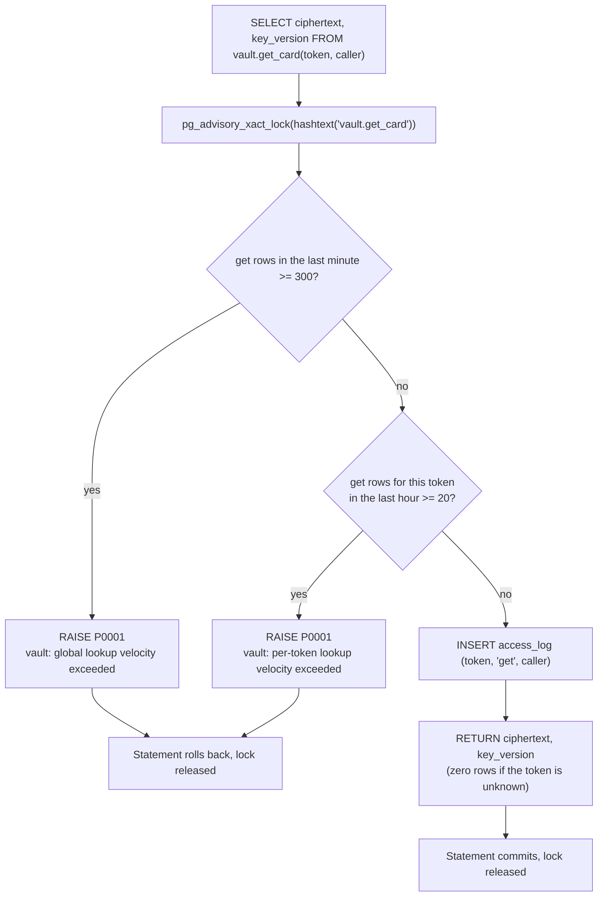

# Database reference

This page is for engineers and operators who work with the vault's PostgreSQL database. It reproduces `schema.sql` (the only SQL in the repository), describes every table, function and role, the Go code that calls the functions (`db.go`, `main.go`), exactly what is stored and how it is encrypted (`card.go`, `tokenize.go`), and which integration tests cover each part. Key rotation as a procedure is in [Rotate keys](../how-to/rotate-keys.md); the reasons behind the cryptography are in [Cryptography](../explanation/cryptography.md).

## `schema.sql`

`schema.sql` is applied by an operator as `vault_owner`. The vault never runs it, and the Go code never names a table: it calls four functions and nothing else. The file in full:

```sql
-- schema.sql — applied as vault_owner. The application never runs this.

CREATE SCHEMA IF NOT EXISTS vault;
REVOKE ALL ON SCHEMA public FROM PUBLIC;

-- Encrypted cards. ciphertext = AES-256-GCM(nonce || ct || tag) over JSON {pan, exp_month, exp_year}.
CREATE TABLE vault.cards (
  token       text        PRIMARY KEY CHECK (token ~ '^tok_[0-9a-f]{32}$'),
  ciphertext  bytea       NOT NULL,
  last4       text        NOT NULL CHECK (last4 ~ '^[0-9]{4}$'),
  key_version int         NOT NULL,
  created_at  timestamptz NOT NULL DEFAULT now()
);

-- Wrapped data-encryption keys. wrapped = KMS-encrypted 32-byte DEK. Highest version is current.
CREATE TABLE vault.deks (
  version    int         PRIMARY KEY,
  wrapped    bytea       NOT NULL,
  created_at timestamptz NOT NULL DEFAULT now()
);

-- Append-only access log. Written only by functions.
CREATE TABLE vault.access_log (
  id          bigserial   PRIMARY KEY,
  at          timestamptz NOT NULL DEFAULT now(),
  token       text        NOT NULL,
  op          text        NOT NULL,            -- 'put' | 'get'
  caller      text                             -- client cert serial for 'get'; null for 'put'
);
CREATE INDEX ON vault.access_log (at);
CREATE INDEX ON vault.access_log (token, at);

CREATE FUNCTION vault.put_card(p_token text, p_ciphertext bytea, p_last4 text, p_key_version int)
RETURNS void
LANGUAGE plpgsql SECURITY DEFINER SET search_path = vault, pg_temp AS $$
BEGIN
  INSERT INTO cards (token, ciphertext, last4, key_version)
  VALUES (p_token, p_ciphertext, p_last4, p_key_version);
  INSERT INTO access_log (token, op) VALUES (p_token, 'put');
END $$;

CREATE FUNCTION vault.get_card(p_token text, p_caller text)
RETURNS TABLE (ciphertext bytea, key_version int)
LANGUAGE plpgsql SECURITY DEFINER SET search_path = vault, pg_temp AS $$
DECLARE
  global_recent int;
  token_recent  int;
BEGIN
  -- Serialize lookups so concurrent calls cannot all pass the count before any inserts (TOCTOU).
  PERFORM pg_advisory_xact_lock(hashtext('vault.get_card'));

  SELECT count(*) INTO global_recent FROM access_log
   WHERE op = 'get' AND at > now() - interval '1 minute';
  IF global_recent >= 300 THEN
    RAISE EXCEPTION 'vault: global lookup velocity exceeded' USING ERRCODE = 'P0001';
  END IF;

  SELECT count(*) INTO token_recent FROM access_log
   WHERE op = 'get' AND token = p_token AND at > now() - interval '1 hour';
  IF token_recent >= 20 THEN
    RAISE EXCEPTION 'vault: per-token lookup velocity exceeded' USING ERRCODE = 'P0001';
  END IF;

  INSERT INTO access_log (token, op, caller) VALUES (p_token, 'get', p_caller);
  RETURN QUERY SELECT c.ciphertext, c.key_version FROM cards c WHERE c.token = p_token;
END $$;

CREATE FUNCTION vault.list_deks()
RETURNS TABLE (version int, wrapped bytea)
LANGUAGE sql SECURITY DEFINER SET search_path = vault, pg_temp AS $$
  SELECT version, wrapped FROM deks ORDER BY version;
$$;

CREATE FUNCTION vault.add_dek(p_wrapped bytea)
RETURNS int
LANGUAGE plpgsql SECURITY DEFINER SET search_path = vault, pg_temp AS $$
DECLARE v int;
BEGIN
  SELECT coalesce(max(version), 0) + 1 INTO v FROM deks;
  INSERT INTO deks (version, wrapped) VALUES (v, p_wrapped);
  RETURN v;
END $$;

-- Roles. On Cloud SQL both are IAM-authenticated users; no passwords exist.
CREATE ROLE vault_app     LOGIN;   -- the running service
CREATE ROLE vault_rotator LOGIN;   -- the DEK rotation job

REVOKE ALL ON ALL TABLES    IN SCHEMA vault FROM PUBLIC, vault_app, vault_rotator;
REVOKE ALL ON ALL FUNCTIONS IN SCHEMA vault FROM PUBLIC;
GRANT USAGE ON SCHEMA vault TO vault_app, vault_rotator;

GRANT EXECUTE ON FUNCTION vault.put_card(text, bytea, text, int) TO vault_app;
GRANT EXECUTE ON FUNCTION vault.get_card(text, text)             TO vault_app;
GRANT EXECUTE ON FUNCTION vault.list_deks()                      TO vault_app, vault_rotator;
GRANT EXECUTE ON FUNCTION vault.add_dek(bytea)                   TO vault_rotator;
```

The file must stay byte-identical to its reviewed form (`CLAUDE.md`). The card comment above lists `{pan, exp_month, exp_year}`; the Go `card` type also writes `name` when the card has one (see [What a card row holds](#what-a-card-row-holds)).

## Entity diagram

There are no foreign keys. The two relationships below are logical: `cards.key_version` names a `deks.version` (in dev with `VAULT_DEV_DEK_HEX` every card has `key_version` 1 and `deks` is not used), and `access_log.token` names a token, which for a `get` row may not exist in `cards`.



## Tables

### `vault.cards`

One row per tokenized card. Written only by `vault.put_card`.

| Column | Type | Constraint | Content |
|---|---|---|---|
| `token` | `text` | `PRIMARY KEY`, `CHECK (token ~ '^tok_[0-9a-f]{32}$')` | The token returned to the browser |
| `ciphertext` | `bytea` | `NOT NULL` | `nonce ‖ ciphertext ‖ tag` of the card JSON (see below) |
| `last4` | `text` | `NOT NULL`, `CHECK (last4 ~ '^[0-9]{4}$')` | Last four digits of the card number, in clear |
| `key_version` | `int` | `NOT NULL` | Version of the DEK the row was sealed with |
| `created_at` | `timestamptz` | `NOT NULL DEFAULT now()` | Insert time |

### `vault.deks`

One row per data-encryption key (DEK). Written only by `vault.add_dek`.

| Column | Type | Constraint | Content |
|---|---|---|---|
| `version` | `int` | `PRIMARY KEY` | 1, 2, 3, …; the highest is the current DEK |
| `wrapped` | `bytea` | `NOT NULL` | The 32-byte DEK encrypted by Cloud KMS (`kmsEncrypt` in `gcp.go`) |
| `created_at` | `timestamptz` | `NOT NULL DEFAULT now()` | Insert time |

### `vault.access_log`

The audit trail of stores and lookups, and the data the velocity limits count. Written only by `vault.put_card` and `vault.get_card`; no function updates or deletes it.

| Column | Type | Constraint | Content |
|---|---|---|---|
| `id` | `bigserial` | `PRIMARY KEY` | Sequence number |
| `at` | `timestamptz` | `NOT NULL DEFAULT now()` | Transaction time of the call |
| `token` | `text` | `NOT NULL` | Token stored or looked up (not checked against `cards`) |
| `op` | `text` | `NOT NULL` | `put` or `get` |
| `caller` | `text` | – | For `get`: the platform's client certificate serial as uppercase hex (`callerSerial` in `vault.go`, e.g. `0A1B2C`). For `put`: `NULL`. |

| Index | Used by |
|---|---|
| `access_log (at)` | The global count in `get_card` (`op = 'get' AND at > now() - interval '1 minute'`) |
| `access_log (token, at)` | The per-token count in `get_card` (`token = p_token AND at > now() - interval '1 hour'`) |

## Functions

All four are `SECURITY DEFINER` with `SET search_path = vault, pg_temp`: they run with the privileges of their owner (`vault_owner`). Unqualified names resolve in `pg_catalog` (which PostgreSQL always searches first when it is not listed), then `vault`, then `pg_temp` last, so a temporary object cannot shadow a `vault` table.

| Function | Returns | Granted to |
|---|---|---|
| `vault.put_card(p_token text, p_ciphertext bytea, p_last4 text, p_key_version int)` | `void` | `vault_app` |
| `vault.get_card(p_token text, p_caller text)` | `TABLE (ciphertext bytea, key_version int)` | `vault_app` |
| `vault.list_deks()` | `TABLE (version int, wrapped bytea)` | `vault_app`, `vault_rotator` |
| `vault.add_dek(p_wrapped bytea)` | `int` | `vault_rotator` |

### `vault.put_card`

Inserts the card row and an `access_log` row `(token, 'put', caller NULL)` in the same statement. Constraint failures raise the standard PostgreSQL errors (for example `23505` for a duplicate token, `23514` for a `CHECK` violation); the vault answers any of them with `500 internal error`.

### `vault.get_card`



| Step | Behaviour |
|---|---|
| Lock | `pg_advisory_xact_lock(hashtext('vault.get_card'))`: one lock key for every call, held until the calling transaction ends. Every `get_card` call in the database, from every session and every vault instance, runs one at a time. This closes the race in which concurrent calls all pass the count before any of them inserts. |
| Global limit | If 300 or more `get` rows have `at` within the last minute, raise `vault: global lookup velocity exceeded` with SQLSTATE `P0001`. |
| Per-token limit | If 20 or more `get` rows for this token have `at` within the last hour, raise `vault: per-token lookup velocity exceeded` with SQLSTATE `P0001`. |
| Audit | Insert `(token, 'get', caller)`. The row is inserted before the card is selected, so a lookup of an unknown token is also recorded and counted. |
| Result | The card's `ciphertext` and `key_version`, or no row. |

Velocity thresholds, as enforced:

| Limit | Window | Allowed | First refused |
|---|---|---|---|
| Global (all tokens) | Rolling 1 minute | 300 lookups | The 301st |
| Per token | Rolling 1 hour | 20 lookups | The 21st |

A refused lookup adds no row (the exception rolls the statement back), so refused lookups are not counted. `now()` is the start time of the calling transaction, which for the vault's autocommit calls is the statement's start.

Consequences of the lock, stated in `CLAUDE.md` and `main.go`: lookups are serialized across all sessions; each instance's pool is capped at 16 connections; each request's database call has a 5 s deadline, so a call that waits too long fails with `500 internal error` instead of holding the request. See [Limits](../reference/limits.md) and [Performance](../explanation/performance.md).

The limit and audit row live inside the caller's transaction. The accepted consequence for a session that opens its own transaction is risk RR-1 in the [risk register](../risk-register.md#rr-1-rollback-bypass-of-lookup-accounting).

### `vault.list_deks`

Returns every `(version, wrapped)` row ordered by `version`. Used at boot (`loadDEKs`) and by every DEK refresh (`dekRefresher`) as `vault_app`, and readable by `vault_rotator`.

### `vault.add_dek`

Computes `coalesce(max(version), 0) + 1`, inserts `(v, p_wrapped)` and returns `v`. Two concurrent calls that compute the same `v` cannot both insert: the second fails on the primary key. Used only by `vault -rotate-dek` (`rotateDEK` in `main.go`), which generates 32 random bytes, wraps them with KMS, unwraps the result and compares it with the original before calling `add_dek`, and prints the new version.

## Roles and privileges

| Role | Created by | Purpose |
|---|---|---|
| `vault_owner` | Not by `schema.sql` (the file is applied as this role; `make itest` creates it with `CREATE ROLE vault_owner LOGIN CREATEROLE`) | Owns the schema, tables and functions. The `SECURITY DEFINER` functions run with its privileges. |
| `vault_app` | `CREATE ROLE vault_app LOGIN;` | The running service |
| `vault_rotator` | `CREATE ROLE vault_rotator LOGIN;` | The DEK rotation job (`-rotate-dek`) |

The schema comment states that on Cloud SQL both login roles are IAM-authenticated users with no passwords.

Privilege statements, in order:

| Statement | Effect |
|---|---|
| `REVOKE ALL ON SCHEMA public FROM PUBLIC;` | No default privileges on the `public` schema. |
| `REVOKE ALL ON ALL TABLES IN SCHEMA vault FROM PUBLIC, vault_app, vault_rotator;` | No direct table access for anyone but the owner. |
| `REVOKE ALL ON ALL FUNCTIONS IN SCHEMA vault FROM PUBLIC;` | Removes PostgreSQL's default `EXECUTE` grant to `PUBLIC` on the four functions. |
| `GRANT USAGE ON SCHEMA vault TO vault_app, vault_rotator;` | Both roles can name objects in `vault`. |
| `GRANT EXECUTE ON FUNCTION … TO …` | As in the matrix below. |

| Action | `vault_app` | `vault_rotator` |
|---|---|---|
| `SELECT`/`INSERT`/`UPDATE`/`DELETE` on any `vault` table | no | no |
| `vault.put_card` | yes | no |
| `vault.get_card` | yes | no |
| `vault.list_deks` | yes | yes |
| `vault.add_dek` | no | yes |

## The Go side (`db.go`)

The vault uses `database/sql` with the `pgx/v5` stdlib driver. It opens no explicit transactions: each call is one autocommit statement, so `get_card`'s audit row commits with the lookup.

| Go function | SQL sent | Result handling |
|---|---|---|
| `dbPutCard(ctx, db, token, ciphertext, last4, keyVersion)` | `SELECT vault.put_card($1, $2, $3, $4)` (`ExecContext`) | Any error → `dbErr` |
| `dbGetCard(ctx, db, token, caller)` | `SELECT ciphertext, key_version FROM vault.get_card($1, $2)` (`QueryRowContext`) | No row → `errUnknownToken`; SQLSTATE `P0001` → `errVelocity`; other → `dbErr` |
| `dbListDEKs(ctx, db)` | `SELECT version, wrapped FROM vault.list_deks()` (`QueryContext`) | Map version → wrapped; any error → `dbErr` |
| `dbAddDEK(ctx, db, wrapped)` | `SELECT vault.add_dek($1)` (`QueryRowContext`) | New version; any error → `dbErr` |

`dbErr(fn, err)` returns a new error holding only the function name and the SQLSTATE (`vault.put_card: sqlstate 23505`) or `<fn>: failed`. It never wraps or quotes the driver error, which can carry argument values. The request handlers never log or return it; at boot and in `-rotate-dek` it appears in the `boot failed:` line.

How the `/proxy` handler maps lookup results (`proxy.go`):

| Result | Status and body | Log |
|---|---|---|
| `errVelocity` (either `P0001` message) | `429 {"error":"rate limit exceeded"}` | `ALERT velocity token=<t> caller=<serial> account=<a>` |
| `errUnknownToken` | `400 {"error":"unknown token"}` | – |
| Other error | `500 {"error":"internal error"}` | – |

### Timeouts and pool

| Setting | Value | Applies to | Source |
|---|---|---|---|
| `dbCallTimeout` | 5 s | Every `put_card` and `get_card` call (derived from the request context), and the `list_deks` call of each DEK refresh | `main.go` (`newVault`, `dekRefresher`) |
| `bootDBTimeout` | 5 s | The boot `PingContext` | `main.go` |
| `bootGCPTimeout` | 60 s | Boot `loadDEKs` (`list_deks` plus KMS unwraps) and `-rotate-dek` | `main.go` |
| `healthzTimeout` | 2 s | The `/healthz` database ping | `proxy.go` |
| `db.SetMaxOpenConns(16)` | 16 | Open connections per instance, dev and prod | `openDB` in `main.go` |

### Connecting (`openDB`)

| Rule | Error |
|---|---|
| `VAULT_DB_URL` starts with `postgres://` or `postgresql://` (the keyword/value form is refused) | `VAULT_DB_URL must be a postgres:// or postgresql:// URL` |
| The URL and its query parse strictly | `VAULT_DB_URL cannot be parsed` |
| No `service`, `servicefile` or `passfile` parameter, in any letter case: configuration never comes from files | `VAULT_DB_URL must not set service, servicefile or passfile` |
| Prod: every connection path verifies the server certificate (`sslmode=verify-ca` or `verify-full`, or `require` with `sslrootcert`) | `VAULT_DB_URL must use sslmode=verify-ca or verify-full in prod` |

| Mode | Authentication |
|---|---|
| `dev` | The URL as given. |
| `prod` | Cloud SQL IAM: before every new connection, the password is set to a fresh access token from the metadata server (`stdlib.OptionBeforeConnect` with `ts.token`). The token also authorizes KMS decrypt, which is why verified TLS is required. |

The database role is the user named in `VAULT_DB_URL`: `vault_app` for the service, `vault_rotator` for `-rotate-dek`. Errors never contain the URL, and the boot ping failure is logged only as `database ping failed`. All variables are in [Configuration](../reference/configuration.md).

## What a card row holds

`handleTokenize` (`tokenize.go`) builds each row:

1. **Token.** `newToken()` (`card.go`): 16 bytes from `crypto/rand`, hex-encoded lower case, prefixed `tok_` (36 characters). It is drawn before sealing, because it is the additional data. A duplicate would fail the primary key and the request would return 500; there is no retry.
2. **Plaintext.** `json.Marshal(card{…})` with the normalized PAN (digits only), `exp_month`, `exp_year`, and `name` when present (`omitempty`). Example: `{"pan":"4242424242424242","exp_month":"12","exp_year":"2030","name":"JANE Q DOE"}`. The CVV is never part of it and never reaches the database.
3. **Seal.** `seal(dek, plaintext, cardAAD(token))` with the current DEK (`currentDEK()`); the plaintext buffer is then zeroed (best effort).
4. **Store.** `put_card(token, ciphertext, last4, keyVersion)`.

| Column | Bytes stored |
|---|---|
| `token` | `tok_` + 32 lowercase hex characters |
| `ciphertext` | 12-byte random nonce ‖ AES-256-GCM ciphertext (same length as the plaintext) ‖ 16-byte tag. Total length: plaintext length + 28. |
| `last4` | Last four digits of the normalized PAN |
| `key_version` | The current DEK version at sealing time |

| Encryption parameter | Value | Source |
|---|---|---|
| Algorithm | AES-256-GCM (`crypto/aes`, `cipher.NewGCM`) | `newGCM` |
| Key | The 32-byte DEK of `key_version`; any other length is refused (no fallback to AES-128/192) | `newGCM`, `dekSize = 32` |
| Nonce | 12 bytes from `crypto/rand`, fresh per seal, stored as the first 12 bytes | `seal`, `gcmNonceSize = 12` |
| Tag | 16 bytes, stored as the last 16 bytes | `gcmTagSize = 16` |
| Additional data | `"pan-vault/card/1\x00" + token` (`cardAADPrefix`); authenticated, not stored | `cardAAD` |

The additional data binds the ciphertext to its token: a ciphertext copied into another token's row fails authentication. On a lookup, `/proxy` unseals with the DEK of the row's `key_version` and `cardAAD(token)`. A version missing from the instance's key snapshot triggers one rate-limited refresh first. Any unseal or JSON decode failure returns `500 internal error` and logs `ALERT decrypt_failed token=<t> key_version=<n> account=<a>`.

`vault.deks.wrapped` holds the KMS ciphertext of each DEK; the unwrapped DEKs exist only in the vault's memory. In dev with `VAULT_DEV_DEK_HEX`, the DEK is version 1 and neither `deks` nor KMS is used.

## Integration tests

`make itest` starts a throwaway `postgres:18` container with trust authentication on loopback, creates `vault_owner` and the `vault` database, applies `schema.sql` as `vault_owner`, and runs `go test -race -count=1 -run Integration ./...` with `VAULT_TEST_DB_URL` set. Without that variable the tests skip. The tests connect as `vault_owner` to count rows and as `vault_app` or `vault_rotator` to exercise privileges; the vault code itself never names a table.

| Test | Covers |
|---|---|
| `TestIntegrationPrivileges` | `vault_app`: direct `SELECT`/`INSERT` on `cards`, `SELECT` on `access_log` and `deks`, and `add_dek` are denied; `put_card`, `get_card` (and `errUnknownToken` for an unseeded token) and `list_deks` work. `vault_rotator`: `add_dek` and `list_deks` work; `put_card` and `get_card` fail with `42501`; `SELECT` on `deks` is denied. |
| `TestIntegrationAccessLogCount` | 3 stores and 2 lookups add exactly 5 rows: 3 `put` with `caller` NULL, 2 `get` with the caller serial. |
| `TestIntegrationSearchPathPinned` | The `vault` schema has exactly the four functions, each with `search_path=vault, pg_temp`. |
| `TestIntegrationVelocityPerToken` | 20 lookups of one token succeed; the 21st returns `errVelocity`. |
| `TestIntegrationVelocityConcurrent` | 50 concurrent lookups of one token (pool of 64): exactly 20 succeed, 30 get `errVelocity`, and exactly 20 `get` rows exist. |
| `TestIntegrationVelocityGlobal` | Lookups (of unknown tokens) up to 300 in the minute succeed or return `errUnknownToken`; the next returns `errVelocity`. |
| `TestIntegrationEndToEnd` | Real TLS listeners and the database as `vault_app`: tokenize (the receipt verifies with the vault's `receiptPub`, checked equal to the test seed's key, and states the tokenized card), the mTLS refusal of a client without a certificate, `/proxy` and `/healthz` end to end, and the vault's request log lines. |
| `TestIntegrationRotateDEK` | `-rotate-dek` as `vault_rotator` (fake KMS) adds a version; after a restart every version loads through KMS and a card sealed under the old DEK still resolves. |
| `TestIntegrationRotationTwoInstances` | Two vaults on one database after a rotation: a card sealed under the new DEK on one instance proxies through the other, which learns the key on demand, and the reverse. No request fails to decrypt. |

`TestOpenDB` (`boot_test.go`) covers `openDB` without a live database: the pool cap of 16 in dev and prod, the metadata token as the prod password, and the URL rules.

## See also

- [Risk register, RR-1](../risk-register.md#rr-1-rollback-bypass-of-lookup-accounting)
- [Rotate keys](../how-to/rotate-keys.md)
- [Deploy on GCP](../how-to/deploy-on-gcp.md)
- [Cryptography](../explanation/cryptography.md)
- [Limits](../reference/limits.md)
- [Configuration](../reference/configuration.md)
- [Logging](../reference/logging.md)
- [README §9 Running it safely](../../README.md#9-running-it-safely)
